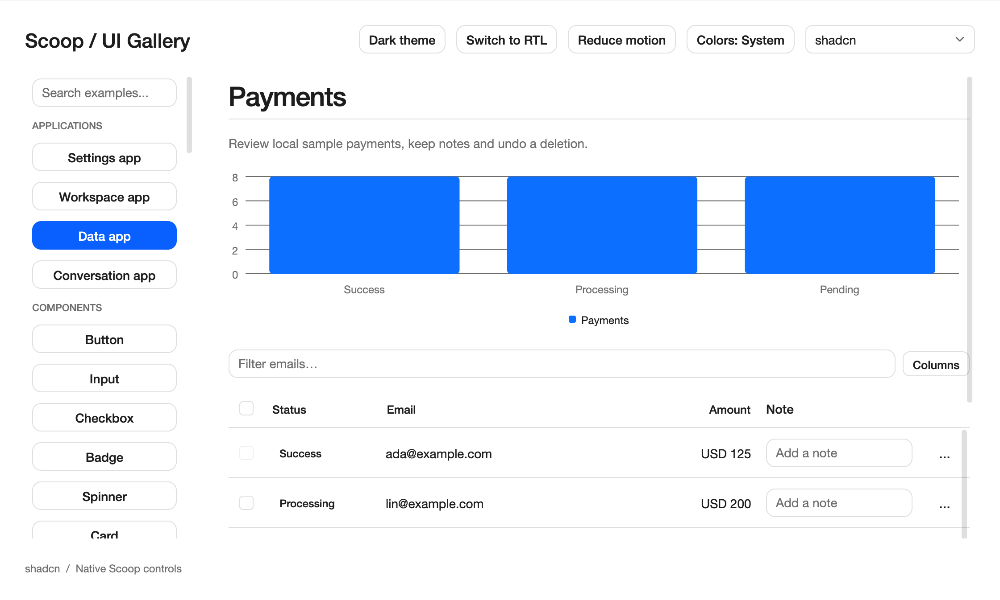

# 第 1 章　认识 Scoop UI

Scoop 工具链自带一套编写桌面图形界面的库。用它写出来的程序是普通的原生可执行文件：界面由 Scoop 自己绘制，窗口、菜单、文件对话框、托盘和读屏器支持则直接使用操作系统的实现。

本章先不写代码，而是回答几个问题：

- Scoop UI 能做出什么样的界面，怎样在自己的电脑上亲手试一试；
- “声明式 UI”是什么意思，它和 React、Jetpack Compose、SwiftUI 有哪些相同和不同；
- 界面为什么由 Scoop 自己绘制，哪些部分仍然交给操作系统；
- Scoop UI 由哪几个库组成，各管什么，写应用时要依赖哪些；
- 支持哪些平台，怎样安装图形组件；
- 怎样使用这本书。

## 1.1　先看一眼

工具链附带了一个完整的示例程序 Gallery。它有 66 个控件和材质页面、4 个组合起来的小应用，右上角可以在五套视觉风格之间切换，顶部可以切换明暗、从右到左的书写方向和减少动态效果。下图是其中的付款管理应用：柱状图、可筛选的表格、行内备注和每行的操作菜单都是用 Scoop 写的。



Gallery 的源码在工具链的安装目录里。构建时会在项目目录下写入输出文件，所以先把它复制到一个可写的位置，再运行：

```sh
cp -R ~/.scoop/toolchains/<版本>-<宿主>/src/scoop.ui.component/examples/shadcn ~/scoop-gallery
cd ~/scoop-gallery
scoop run --release
```

`<版本>-<宿主>` 换成你实际安装的工具链目录名，`ls ~/.scoop/toolchains` 可以看到。第一次构建要编译整个示例并链接图形相关的库，在 Apple M 系列芯片上大约一分钟；之后再运行就快了。

打开以后不妨随意点一点：在 Input 页输入几个中文字，在 Settings app 里用 Tab 键在控件之间移动，在 Tree 页把文件拖进另一个目录，切换 Style 看同一个界面换成 macOS、Material、Fluent、Liquid Glass 风格，在 Liquid Glass 页滚动彩色的底图，看浮在上面的两块玻璃怎样融合在一起、怎样透出背后的颜色。这些行为后面的章节都会讲到怎样实现。

> **注意**
>
> 示例目录名叫 `shadcn` 是历史原因，它包含全部五套风格。示例的测试依赖指向工具链源码树里的其他目录，复制出来以后不能运行它的测试，但构建和运行不受影响。

## 1.2　声明式 UI

传统的界面库是**命令式**的：先创建一个按钮对象，再在点击回调里修改某个文本框的内容，界面上的每一处变化都要自己去“改”。Scoop UI 是**声明式**的：你只描述“当前状态下界面应该是什么样子”，状态变化后，框架找出前后两次描述的差别，只更新需要变的部分。

用 Scoop 写一个点击计数的按钮，核心只有这几行（完整程序见第 2 章）：

```scoop
class Counter(scope: ComponentScope) : Component(scope) {
    private var count: Int by state(0)

    public override fun render(): View = button(f"Count: ${count}", { count += 1 })
}
```

`render()` 不修改任何控件，只返回一份描述：“这里有一个按钮，文字是 `Count: ` 加上当前的计数”。点击回调只改 `count`，不碰按钮。`count` 是一个**状态**（State），框架记得 `render()` 读过它；它一变，框架就重新调用 `render()`，拿到新的描述，再把按钮上的文字更新过来。

这套思路和 React、Jetpack Compose、SwiftUI 一脉相承。如果你用过其中之一，可以用下表对照：

| 概念 | Scoop UI | React | Jetpack Compose | SwiftUI |
| --- | --- | --- | --- | --- |
| 组件 | 继承 `Component` 的 class | 函数组件 | `@Composable` 函数 | 遵循 `View` 的 struct |
| 界面描述 | `render()` 返回的 `View` | JSX 产生的元素 | 组合过程本身 | `body` 返回的视图值 |
| 本地状态 | 成员字段 `state(...)` | `useState` | `remember { mutableStateOf(...) }` | `@State` |
| 父级传给子级的输入 | `Props<P>` | props | 函数参数 | 初始化参数 |
| 子级修改父级的值 | `Binding<T>` | 回调函数 | 回调或状态提升 | `@Binding` |
| 跨层传递依赖 | 语言的 Context | Context | `CompositionLocal` | Environment |
| 列表项身份 | `ViewKey` | `key` | `key(...)` | `id` |

区别同样值得留意，它们会影响你写代码的方式：

- **组件是一直存在的对象。** 组件挂载时创建一个 class 实例，之后不论 `render()` 执行多少次，都是同一个实例在工作，状态就是它的普通字段。没有 hooks 那样“必须按固定顺序调用”的规则，也没有 `remember`：`state(0)` 每次调用都会创建一个新的状态对象，所以它只该出现在字段初始化里，不能写在 `render()` 中。
- **不需要编译器插件。** `column { ... }`、`row { ... }` 这样的写法是语言里普通的接收者 lambda，不是 `@Composable` 那样的特殊函数，也不是 SwiftUI 的 result builder。第 2 章会看到它带来的一条规则。
- **更新是细粒度的。** 只有读过某个状态的组件才会在它变化时重新 `render()`，其他组件不受影响。第 4 章会用一个会“自报家门”的程序把这一点看得清清楚楚。
- **没有原生控件这一层。** React Native 这类框架最终把描述映射成平台的原生控件，Scoop UI 则自己绘制每一个像素，下一节解释为什么。

## 1.3　自己绘制，原生集成

Scoop UI 的按钮、输入框、表格并不是 AppKit、Win32 或 GTK 的控件，而是 Scoop 在一块画布上画出来的。绘制使用 Skia 图形库，在 macOS 上走 Metal，在 Windows 上走 Direct3D 12，在 Linux 上走 EGL／OpenGL ES。

这样做有几个直接的结果：

- **同一份代码，各平台外观一致。** 控件长什么样由**主题**决定，与运行在哪个系统上无关。工具链提供 macOS、Material、Fluent、shadcn、Liquid Glass 五套主题，你完全可以在 Windows 上使用 macOS 风格，或者在所有平台上使用自己的品牌主题。
- **自定义控件和内置控件地位相同。** 内置控件也是用公开接口画出来的，你自己写的控件可以使用同样的布局、输入、焦点、主题和动画能力（第七部分）。
- **静止时不做无用功。** 界面没有变化时，框架不重新计算、不重新绘制，也不提交 GPU 命令。这一条是框架的硬性要求，第 4 章会实际验证。

另一方面，有些东西必须和操作系统打交道才能做好，Scoop 就使用系统的原生实现：

- 窗口本身、标题栏、全屏切换；
- 应用菜单栏、右键菜单、文件打开和保存对话框；
- 系统托盘、Dock 或任务栏的角标和进度；
- 输入法（拼音、日文等组合输入）、剪贴板、拖放；
- 无障碍接口：macOS 的 VoiceOver、Windows 的讲述人、Linux 的 Orca 都能读出 Scoop 界面中的按钮、复选框和文字，并操作它们。

最后一条值得多说一句。自己绘制的界面在系统看来只是一块图像，读屏器无从得知哪里有按钮。Scoop UI 会为界面另外维护一棵**语义树**，告诉系统“这里有一个按钮，名字叫 Count: 0，可以按下”。标准控件自动提供这些信息；自己画的控件也能提供（第 31 章）。

## 1.4　由哪些库组成

Scoop UI 不是一个大而全的库，而是几个分工明确的 Cone（Scoop 的包）。从下往上看：

| 层次 | Cone | 负责什么 |
| --- | --- | --- |
| 底层 | `scoop.window` | 原生窗口、事件循环、键盘鼠标触摸输入、输入法、菜单、剪贴板、拖放；`scoop.window.accessibility` 对接系统无障碍接口 |
| | `scoop.graphics` | 与窗口无关的 2D 绘图：路径、渐变、裁剪、变换、图像、滤镜、SkSL 着色器 |
| | `scoop.graphics.text`、`scoop.graphics.svg` | 字体与段落排版（基于 SkParagraph、HarfBuzz 和 ICU，支持富文本与行内对象）；静态 SVG 渲染 |
| 呈现 | `scoop.surface` | 把画面呈现到窗口上：帧调度、动画、输入区域 |
| 框架 | `scoop.ui` | 组件、状态、挂载与更新、布局协议、输入与焦点、弹层、滚动 |
| | `scoop.ui.style` | 样式与主题协议：颜色、边框、圆角、阴影，主题的设计参数和部件绘制 |
| 控件与主题 | `scoop.ui.component` | Label、Button、Input、Checkbox、布局容器、滚动区域、虚拟列表、弹层、菜单、表格、树、日历、图表…… |
| | `scoop.ui.style.macos`、`.material`、`.fluent`、`.shadcn`、`.liquidglass` | 五套主题预设 |
| 桌面外围 | `scoop.ui.component.desktop`、`scoop.ui.component.tray` | 把 Dock／任务栏和系统托盘接入组件 |
| | `scoop.desktop`、`scoop.tray`、`scoop.icons.lucide` | 应用图标、角标、系统通知、托盘；一组 Lucide 图标 |

写一个普通应用，通常直接依赖这几个：

- `scoop.ui`：组件和状态；
- `scoop.ui.component`：现成的控件；
- `scoop.ui.style` 和一套主题预设，例如 `scoop.ui.style.shadcn`；
- 用到颜色、字体对齐等类型时，再加上它们所在的 `scoop.graphics`、`scoop.graphics.text`。

框架和控件是分开的。`scoop.ui` 不认识 Button，也不提供任何布局策略；`scoop.ui.component` 只通过 `scoop.ui` 的公开接口实现全部控件，和第三方控件库的地位完全一样。这个设计保证了一件事：凡是内置控件能做到的，你自己写的控件也能做到。

## 1.5　平台与安装

Scoop UI 支持三类桌面平台：

| 平台 | 目标 | 说明 |
| --- | --- | --- |
| macOS | `aarch64-apple-darwin`、`x86_64-apple-darwin` | 完成运行验证，本书示例都在 Apple Silicon 上验证 |
| Linux GNU | `x86_64-unknown-linux-gnu` | 完成运行验证；同时支持 Wayland 和 X11，需要 GTK 4.18 和 libadwaita 1.4 或更新版本 |
| Windows | `x86_64-pc-windows-msvc-ucrt` 等三个 x64 目标 | 需要 Windows 10 1703 或更新版本；可以构建和运行，部分桌面交互的实机验证仍在补齐 |

Linux musl 目标不提供图形界面。在 Linux 上，程序默认在有 `WAYLAND_DISPLAY` 时使用 Wayland，否则使用 X11；也可以用环境变量 `SCOOP_WINDOW_BACKEND=wayland` 或 `x11` 明确指定。

默认安装的工具链不含图形库，需要单独添加 GUI 组件。在 Apple Silicon 的 Mac 上：

```sh
scoop-install component add gui --target aarch64-apple-darwin
```

其他平台把 `--target` 换成对应的目标。`scoop-install component list` 列出本机可以安装的组件，已经装好的会标明 `(installed)`：

```text
sources (installed)
vendor
gui --target aarch64-apple-darwin (installed)
gui --target x86_64-apple-darwin
```

还没有安装工具链的话，先按《Scoop 程序设计》[第 2 章](../../programming/part01-start/ch02-getting-started.html)或官网的快速开始安装。

> **注意：Windows 上的命令叫 `sco`**
>
> Windows 上有一个同名的包管理器，所以 Scoop 语言在 Windows 上的主命令是 `sco`。本书的 `scoop run …` 在 Windows 上都写作 `sco run …`。

## 1.6　怎样使用这本书

本书假定你已经掌握 Scoop 语言本身，至少熟悉类、lambda、接收者 lambda、属性委托和 Context。还不熟悉的话，先读《Scoop 程序设计》的前四部分。

全书分为十个部分：

- **第一部分（起步）**：写出第一个窗口，把它组织成正式的项目，再建立贯穿全书的心智模型。
- **第二、三部分**：布局与文字、状态与数据流。这是写任何界面都离不开的基础，建议按顺序读。
- **第四、五部分**：输入与交互、组织界面（滚动、弹层、导航、数据展示）。
- **第六部分**：主题与样式。
- **第七部分**：自己绘制控件，以及 2D 图形与着色器。只用现成控件的读者可以先跳过。
- **第八部分**：多窗口、原生菜单、托盘、后台任务等桌面应用的能力。
- **第九部分**：测试、无障碍、性能和打包分发。
- **第十部分**：一个综合项目，把前面的内容串起来。

赶时间的话，可以先读第 1～3 章和第 5、8、9 章，然后直接看综合项目，遇到不懂的地方再回头查。

## 小结

- Scoop UI 是声明式的：`render()` 根据当前状态返回界面描述，状态变化后框架只更新需要变的部分。
- 组件是一直存在的 class 实例，状态是它的字段；`state(...)` 不能写在 `render()` 里。
- 界面由 Scoop 用 Skia 自己绘制，外观由主题决定；窗口、菜单、对话框、托盘、输入法和无障碍使用系统的原生实现。
- 框架 `scoop.ui` 与控件库 `scoop.ui.component` 分离，自定义控件与内置控件地位相同。
- macOS 和 Linux GNU 已完成运行验证，Windows 的部分交互验证仍在补齐；GUI 组件需要用 `scoop-install component add gui` 单独安装。

## 练习

1. 用 `scoop-install component list` 查看本机的 GUI 组件是否已经安装，没有的话装上。
2. 按 1.1 节的步骤运行 Gallery。在 Style 下拉框里切换五套风格，观察同一个页面上哪些东西变了、哪些没变。
3. 在 Gallery 里点一下 “Switch to RTL”，看看界面布局怎样变化。再打开系统的读屏器（macOS 上按 ⌘F5 开关 VoiceOver），用它在 Button 页上找到 Continue 按钮。
