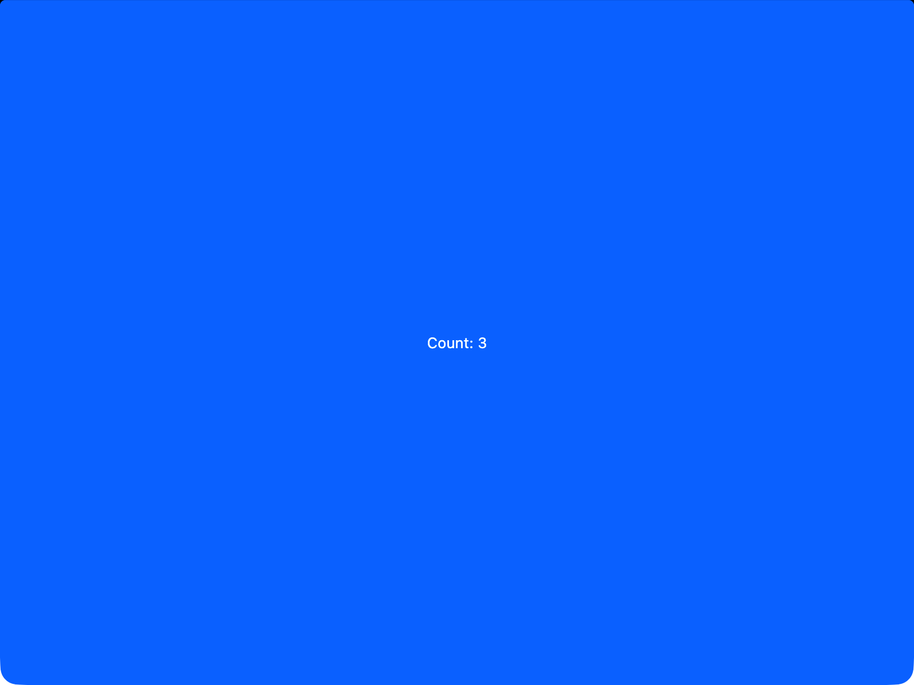
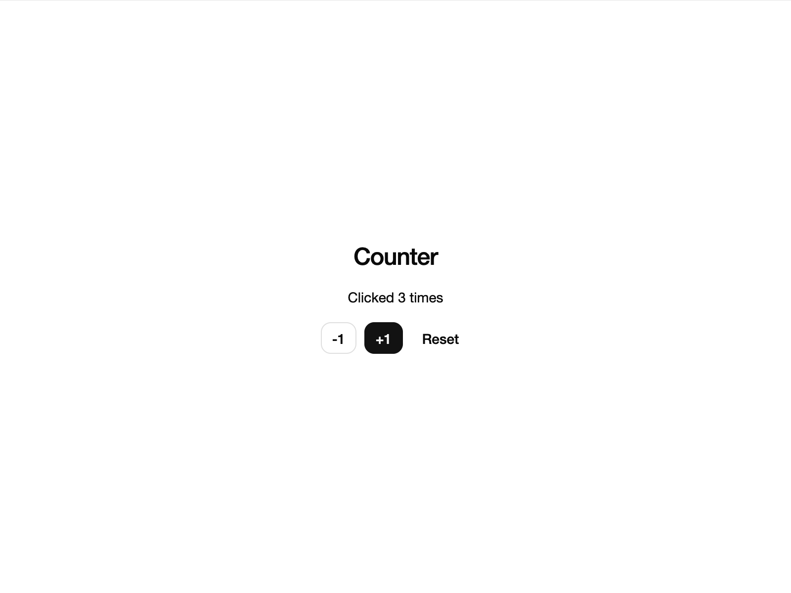

# 第 2 章　第一个窗口

本章写出第一个 Scoop UI 程序：一个点击计数器。先用最少的代码让窗口出来，再逐步改写成一个像样的小界面。读完本章，你会知道：

- 单文件 UI 程序怎样声明依赖、怎样运行；
- 一个组件由哪几部分组成，`render()`、`state`、`runUiApplication` 各做什么；
- 为什么所有控件都需要一个“主题来源”；
- 为什么一个按钮会铺满整个窗口，怎样让内容按自身大小居中；
- `column { ... }` 这类 builder 写法，以及它带来的“外层接收者”规则；
- 刚开始写 UI 时最常遇到的几个错误。

## 2.1　最小的程序

新建一个文件 `counter.scoop`：

```scoop
{{#include ../../examples/ch02/counter.scoop}}
```

在它所在的目录运行：

```sh
scoop run counter.scoop --release
```

编译要链接图形相关的库，需要二十多秒；之后会打开一个标题为 Counter 的窗口。整个窗口是一个蓝色的按钮，每点一次，文字 `Count: 0` 中的数字加一。下图是点了三次之后的样子：



关闭窗口，程序就结束了。

> **注意：先编译，后运行**
>
> `scoop run` 先把程序编译、链接成可执行文件，再启动它。源码没有变化时，再次运行直接使用上次的程序，几乎不需要等待；改了源码就要重新编译，在 Apple M 系列芯片上，本章的程序每次大约二十秒出头。`--release` 生成优化过的程序，本书的示例都用它运行。

## 2.2　逐行看一遍

这个程序虽然短，却已经用到了 Scoop UI 的几个核心概念。

### 依赖声明

开头四行 `//! dep:` 是单文件程序的依赖声明，必须写在所有代码之前。单文件程序默认只能使用 `scoop.core` 和 `scoop.std`，其他库要逐个声明，格式是 `group:name:版本`。这里用到了：

- `scoop.ui`：组件、状态和应用入口；
- `scoop.ui.component`：`button` 等现成的控件；
- `scoop.ui.style`：主题协议，`ThemeSource`、`ThemeMode` 在这里；
- `scoop.ui.style.macos`：macOS 风格的主题预设 `macosTheme`。

声明依赖只是让库可用，名字还要用 `import` 引入。注意依赖**不会传递**：`scoop.ui.component` 自己依赖了 `scoop.graphics`，但如果你的代码要 `import scoop.graphics.Paint`，仍然要为 `scoop.graphics` 写一行 `//! dep:`。

### 组件

```scoop
class Counter(scope: ComponentScope) : Component(scope) {
```

`Counter` 是一个**组件**。它继承 `Component`，构造函数接收一个 `ComponentScope` 并传给基类。你不会自己去 `Counter(...)`：框架在把组件放进窗口（称为**挂载**）时创建它，并传入 scope。组件通过 scope 访问它所在的窗口、应用和各种资源，后面的章节会经常用到。

挂载后，这个实例会一直存在，直到组件被移出界面。

### 状态

```scoop
    private var count: Int by state(0)
```

`state(0)` 创建一个初始值为 0 的**状态**，类型是 `State<Int>`。这里用属性委托把它包装成一个普通的 `Int` 属性：读 `count` 就是读状态的值，写 `count` 就是写状态的值。

状态和普通字段的区别在于框架能“看到”它：`render()` 里读了哪个状态，框架就记下来；这个状态被写入后，框架会重新调用 `render()`。普通的 `var count = 0` 也能保存数字，但修改它不会让界面更新。

### render

```scoop
    public override fun render(): View = button(f"Count: ${count}", { count += 1 })
```

`render()` 是组件唯一必须实现的方法，它返回一个 `View`：对“这里应该显示什么”的描述。`button(text, onClick)` 并不会马上创建一个按钮，它只是生成一份描述，说明这里有一个按钮、文字是什么、点击时调用哪个函数。框架拿到描述后，才决定怎样创建或更新真正的按钮。

点击回调 `{ count += 1 }` 写入了状态，于是框架重新调用 `render()`，得到一个文字为 `Count: 1` 的新描述，再把它应用到界面上。

### 运行应用

```scoop
fun main() {
    val source = ThemeSource(macosTheme(ThemeMode.Light))
    context(source) {
        runUiApplication("Counter", { scope -> Counter(scope) })
    }
}
```

`runUiApplication(title, create)` 创建应用和一个窗口，用 `create` 创建根组件并挂载到窗口上，然后运行事件循环，直到窗口关闭。它的完整签名可以用 `scoop api show` 查到：

```text
public fun <C: Component> runUiApplication(title: String, create: (ComponentScope) -> C, fonts: FontCollection? = None, preferences: UiPreferences = uiPreferences()): Unit
```

后两个参数是可选的，分别用来指定字体集合和覆盖系统的显示偏好（例如减少动画），以后用到时再讲。

`ThemeSource(macosTheme(ThemeMode.Light))` 选择了浅色的 macOS 主题。`context(source) { ... }` 是 Scoop 语言的 Context 机制：它把 `source` 放进当前上下文，块里执行的代码，包括框架在其中创建的所有组件，都能取到它。控件库里的每个控件都要从上下文取得主题来源，才能知道自己该用什么颜色、字号和尺寸。忘了这一层，程序一启动就会失败（见 2.6 节）。

## 2.3　为什么按钮铺满了窗口

按钮通常不会占满整个窗口，这里却铺满了。原因在于布局的**约束**：父级告诉子项“你的宽高必须在什么范围内”，子项在这个范围内决定自己的大小。

窗口给根组件的是**紧约束**：宽和高的最小值、最大值都等于窗口的尺寸。按钮作为根，别无选择，只能和窗口一样大。

要让内容按自己的大小显示，需要在外面套一层容器，由它把约束放宽。下一节的 `frame` 就是这样的容器：它给子项的约束是“最小为 0，最大不超过窗口”，并默认把子项放在中央。约束模型的完整规则见第 6 章。

## 2.4　用布局和多个控件改写

把程序改写成下面的样子，保存为 `counter_layout.scoop`：

```scoop
{{#include ../../examples/ch02/counter_layout.scoop}}
```

```sh
scoop run counter_layout.scoop --release
```



窗口中央是标题 Counter、一行计数文字和三个按钮。计数为 0 时 `-1` 按钮是灰色的、不能点；点一次 `+1` 后它变为可用。这次换成了 shadcn 主题：依赖声明和 import 改为 `scoop.ui.style.shadcn`，控件代码一行都不用改。

和第一个版本相比，有五处变化。

**1. builder 写法。** `column { ... }` 和 `row { ... }` 是布局容器，分别把子项纵向、横向排列。它们的参数是一个带接收者的 lambda，块里直接调用 `typography(...)`、`label(...)`、`button(...)`，就会依次把子项加进容器；`spacing`、`alignment` 等属性则配置容器本身。控件的可选配置写在它自己的尾随块里，例如：

```scoop
button("-1", { count.value -= 1 }) {
    variant = ButtonVariant.Outline
    enabled = count.value > 0
}
```

`variant` 选择按钮的外观，可选 `Default`、`Outline`、`Secondary`、`Ghost`、`Destructive`、`Link`。`enabled = count.value > 0` 让按钮在计数为 0 时禁用。注意这里没有“当计数变化时去修改按钮的 enabled”这样的代码：每次 `render()` 都按当前计数重新描述一遍，框架负责把变化应用上去。

**2. 状态作为字段。** `private val count = state(0)` 不再使用委托，而是直接保存 `State<Int>` 对象，通过 `count.value` 读写。`render()` 开头的 `val count = this.count` 把它取到局部变量里。这一步是必须的，原因见下一节。

**3. 窗口底色。** 窗口不会自动铺上背景色，不设置的话是黑色的。组件在构造时用 `currentThemeSource()` 从上下文取得主题来源，在 `render()` 中用 `theme.read(scope)` 读出当前主题，把调色板中的页面底色 `tokens.palette.background.background` 设为根 `frame` 的背景。主题切换、系统开启高对比度时，背景会跟着变化。

**4. 根是 frame。** `frame(content) { ... }` 只有一个子项。它接收窗口的紧约束、铺满窗口、画出背景，同时把子项的约束放宽，并把子项放在中央。这就解决了上一节的问题。

**5. 文字居中。** `column` 的 `alignment = CrossAlignment.Center` 让较窄的子项（按钮行）在水平方向居中。但 `label` 和 `typography` 在宽度有上限时会占满可用的宽度，再在里面排版文字，文字默认从段落起始边开始。所以要让文字本身居中，需要设置段落的对齐方式：`settings { alignment = TextAlignment.Center }`。`TextAlignment` 来自 `scoop.graphics.text`，`Paint` 来自 `scoop.graphics`，所以依赖声明里多了这两个库。

## 2.5　builder 块里的“外层接收者”

把上一节的 `val count = this.count` 删掉，直接在块里使用组件的成员 `count`，会怎样？下面是一个精简的例子：

```scoop
{{#include ../../examples/ch02/outer_receiver_fail.scoop}}
```

编译时报错（省略了文件路径）：

```text
error[E0716]: implicit use of an outer receiver is not allowed
  --> outer_receiver_fail.scoop:18:31
   |
18 |             label(f"Clicked ${count.value} times")
   |                               ^^^^^
help[H0402]: use `this@label` or an explicit object reference
error[E0716]: implicit use of an outer receiver is not allowed
  --> outer_receiver_fail.scoop:19:28
   |
19 |             button("+1", { count.value += 1 })
   |                            ^^^^^
help[H0402]: use `this@label` or an explicit object reference
```

`column` 的块有自己的接收者：一个负责收集子项的 builder 对象。块里的 `spacing`、`label`、`button` 都是在这个接收者上解析的。Scoop **不允许**在这样的块里隐式使用更外层的接收者，这里就是 `Counter` 组件本身，所以 `count` 不能不加说明地直接写。

注意第二处报错：`button` 的点击回调本身是一个普通 lambda，没有接收者，但它写在 `column` 的块里，同样不能隐式访问外层的 `count`。规则针对的是整个块的范围，而不是某一个 lambda。

这条规则是为了避免歧义。builder 和组件都可能有同名的成员（比如 `alignment`），如果允许隐式查找外层，写错一个名字就可能悄悄地改到另一个对象上。有两种改法：

- **先取到局部变量**，这是本书采用的惯用写法：

  ```scoop
  public override fun render(): View {
      val count = this.count
      return column {
          label(f"Clicked ${count.value} times")
          button("+1", { count.value += 1 })
      }
  }
  ```

- **用带标签的 `this` 明确指出**：写成 `this@Counter.count`。报错提示中的 `this@label` 是这个写法的通用形式，`label` 要换成外层类的名字。

第一个版本的程序没有这个问题：`button(text, onClick)` 不在任何 builder 块里，回调可以直接访问组件的成员。

> **深入一点：`val count = this.count` 取到的是什么**
>
> 字段写法 `private val count = state(0)` 保存的是 `State<Int>` 对象，`val count = this.count` 取到的是同一个对象的引用，块里既可以读 `count.value`，也可以写 `count.value += 1`。如果用的是委托写法 `private var count: Int by state(0)`，`val count = this.count` 就只是读出了当前的整数值，可以显示，但不能用来修改状态。需要在块里修改状态时，用字段写法更方便。

## 2.6　常见错误

刚开始写 UI 时，下面几个问题最常见。

**编译时找不到 `scoop.ui...`。** 漏写了 `//! dep:`，或者依赖声明没有放在文件最前面。

**编译时找不到 `Paint`、`TextAlignment` 等类型。** 依赖不会传递。直接 import 了哪个库的名字，就要为哪个库写依赖声明。

**程序一启动就退出，报 `MissingContextException`。** 挂载入口外面没有用 `context(source) { ... }` 安装主题来源。去掉第一个程序中的 `context(source)`，运行时会立即退出，退出码为 1，stderr 中是：

```text
scoop: uncaught exception: n(c=scoop%3Ascoop.core%3A0.1.0;p=;o=-;k=C;x=MissingContextException)
  <stack trace unavailable: disabled>
```

括号里是异常类型的内部编码名，最后的 `x=MissingContextException` 就是类型名。

**窗口是黑的，文字看不清。** 窗口不会自动铺底色。用主题调色板的页面底色给根 `frame` 设置背景，如 2.4 节所示。

**column 设了居中，文字还是靠左。** 文字控件占满了可用宽度。设置段落的 `settings { alignment = TextAlignment.Center }`。

**控件铺满了整个窗口。** 根拿到的是紧约束。在外面套一层 `frame` 或其他容器。

**builder 块里报 `error[E0501]: dependency function argument must be of type View, found Unit`。** 块里的 `label`、`button` 是“追加一个子项”的函数，返回 `Unit`，不能把它们的结果当作参数传给 `frame(...)` 等函数。要传递控件，先在块外创建 View，第 5 章会详细说明。

## 小结

- 单文件 UI 程序用 `//! dep:` 声明依赖，依赖不传递；用 `scoop run file.scoop --release` 运行。
- 组件继承 `Component`，由框架在挂载时创建，实例一直保留；`render()` 返回描述界面的 `View`。
- `state(...)` 创建状态。`render()` 读过的状态被写入后，框架重新 `render()` 并更新界面。
- `runUiApplication` 创建应用和窗口并挂载根组件；控件需要用 `context(ThemeSource(...)) { ... }` 提供主题来源。
- 窗口根是紧约束，套一层 `frame` 可以让内容按自身大小居中；窗口底色要自己设置。
- builder 块里不能隐式使用外层接收者，先用 `val x = this.x` 取到局部变量，或写 `this@类名.x`。

## 练习

1. 把 `counter_layout.scoop` 的主题换成 `ThemeMode.Dark`，观察背景和按钮颜色的变化。
2. 给 `+1` 按钮加上 `variant = ButtonVariant.Secondary`，再把 `Reset` 改成 `ButtonVariant.Destructive`。
3. 去掉根上的 `frame`，直接返回 `content`，体会紧约束对 `column` 的影响。
4. 把计数的上限设为 5：达到 5 以后 `+1` 按钮禁用。只需要改一行。
5. 在 `counter.scoop` 里把 `private var count: Int by state(0)` 改成 `private var count = 0`，程序还能编译吗？点击按钮时界面会变吗？为什么？
