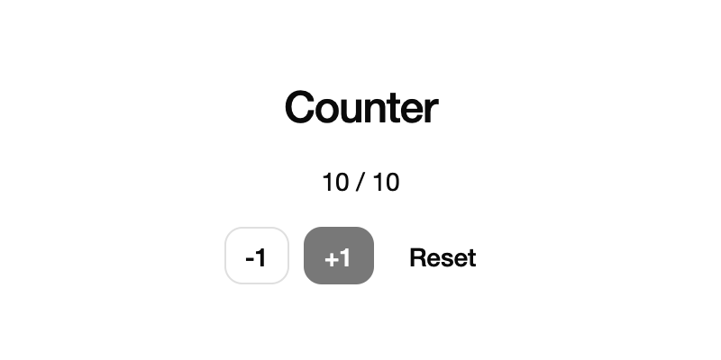

# 第 3 章　从单文件到 Cone 项目

单文件程序适合做实验，真正的应用则需要多个源码文件、测试、锁定的依赖版本，以后还要打包分发。这些都由 **Cone**（Scoop 的项目和包）来组织。本章把第 2 章的计数器改造成一个正式的 Cone 项目。读完本章，你会知道：

- 怎样用 `scoop new` 创建项目，怎样在 `Cone.toml` 里声明 UI 依赖；
- 怎样把一个界面拆成模型、视图和入口三个文件；
- 为什么要把状态和业务逻辑放进模型类，以及怎样在没有窗口的情况下测试它；
- 日常开发中 `fmt`、`check`、`test`、`run`、`build` 的用法；
- 遇到不认识的 API 时，去哪里查。

本章只讲 UI 项目需要注意的地方。Cone、依赖管理和测试的完整说明见《Scoop 程序设计》[第八部分](../../programming/part08-engineering/ch28-cones.html)。

## 3.1　什么时候该用 Cone

满足下面任何一条，就应该从单文件换成 Cone：

- 代码多到想拆成几个文件；
- 需要写测试；
- 需要把依赖的版本锁定下来，让团队成员和 CI 构建出相同的程序；
- 要在 Windows 上生成不带控制台窗口的 GUI 程序；
- 要打包成 `.app`、安装包等交付给用户（第 33 章）。

对 UI 程序来说，第二条尤其重要。界面上的逻辑很容易越写越多，只有把它放进可以单独测试的类里，才敢放心地修改。

## 3.2　用 scoop new 创建项目

```sh
scoop new counter-app --group example.app
```

```text
created counter-app
```

`counter-app` 是要创建的目录，它必须还不存在。`--group` 是 Cone 的组名，一般用你的组织或项目的反向域名。生成的文件是：

```text
counter-app/
├── Cone.toml
├── src/
│   └── main.scoop
└── tests/
    └── basic.scoop
```

`Cone.toml` 是项目清单：

```toml
schema = 1

[cone]
group = "example.app"
name = "counter-app"
version = "0.1.0"
kind = "executable"

[test-dependencies]
"scoop:scoop.test" = "0.1.0"
```

`src/main.scoop` 是一个打印问候语的命令行程序，`tests/basic.scoop` 是对应的测试。接下来把它们换成计数器。

## 3.3　声明依赖

改好以后的 `Cone.toml`：

```toml
{{#include ../../examples/ch03/counter-app/Cone.toml}}
```

和单文件程序相比：

- **依赖写在 `[dependencies]` 里。** 单文件的 `//! dep:` 注释在 Cone 中不起作用，即使留在源码里也会被忽略。版本 `"0.1.0"` 表示兼容 0.1.0 的版本，随工具链发布的库都使用这个版本号。
- **仍然是直接 import 了谁，就声明谁。** 视图要用 `Paint` 和 `TextAlignment`，所以声明了 `scoop.graphics` 和 `scoop.graphics.text`。`scoop.core` 不必写，每个 Cone 都会自动依赖它。
- **测试专用的依赖写在 `[test-dependencies]` 里。** `scoop.test` 只在编译测试时使用，不会进入正式的程序。
- **`[windows]` 一节只在 Windows 上生效。** `subsystem = "gui"` 让程序在 Windows 上作为 GUI 程序启动，不再附带一个控制台窗口；省略时默认为 `"console"`。在其他平台上这一节被忽略。

第一次构建时，工具会解析依赖，在项目根目录生成 `Cone.lock`，记下每个依赖实际选中的版本。在真实项目中要把它和源码一起提交，这样每个人构建的都是同一组依赖。

## 3.4　package 与源码文件

Cone 默认编译 `src/` 下的全部 `.scoop` 文件。每个文件开头的 `package` 声明必须等于 Cone 的 group，或者是它的子包；这里统一写 `package example.app`。同一个 Cone 中的文件可以互相使用彼此的声明，不需要 import。

计数器被拆成三个文件：

```text
src/
├── main.scoop            入口：安装主题，启动应用
├── counter_model.scoop   模型：计数器的状态和规则
└── counter_view.scoop    视图：把模型显示出来
```

### 模型

```scoop
{{#include ../../examples/ch03/counter-app/src/counter_model.scoop}}
```

`CounterModel` 是一个普通的类，不继承 `Component`，也不知道界面的存在。它持有状态 `count`，并提供几条业务规则：计数不能小于 0，不能超过上限，`summary` 是显示用的文字。

`canIncrement`、`summary` 等都是计算属性，每次读取时现算。这里有一个要点：视图的 `render()` 读取 `model.summary` 时，getter 内部读了 `count.value`，这次读取同样会被记为视图的依赖。也就是说，**状态读取是否“算数”，不取决于它写在 `render()` 里还是写在被调用的函数里**，只要发生在 `render()` 执行期间就算。所以模型可以放心地用计算属性和方法把状态包装起来，视图照样会在 `count` 变化时更新。

### 视图

```scoop
{{#include ../../examples/ch03/counter-app/src/counter_view.scoop}}
```

视图的结构和第 2 章几乎一样，区别在于它不再有自己的状态：每个按钮都调用模型的方法，`enabled` 也由模型决定。模型通过构造函数传入。组件的构造函数参数只在创建实例时传一次，正适合传递这种整个生命周期都不变的对象。

### 入口

```scoop
{{#include ../../examples/ch03/counter-app/src/main.scoop}}
```

`main` 先创建模型，再在 `create` 回调里把它交给视图。模型的创建者是 `main`，而不是某个组件，这意味着它的生命周期和整个应用一样长。第 10 章会看到，多个组件可以共享同一个模型，也可以用 Context 把模型交给深层的组件。

在项目根目录运行：

```sh
scoop run --release
```

省略输入时，`scoop` 从当前目录向上查找最近的 `Cone.toml`，构建并运行整个项目。点到 10 以后，`+1` 按钮变为禁用：



## 3.5　测试模型

因为状态和规则都在模型里，测试它不需要打开任何窗口。把 `tests/basic.scoop` 换成 `tests/counter_model_test.scoop`：

```scoop
{{#include ../../examples/ch03/counter-app/tests/counter_model_test.scoop}}
```

测试文件也属于 `package example.app`，所以可以直接使用 `CounterModel`。`@Test` 标注的类是测试容器，每个测试用例使用一个新的容器实例，所以 `model` 在每个用例开始时都是新的。用反引号括起来的函数名可以包含空格，便于写出可读的用例名称。

运行测试：

```sh
scoop test --release
```

```text
counter-app
  example.app.CounterModelTests [passed]
    starts at zero and cannot go below it (tests/counter_model_test.scoop:9:5) passed (1000 ns)
    stops at the limit (tests/counter_model_test.scoop:17:5) passed (2000 ns)
    reset returns to zero (tests/counter_model_test.scoop:26:5) passed (1000 ns)
1 containers, 3 tests: 3 passed, 0 failed, 0 ignored, 0 not run
```

这几个测试验证的是**业务规则**：不能减到负数，不能超过上限，重置后回到 0。它们和按钮长什么样、放在哪里都无关，界面怎么改都不会让测试失效。这就是把逻辑放进模型的回报。

需要验证组件挂载、卸载和真实的绘制帧时，可以在隐藏的窗口里测试组件，第 30 章会讲。

## 3.6　日常命令

在 Cone 根目录下，最常用的命令是：

| 目的 | 命令 | 说明 |
| --- | --- | --- |
| 格式化 | `scoop fmt .` | 改写源码和测试的格式；加 `--check` 只检查不修改，适合 CI |
| 检查生产代码 | `scoop check . --release` | 只做前端检查，不生成程序，比构建快得多 |
| 检查测试代码 | `scoop check . --tests --release` | 同时检查测试源码 |
| 运行测试 | `scoop test . --release` | `--filter "stops at"` 只运行名字包含这段文字的用例，`--list` 列出全部用例 |
| 运行程序 | `scoop run . --release` | 程序自己的参数写在 `--` 之后 |
| 构建程序 | `scoop build . --release -o ./counter` | `-o` 指定输出位置；不指定时输出在 `target/` 下 |

写 UI 时一个高效的节奏是：频繁地 `check`，确认能编译；改完一批再 `run`，到窗口里看效果；改了模型就跑一遍 `test`。

## 3.7　去哪里查资料

Scoop UI 的 API 很多，没有人能全记住。下面这些资料都随工具链安装在本机上，不需要联网。

**示例。** `scoop example` 是离线的示例阅读器，`ui` 分类下有界面相关的主题：

```sh
scoop example --list
scoop example ui/state
```

`ui/state` 演示一个可以增删和重排的计数器列表，包括稳定身份和组件持有的资源，是第三部分内容的一个缩影。

**API 查询。** `scoop api search` 按名字查找声明，`scoop api show` 显示完整签名、文档和所在的库：

```sh
scoop api search runUiApplication
```

```text
aarch64-apple-darwin · 1 matches, showing 1 from 0

scoop.ui.runUiApplication [scoop:scoop.ui:0.1.0]
public fun <C: Component> runUiApplication(title: String, create: (ComponentScope) -> C, fonts: FontCollection? = None, preferences: UiPreferences = uiPreferences()): Unit
key: d-b870238a495975503f6dbb7c0804a9995d325902ae922dd008417023ae5f57de
import `scoop`.`ui`.`runUiApplication` · dependency scoop:scoop.ui:0.1.0
```

输出的最后一行同时告诉你应该怎样 import，以及要在 `Cone.toml` 中声明哪个依赖。

**离线 API 文档。** 安装工具链时会生成完整的 API 文档网站，入口在 `~/.scoop/toolchains/<版本>-<宿主>/docs/index.html`，用浏览器打开即可，带有搜索功能。

**库的说明和示例。** 每个库的源码目录 `~/.scoop/toolchains/<版本>-<宿主>/src/<库名>/` 下都有 `README.md`，许多还有 `examples/` 目录。`scoop.ui`、`scoop.ui.component`、`scoop.window` 的 README 记录了很多文档里没有展开的细节和平台差异。

**Gallery 的源码。** 第 1 章运行过的 Gallery 是一个真实规模的应用，65 个控件页面的写法都可以直接参考。想知道某个控件怎么用，先在 Gallery 里找到它，再到 `src/` 下找对应的文件。

**编辑器。** VS Code 扩展和语言服务器 `scoop-lsp` 随工具链发布，提供补全、跳转定义、悬停查看类型等功能，配置方法见《Scoop 程序设计》[第 2 章](../../programming/part01-start/ch02-getting-started.html)。打开 Cone 的根目录，语言服务器就能按 `Cone.toml` 理解整个项目。

## 常见误用

- **在 Cone 里运行 `scoop run src/main.scoop`。** 传入单个文件会进入单文件模式，忽略 `Cone.toml` 和其中的依赖，其他源码文件也不会参与编译。结果是一串 `error[E0406]: import target is not available in the current compilation unit`。在 Cone 根目录直接运行 `scoop run --release`，或者传入目录 `scoop run . --release`。
- **把 `//! dep:` 留在 Cone 的源码里，以为依赖已经声明了。** Cone 只认 `Cone.toml`。
- **package 写成和 group 无关的名字。** package 必须等于 group 或位于它之下。
- **在组件里保存业务数据。** 数据放在组件字段里时，只能通过打开窗口、点击按钮来验证它。需要测试、需要在多个组件间共享，或者需要在组件消失后继续保留的数据，应该放进模型类。
- **只运行 `check` 就提交。** `check` 不链接、不运行，也不执行测试。

## 小结

- `scoop new 目录 --group 组名` 创建项目；依赖写在 `Cone.toml` 的 `[dependencies]` 里，单文件的 `//! dep:` 在 Cone 中无效。
- 直接 import 了哪个库，就在 `Cone.toml` 中声明哪个库；测试专用的库放进 `[test-dependencies]`。
- `[windows] subsystem = "gui"` 让 Windows 上的程序不带控制台窗口。
- `src/` 下的文件都会参与编译，package 必须等于 group 或位于它之下。
- 把状态和规则放进普通的模型类，视图只负责显示和转发操作；模型不需要窗口就能测试。
- `render()` 执行期间通过 getter 或函数间接读到的状态，同样会成为依赖。
- 查资料的顺序：`scoop example`、`scoop api search/show`、离线 API 文档、库的 README 和 examples、Gallery 源码。

## 练习

1. 给 `CounterModel` 加一个构造参数 `step`，让每次加减的数量可以配置；为它补一个测试用例，并只用 `--filter` 运行这一个用例。
2. 在 `main` 里创建两个 `CounterView`，共用同一个模型。提示：`runUiApplication` 只能挂载一个根组件，先写一个包含两个视图的父组件。点击其中一个，另一个会怎样？
3. 用 `scoop api show TypographyRole --cone scoop.ui.component` 查一查标题除了 `H3` 还有哪些级别，把标题改成另一个级别试试。
4. 打开离线 API 文档，找到 `ButtonVariant`，看看它的每个取值在文档中是怎样描述的。
