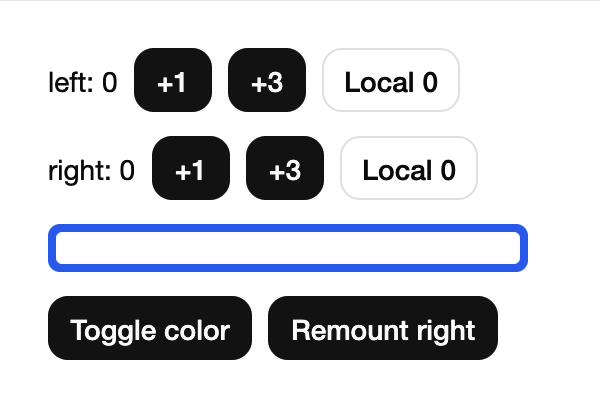

# 第 4 章　核心模型：组件、视图与一帧

前三章已经写出了能用的界面，但框架在背后做了什么，我们还只知道个大概：状态变了，界面就会更新。本章把这个过程完整地拆开。这里建立的心智模型会贯穿全书，以后遇到“为什么界面没更新”“为什么状态丢了”“为什么这么卡”之类的问题，都可以回到这张图上找答案。读完本章，你会知道：

- Component、View、State、Element 四个角色各自的职责；
- 从一次点击到屏幕上出现新画面，中间经过了哪几步；
- 框架怎样决定哪些组件需要重新 `render()`；
- 为什么父组件重新 `render()` 时子组件也会跟着 `render()`；
- 组件实例在什么情况下保留，什么情况下被重新创建；
- `render`、布局、场景三层工作分别在什么时候发生；
- 界面静止时，框架为什么什么都不做。

本章的核心是一个会把自己的每一步都打印出来的演示程序。建议一边读，一边运行它、点一点。

## 4.1　四个角色

Scoop UI 中的一切都围绕四个概念展开：

| 角色 | 是什么 | 由谁创建 | 生命周期 |
| --- | --- | --- | --- |
| **Component** | 组合界面的类，`render()` 返回 View | 框架在挂载时调用你提供的工厂函数 | 从挂载到卸载，实例一直保留 |
| **View** | 对“这里应该有什么”的描述，不可变 | `render()` 中调用 `button(...)`、`column { ... }`、`component(...)` 等函数 | 临时值，用完即弃 |
| **State** | 可以被观察的值，`render()` 读取它就建立依赖 | `state(...)`，可以在组件里，也可以在任何普通类里 | 和持有它的对象一样长 |
| **Element** | 真正做布局和绘制的节点：测量尺寸、放置子项、登记输入区域、绘制 | 框架在挂载时调用工厂函数 | 从挂载到卸载 |

前三章写的 `Counter`、`CounterView` 都是 Component。Component 本身不测量也不绘制，它只负责“组合”：根据当前的状态，返回一棵由其他节点组成的描述。真正干活的是 Element。`button`、`label`、`column` 这些控件，最终都是由控件库里的 Element 测量和绘制出来的。

View 只是描述。`button("+1", onClick)` 返回的是一个小小的不可变对象，记录了“这里放一个按钮，文字是 +1，点击调用 onClick”。同一个 View 可以用在多个地方，每个地方都会各自挂载一份。

## 4.2　从一次点击到新画面

点击第 2 章计数器的 `+1` 按钮之后，框架依次做了这些事：

1. **派发事件。** 系统把鼠标事件交给窗口，框架找到点击位置上的按钮，调用它的点击回调。
2. **写入状态。** 回调执行 `count.value += 1`。新值立即生效，此后读到的就是新值；同时，框架把读过这个状态的组件标记为“待更新”。此时并不会立刻调用 `render()`。
3. **逻辑更新。** 回调返回后，框架处理所有待更新的组件，从祖先到后代，每个组件在这一轮中最多 `render()` 一次。它把新的描述和上一次的描述逐层比较，决定哪些实例保留、哪些新建、哪些卸载（这个过程称为**协调**）；保留下来的子组件和元素拿到新的 Props，元素的 `update()` 被调用；新挂载的实例执行 `onMount()`，被移除的执行 `onUnmount()`；最后，依赖关系按这次 `render()` 实际读取的状态重新登记。
4. **呈现一帧。** 如果画面需要变化，框架向窗口请求一帧。等到系统给出绘制时机，框架先推进正在进行的动画，然后对需要的部分执行**布局**（`measure`：测量尺寸、放置子项），再**装配场景**（`scene`：登记输入区域、按顺序呈现子项、提交绘制块），把绘制命令交给 GPU。
5. **发布几何。** 窗口接受了这一帧之后，新的命中区域和无障碍信息才正式生效。从这一刻起，点击按新画面上的位置判定。
6. **回到静止。** 没有新的工作，框架就停下来，等待下一个事件。

第 3 步是**逻辑**层面的工作，即使窗口被遮挡、最小化，也照常进行；第 4、5 步是**呈现**层面的工作，只在真正有画面要显示时发生。两者分开，是理解后面许多现象的关键。

## 4.3　动手观察

下面的程序把每个组件和元素的关键时刻都打印到终端。保存为 `pipeline.scoop`：

```scoop
{{#include ../../examples/ch04/pipeline.scoop}}
```

先说明它的结构：

- `Pipeline` 是根组件，持有四个状态：两个计数 `left`、`right`，右侧计数行的 key `rightKey`，以及颜色开关 `warm`。
- `Tile` 是子组件，显示一行计数和三个按钮。它在构造、`onMount()`、`onUnmount()`、`render()` 时打印一行。它还有一个自己的本地状态 `local`，由 “Local” 按钮修改。
- `Swatch` 是一个最简单的自绘元素：画一个圆角色条。它在 `update()`、`measure()`、`scene()` 时打印。点击色条会在空心和实心之间切换。
- `Pipeline` 把**状态对象本身**（而不是它的值）通过 `TileInput` 交给 `Tile`，自己从不读取 `left.value` 和 `right.value`。这一点很重要，后面会看到它的效果。
- GUI 程序的标准输出带有缓冲，所以 `log` 在每次 `println` 之后调用 `flushOutput()`，让输出立即出现在终端里。

在终端运行它，让窗口和终端并排放置：

```sh
scoop run pipeline.scoop --release
```



### 启动

窗口出现时，终端打印：

```text
create  Pipeline
render  Pipeline
create  left
create  right
render  left
render  right
mount   left
mount   right
update  swatch
render  Pipeline
render  left
render  right
update  swatch
measure swatch
measure swatch
scene   swatch
```

前九行是首次挂载：先创建根组件并 `render()`，从它返回的描述中发现两个 `Tile` 和一个 `Swatch`，于是创建它们、执行它们的第一次 `render()`，挂载完成后调用 `onMount()`，元素则执行第一次 `update()`。注意顺序：**先 `render()`，后 `onMount()`**。`onMount()` 被调用时，组件已经有了自己的子树。

接下来的四行是第二轮逻辑更新，原因在 4.4 节解释。最后三行是第一帧的布局和场景：色条被测量了两次（4.8 节解释），场景装配了一次，画面出现。

之后就安静了。除非你操作界面，终端不会再有任何输出。

### 实验 1：点击 left 行的 +1

```text
render  left
measure swatch
scene   swatch
```

只有 `left` 重新 `render()`。`Pipeline` 没有，`right` 也没有：它们没有读过 `left` 这个状态。

色条为什么被重新测量了？`left` 行的文字从 `left: 0` 变成了 `left: 1`，宽度可能变化，于是这一行的布局失效，失效沿着父级向上传播到外层的 `column`。`column` 要重新排列，就要重新测量它的每一个直接子项，色条也在其中。4.8 节会详细讲布局失效。

### 实验 2：点击 left 行的 +3

```text
render  left
measure swatch
scene   swatch
```

`+3` 的回调连续写了三次状态，计数从 1 变成 4，但 `left` 只 `render()` 了一次。写入在回调执行期间只是“记账”，回调结束后才统一处理。

### 实验 3：点击 right 行的 Local

```text
render  right
measure swatch
scene   swatch
```

`local` 是 `right` 这个 `Tile` 实例自己的状态，只有它读过，所以只有它 `render()`。

### 实验 4：点击 Toggle color

```text
render  Pipeline
render  left
render  right
update  swatch
measure swatch
scene   swatch
```

`warm` 是 `Pipeline` 的状态，`Pipeline` 在 `render()` 中读了它来决定颜色，所以 `Pipeline` 重新 `render()`。接着，两个 `Tile` 也跟着 `render()` 了，尽管它们的计数没有变：父组件产生了新的描述，子组件拿到了新的 Props，框架默认就会让它们重新 `render()`（4.6 节）。色条拿到新颜色，`update()` 被调用，画面变成橙色。

### 实验 5：先点几下 right 行的 Local，再点 Remount right

```text
render  Pipeline
unmount right
create  right
render  left
render  right
update  swatch
mount   right
measure swatch
scene   swatch
```

`rightKey` 变了，`right` 行的 key 从 `ViewKey.Number(1)` 变成了 `ViewKey.Number(2)`。框架认为这已经不是原来那个组件了：卸载旧实例（`unmount right`），创建一个新实例（`create right`），新实例 `render()` 后挂载（`mount right`）。窗口上 right 行的 “Local” 计数回到了 0：本地状态随旧实例一起消失了。而 `right` 的计数没有变，因为它保存在 `Pipeline` 的状态里，不属于 `Tile`。

### 实验 6：拖动窗口边缘改变大小

```text
measure swatch
measure swatch
scene   swatch
```

没有任何 `render()`。窗口变大变小，状态和描述都没有变，只需要重新布局和装配场景。

### 实验 7：点击色条

```text
press   swatch
scene   swatch
```

既没有 `render()`，也没有 `measure()`。色条在自己的点击处理里改了一个普通字段 `hollow`，然后调用 `scope.requestFrame()` 请求重画。尺寸没有变，所以只需要重新装配场景。

### 实验 8：什么都不做

终端没有任何输出。用活动监视器或 `ps -o %cpu -p <进程号>` 查看，这个程序的 CPU 占用是 0%。

下面几节逐条解释这些现象背后的规则。

## 4.4　规则一：读取即依赖

`render()` 执行期间读了哪些状态，组件就依赖哪些状态；这些状态之一被写入，组件就会重新 `render()`。这条规则有几个推论。

**没读就不依赖。** `Pipeline` 把 `left` 和 `right` 这两个状态对象交给了 `Tile`，却从不读取它们的值，所以计数变化时 `Pipeline` 不受影响（实验 1、2）。

**间接读取也算。** 读取不一定要直接写在 `render()` 里。第 3 章的视图读 `model.summary`，getter 里面读了 `count.value`，这同样是视图的依赖。只要发生在 `render()` 执行期间，在多深的函数调用里读的都算。

**依赖每次重新收集。** 每次 `render()` 结束后，依赖关系按这一次实际读取的状态更新。比如 `if (expanded.value) details.value else ""`：`expanded` 为 false 时没有读 `details`，此时修改 `details` 不会引起重新 `render()`；`expanded` 变为 true 后，`details` 自动成为依赖。

**主题和系统偏好也是依赖。** 现在可以解释启动时的第二轮 `render()` 了。`Pipeline` 在 `render()` 中调用 `theme.read(scope)` 取主题，这个函数除了读主题本身，还读了窗口的**交互偏好**：是否减少动画、是否高对比度、是否减少透明效果、文字缩放比例。窗口刚创建时这些值还未就绪，窗口真正显示后，系统的实际偏好送达，这次读取的结果随之失效，`Pipeline` 于是再 `render()` 一次，两个子组件也跟着 `render()`（规则三）。把 `theme.read(scope)` 换成一个固定颜色，启动时就只有一轮 `render()`。这正是“读取即依赖”的体现：用户在系统设置里打开高对比度时，读过偏好的组件会自动更新。

**普通字段不是状态。** 修改普通的 `var` 字段，框架不会知道。同理，状态里存的是一个可变对象时，修改这个对象的内部（比如往一个可变列表里添加元素），并没有经过状态的 setter，也不会通知任何人。要么把新值整体赋给 `state.value`，要么让对象内部的字段本身也是状态。第 8 章会详细讨论。

## 4.5　规则二：写入先记账，回调结束后统一更新

实验 2 中，三次写入只引起一次 `render()`。框架的做法是：

- setter 先保存新值，再把依赖它的组件标记为“待更新”，不在 setter 里调用 `render()`；
- 同一个回调里的多次写入，无论写的是同一个状态还是不同的状态，都在回调结束后的那一轮逻辑更新中一起处理；
- 每次写入都算数，哪怕写回的是和原来相同的值，框架也不做相等比较。

反过来，**`render()` 中不能写状态**，`measure`、`scene` 和绘制块中同样不能。这些阶段只负责根据当前状态产生描述和画面，如果它们改变状态，就会引起新的更新，甚至无限循环。框架会直接拒绝，抛出 `IllegalStateException`，消息是：

```text
State cannot change during render, measure, scene or draw
```

修改状态应该放在事件回调、`onMount()` 等生命周期方法里。需要从一个状态派生出另一个值时，直接在 `render()` 里计算，不要写回另一个状态。

## 4.6　规则三：父组件 render，子组件跟着 render

实验 4 中，`Tile` 的计数没有变，却也重新 `render()` 了。这是因为父组件 `render()` 时，会为子组件生成新的描述，携带新的 Props。框架不知道新旧 Props 是否“相等”（Props 可以是任意类型，框架不做深比较），所以保守地让子组件重新 `render()`。

这条规则通常不会成为问题：`render()` 只是产生描述，代价很小。但在界面很大时，它提示了一个组织代码的原则：**让状态在尽可能靠近使用它的地方被读取。** `Pipeline` 把状态对象交给 `Tile`，由 `Tile` 自己读取，计数变化就只影响一行。如果 `Pipeline` 读出 `left.value` 再把整数传下去，每次计数变化都会让 `Pipeline` 和两个 `Tile` 全部 `render()`（练习 2 会让你验证这一点）。第 9 章介绍的 `Binding` 是传递“可读写的值”的标准方式，同样能把读取推迟到子组件中。

需要时，也可以为 `component(...)` 提供一个 `InputComparison`，告诉框架怎样判断新旧 Props 等价，等价时跳过子组件的 `render()`。这属于性能优化的手段，第 32 章再讨论。

> **从其他框架过来**
>
> React 的默认行为与此相同：父组件重新渲染时子组件也重新渲染，除非用 `memo` 包起来。Jetpack Compose 则会自动跳过参数“稳定”且与上次相等的可组合函数。Scoop UI 不做自动比较，也就没有“稳定性”推断带来的意外；需要跳过时，用 `InputComparison` 明确写出比较规则。

## 4.7　规则四：身份由位置、key 和类型决定

协调时，框架在**同一个父级**的子项之间，把新描述和旧实例配对：

| 情况 | 结果 |
| --- | --- |
| 同一个显式 key，同一种类型 | 保留原实例，只替换 Props；它在兄弟之间移动了位置也没关系 |
| 没有显式 key，位置相同，类型相同 | 保留原实例 |
| key 或类型变了 | 卸载旧实例，创建新实例 |
| 从描述中消失，或者换到了另一个父级下 | 卸载；以后再出现时是新实例 |
| 只有尺寸、位置或外观变化 | 保留实例和状态 |

“类型”同时包括节点的类别（组件还是元素）、组件的具体 class，以及 Props 的完整类型。key 的类型是 `ViewKey`：默认的 `ViewKey.Position` 表示按位置配对，`ViewKey.Text(...)` 和 `ViewKey.Number(...)` 是显式 key。同一父级下的显式 key 必须互不相同。

保留实例就保留了它的一切：字段、本地状态、焦点、正在进行的动画。重新创建则意味着全部从头开始，实验 5 中 Local 计数归零就是这个原因。这引出了两条实践规则：

- 列表项可能插入、删除或重新排序，而且项里有本地状态时，用来自数据的稳定标识（例如数据库 id）作为 key。用数组下标作 key 和按位置配对没有区别。
- 想有意丢弃一棵子树的全部本地状态时（比如切换到另一个用户的资料页），换一个 key 即可，正如 Remount right 所做的。

还有一点：`component(...)` 的工厂函数每次都必须返回一个新创建的实例。不要把实例缓存起来重复返回，框架会拒绝把同一个实例挂载两次。第 11 章会更深入地讨论身份和 key。

## 4.8　规则五：三层工作量

实验 1、6、7 展示了三种不同的工作量：

| 层次 | 做什么 | 由什么触发 |
| --- | --- | --- |
| 逻辑更新 | 组件 `render()`、协调、元素 `update()`、挂载与卸载 | 状态写入；父级产生新的描述 |
| 布局 | 元素 `measure()`：在约束内决定尺寸，测量并放置子项 | 布局失效；父级给出的约束变化（例如窗口大小改变） |
| 场景 | 元素 `scene()`：登记输入区域、呈现子项、提交绘制块 | 每一次真正绘制的帧 |

越往下层，触发越频繁，所以越要轻量。

**元素自己声明失效的程度。** `Element.update()` 的返回值类型是 `UiInvalidation`，有三个取值：`None`（不需要重画）、`Scene`（需要重新装配场景，但布局仍然有效）、`Layout`（需要重新布局）。默认返回 `Layout`，这是最保守的选择。`Swatch` 的新 Props 只可能改变颜色，所以它返回 `Scene`。元素在自己的输入处理中改变了外观，用 `scope.requestFrame()` 请求重画（相当于 `Scene`），改变了尺寸则用 `scope.requestLayout()`。

**布局失效向上传播。** 一个元素的布局失效后，它的父容器也需要重新安排子项，失效一直传播到不受影响的位置。父容器重新布局时会重新测量它的直接子项，这就是实验 1 中色条也被测量的原因。在实验 4 中，`Swatch.update()` 返回的虽然是 `Scene`，但两个 `Tile` 里的文字和按钮也拿到了新的 Props，它们引起的布局失效同样让 `column` 重新测量了色条。

**measure 可能被调用多次。** 启动和改变窗口大小时，色条在同一帧里被测量了两次。容器为了决定最终的排列，可能先用一种约束试测子项，再用另一种约束正式测量。所以 `measure()` 必须是一个只依赖输入、没有副作用的计算。

**scene 每帧都执行。** 实验 1 里色条本身什么都没变，`scene()` 还是执行了。默认情况下，每次真正绘制一帧，框架都会遍历需要呈现的元素，重新装配场景；直接使用 `draw` 的元素每帧都会执行 `scene()`。对于内容稳定、绘制代价又高的部分，可以用 `cachedScene(...)` 声明一个场景缓存边界，或者用 `drawLayer` 缓存绘制结果，第 24 章和第 32 章会讲。

## 4.9　以真正呈现的画面为准

4.2 节的第 5 步值得单独说一说。逻辑更新完成之后，界面的“新状态”已经确定了，但用户看到的仍然是上一帧。在新的一帧被窗口接受（Accepted）之前：

- 点击仍然按上一帧画面上的位置判定，用户点中的是他看到的那个按钮；
- 新挂载的元素在第一次被放置并呈现之前，不能被点中；
- 已经卸载的元素立即停止接收事件，不会等到下一帧；
- 事件回调使用的是节点最新的处理函数。

只有 Accepted 之后，新的命中区域、无障碍信息中的位置等几何信息才发布出来。如果某一帧因为某种原因没有被接受（Discarded），它的几何信息就不会生效，已经生效的状态修改也不会回滚。

写普通应用时很少需要直接面对这些细节，但它们解释了一个设计取向：**界面的交互总是以用户真正看到的画面为准。** 后面讲焦点、滚动、弹层定位时，你会多次看到“在 Accepted 之后”这样的说法。

## 4.10　静止时什么都不做

实验 8 中程序的 CPU 占用是 0%。这不是巧合，而是框架的硬性要求：一个窗口没有待处理的更新、没有尚未呈现的变化、没有正在运行的动画，也没有系统的重绘请求时，就进入静止。静止时：

- 不调用 `render()`、`update()`、`measure()` 或 `scene()`，不做协调和布局；
- 不用定时器去检查状态是否变化，状态的变化由写入主动通知；
- 不请求新的帧，不提交 GPU 命令，不重复呈现同一幅静态画面。

能唤醒它的只有真实的工作来源：状态写入、用户输入、窗口大小或主题变化、动画开始、显式的 `requestFrame()`。持续运行的动画会持续请求帧，动画结束后，最后一帧呈现完毕就停下。多个窗口各自独立，一个窗口里的动画不会让其他窗口重新计算。

这对笔记本电脑的电池非常友好，也意味着你不必为“界面空闲时浪费资源”操心，只要别在代码里无休止地请求帧。

## 4.11　一切发生在 UI 线程

上面描述的所有工作，从事件回调、`render()`、协调到布局和绘制，都在同一个线程上进行，本书称它为 **UI 线程**（框架文档中也称为 owner 线程）。状态对象绑定创建它的线程，只能在这个线程上读写。

所以，耗时的工作不能直接放在回调里做，否则窗口会卡住；后台线程也不能直接写状态。正确的做法是：等待网络、文件这类工作用协程，计算密集的工作放到后台线程，完成后把结果“投递”回 UI 线程再写状态。第 29 章会完整地讲这些方法。

## 4.12　全书的地图

本章的每个概念，后面都有专门的章节展开：

| 概念 | 章节 |
| --- | --- |
| View 的组合、布局容器、约束、文字 | 第二部分（第 5～7 章） |
| State、Props、Binding、Store、Context、key | 第三部分（第 8～11 章） |
| 事件、焦点、键盘、手势、拖放 | 第四部分（第 12～16 章） |
| Element 的 `measure`、`scene`、绘制、缓存 | 第七部分（第 23～26 章） |
| 应用、窗口、UI 线程与后台任务 | 第八部分（第 27～29 章） |
| 只做必要的工作：性能分析与优化 | 第 32 章 |

## 常见误用

- **在 `render()` 里调用 `state(...)`。** `state(...)` 每次调用都创建一个新的状态对象，写在 `render()` 里，每次 `render()` 都会得到一个初始值的新状态。状态只能在字段初始化或普通对象里创建。
- **在 `render()` 里写状态。** 运行时抛出 `State cannot change during render, measure, scene or draw`。派生值直接计算，修改放进回调。
- **修改了可变对象的内部，期待界面更新。** 状态的 setter 没有被调用，没有任何通知。把新值整体赋给 `state.value`。
- **在 `measure()` 里做有副作用的事。** 它可能在一帧内被调用多次，也可能在你意想不到的时候被调用。
- **以为子组件只有在自己的状态变化时才 `render()`。** 父组件 `render()` 时，子组件默认跟着 `render()`。
- **用位置或数组下标区分会重排的列表项。** 项的本地状态会错位。用来自数据的稳定 key。
- **在回调里做耗时计算。** UI 线程被占用，整个窗口卡住。

## 小结

- Component 组合描述，View 是不可变的描述，State 是可观察的值，Element 负责布局和绘制。
- 一次更新分为逻辑更新（`render`、协调、挂载与卸载）和呈现（布局、场景、绘制）两个阶段；几何信息在帧被窗口接受后才生效。
- 读取即依赖：`render()` 期间读过的状态才会触发它重新 `render()`，间接读取也算，依赖每次重新收集；主题读取也会读取系统的交互偏好。
- 写入先记账，回调结束后统一更新；`render`、`measure`、`scene` 和绘制中不能写状态。
- 父组件 `render()` 时子组件默认跟着 `render()`；让状态在靠近使用处被读取。
- 同一父级下，key 和类型相同就保留实例和本地状态，否则重新创建。
- 逻辑更新、布局、场景三层工作的触发条件不同；元素用 `UiInvalidation`、`requestFrame()`、`requestLayout()` 声明需要的工作量。
- 静止时框架不做任何计算和绘制。
- 所有 UI 工作都在 UI 线程上进行，状态只能在创建它的线程上读写。

## 练习

1. 运行 `pipeline.scoop`，依次重做 4.3 节的八个实验，对照终端输出逐条理解。
2. 把 `TileInput` 改成携带 `Int` 而不是 `State<Int>`：`Pipeline` 传入 `left.value`，`+1` 按钮的回调改为修改 `Pipeline` 的状态（提示：可以在 `TileInput` 里再放一个 `(Int) -> Unit` 类型的回调）。再点击 left 行的 `+1`，终端的输出变成了什么？为什么？
3. 去掉 `right` 行的 `ViewKey.Number(rightKey.value)`，改成默认的按位置配对。点几下 right 行的 Local，再点 Remount right，结果和原来有什么不同？
4. 把 `Swatch.update()` 的返回值改成 `UiInvalidation.Layout`，再点 Toggle color。输出有变化吗？结合 4.8 节解释原因。
5. 在 `Pipeline.render()` 中把 `theme.read(scope)` 换成固定的 `Color(1.0, 1.0, 1.0)`，验证启动时只剩一轮 `render()`。
