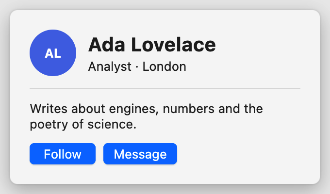
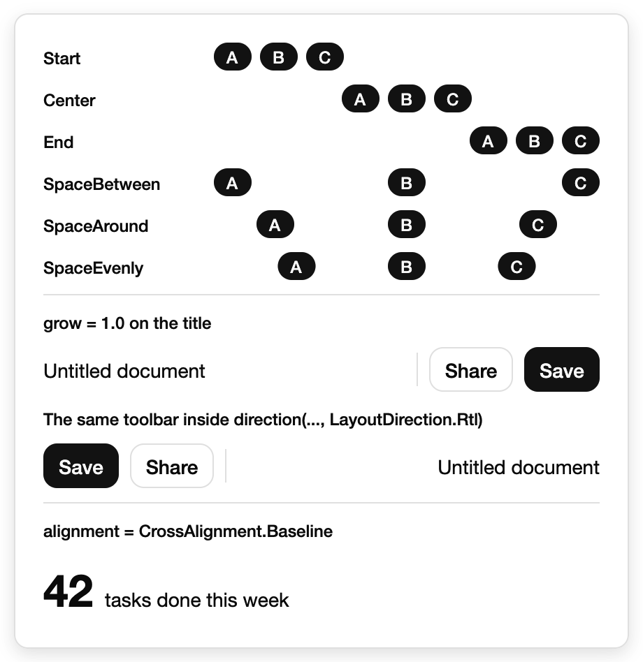
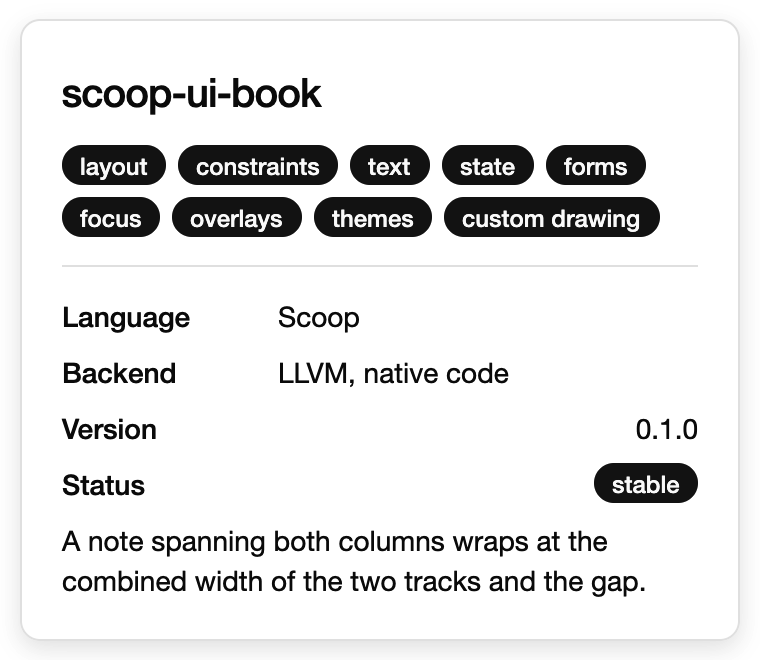
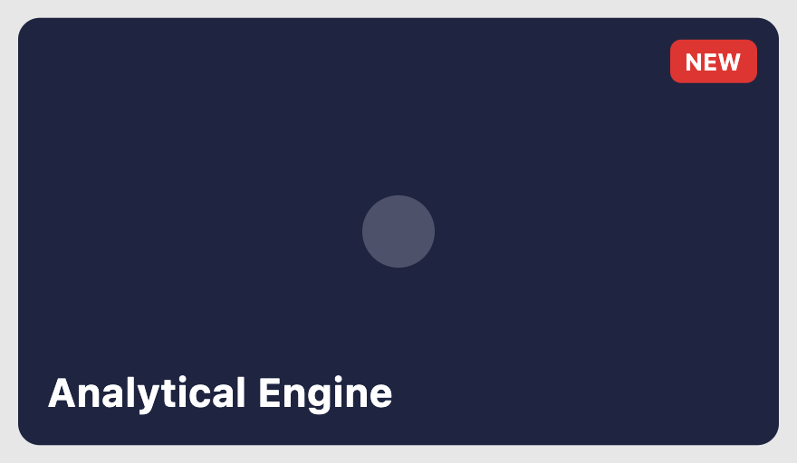

# 第 5 章　布局容器

一个界面能不能看，八成取决于布局。本章介绍控件库提供的布局容器：怎样把控件排成行和列、叠在一起、按网格对齐、放到指定位置，以及怎样适应从右到左书写的语言。读完本章，你会知道：

- `row`、`column`、`stack` 的分工和它们的属性；
- 主轴上的剩余空间怎样分配，`basis`、`grow`、`shrink` 各管什么；
- `direction` 怎样把布局切换为从右到左，哪些东西会镜像、哪些不会；
- `frame` 怎样给内容加上尺寸、内边距、对齐和外观；
- `wrap` 和 `grid` 适合什么场景；
- `absolute` 和 `aspectRatio` 怎样做叠放和固定比例；
- builder 块里的同名成员为什么是最容易踩的坑，有哪几种解决办法；
- 怎样把一个大的 `render()` 拆成几个函数。

容器决定子项**放在哪里**，至于子项**有多大**，由下一章的约束模型决定。两章合起来，才能完整地解释布局的行为。

## 5.1　一张名片：row、column 与 stack

先看一个完整的例子。保存为 `card.scoop`：

```scoop
{{#include ../../examples/ch05/card.scoop}}
```

```sh
scoop run card.scoop --release
```



窗口中央是一张宽 320 的卡片：左上是圆形头像，右边是姓名和副标题；下面是一条分隔线、一段会自动换行的简介和两个按钮。这张卡片用到了三种基础容器：

| 容器 | 作用 |
| --- | --- |
| `column { ... }` | 子项从上到下排列 |
| `row { ... }` | 子项沿书写方向排列：从左到右，在从右到左的布局中从右到左 |
| `stack { ... }` | 子项按声明顺序叠放，后声明的画在上面 |

`row` 和 `column` 的块中可以设置这些属性：

| 属性 | 类型与默认值 | 作用 |
| --- | --- | --- |
| `spacing` | `Double`，默认 0 | 相邻子项之间的间距 |
| `alignment` | `CrossAlignment`，默认 `Start` | 子项在交叉轴上的对齐：`Start`、`Center`、`End`、`Stretch`（拉伸到容器的交叉轴尺寸）、`Baseline`（只用于 `row`，按文字基线对齐） |
| `justify` | `MainAlignment`，默认 `Start` | 主轴上的剩余空间怎样分配，见 5.2 节 |
| `padding` | `Insets`，默认四边为 0 | 容器的内边距，`Insets(left, top, right, bottom)`，`Insets.all(20.0)` 表示四边相同 |
| `clip` | `Boolean`，默认 `false` | 是否裁剪超出容器的子项 |

“主轴”是容器排列子项的方向，`row` 是水平方向，`column` 是垂直方向；“交叉轴”是与之垂直的方向。

`stack` 只有一个属性 `alignment`，类型是 `Alignment(horizontal, vertical)`，两个分量都是 `AxisAlignment`（`Start`、`Center`、`End`），默认两个方向都居中。名片的头像就是一个 `stack`：底下是一个 48×48、圆角半径 24 的蓝色 `frame`（也就是一个圆），上面叠一个白色的 Label。`empty()` 是一个什么都不画的 View，这里只是给 `frame` 一个内容。

`separator()` 画一条细线，默认横向并占满可用宽度。

卡片本身是带主题表面的 `frame`：`surface = Some(SurfaceKind.Elevated)` 让它使用当前主题的“浮起”表面，背景、边框、圆角和阴影都来自主题。这个例子用的是 macOS 主题，所以页面是浅灰色的，卡片带有阴影。

## 5.2　主轴上的分配：justify、basis、grow 与 shrink

容器在主轴上排好子项之后，往往会有剩余的空间，或者空间不够。怎样处理这两种情况，由容器的 `justify` 和每个子项的弹性参数决定。下面的程序把几种常见的情况放在一起，保存为 `flex.scoop`：

```scoop
{{#include ../../examples/ch05/flex.scoop}}
```



### justify：剩余空间的分配

上半部分的六行展示了 `MainAlignment` 的全部取值：

| 取值 | 剩余空间放在哪里 |
| --- | --- |
| `Start` | 全部放在末尾，子项靠起始边 |
| `Center` | 两端各一半，子项居中 |
| `End` | 全部放在开头，子项靠末尾 |
| `SpaceBetween` | 平均放在子项之间，两端不留 |
| `SpaceAround` | 每个子项两侧各留一份，所以两端的空白是子项之间的一半 |
| `SpaceEvenly` | 子项之间和两端的空白完全相等 |

注意，`justify` 只有在容器**比内容宽**时才看得出效果。一个 `row` 如果没有被要求占满某个宽度，它会收缩到正好包住子项，也就没有剩余空间可分。这个例子中，每一行的三个徽章放在一个设置了 `grow = 1.0` 的 `row` 里，这个 `row` 被拉伸到剩余的宽度，`justify` 才有了用武之地。

`spacing` 是固定的最小间距，`SpaceBetween` 等分配方式在它的基础上再加上分到的空白。

### item：单独设置一个子项

直接在块中调用 `badge(...)`、`button(...)` 等，子项使用默认的弹性参数。需要单独设置时，改用 `item(view) { ... }`：

| 参数 | 默认值 | 作用 |
| --- | --- | --- |
| `basis` | `FlexBasis.Content` | 子项的基础尺寸：`Content` 按内容测量，`FlexBasis.Fixed(长度)` 直接给定 |
| `grow` | 0 | 有剩余空间时，按这个权重分到额外的尺寸 |
| `shrink` | 1 | 空间不够时，按这个权重乘以基础尺寸收缩 |
| `min`、`max` | 0、无上限 | 子项在主轴上的最小和最大尺寸 |
| `align` | 无 | 只对这个子项生效的交叉轴对齐，例如 `align = Some(CrossAlignment.Stretch)` |

`justified` 函数里，说明文字用 `basis = FlexBasis.Fixed(110.0)` 固定为 110 宽，所以六行的徽章都从同一位置开始；徽章行用 `grow = 1.0` 占满剩下的宽度。

工具栏 `toolbar()` 是 `grow` 最常见的用法：标题 `grow = 1.0`，拿走全部剩余空间，把分隔线和两个按钮推到行尾。竖向的分隔线用 `separator { axis = FlexAxis.Vertical; length = Some(24.0) }` 画出。

空间不够时，容器按 `shrink × 基础尺寸` 的比例压缩各个子项，所以默认情况下，按钮也会被压缩。下一章会看到一个按钮被压成两行的例子，以及怎样用 `shrink = 0.0` 保护它。

需要在运行时决定排列方向时，可以用 `flex { axis = FlexAxis.Vertical }`，它的其他用法和 `row`、`column` 完全相同。

### 基线对齐

最后一行用了 `alignment = CrossAlignment.Baseline`：字号 32 的 “42” 和正文大小的说明文字，底部不对齐，但文字的基线落在同一条线上，这是排版上最自然的对齐方式。基线对齐只能用于 `row`。

## 5.3　书写方向：从右到左

阿拉伯文、希伯来文等语言从右往左书写，界面通常也要整体镜像。Scoop UI 用 `direction(content, LayoutDirection.Rtl)` 创建一个**方向作用域**，其中的所有内容都按从右到左布局。上图中第二个工具栏就是把同一个 `toolbar()` 放进了 RTL 作用域：标题跑到了右边，按钮排在左边，顺序也反了过来。

方向作用域改变的是**逻辑方向**：

- `row` 的子项从右边开始排列；`Start` 和 `End` 分别指右边和左边。
- `column` 的交叉轴对齐 `Start`、`End` 同样随方向翻转。
- `stack` 和 `frame` 的 `Alignment` 中，水平的 `Start`、`End` 是逻辑起终点。
- 文字段落默认的起始边也随之变化，所以标题靠到了右边。

有些东西**不会**改变：

- 文字、图片、自己画的图形不会被镜像。镜像布局不等于把画面左右翻转。
- 子项的声明顺序、key 和 Tab 焦点顺序不变。
- `padding = Insets(left, top, right, bottom)` 是物理方向的边距。需要“起始边 16、末尾边 8”这样的逻辑边距时，改用 `logicalPadding`，它会按当前方向解析成实际的左右边距。

方向作用域只看你给的值，不读取系统的语言设置。应用自己决定什么时候使用 RTL，比如根据用户选择的界面语言，在根组件外面包一层 `direction(...)`。不在任何作用域里的内容默认是从左到右。

## 5.4　frame：尺寸、内边距、对齐与外观

`frame(content) { ... }` 只有一个子项，负责给它加上尺寸限制、内边距、对齐和外观。它是最常用的容器：

| 属性 | 作用 |
| --- | --- |
| `width`、`height` | 尺寸上限，类型是 `Double?`，例如 `width = Some(320.0)` |
| `padding`、`logicalPadding` | 内边距，物理或逻辑方向 |
| `alignment` | 子项在 frame 内的位置，默认两个方向都居中 |
| `surface` | 使用主题的表面：`SurfaceKind.Plain`、`Action` 或 `Elevated` |
| `surfaceRole` | 表面的用途，默认 `SurfaceRole.Content`；主题据此决定这块表面是否使用玻璃（第 21.7 节） |
| `style { ... }` | 局部装饰：`background(...)`、`corners(...)`、`border(...)` 等 |

几点需要注意：

- **`width` 和 `height` 是上限，不是强制尺寸。** 父级给出的最小尺寸更大时，以父级为准。下一章的实验 4 会演示这种情况。
- **frame 会放宽约束。** frame 给子项的约束是“最小为 0，最大不超过自己的可用尺寸”，子项可以比 frame 小，再按 `alignment` 摆放。这正是第 2 章用它把按钮从“铺满窗口”中解放出来的原因。
- **没有选择 `surface` 时，frame 只是普通的布局和装饰容器，不需要主题。** 选择了表面，它就使用当前主题的背景、圆角、边框、阴影和默认内边距；明确给出的 `padding` 会替换主题的内边距。
- **frame 默认不裁剪。** 子项超出 frame 的部分照常绘制，需要裁剪时写 `style { clipContent(true) }`。

`style { ... }` 中的装饰和效果会在第 22 章详细介绍。

## 5.5　wrap 与 grid

`row` 放不下时会压缩子项，而有些内容更适合换行，比如一组标签；有些内容需要行列都对齐，比如“名称—值”的信息表。下面的项目卡片同时用到了这两种容器，保存为 `wrap_grid.scoop`：

```scoop
{{#include ../../examples/ch05/wrap_grid.scoop}}
```



### wrap

`wrap { ... }` 的用法和 `row` 一样，区别在于一行放不下时，后面的子项转到下一行。`spacing` 是同一行内的间距，`lineSpacing` 是行与行之间的距离；`axis = FlexAxis.Vertical` 改为纵向排列、按列换行。子项照样可以用 `item` 设置 `grow`，每一行单独分配自己的剩余空间。

### grid

`grid { ... }` 按行列轨道放置子项：

- `columns` 和 `rows` 是轨道列表。`GridTrack.Fixed(长度)` 是固定尺寸，`GridTrack.Auto` 按内容决定，`GridTrack.Fraction(权重)` 按比例分配剩余的空间。不设置时，两个方向都只有一条 `Auto` 轨道。
- `columnGap`、`rowGap` 是轨道之间的间距。
- `item(view) { ... }` 放入一个单元格：`column`、`row` 是从 0 开始的位置，`columnSpan`、`rowSpan` 是跨越的轨道数。
- 单元格内的对齐用 `horizontal`、`vertical` 设置，类型是 `CrossAlignment`，默认是 `Stretch`。

例子中的信息表第一列固定 96 宽，第二列占剩余宽度；最后一段说明用 `columnSpan = 2L` 横跨两列，所以按两列加间距的总宽度换行。

版本号和状态这两行值得仔细看。它们都要靠右，但用了不同的写法：

- 状态徽章 `stable` 外面套了一层 `row`，`row` 按内容收缩，所以徽章比单元格窄。这时单元格的 `horizontal = CrossAlignment.End` 能把它推到右边。
- 版本号是一个 Label。Label 在有上限的宽度里会占满整个单元格，这时单元格对齐挪不动它，要设置段落对齐 `settings { alignment = TextAlignment.End }`，让文字在 Label 内部靠右。

如果把版本号也写成单元格对齐，它会纹丝不动地待在左边。这个现象的原因是下一章约束模型的第 3 条规则。

## 5.6　absolute 与 aspectRatio

有些界面需要把元素叠放在指定的位置，例如封面图上的角标。`absolute { ... }` 在一个有限大小的容器里按偏移定位子项；`aspectRatio(content, ratio)` 在父级的约束内算出固定宽高比的外框。保存为 `absolute.scoop`：

```scoop
{{#include ../../examples/ch05/absolute.scoop}}
```



窗口中央是一张宽 420、比例 16:9 的深蓝色封面：右上角是 NEW 角标，左下角是标题，正中央是一个半透明的小圆。

每个子项用 `item(view) { ... }` 加入，分别设置水平和垂直两个轴。`AbsoluteAxis` 有四种取值：

| 取值 | 含义 |
| --- | --- |
| `Start(offset, size)` | 距起始边 `offset`；`size` 为 `Some(...)` 时固定这个轴的尺寸 |
| `End(offset, size)` | 距末尾边 `offset` |
| `Center(offset, size)` | 居中后再偏移 `offset` |
| `Stretch(start, end)` | 两端分别距边缘 `start` 和 `end`，尺寸随容器 |

几点说明：

- `zIndex` 决定叠放和点击命中的先后，值大的在上面，相同时按声明顺序。例子中的角标先于标题声明，但 `zIndex = 1` 让它始终在最上层。`zIndex` 不改变 Tab 焦点顺序。
- 水平方向的 `Start`、`End` 是逻辑方向，在 RTL 作用域中会翻转；垂直方向不变。
- absolute 的尺寸**不由子项撑开**，每个子项只测量一次。父级在某个方向没有上限时，必须用 `width`、`height` 明确给出尺寸。这里由 `aspectRatio` 提供了有限的外框。
- absolute 不裁剪超出边界的子项，允许负偏移；需要背景、圆角或裁剪时，在外面再套一层 frame。
- `aspectRatio` 默认把内容裁剪到比例外框内（`clip = true`），常和图片的 Cover、Contain 适配方式一起使用（第 20 章）。

如果违反了尺寸的要求，比如把 `absolute` 直接放进一个纵向滚动区域（高度没有上限），程序会在布局时抛出 `IllegalArgumentException` 并退出：

```text
scoop: uncaught exception: n(c=scoop%3Ascoop.core%3A0.1.0;p=;o=-;k=C;x=IllegalArgumentException)
```

终端只显示异常类型。它对应的消息是 `absolute height requires a bounded parent or an explicit height`，在 `scoop.ui.component` 的源码中可以找到。

## 5.7　builder 块里的同名成员

前面的例子里，有几处写法看起来有点别扭：名片要把头像写成单独的函数 `initials()`，再用 `add(...)` 加进去；`flex.scoop` 和 `wrap_grid.scoop` 把 `label` 改名为 `textView` 导入；`direction(toolbar(), ...)` 直接写在块里，外面没有 `add`。这些都是同一个原因。

`row`、`column`、`stack`、`wrap` 等容器的块接收者上有一组**成员函数**：`label(...)`、`button(...)`、`badge(...)`、`frame(...)`、`row { ... }`、`column { ... }`、`scrollArea(...)`、`direction(...)`，几乎每个控件都有一个。在块中调用它们，会把对应的控件**追加**为子项，返回值是 `Unit`。同名的**顶层函数**（例如 `scoop.ui.component.label`）则只创建并返回一个 `View`，不追加到任何地方。在块中写下 `label(...)` 时，编译器总是优先选择成员。

所以，在块中需要“一个 View 值”时，比如作为 `frame(...)`、`item(...)` 的参数，直接写控件函数就会出错：

```scoop
{{#include ../../examples/ch05/builder_unit_fail.scoop}}
```

```text
error[E0501]: dependency function argument must be of type View, found Unit
  --> builder_unit_fail.scoop:14:15
   |
14 |         frame(label("boxed")) { width = Some(80.0) }
   |               ^^^^^^^^^^^^^^
```

`label("boxed")` 解析成了块的成员：它的作用是把一个 Label 追加进 `column`，返回值是 `Unit`，而这个 `Unit` 又被当作了 `frame` 的参数。

这条规则的作用范围是**整个块**，包括写在函数参数里的表达式。编写本书第二部分的示例时，下面几种写法都报了同样的错：

```scoop
column {
    add(direction(toolbar(), LayoutDirection.Rtl)) // direction(...) 本身就是追加成员
    add(frame(tinted(label("x"))) { width = Some(300.0) }) // frame(...) 同上
    add(panel("caption", row { label("x") }))      // 参数里的 row { } 也是成员
}
```

解决办法有三种：

1. **直接使用成员。** 如果目的就是把控件追加进来，不要再套 `add(...)`：在块里写 `direction(toolbar(), LayoutDirection.Rtl)` 或 `frame(...) { ... }` 即可。
2. **在块外构造 View。** 把需要作为参数的 View 先存进局部变量，或者写成返回 `View` 的顶层函数，再在块里用 `add(view)` 加入。名片的 `initials()`、约束实验室（第 6 章）的每个实验函数都是这样写的。顶层函数的函数体不在任何块里，`label`、`row` 在那里就是普通的顶层函数。
3. **用别名导入顶层函数。** `import scoop.ui.component.label as textView` 之后，块中的 `textView(...)` 不会和任何成员同名，总是返回 View。

第 3 种办法在 `grid { ... }` 和 `absolute { ... }` 的块中尤其有用。这两个 builder 不提供 `label` 等追加成员，只接受 `item(...)`。如果它们写在某个 `column` 的块里，块中的 `label(...)` 会去找外层 `column` 的成员，报出第 2 章见过的 `implicit use of an outer receiver is not allowed`。用别名导入就不会有这个问题。

> **从其他框架过来**
>
> Jetpack Compose 的 `Column { Text("a") }` 和 SwiftUI 的 `VStack { Text("a") }` 中，块里的每个控件调用都“自动”成为子项。Scoop 的 builder 只是普通的接收者 lambda，追加子项靠的是接收者上实实在在的成员函数，这既是它不需要编译器插件的原因，也是这一节所有规则的来源。

## 5.8　把 render 拆成函数

界面一大，`render()` 就会变得很长。最简单的拆法，是把一块界面写成返回 `View` 的普通函数，就像本章的 `initials()`、`toolbar()`、`facts()`。这种函数：

- 没有自己的身份，也没有自己的状态。它只是在调用者的 `render()` 中执行，产生一段描述。
- 其中读取的状态，算作调用者 `render()` 的依赖（第 4 章的规则一）。
- 可以有参数，也可以写在别的文件里复用。

只有当一块界面需要**独立的状态或生命周期**时，才值得把它做成组件：比如它有自己的展开和收起状态，需要在挂载时注册快捷键，或者需要在列表里随数据移动并保留状态。不要为每个小部件都建一个组件类，普通函数更简单，也更容易阅读。

## 常见误用

- **在块里把控件函数当作参数用。** `frame(label(...))`、`item(button(...))`、`add(row { ... })` 在块中都会出错。用块外的函数、局部变量，或者别名导入。
- **以为 `justify` 能让短小的 `row` 撑开。** `row` 默认收缩到内容的宽度，没有剩余空间可分。让它占满宽度（`grow`、`Stretch` 或固定尺寸）后，`justify` 才有效果。
- **把 `frame` 的 `width` 当作强制宽度。** 它是上限；父级要求的最小值更大时以父级为准。
- **用单元格对齐去挪动一个 Label。** Label 在有界宽度里占满单元格，要用段落对齐。
- **把 `absolute` 放进没有上限的方向。** 程序会抛出 `IllegalArgumentException`；用 `width`、`height` 或 `aspectRatio` 给出明确的尺寸。
- **以为 RTL 会镜像所有东西。** 只有布局方向改变，文字、图片和自绘内容保持原样。
- **为每个小部件都建一个组件。** 没有独立状态和生命周期时，用返回 View 的函数。

## 小结

- `column` 纵向、`row` 沿书写方向、`stack` 叠放；`row`、`column` 有 `spacing`、`alignment`、`justify`、`padding`、`clip`。
- `justify` 分配主轴上的剩余空间；`item` 为单个子项设置 `basis`、`grow`、`shrink`、`min`、`max`、`align`；`grow` 分配多余空间，`shrink` 决定空间不够时谁让步。
- `direction(content, LayoutDirection.Rtl)` 切换为从右到左；只改变逻辑方向，不镜像内容，需要逻辑边距时用 `logicalPadding`。
- `frame` 提供尺寸上限、内边距、对齐、主题表面和装饰，并把约束放宽为“最小为 0”。
- `wrap` 放不下时换行；`grid` 用 `Fixed`、`Auto`、`Fraction` 轨道按行列对齐。
- `absolute` 按偏移定位、用 `zIndex` 控制叠放，自身尺寸不由子项决定；`aspectRatio` 给出固定比例的外框。
- builder 块里的控件调用是追加子项、返回 `Unit` 的成员，作用于整个块；需要 View 值时在块外构造，或用别名导入。
- 没有独立状态和生命周期的界面片段，写成返回 View 的普通函数。

## 练习

1. 在名片的按钮行中，让 Follow 按钮占满剩余宽度，Message 保持自然宽度。
2. 把 `flex.scoop` 中徽章行的 `grow = 1.0` 去掉，六种 `justify` 的效果还在吗？为什么？
3. 用 `direction(...)` 把整张名片切换成 RTL，观察头像、文字和按钮的位置怎样变化，哪些东西没有镜像。
4. 给 `wrap_grid.scoop` 的信息表增加第三列 `GridTrack.Auto`，在 Version 一行的第三列放一个 `badge("latest")`。
5. 在 `absolute.scoop` 的封面左上角再加一个角标，并让它在 RTL 作用域中出现在右上角。提示：只需要用到 `Start`。
6. 写一个 `column`，在块里用 `add(label("x"))` 加入子项，看看编译器怎么说；再说出三种改法。
