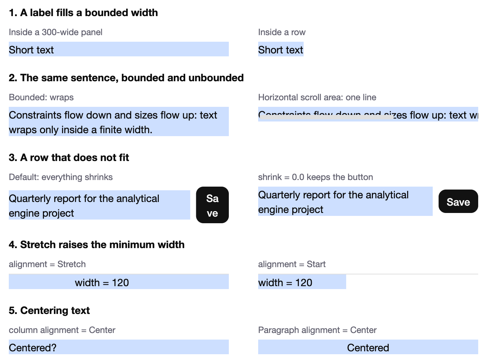

# 第 6 章　约束模型

上一章介绍了容器把子项放在哪里，但还留下了不少疑问：为什么按钮会铺满窗口？为什么在 `column` 里设置了居中，文字却还靠左？为什么同一个徽章在 `row` 里刚刚好，在网格里却被拉得很宽？这些问题的答案都在**约束**里。读完本章，你会知道：

- 布局是怎样一步步进行的，“约束向下、尺寸向上”是什么意思；
- 紧约束、宽松约束和无界约束的区别；
- 解释大部分布局现象的六条规则；
- 怎样把控件实际占据的范围“画”出来，排查布局问题。

本章的规则只有几条，但值得花时间弄透。理解了它们，你就不必再靠反复尝试来调布局。

## 6.1　约束向下，尺寸向上

布局从窗口的根开始，逐层向下进行，每一层都做三件事：

1. **父级给子项一个约束**：宽和高各有一个最小值和一个最大值，最大值也可以是“无上限”。
2. **子项在约束内决定自己的尺寸**，必要时先用自己的约束去测量它的子项。
3. **父级根据子项的尺寸摆放它们**。

约束只能向下传，尺寸只能向上报。子项不知道自己会被放在哪里，父级也不能直接指定子项的尺寸，只能通过约束来限定范围。

约束的类型是 `scoop.ui` 中的 `Constraints`：

```scoop
public struct Constraints(val minWidth: Double = 0.0, val maxWidth: Double? = None, val minHeight: Double = 0.0, val maxHeight: Double? = None)
```

`maxWidth` 为 `None` 表示宽度没有上限。按照最小值和最大值的关系，可以把约束分成三种：

| 约束 | 含义 | 典型来源 |
| --- | --- | --- |
| **紧约束** | 最小值等于最大值，子项只能是这个尺寸 | 窗口给根的约束；`Stretch` 对齐 |
| **宽松约束** | 最小值为 0，最大值有限 | `frame` 给它的子项 |
| **无界约束** | 最大值为 `None` | 横向滚动区域给内容的宽度；`row` 第一轮测量子项时的宽度 |

## 6.2　六条规则

下面六条规则，能解释你会遇到的大部分布局现象：

1. **窗口给根的是紧约束。** 最小值和最大值都等于窗口的内容尺寸，根只能铺满窗口。这是第 2 章的按钮铺满窗口的原因。
2. **frame 放宽约束。** frame 给子项的最小值是 0，最大值不超过自己的可用尺寸（扣除 padding）。所以套一层 frame 后，子项可以比窗口小，再按 `alignment` 摆放。frame 的 `width`、`height` 只是上限：父级给 frame 的最小值更大时，以父级为准。
3. **宽度有上限时，Label 按这个上限排版，自身宽度也等于上限。** 文字在这个宽度内换行，文字本身默认靠段落起始边。按钮、徽章、输入框在宽度有上限时同样会占满宽度。
4. **宽度没有上限时，Label 不换行。** 它按一整行的自然宽度排版。横向滚动区域的内容、`row` 第一轮测量子项时，宽度都没有上限。
5. **row 先按自然宽度测量子项。** row 先在无上限的宽度下测量各个子项，得到它们的自然宽度。总宽度超出容器时，按 `shrink × 基础尺寸` 的比例压缩；有剩余空间时，分给设置了 `grow` 的子项。所以放在 row 里的 Label 和按钮会保持自然宽度。
6. **Stretch 会抬高最小值。** 容器的 `alignment = CrossAlignment.Stretch` 把子项在交叉轴上的最小尺寸设为容器的尺寸，也就是给了紧约束。子项 frame 的 `width` 小于这个最小值时，会被撑到容器的宽度。

第 2 条还有一个推论。根 `frame` 拿到的是紧约束，所以在根 `frame` 上设置 `width = Some(300.0)` 不会有任何效果，它依然铺满窗口。这就是本书的示例总要套两层 `frame` 的原因：外层铺满窗口并放宽约束，内层才真正限定宽度。

## 6.3　约束实验室

规则读起来容易，用起来却需要“看见”控件实际占据的范围。下面的程序给每个被观察的控件铺上一层浅蓝色的底色，把五组对照实验放在一起。保存为 `constraints.scoop`：

```scoop
{{#include ../../examples/ch06/constraints.scoop}}
```

```sh
scoop run constraints.scoop --release
```



程序的结构很简单：`tinted(view)` 给内容加一层底色，`panel(caption, content)` 是一侧最大 300 宽的展示区，`experiment(title, left, right)` 把两侧并排放在一起。五个实验函数都写在顶层，原因见第 5 章 5.7 节。

**实验 1：Label 占满有界宽度（规则 3、5）。** 左边的 `Short text` 放在 300 宽的展示区里，底色铺满了 300：Label 在有上限的宽度下，宽度就等于这个上限。右边把同一个 Label 放进 `row`，row 先按自然宽度测量它，底色刚好包住文字。

**实验 2：有界会换行，无界不换行（规则 3、4）。** 左边的句子在 300 宽度内折成两行；右边把它放进横向滚动区域，宽度没有上限，句子排成一整行，超出视口的部分可以横向滚动查看。

**实验 3：空间不够时，row 会压缩每个子项（规则 5）。** 标题和按钮的自然宽度加起来超过了 300。左边使用默认参数，两者都按 `shrink × 自然宽度` 的比例收缩：标题折成了两行，按钮也被压得太窄，`Save` 断成了 `Sa` 和 `ve` 两行。右边给按钮设置了 `shrink = 0.0`，它不再参与压缩，所有的让步都由标题承担。这是真实项目中很常见的问题：一个长标题把旁边的按钮挤变形了。

**实验 4：Stretch 抬高最小宽度（规则 6）。** 两侧都是一个 `column`，里面有一条分隔线和一个 `width = Some(120.0)` 的 frame。分隔线占满 300 宽，把 column 撑到 300。左边的 column 用 `Stretch`，frame 收到的最小宽度是 300，`width = 120` 这个上限被突破，frame 被撑到 300 宽，里面的文字因为 frame 默认居中而出现在中间。右边用 `Start`，frame 保持 120 宽。

**实验 5：让文字居中（规则 3）。** 左边的 column 设置了 `alignment = CrossAlignment.Center`，但 Label 已经占满了 300 宽，“居中”没有可以挪动的余地，文字仍然靠左。右边改为设置段落的对齐方式 `settings { alignment = TextAlignment.Center }`，文字在 Label 内部居中。

## 6.4　回头看前面的谜题

有了这六条规则，前几章遇到的现象都能解释了：

| 现象 | 原因 |
| --- | --- |
| 第 2 章的按钮铺满整个窗口 | 规则 1：根是紧约束 |
| 第 2 章套一层 frame 之后，内容居中显示 | 规则 2：frame 把约束放宽到最小为 0，再按默认的居中对齐摆放 |
| 第 2 章 column 设置了居中，标题仍然靠左 | 规则 3：Label 占满宽度，要用段落对齐 |
| 第 5 章名片的简介在 280 宽度内换行 | 规则 3：卡片宽 320，扣除两侧 20 的内边距 |
| 第 5 章网格里的版本号无法用单元格对齐挪动 | 规则 3：Label 占满单元格；而套了 `row` 的徽章按规则 5 保持自然宽度，可以挪动 |
| 第 5 章 `justify` 需要徽章行设置 `grow` | 规则 5：row 默认收缩到内容宽度，没有剩余空间可分 |
| 第 5 章 absolute 放进纵向滚动区域会报错 | 滚动区域给内容的高度没有上限，而 absolute 的尺寸不由子项决定 |

## 6.5　排查布局问题

遇到布局和预想不一致时，可以按下面的步骤来找原因：

1. **把实际范围画出来。** 像实验室里的 `tinted()` 一样，给可疑的控件套一层带背景色的 frame。很多问题一画出来就一目了然：控件比你以为的宽，或者容器比你以为的窄。
2. **沿着父级往上找约束的来源。** 这个控件拿到的是紧约束、宽松约束，还是无界约束？是谁给的？
3. **检查祖先中有没有 `Stretch`。** 它会抬高最小值，让 `width`、`height` 的上限失效。
4. **检查是不是在 `row` 里。** row 里的子项按自然宽度测量，空间不够时还会按比例收缩。
5. **选择合适的修正方式。**
   - 需要限定尺寸：在外面套 frame，设置 `width`、`height`。
   - 需要控制分配：用 `item` 设置 `grow`、`shrink`、`basis`、`min`、`max`。
   - 不想被拉伸：把容器的 `alignment` 改为 `Start` 或 `Center`，只对个别子项用 `item(view) { align = Some(CrossAlignment.Stretch) }`。
   - 文字的对齐：用段落的 `settings { alignment = ... }`，而不是容器的对齐。
   - 短小的控件不想占满宽度：外面套一层 `row`，让它按自然宽度测量。

> **深入一点：自绘元素看到的约束**
>
> 第 4 章的 `Swatch` 在 `measure(context, constraints)` 中调用 `constraints.constrain(Size(240.0, 24.0))`，意思是“我希望是 240×24，但要服从父级的约束”。容器类的元素还会用 `context.measureChild(下标, 约束)` 测量子项、用 `context.placeChild(下标, 位置)` 放置子项。控件库的 row、column、frame 都是这样用公开接口实现的，你自己写的容器也遵守同样的规则。第 23 章会详细介绍。

## 常见误用

- **在根 frame 上设置宽度。** 根是紧约束，宽度上限不起作用。在外面再套一层 frame。
- **用容器的对齐方式去对齐文字。** Label 在有界宽度下占满宽度，要设置段落对齐。
- **在 `Stretch` 的容器里给子项设置 `width`，然后奇怪它为什么不生效。** 改用 `Start`，或者只拉伸需要拉伸的子项。
- **让长文字和按钮在同一行里自由收缩。** 按钮会被挤变形。给按钮设置 `shrink = 0.0`，让文字承担全部的收缩。
- **以为 `row` 会自动换行。** 放不下时 row 只会压缩子项；需要换行用 `wrap`。
- **把需要有界尺寸的内容放进无界的方向。** 例如把 absolute 放进纵向滚动区域。用 frame 给出明确的尺寸。

## 小结

- 布局逐层进行：约束向下传，尺寸向上报，父级再摆放子项。
- 约束分为紧约束（最小等于最大）、宽松约束（最小为 0）和无界约束（最大为 `None`）。
- 六条规则：根是紧约束；frame 放宽约束且 `width`、`height` 只是上限；有界宽度下 Label、按钮、徽章占满宽度；无界宽度下文字不换行；row 先按自然宽度测量再按 `shrink`、`grow` 分配；`Stretch` 抬高最小值。
- 排查布局问题时，先把实际范围画出来，再沿父级找约束的来源。

## 练习

1. 在约束实验室的实验 1 中，把右边的 `row` 换成 `column`，底色会变成什么样？为什么？
2. 在实验 3 的左边，不改 `shrink`，而是给标题设置 `settings { maxLines = Some(1L) }`。按钮还会被压扁吗？为什么？
3. 在实验 4 的左边，怎样在保留 `alignment = Stretch` 的前提下，让 frame 保持 120 宽？至少给出一种办法。
4. 写一个 `row`，里面是一个 `badge("NEW")` 和一段很长的说明文字，放进 260 宽的 frame。让徽章保持自然宽度，说明文字换行。
5. 回到第 2 章的 `counter_layout.scoop`，用 `tinted()` 的办法给标题和按钮行加上底色，验证 6.4 节表格中对第 2 章现象的解释。
