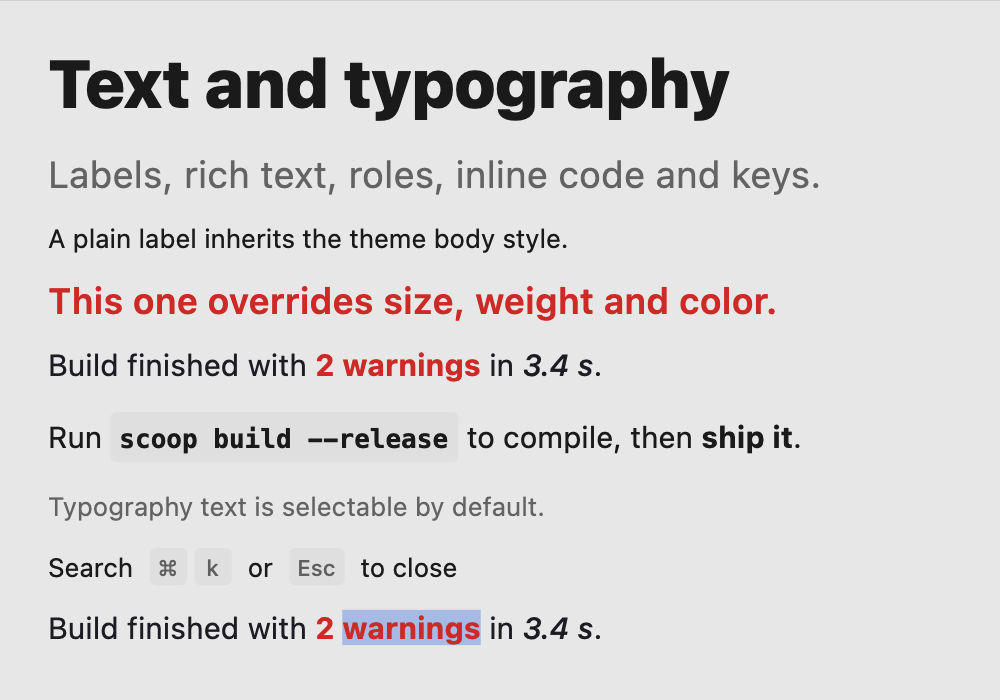
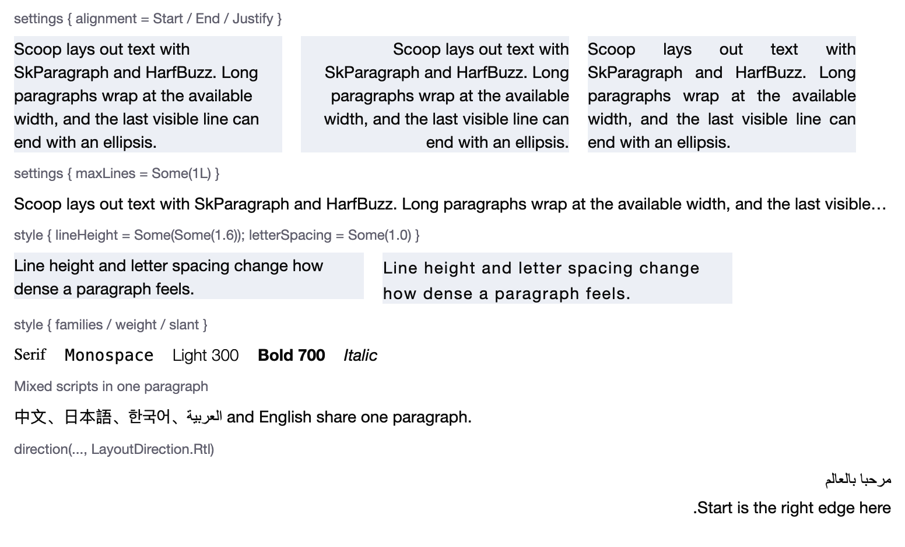
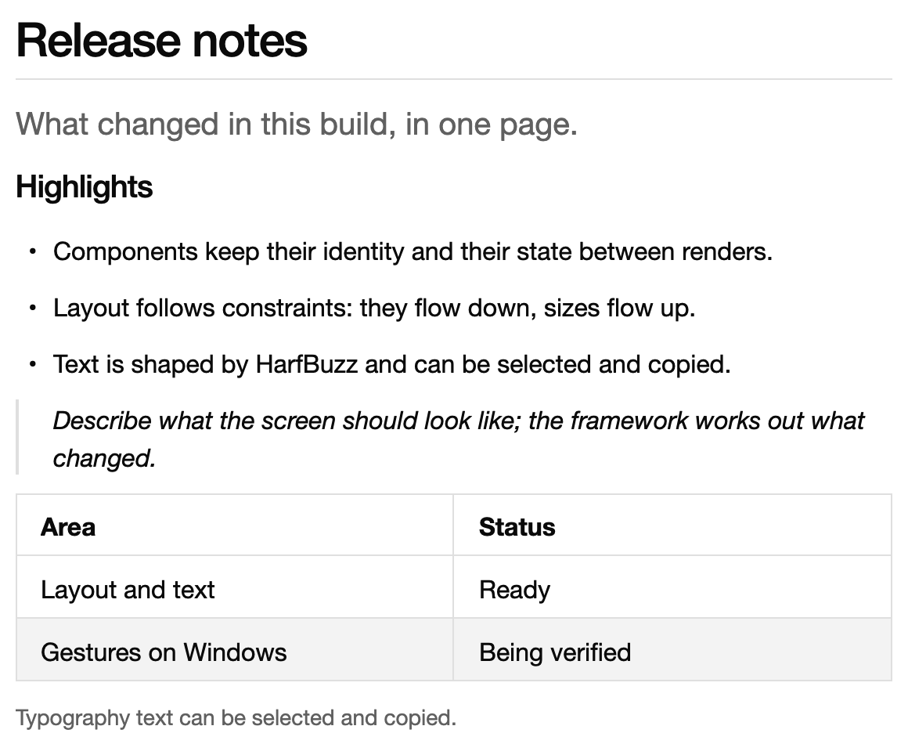
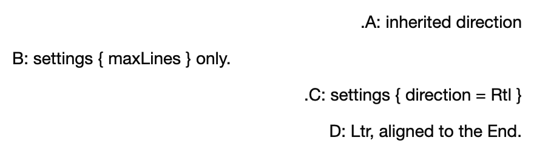

# 第 7 章　文字与排版

几乎每个界面的主体都是文字。本章介绍显示文字的几种控件，以及控制字体、段落和书写方向的方法。读完本章，你会知道：

- `label` 怎样显示文字，`SpanStyle` 怎样局部修改字号、粗细、颜色和字体；
- 段落的对齐、最大行数、省略号和行高怎样设置；
- 怎样在一段文字中混合多种样式；
- `typography` 的排版角色、行内代码、列表和表格；
- 键帽 `kbd` 和 `kbdGroup` 怎样显示快捷键；
- 怎样让用户选择和复制文字；
- 怎样使用自己的字体文件；
- 多种文字混排，以及从右到左的段落要注意什么。

Scoop 的文字排版由 `scoop.graphics.text` 完成，它基于 SkParagraph、HarfBuzz 和 ICU，能正确处理中日韩文字、阿拉伯文、组合字符和 emoji。控件库在它之上提供了 Label、Typography 等现成的控件。

## 7.1　一页文字

先看一个包含各种文字控件的例子。保存为 `text.scoop`：

```scoop
{{#include ../../examples/ch07/text.scoop}}
```

```sh
scoop run text.scoop --release
```



窗口自上而下显示：粗大的 H1 标题、一行灰色导语、一行普通文字、一行红色加粗的大字、一段混合样式的构建提示（`2 warnings` 红色加粗，`3.4 s` 斜体）、一段带等宽行内代码的说明、一行灰色小字、一行带键帽的快捷键说明，最后再显示一次构建提示，这一次可以用鼠标选中：双击 `warnings`，它就被选中了，如图所示。下面逐项说明。

## 7.2　label 与 SpanStyle

`label(text)` 显示普通文字，默认使用当前主题的正文样式。尾随块中的 `style { ... }` 构造一个 `SpanStyle`，只覆盖其中明确设置的属性，其余的继续沿用主题：

```scoop
label("This one overrides size, weight and color.") {
    style {
        fontSize = Some(18.0)
        weight = Some(600)
        color = Some(accent)
    }
}
```

`SpanStyle` 的每个属性都是可选值，`None` 表示继承：

| 属性 | 类型 | 说明 |
| --- | --- | --- |
| `families` | `Array<String>?` | 字体族列表，按顺序查找，例如 `Some(["serif"])` |
| `fontSize` | `Double?` | 字号，逻辑像素 |
| `color` | `Color?` | 文字颜色 |
| `weight` | `Int?` | 字重，400 为常规，700 为粗体 |
| `width` | `Int?` | 字宽（用于有多种宽度的字体） |
| `slant` | `FontSlant?` | `Upright`、`Italic` 或 `Oblique` |
| `letterSpacing`、`wordSpacing` | `Double?` | 字距、词距 |
| `lineHeight` | `Option<Option<Double>>` | 行高，字号的倍数；见 7.3 节 |
| `locale` | `String?` | 语言区域，影响某些文字的字形选择 |
| `features`、`variations` | 数组 | OpenType 特性和可变字体参数 |

Label 只用于展示：它不能被选择，也不参与 Tab 焦点。需要可选择的文字，用 7.6 节的 Typography 或 `selectableStyledText`；需要给表单控件加可以点击的标签，用 `fieldLabel`（第 13 章）。

## 7.3　段落设置

`settings { ... }` 设置段落的属性，类型是 `ParagraphStyle`：

| 属性 | 默认值 | 说明 |
| --- | --- | --- |
| `alignment` | `Start` | `Start`、`End`、`Center`、`Justify`，以及物理方向的 `Left`、`Right` |
| `direction` | `Ltr` | 段落的书写方向，`TextDirection.Ltr` 或 `Rtl`，见 7.9 节 |
| `maxLines` | 无限制 | 最多显示几行，例如 `Some(2L)` |
| `ellipsis` | `"…"` | 超过最大行数时，最后一行末尾显示的省略符号 |

下面的程序把段落和字体的常用设置放在一起，保存为 `paragraph.scoop`：

```scoop
{{#include ../../examples/ch07/paragraph.scoop}}
```



从上往下看：

**对齐。** 三段相同的文字分别设置为 `Start`、`End` 和 `Justify`。两端对齐会拉大词间距，让每一行都填满宽度，但最后一行保持左对齐。`Start` 和 `End` 是逻辑方向，在从右到左的段落中会翻转；`Left` 和 `Right` 是物理方向，不随书写方向变化。一般情况下用 `Start` 和 `End`。

**最大行数与省略号。** `maxLines = Some(1L)` 把长句截成一行，末尾显示 `…`。

**行高与字距。** 左右两段文字相同，右边设置了 `lineHeight = Some(Some(1.6))` 和 `letterSpacing = Some(1.0)`。行高是字号的倍数。`lineHeight` 的类型是 `Option<Option<Double>>`，因为局部样式要区分三种情况：`None` 表示继承，`Some(None)` 表示恢复字体自身的自然行高，`Some(Some(1.6))` 表示设为 1.6 倍。

**字体族、字重与倾斜。** `families = Some(["serif"])` 和 `Some(["monospace"])` 使用系统的衬线字体和等宽字体；`weight` 和 `slant` 分别设置粗细和斜体。`families` 是一个列表，排版时按顺序查找字体，前面的字体缺少某个字符时，再到后面的字体中查找。

**多种文字混排。** 中文、日文、韩文、阿拉伯文和英文写在同一个字符串里，不需要任何额外设置。排版引擎会为每种文字找到合适的字体，阿拉伯文也会按从右到左的顺序正确地连写。

最后两行是一个从右到左的段落，7.9 节专门讨论。

## 7.4　StyledText：一段文字里的多种样式

同一段文字中混合多种样式时，用 `scoop.graphics.text` 的 `styledText { ... }` 构造一个 `StyledText`，再用 `label(...)` 显示。`text.scoop` 中的构建提示就是这样写的：

```scoop
val notice = styledText {
    style {
        fontSize = 15.0
        color = Color(0.15, 0.15, 0.18)
    }
    text("Build finished with ")
    span {
        style {
            weight = Some(700)
            color = Some(accent)
        }
        text("2 warnings")
    }
    text(" in ")
    span {
        style { slant = Some(FontSlant.Italic) }
        text("3.4 s")
    }
    text(".")
}
```

- 最外层的 `style { ... }` 设置整段的基础样式，类型是完整的 `TextStyle`，所以 `fontSize`、`color` 等不是可选值。
- `text("...")` 追加一段使用当前样式的文字。
- `span { ... }` 追加一个片段，片段里的 `style` 是 `SpanStyle`，只覆盖部分属性。片段可以嵌套。

要注意，StyledText 自带完整的样式，**不会**继承主题的正文字体和颜色。例子显式写了字号和深色的文字颜色；切换到深色主题时，这段文字仍然是深色的，在深色背景上会看不清。需要跟随主题的富文本，优先使用下一节 `typography { ... }` 的写法：它的基础样式来自主题，块中的 `span` 只覆盖局部属性。

## 7.5　typography：排版角色

`typography(text, role)` 按**排版角色**显示文字，字号、行高、字重、颜色和装饰都由主题决定。`TypographyRole` 有这些取值：

| 角色 | 用途 | 默认的字号／行高、字重 |
| --- | --- | --- |
| `H1`、`H2`、`H3`、`H4` | 各级标题 | 36／40、800；30／36、600；24／32、600；20／28、600 |
| `P` | 正文段落（默认） | 16／28、400 |
| `Lead` | 导语 | 20／28，较浅的颜色 |
| `Large` | 强调 | 18／28、600 |
| `Small` | 小字 | 14／14、500 |
| `Muted` | 弱化的说明 | 14／20，较浅的颜色 |
| `Blockquote` | 引用 | 16／24，斜体，起始边有一条竖线 |
| `InlineCode` | 单独显示的代码片段 | 14／20、600，等宽字体，带底色 |

表中的数值是主题正文字号为 14 时的大小，主题的正文字号不同时按比例缩放。`H2` 下方带一条细线。

需要在一个段落中混排文字和行内代码时，使用 builder 形式：

```scoop
typography {
    text("Run ")
    code("scoop build --release")
    text(" to compile, then ")
    span {
        style { weight = Some(700) }
        text("ship it")
    }
    text(".")
}
```

`code(...)` 生成真正的行内代码块：等宽字体，带主题的代码底色，换行时作为一个整体移动。复制整段文字时，代码按普通文字复制。builder 形式的第一个参数仍然可以指定角色，例如 `typography(TypographyRole.Small) { ... }`。

Typography 与 Label 最大的区别是：Typography **默认可以选择和复制**，设置 `selectable = false` 可以关闭。

### 列表与表格

静态的列表和表格可以用 `typographyList` 和 `typographyTable` 排版。下面用各种排版角色拼出一页发布说明，保存为 `document.scoop`：

```scoop
{{#include ../../examples/ch07/document.scoop}}
```



- `typographyList { item("...") }` 生成带圆点的列表。`item` 也可以接受 `StyledText` 或任意 View，比如另一个列表，用来做嵌套列表。
- `typographyTable { ... }` 先用 `header { cell(...) }` 声明表头（最多一行，必须放在最前面），再用 `row { cell(...) }` 逐行添加。所有行的单元格数必须相同。默认各列平分宽度，也可以用 `columns` 指定第 5 章介绍的网格轨道。
- 表格中的文字同样可以选择。

这两个控件只负责静态排版。需要排序、选择、分页等交互的表格，用第 20 章的 `table` 和 `dataTable`。

## 7.6　键帽：kbd 与 kbdGroup

`kbd("Esc")` 把一段文字显示成一个键帽。显示快捷键时，更好的做法是使用 `scoop.window` 的 `ShortcutChord`：

```scoop
val searchChord = ShortcutChord(
    ShortcutKey.Logical(LogicalKey.Character("k")),
    ShortcutModifiers(primary = true)
)
```

`kbd(searchChord)` 用一个键帽显示整个组合，`kbdGroup(searchChord)` 则把每个键分成单独的键帽，`text.scoop` 用的是后者。键名按平台和当前的键盘布局显示：`primary = true` 在 macOS 上显示为 ⌘，在 Linux 和 Windows 上显示为 Ctrl。也可以用 `kbdGroup { kbd("↑"); kbd("↓") }` 自由组合。

键帽只负责显示，不会注册快捷键。真正响应按键，要用同一个 `ShortcutChord` 注册绑定，见第 14 章。这样显示的提示和实际的按键永远一致。

用到 `ShortcutChord` 时，别忘了为 `scoop.window` 写依赖声明。

## 7.7　可选择的文本

`selectableStyledText(content)` 显示一段 StyledText，用户可以拖动选择、双击选词，并用平台的快捷键全选和复制。它可以通过 Tab 获得键盘焦点，右键菜单提供复制和全选。`text.scoop` 的最后一行就是它，截图中双击选中了 `warnings`。

选择相关的配置写在尾随块中：`onSelectionChanged` 接收选区的变化；`actions` 和 `decorations` 可以给指定的文字范围加上可点击的动作或下划线，用来实现文字中的链接。Typography 内部使用同一个组件，所以 `typography(...)` 的块中也有这些配置项。

什么时候让文字可选择？一个简单的原则：**用户可能想复制的内容就让它可选择**，比如错误信息、文件路径、文档正文；按钮上的文字、标签、标题等界面元素通常不需要。

## 7.8　字体

默认情况下，界面使用主题指定的字体，系统中的字体作为后备：主题字体缺少某个字符（比如中文）时，排版引擎会自动从系统字体中找一个能显示它的。这由一个 `FontCollection`（字体集合）完成。`runUiApplication` 在没有指定字体时，会为窗口创建一个启用系统后备的字体集合，窗口中所有的文字控件共享它。

要使用自己的字体文件，比如品牌字体，可以自己创建字体集合，登记字体，再交给 `runUiApplication`：

```scoop
import scoop.compiler.includeBytes
import scoop.graphics.text.FontCollection

fun main() {
    FontCollection().use { fonts ->
        // The font file is embedded into the program at compile time.
        fonts.register(includeBytes("fonts/Brand.ttf"), "Brand")
        context(ThemeSource(shadcnTheme(ThemeMode.Light))) {
            runUiApplication("App", { scope -> App(scope) }, fonts = Some(fonts))
        }
    }
}
```

然后在需要的地方通过字体族名使用它：

```scoop
label("Headlines use the brand font.") {
    style {
        families = Some(["Brand"])
        fontSize = Some(28.0)
    }
}
```

几点说明：

- `includeBytes("fonts/Brand.ttf")` 在编译时把文件内容嵌入程序，路径相对于源码文件所在的目录。字体随程序一起分发，不依赖用户的机器上是否安装了它。
- `register(data, family)` 以给定的名字登记字体。名字只是一个别名，和字体文件内部记录的名称无关。一个文件包含多个字体时，用 `collectionIndex` 参数选择。
- `FontCollection()` 默认启用系统后备，登记的字体缺少的字符仍会从系统字体中查找。传入 `false` 可以关闭后备。
- `FontCollection` 持有原生资源，用 `use` 确保它在应用结束后关闭。传给 `runUiApplication` 的集合只是借给窗口使用，由你负责关闭。
- Label、Typography 等控件也有自己的 `fonts` 属性，可以为个别控件指定另一个字体集合。

本书没有附带字体文件。上面的代码在编写本章时，用一份系统自带的字体代替 `Brand.ttf` 做过验证。使用第三方字体时，请确认它的许可允许随程序分发。

## 7.9　从右到左的段落

第 5 章介绍过 `direction(content, LayoutDirection.Rtl)`。在 RTL 作用域里，段落默认也按从右到左排版：文字靠右，`Start` 指右边。但有两个细节，做本地化时经常让人困惑。下面的程序把它们放在一起，保存为 `rtl.scoop`：

```scoop
{{#include ../../examples/ch07/rtl.scoop}}
```



**第一个细节：英文句子的句号跑到了最左边。** A 行的文字是 `A: inherited direction.`，显示出来却是 `.A: inherited direction`。这不是错误，而是 Unicode 双向文字算法的正常结果：在从右到左的段落中，英文单词本身仍然从左到右排列，但句末的句号这类“中性”字符跟随段落的方向，被放在段落的逻辑末尾，也就是最左边。在阿拉伯语的界面里，翻译好的阿拉伯文本身就是从右到左的，不会有这个问题；问题出在 RTL 界面里显示以英文为主的字符串，比如还没有翻译的文字、文件名、代码。

**第二个细节：写了 `settings` 就不再继承方向。** B 行只设置了 `maxLines`，却变成了从左到右的段落，靠到了左边。原因是：不写 `settings` 时，Label 的段落继承所在作用域的方向；一旦写了 `settings { ... }`，就会从默认的 `ParagraphStyle` 开始配置，而默认的方向是 `Ltr`。

两个问题的处理方法：

- **需要在 RTL 作用域中修改段落设置时，同时写明方向**，如 C 行的 `direction = TextDirection.Rtl`。在组件里，可以用 `scope.layoutDirection.textDirection()` 取得当前作用域的方向，再赋给 `direction`。
- **在 RTL 界面中显示以英文为主的文字时**，把段落方向设为 `Ltr`，再用 `alignment = TextAlignment.End` 让它靠右，如 D 行。这样英文的标点位置正常，排列位置也符合 RTL 界面的习惯。

## 常见误用

- **用 Label 显示需要复制的内容。** Label 不能选择。用 Typography 或 `selectableStyledText`。
- **用 StyledText 做需要跟随主题的富文本。** StyledText 自带完整样式，深色主题下颜色不会变。用 `typography { ... }` 的 builder 形式。
- **用 `kbd` 显示快捷键，却忘了注册快捷键。** 键帽只负责显示，绑定要单独注册。
- **使用没有随程序分发的字体。** 用户的机器上未必有这个字体。用 `includeBytes` 嵌入并登记。
- **在 RTL 作用域里写了 `settings`，却没有写 `direction`。** 段落会悄悄变回从左到右。
- **以为 RTL 段落中英文标点的位置错了。** 这是双向算法的正常结果；以英文为主的段落设为 `Ltr` 并靠 `End` 对齐。

## 小结

- `label(text)` 显示文字，`style { ... }` 的 `SpanStyle` 只覆盖明确设置的属性；Label 不能选择，也不参与焦点。
- `settings { ... }` 设置段落的 `alignment`、`direction`、`maxLines` 和 `ellipsis`；`lineHeight` 是字号的倍数。
- `styledText { ... }` 在一段文字中混合多种样式，但不继承主题；需要跟随主题时用 `typography { ... }`。
- `typography(text, role)` 按排版角色显示文字，默认可以选择；`code(...)` 生成行内代码；`typographyList` 和 `typographyTable` 排版静态列表和表格。
- `kbd` 和 `kbdGroup` 显示键帽，`ShortcutChord` 按平台显示键名；键帽不注册快捷键。
- `selectableStyledText` 让用户选择和复制文字。
- 用 `FontCollection` 登记自己的字体，通过 `runUiApplication` 的 `fonts` 参数交给窗口，再用 `families` 引用。
- 在 RTL 作用域中，写 `settings` 时要同时写 `direction`；以英文为主的段落设为 `Ltr` 并靠 `End` 对齐。

## 练习

1. 把 `text.scoop` 的主题换成 `ThemeMode.Dark`，哪些文字看不清了？用 `typography { ... }` 改写构建提示，让它在深色主题下也能看清。
2. 在 `paragraph.scoop` 中给截断的长句加一个按钮：点击后在 `maxLines = Some(1L)` 和不限制行数之间切换。
3. 用 `typographyList` 写一个两级的嵌套列表。
4. 在 `document.scoop` 的表格中增加一列 `Owner`，并用 `columns` 让第一列占两份宽度、其余两列各占一份。
5. 把 `rtl.scoop` 的 B 行改成用 `scope.layoutDirection.textDirection()` 设置方向。提示：`sentences()` 需要写成一个组件，才能拿到 RTL 作用域里的 scope。
