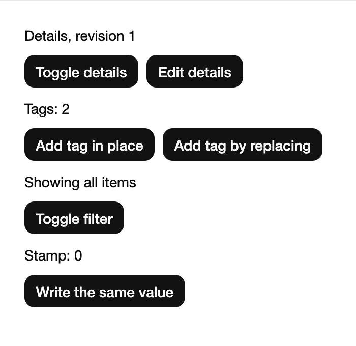

# 第 8 章　State 与依赖追踪

第 4 章从整体上介绍了“读取即依赖”和“写入先记账”两条规则。从本章开始的第三部分，我们深入状态与数据流：数据保存在哪里，怎样在组件之间传递，怎样在组件实例之间保持或丢弃。本章先把 State 本身讲透。读完本章，你会知道：

- `state(...)` 的两种写法，分别适合什么场合；
- 依赖是怎样收集的，为什么条件分支里的读取会让依赖“时有时无”；
- 状态里存的是可变对象时，为什么修改它界面不更新；
- 用 struct 保存状态有什么好处；
- 写入相同的值、连续写入时会发生什么；
- 派生值应该怎样计算；
- State 与线程的关系。

## 8.1　两种写法

`state(initial)` 创建一个 `State<T>`。在组件中有两种常见的写法：

```scoop
private val celsius = state(20)      // State<Int>; read and write celsius.value
private var edits: Int by state(0)   // delegated property; read and write edits directly
```

两种写法的行为完全相同，区别只在访问方式：

- **字段写法**拿到的是 State 对象本身。它可以被取到局部变量、传给其他对象或子组件、用来生成 Binding（第 9 章）。在 builder 块中修改状态时，这种写法最方便。
- **委托写法**读起来像普通属性，适合只在组件内部使用、不需要传出去的状态。注意 `val edits = this.edits` 取到的只是当前的值，不能用它来修改状态。

`state(...)` 每调用一次就创建一个新的状态对象，没有 React 的 hooks 或 Compose 的 `remember` 那样的“槽位”。所以它只应该出现在字段初始化、构造函数或普通对象里，**不能**写在 `render()` 中：那样每次 `render()` 都会得到一个全新的、初始值的状态。

State 也不限于组件。它是一个普通的对象，可以放在任何类里，被多个组件读取。第 3 章的 `CounterModel` 就是这样做的，第 10 章还会详细讨论。

## 8.2　一个会说话的例子

下面的程序把本章要讲的几种情况放在一起。四个子组件各读一个状态，每次 `render()` 都在终端打印一行；每个按钮被点击时也先打印一行，说明它做了什么。保存为 `dependencies.scoop`：

```scoop
{{#include ../../examples/ch08/dependencies.scoop}}
```

```sh
scoop run dependencies.scoop --release
```



所有的状态都放在 `DemoModel` 里，四个子组件通过构造函数拿到同一个模型。根组件 `DependencyDemo` 自己不读任何状态，所以下面的实验中它不会重新 `render()`。启动时终端会打印两轮 `render`，原因第 4 章解释过：根组件读取了主题和窗口的显示偏好。

## 8.3　依赖每次重新收集

`DetailsView` 的 `render()` 是这样写的：

```scoop
val text = if (model.open.value) f"Details, revision ${model.details.value}" else "Collapsed"
```

刚启动时 `open` 为 false，这次 `render()` 只读了 `open`，没有读 `details`。这时点击 Edit details，终端只打印：

```text
-- edit details
```

`details` 的值已经从 1 变成了 2，但 `DetailsView` 没有依赖它，所以没有重新 `render()`。接着点 Toggle details，再点 Edit details：

```text
-- toggle details
render  details
-- edit details
render  details
```

`open` 变为 true 之后的那次 `render()` 读了 `details`，`details` 就成了依赖，之后修改它就会引起重新 `render()`。

这就是“依赖每次重新收集”：每次 `render()` 结束后，框架都按**这一次**实际读取的状态更新依赖关系，不再读取的解除订阅，新读取的加上订阅。这个机制是自动且精确的，你不需要手动声明依赖，也不会因为“多声明了依赖”而浪费工作。

它也意味着一个推论：`render()` 中通过 `if`、`when` 或提前 `return` 跳过的读取，不会成为依赖。这通常正是你想要的。收起的详情面板不必关心详情内容的变化，展开时自然会读到最新的值。

## 8.4　可变对象：原地修改不会通知任何人

`TagsView` 显示 `model.tags.value.size`。`tags` 的类型是 `State<ArrayList<String>>`，状态里存的是一个**可变**列表。点击 Add tag in place：

```text
-- add tag in place
```

什么也没有发生，界面仍然显示 `Tags: 0`。这个按钮执行的是 `model.tags.value.add("tag")`：先读出列表，再往列表里添加一个元素。整个过程只调用了状态的 getter，没有调用 setter，框架无从得知列表的内容变了。

再点击 Add tag by replacing：

```text
-- add tag by replacing
render  tags
```

这次复制了一份新列表，加入新元素后整体赋给 `model.tags.value`，setter 被调用，`TagsView` 重新 `render()`，界面显示 `Tags: 2`。注意是 2 而不是 1：前一次原地添加的元素其实已经加进去了，只是当时没有人知道。

这是使用 State 时最常见的错误。规则很简单：**State 只在 `value` 被赋值时发出通知。** 修改它所指向的对象的内部，无论是往列表里添加元素，还是给一个 class 的 `var` 属性赋值，都不会通知任何人。有两种正确的做法：

- **整体替换。** 像 Add tag by replacing 那样构造一个新值赋给 `state.value`。状态里存的最好是不可变的 `Array`，这样根本无法原地修改，也就不会犯错。
- **让内部的字段本身也是状态。** 第 10 章的阅读清单中，每本书的进度都是一个单独的 State，修改某本书的进度只更新显示它的那一行。

> **从其他框架过来**
>
> React 的 `useState` 同样要求替换而不是修改对象，但 React 会比较新旧引用，相同的引用不会触发重新渲染。Scoop 不做比较，赋值就通知，所以把同一个列表对象原地修改后再赋回去（`tags.value = tags.value`）也能触发更新。不过这种写法很容易漏掉，不推荐。

## 8.5　struct：天然适合做状态

`FilterView` 显示的是一个 struct：

```scoop
struct Filter(val text: String, val onlyOpen: Boolean)
```

struct 是值类型，构造之后不能修改，所以“原地修改”在它身上根本不可能发生。要改变其中一个字段，用副本更新表达式构造一个新值：

```scoop
val current = model.filter.value
model.filter.value = current.{onlyOpen: !current.onlyOpen}
```

`current.{onlyOpen: ...}` 复制 `current` 的全部字段，只替换 `onlyOpen`。点击 Toggle filter，终端打印 `render  filter`，界面切换为 `Showing open items`。

把一组相关的设置放进一个 struct，再用一个 State 保存它，是很常见的做法：读写都是整体进行的，不会遗漏通知，也容易在测试中比较。

## 8.6　每次赋值都会通知

`StampView` 显示 `stamp` 的值。点击 Write the same value，它执行的是 `model.stamp.value = model.stamp.value`，值没有任何变化：

```text
-- write the same value
render  stamp
```

`StampView` 照样重新 `render()` 了。框架不比较新旧值是否相等：任意类型的值都可以放进 State，并不是每种类型都能比较相等，比较本身也有代价。所以**每次合法的赋值都会发出通知**。

如果某个状态的赋值很频繁，而新值又经常和旧值相同（比如在鼠标移动的回调里写入“是否悬停”），可以在赋值前自己判断一下：

```scoop
if (hovered.value != inside) hovered.value = inside
```

## 8.7　连续写入与派生值

第 4 章已经看到，同一个回调里的多次写入只会引起一次 `render()`。写入的新值是立即生效的，后面的代码读到的就是新值；只是 UI 的更新被合并到回调结束之后。

需要从一个状态派生出另一个值时，直接在 `render()` 中计算，或者写成模型的计算属性：

```scoop
val canDecrement: Boolean
    get() = count.value > 0
```

不要为派生值再建一个 State，然后在 `render()` 或某个回调里“同步”它。这样不仅多了一份需要保持一致的数据，而且在 `render()` 中写入状态会直接抛出异常：

```text
State cannot change during render, measure, scene or draw
```

第 9 章会介绍另一种派生方式：派生的 Binding，它既能读也能写。

## 8.8　State 与线程

State 绑定创建它的线程，只能在这个线程上读写。界面中的组件和模型都在 UI 线程上创建，所以后台线程不能直接写入它们。后台线程完成工作后，要把结果投递回 UI 线程再写状态，第 29 章会详细介绍。

这条规则也意味着 State 不需要任何锁：所有的读写、依赖收集和通知都发生在同一个线程上。

## 常见误用

- **在 `render()` 中调用 `state(...)`。** 每次都得到一个新状态。状态在字段初始化或模型中创建。
- **原地修改状态中的可变对象。** 往 `ArrayList` 里添加元素、修改 class 的 `var` 属性，都不会通知。整体替换 `state.value`，或者让内部字段也成为 State。
- **用 `val x = this.x` 取出委托属性，然后试图修改它。** 委托写法取到的是值，不是状态对象。需要传出去或修改时用字段写法。
- **为派生值单独建一个 State。** 直接计算，或者用计算属性、派生 Binding。
- **在 `render()` 中写状态。** 运行时抛出异常。修改放进回调或生命周期方法。
- **在后台线程写状态。** 先投递回 UI 线程。

## 小结

- `state(initial)` 创建 `State<T>`；字段写法拿到状态对象，委托写法像普通属性一样读写。
- 依赖在每次 `render()` 后按实际读取的状态重新收集；条件分支中没有执行的读取不是依赖。
- State 只在 `value` 被赋值时通知；原地修改可变对象不会通知。优先在 State 中保存不可变的 `Array` 和 struct，用整体替换和副本更新改变它们。
- 每次赋值都会通知，即使新旧值相等；同一回调中的多次写入合并为一次更新。
- 派生值直接计算，不要另存为 State；`render()` 中不能写状态。
- State 只能在创建它的线程上读写。

## 练习

1. 在 `dependencies.scoop` 中，先点两次 Add tag in place，再点一次 Add tag by replacing，界面上会显示几个标签？先预测，再运行验证。
2. 把 `DemoModel.tags` 改成 `state<Array<String>>([])`，再试着写出 Add tag in place 的代码。编译器会怎么说？
3. 给 `Filter` 增加一个字段 `sortByDate: Boolean`，并添加一个按钮切换它。只用副本更新表达式完成。
4. 修改 `DetailsView`，让它在收起时也显示详情的修订号。这时在收起状态下点击 Edit details，终端会打印什么？
5. 给 `DemoModel` 增加一个计算属性 `summary`，组合 `open`、`tags` 和 `stamp` 的值，再写一个读取它的组件。哪些按钮会让这个组件重新 `render()`？
