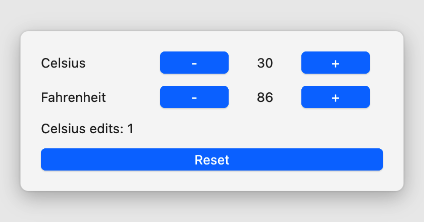
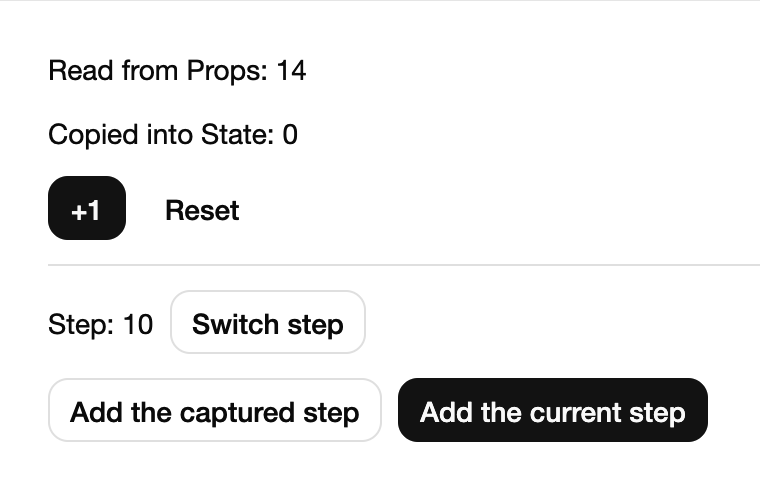

# 第 9 章　组件之间传值：Props 与 Binding

上一章的状态都放在一个模型对象里，子组件通过构造函数拿到它。但很多时候，父组件需要把**会变化**的数据交给子组件，子组件也需要修改父组件的数据。本章介绍完成这两件事的标准方式：Props 和 Binding。读完本章，你会知道：

- 构造参数和 Props 有什么区别，各自适合传递什么；
- 怎样用 Props 把变化的数据交给子组件；
- 子组件怎样通过 Binding 修改不属于自己的值；
- 怎样用派生 Binding 实现“读写都要换算”的值；
- 两个常见的错误：把 Props 复制进本地状态，以及在长期保存的回调里用了旧的输入。

## 9.1　构造参数与 Props

组件的构造函数只在挂载时调用一次。之后无论父组件 `render()` 多少次，同一个实例的构造参数都不会再变。所以构造参数只适合传递**整个生命周期内都不变**的东西，比如第 3 章交给视图的模型对象。

需要变化的输入，用 `Props<P>` 传递：

```scoop
add(component(StepperProps("Celsius", counted, 5), { p, s -> Stepper(p, s) }))
```

`component(props, create, key)` 的第一个参数是这次要传给子组件的值，第二个参数是工厂函数，只在首次挂载时调用。子组件的构造函数接收一个 `Props<P>`：

```scoop
class Stepper(private val props: Props<StepperProps>, scope: ComponentScope) : Component(scope) {
    public override fun render(): View {
        val input = props.value
        // ...
    }
}
```

`props.value` 始终是父组件**最近一次** `render()` 传入的值。父组件重新 `render()` 时，框架保留同一个 `Stepper` 实例，先把 `props.value` 换成新值，再调用它的 `render()`。Props 是只读的，子组件不能修改它。

不需要输入时，用不带 Props 的 `component(create, key)`，例如 `component({ s -> Summary(s) })`。

## 9.2　温度换算器

下面的程序有两个调节器，一个调摄氏度，一个调华氏度，但只有一份真实的数据。保存为 `temperature.scoop`：

```scoop
{{#include ../../examples/ch09/temperature.scoop}}
```

```sh
scoop run temperature.scoop --release
```



窗口中央是一张卡片：Celsius 一行显示 20，Fahrenheit 一行显示 68，下面是编辑计数和一个 Reset 按钮。

- 点 Celsius 的 `+`，摄氏度加 5，两行分别变为 25 和 77，编辑计数变为 1。
- 再点 Fahrenheit 的 `+`，华氏度加 9 变为 86，摄氏度随之变为 30，编辑计数仍然是 1。上图就是这时的样子。
- 点 Reset，回到 20 和 68。

两个 `Stepper` 实例完全相同，区别只在父组件交给它们的 `StepperProps`：标题、步长，以及一个 `Binding<Int>`。

## 9.3　Binding：读写别人的值

`Binding<T>` 是一对读写函数。它本身不保存任何值，读取和写入都转交给背后真正的数据。有两种方式得到一个 Binding：

- `state.binding()`：直接读写这个 State；
- `binding(get = { ... }, set = { next -> ... })`：自己定义读写的逻辑。

例子中的两个 Binding 都是自定义的：

```scoop
val fahrenheit = binding(
    get = { celsius.value * 9 / 5 + 32 },
    set = { next -> celsius.value = (next - 32) * 5 / 9 }
)
val counted = binding(
    get = { celsius.value },
    set = { next ->
        celsius.value = next
        this.edits += 1
    }
)
```

`fahrenheit` 是一个**派生 Binding**：读取时把摄氏度换算成华氏度，写入时再换算回来写入 `celsius`。`counted` 读写的都是摄氏度本身，只是在写入时顺带把编辑次数加一。

`Stepper` 只知道自己拿到了一个 `Binding<Int>`，不知道背后是一个 State、一段换算，还是别的什么。它的按钮这样修改值：

```scoop
button("+", { value.value += input.step })
```

这就是 Binding 的价值：**数据只有一份**。子组件不保存“自己的温度”，也就不需要想办法和父组件同步。摄氏度和华氏度永远一致，因为华氏度根本不是一份独立的数据。

几点说明：

- Binding 的 getter 在 `render()` 中执行时，它读到的状态同样会成为依赖。`Stepper` 读 `value.value`，实际读的是 `celsius`，所以摄氏度变化时，两个 `Stepper` 都会更新。
- Binding 也遵守 State 的规则：背后如果是一个普通的 `var` 字段，读写都不会通知任何人，界面不会更新。
- 控件库中，凡是用户可以修改的值都通过 Binding 传入，比如 `checkbox(done.binding())`、`switchControl(enabled.binding())`。用户操作控件时，控件直接写回你的状态。第 13 章会大量使用这种写法。

## 9.4　两个陷阱

下面的程序故意写了两个错误，并在旁边放上正确的写法作对比。保存为 `props_pitfalls.scoop`：

```scoop
{{#include ../../examples/ch09/props_pitfalls.scoop}}
```



### 陷阱一：把 Props 复制进本地状态

点三次 `+1`。上面一行 `Read from Props` 变成了 3，下面一行 `Copied into State` 却一直是 0。

`CopyingView` 在字段初始化时写了 `state(props.value)`：用当时的输入作为初始值，创建了一个自己的状态。字段初始化只在构造时执行一次，之后父组件传来的新值虽然进了 `props.value`，`CopyingView` 却再也不看它，只显示自己那份早已过时的副本。

正确的做法是 `ReadingView` 那样，每次 `render()` 都直接读 `props.value`。如果子组件需要修改这个值，父组件应该传一个 Binding，而不是让子组件复制一份。

有时候你确实需要一个“以父级的值为起点、之后独立编辑”的本地状态，比如一个编辑表单的草稿。这时要明确地处理“父级的值变了怎么办”：常见的做法是给子组件换一个 key（第 11 章），让它带着新的初始值重新挂载。

### 陷阱二：长期保存的回调用了旧的输入

点 Switch step，步长从 1 变为 10。再点 Add the captured step，计数只加了 1；点 Add the current step，计数加了 10。上图是依次点击这两个按钮之后的状态：3 + 1 + 10 = 14。

`StepButtons` 的两个回调都保存在字段里，只在构造时创建一次：

```scoop
private val firstStep = props.value.step
private val stale: () -> Unit = { props.value.add(firstStep) }

private val current: () -> Unit = { props.value.add(props.value.step) }
```

`stale` 使用的 `firstStep` 是构造时读到的步长，之后永远是 1。`current` 每次被调用时才读 `props.value.step`，读到的总是父组件最新传入的值。

把回调保存在字段里本身并没有错，它们在多次 `render()` 之间保持不变，是一种常用的写法。工具链的 `ui/state` 示例就是这样写的：`private val increment: () -> Unit = { props.value.increment() }`。规则是：**Props 是“当前输入”的入口，不是某个时刻的快照。** 回调要在执行时读取 `props.value`，而不是提前把值取出来存着。

反过来，如果你确实需要“某个时刻的值”，比如启动一个耗时任务时，要用启动那一刻的参数，就在那一刻把需要的值复制到局部的 `val` 里。

同样的道理也适用于 `render()` 中取出的值。`render()` 开头写 `val value = input.value.value`，用来**显示**没有问题；但在回调里根据它计算新值，比如 `{ binding.value = value + 1 }`，就有可能在两次 `render()` 之间用到旧值。直接写 `{ binding.value += 1 }`，让计算在回调执行时读取当前值。

## 9.5　选择传递方式

到这里，我们已经见过三种把东西交给子组件的方式。下一章还会介绍第四种：Context。

| 方式 | 适合传递 | 例子 |
| --- | --- | --- |
| 构造参数 | 整个生命周期内不变的对象 | 第 3 章交给视图的模型 |
| Props | 每次 `render()` 都可能变化的只读输入 | 标题、要显示的任务、步长 |
| Props 中的 Binding | 子组件可以修改的值 | 调节器的数值、复选框的勾选状态 |
| Context | 很多层组件都要用、逐层传递很繁琐的依赖 | 主题来源、业务 Store（第 10 章） |

> **深入一点：跳过子组件的 render**
>
> 第 4 章提到，父组件 `render()` 时，子组件默认会拿到新的 Props 并跟着 `render()`。`component(...)` 的最后一个参数可以是一个 `InputComparison<P>`，用来判断新旧 Props 是否等价；等价时，框架跳过这个子组件的 `render()`。比较规则要覆盖 `render()` 用到的全部输入，而且回调、Binding 等函数值通常无法比较。只有在性能分析确认某个子组件的 `render()` 确实是瓶颈时才考虑使用，第 32 章会举例。

## 常见误用

- **用构造参数传递会变化的值。** 构造函数只执行一次。用 Props。
- **把 Props 复制进本地状态。** 父组件的新值不会再生效。直接读 `props.value`，需要修改时传 Binding。
- **在字段中的回调里使用构造时取出的 Props 值。** 回调执行时读 `props.value`。
- **在回调里用 `render()` 时取出的值计算新值。** 用 `+=` 等在执行时读取当前值的写法。
- **让子组件持有一份“自己的”数据，再靠回调和父组件同步。** 数据只保留一份，用 Binding 让子组件直接读写它。
- **把 Binding 接到普通字段上。** 读写都不会通知，界面不会更新。

## 小结

- 构造参数只在挂载时传入一次，适合不变的对象；会变化的输入用 `component(props, create)` 传递，子组件通过 `props.value` 读取最新的值。
- Props 是只读的；子组件需要修改父组件的值时，父组件传入一个 `Binding<T>`。
- `state.binding()` 直接读写状态，`binding(get, set)` 自定义读写；派生 Binding 让多个视图共享一份数据。
- 不要把 Props 复制进本地状态。
- Props 是当前输入的入口，不是快照：长期保存的回调在执行时读取 `props.value`。

## 练习

1. 在温度换算器中增加一行开尔文（K = C + 273），步长为 1。只需要一个新的派生 Binding。
2. 把 `Stepper` 改成在 `render()` 开头取出 `val current = value.value`，按钮的回调写成 `{ value.value = current + input.step }`。程序还能正常工作吗？在什么情况下可能出问题？
3. 修改 `CopyingView`，让它在父组件的值变化时重新以新值开始。提示：在 `PropsDemo` 中给它一个随 `count` 变化的 key。
4. 给 `StepButtons` 增加一个“加两倍步长”的按钮，回调同样保存在字段里，并确保切换步长后结果正确。
5. 写一个 `ToggleRow` 组件，Props 中包含一个标题和一个 `Binding<Boolean>`，用 `checkbox(...)` 显示。在父组件中用三个 `ToggleRow` 编辑一个 struct 的三个布尔字段。提示：每个 Binding 的 setter 用副本更新表达式写回 struct。
