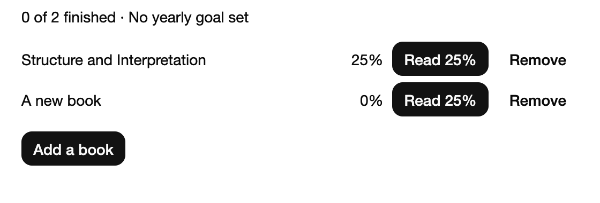

# 第 10 章　业务 Store 与 Context

界面稍微复杂一点，就会有多个互不相干的组件需要同一份数据：标题栏要显示总数，列表要显示每一项，工具栏要根据选中的项决定按钮能不能点。本章介绍怎样把这样的数据放进一个业务类（本书称为 **Store**），以及怎样用 Scoop 语言的 Context 把它交给需要的组件。读完本章，你会知道：

- 什么样的数据应该放进 Store，什么样的留在组件里；
- 怎样设计一个 Store，让更新尽可能精确；
- 怎样用 Context 注入 Store，避免一层层地传递；
- 可选的依赖怎样处理，缺少依赖时会发生什么；
- 组件持有的资源怎样跟随组件的生命周期。

## 10.1　一个阅读清单

保存为 `reading_list.scoop`：

```scoop
{{#include ../../examples/ch10/reading_list.scoop}}
```

```sh
scoop run reading_list.scoop --release
```



窗口中显示一个标题行和两本书。每本书有一个进度，点 Read 25% 推进四分之一；Remove 删除这本书；Add a book 在末尾添加一本新书。标题行统计已经读完的书和书的总数。

程序分成三层：

- **`Book` 和 `ReadingList` 是业务类。** 它们持有状态、提供操作，完全不知道界面的存在。
- **四个组件负责显示。** `ReadingApp` 是根，`Header` 显示统计，`BookList` 显示列表，`BookRow` 显示一本书。
- **`main` 负责组装。** 它创建 Store，用 Context 把它交给组件。

## 10.2　Store 是普通的类

`ReadingList` 没有继承任何东西，也没有引用任何 View：

```scoop
class ReadingList {
    val books = state<Array<Book>>(...)
    val finished: Int get() { ... }
    fun add(title: String) { ... }
    fun remove(id: Long) { ... }
}
```

- 数据保存在 State 里，所以读取它的组件会自动更新。
- 修改数据的操作写成方法，组件只调用方法，不直接修改状态。`add` 和 `remove` 都构造一个新的数组整体替换 `books.value`，遵守第 8 章的规则。
- 派生的数据写成计算属性，比如 `finished`。

把数据和规则放进这样的类，有几个直接的好处：多个组件可以共享同一份数据；业务规则集中在一个地方，不散落在各个按钮的回调里；可以不打开任何窗口就测试它（第 3 章、第 30 章）；它的生命周期也不受组件的影响，组件卸载了，数据依然在。

### 让更新尽可能精确

`Book` 的进度是它自己的一个 State：

```scoop
class Book(val id: Long, val title: String) {
    val progress = state(0)
    fun advance() { ... }
}
```

这样设计，修改一本书的进度只会通知读过**这本书的进度**的组件。点第一本书的 Read 25%，终端打印：

```text
render  header
render  row 1
```

只有标题行和第一行重新 `render()`。列表 `BookList` 没有重新 `render()`，因为 `books` 数组本身没有变；第二行也没有，因为它没读第一本书的进度。标题行重新 `render()`，是因为它通过 `finished` 读了每一本书的进度（第 4 章：间接读取也算）。

再点 Add a book：

```text
render  header
render  list
render  row 1
render  row 2
render  row 3
```

`books` 被替换，读过它的 `Header` 和 `BookList` 重新 `render()`；`BookList` 产生了新的描述，两个已有的行跟着 `render()`（第 4 章规则三），新的第三行被创建。根组件 `ReadingApp` 没有出现在输出中：它没有读 `books`。

如果把进度做成 `Book` 的一个普通字段，每次修改都要整体替换 `books` 数组，那么推进一本书的进度就会让整个列表和所有的行都重新 `render()`。对于几本书无所谓，对于几千条记录就不一样了。**把经常单独变化的部分做成单独的 State**，是设计 Store 时最重要的一条经验。

### 数据放在哪里

可以按“谁需要它”来决定：

| 数据 | 放在哪里 | 例子 |
| --- | --- | --- |
| 只有一个组件关心的界面细节 | 组件自己的 State | 面板是否展开、悬停状态、本地的星标 |
| 多个组件共享的数据 | Store | 书和进度、任务列表、当前用户 |
| 需要测试的业务规则 | Store | 进度不超过 100%、删除后统计更新 |
| 组件卸载后仍要保留的数据 | Store | 切换页签后要保留的草稿 |
| 由其他数据算出来的值 | Store 的计算属性，或直接在 `render()` 中计算 | 已读完的数量 |

拿不准时，先放进 Store。从 Store 挪回组件很容易，反过来则要改动所有读取它的地方。

## 10.3　用 Context 注入 Store

`Header`、`BookList`、`BookRow` 都需要同一个 `ReadingList`。逐层通过构造参数或 Props 传递当然可以，但层级多了会很繁琐，中间那些自己用不到 Store 的组件也被迫转手。例子改用 Scoop 语言的 Context：

```scoop
context(list: ReadingList)
fun currentReadingList(): ReadingList = list
```

`context(list: ReadingList)` 声明这个函数需要上下文中有一个 `ReadingList`。`main` 用 `context(list) { ... }` 安装它：

```scoop
fun main() {
    val list = ReadingList()
    context(ThemeSource(shadcnTheme(ThemeMode.Light))) {
        context(list) {
            runUiApplication("Reading list", { scope -> ReadingApp(scope) })
        }
    }
}
```

每个 `context(value) { ... }` 只安装一个值，需要多个依赖时就嵌套。主题来源 `ThemeSource` 和 `currentThemeSource()` 也是用同样的机制交给控件的。

组件在**字段初始化**时取得依赖：

```scoop
class Header(scope: ComponentScope) : Component(scope) {
    private val list = currentReadingList()
    // ...
}
```

`context(list) { ... }` 包住了整个 `runUiApplication(...)`，这个绑定在应用运行的全过程中都有效：框架创建组件、调用 `render()`、执行事件回调时，都能查到 `ReadingList`。尽管如此，惯用的写法仍是在字段初始化时取得一次，保存在字段里，`render()` 和回调都使用这个字段。要注意：

- **在字段初始化时取得一次。** 这样组件依赖什么一目了然，也不必在每次 `render()` 和回调中重复查找。组件拿到的始终是创建它时的那个 Store。
- **Context 不会被捕获。** 普通的闭包、函数引用和 View 描述都不会记住创建它们时的 Context。如果在某个临时的 `context(x) { ... }` 块中创建了一个 View 或回调，等到块结束之后再挂载或调用它，就查不到 `x`。一个 View 在哪里挂载，它的组件就在那里查找 Context。
- **不同的窗口需要不同的依赖时**，在各个窗口实际挂载的入口分别安装，或者干脆显式地传递模型（第 27 章）。
- **Context 适合传递依赖，不适合传递数据。** Store 本身是一个长期存在的对象，通过 Context 交给组件；Store 里面会变化的数据，组件通过读取 State 获得。不要用 Context 去传一个会变化的值。重新安装一个 Context 不会通知任何人，也不会替换组件已经保存的字段。

## 10.4　可选的依赖与缺失的依赖

`Header` 还用到了一个可选的依赖：

```scoop
private val goal = contextOrNone<ReadingGoal>()
```

`contextOrNone<T>()` 在上下文中有 `T` 时返回 `Some(value)`，没有时返回 `None`，不会出错。`T` 必须是引用类型，即 class。例子的 `main` 没有安装 `ReadingGoal`，所以标题行显示 `No yearly goal set`。

相反，`currentReadingList()` 这样声明了 `context(list: ReadingList)` 的函数，在上下文中找不到 `ReadingList` 时会抛出 `MissingContextException`。第 2 章已经见过这个异常：忘了安装主题来源时，程序一启动就以它退出。

一个经验做法：**应用离不开的依赖用 `context(...)` 函数获取，缺了就应该立刻失败；锦上添花的依赖用 `contextOrNone`，并给出合理的默认行为。**

## 10.5　组件持有的资源

有些东西属于某个组件，组件在它就在，组件卸载它就该消失，比如这个组件注册的快捷键。工具链的 `ui/state` 示例在 `onMount()` 中注册了一个快捷键：

```scoop
public override fun onMount() {
    // The component owns the shortcut registration until it unmounts.
    scope.resource {
        ShortcutScope(scope.input, [shortcutBinding(chord, { model.add() })])
    }
}
```

`scope.resource { ... }` 创建一个资源并把它登记到组件的 scope 上，组件卸载时，框架自动关闭它。用 `scope.onDispose { ... }` 可以登记任意的清理动作。这样你不需要自己在 `onUnmount()` 里记着关闭什么，也不会因为忘了关闭而泄漏。完整的示例可以用 `scoop example ui/state` 查看，快捷键的细节见第 14 章。

注意这个快捷键的回调 `{ model.add() }` 在执行时才调用模型的方法，读到的总是当前的数据。这和第 9 章“长期保存的回调要在执行时读取当前值”是同一条规则。

## 常见误用

- **把多个组件共享的数据放在其中一个组件里。** 其他组件拿不到，或者只能通过层层回调去改。放进 Store。
- **把列表中每一项的可变数据都塞进一个大数组。** 修改一项就要替换整个数组，所有行都重新 `render()`。把经常单独变化的部分做成单独的 State。
- **在临时的 `context(x) { ... }` 块中创建 View 或回调，到块外再使用。** 闭包和 View 描述不捕获 Context，块外查不到 `x`。让 Context 绑定覆盖实际挂载和执行的过程，比如包住整个 `runUiApplication`。
- **用 Context 传递会变化的值。** Context 传依赖，变化的数据放在依赖里的 State 中。
- **在 Store 里引用 View 或组件。** Store 应该不知道界面的存在，这样它才能被测试、被多个界面复用。
- **忘了关闭组件注册的资源。** 用 `scope.resource { ... }` 或 `scope.onDispose { ... }` 让框架在卸载时处理。

## 小结

- 多个组件共享、需要测试、需要在组件卸载后保留的数据，放进一个普通的业务类（Store）；只有一个组件关心的界面细节，留在组件的 State 中。
- Store 用 State 保存数据，用方法修改数据，用计算属性派生数据，不引用任何 View。
- 把经常单独变化的部分做成单独的 State，修改它只更新读取它的组件。
- 用 `context(store) { ... }` 包住运行入口来安装依赖，用 `context(x: T)` 函数在组件的字段初始化时取得；找不到时抛出 `MissingContextException`。闭包和 View 描述不会捕获 Context。
- 可选的依赖用 `contextOrNone<T>()`，并提供默认行为。
- 组件持有的资源用 `scope.resource { ... }` 或 `scope.onDispose { ... }` 登记，卸载时自动清理。

## 练习

1. 在 `main` 中安装一个 `ReadingGoal(12)`，观察标题行的变化。
2. 给 `ReadingList` 增加一个 `markAllFinished()` 方法，把每本书的进度设为 100，并在根组件中增加一个按钮调用它。点击时终端会打印哪些 `render`？
3. 把 `Book.progress` 改成 `Book` 的一个普通 `val progress: Int` 字段，`advance` 改为在 `ReadingList` 中用新的 `Book` 替换数组中的旧对象。再点 Read 25%，终端的输出有什么不同？
4. 为 `ReadingList` 写几个测试：添加后数量加一、删除后数量减一、所有书都读完后 `finished` 等于总数。提示：参考第 3 章，把程序改写成 Cone。
5. 去掉 `main` 中的 `context(list) { ... }`，运行程序，观察会发生什么。
