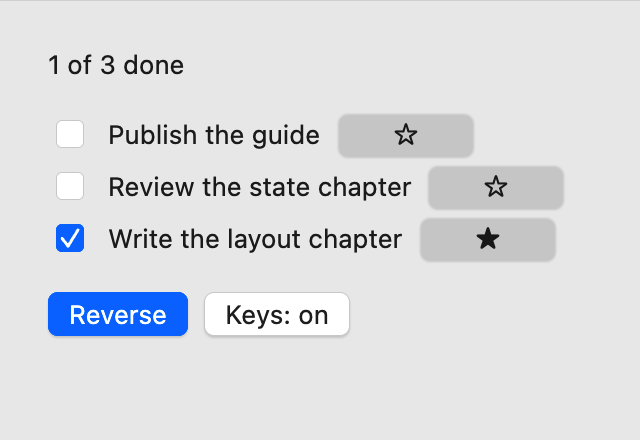
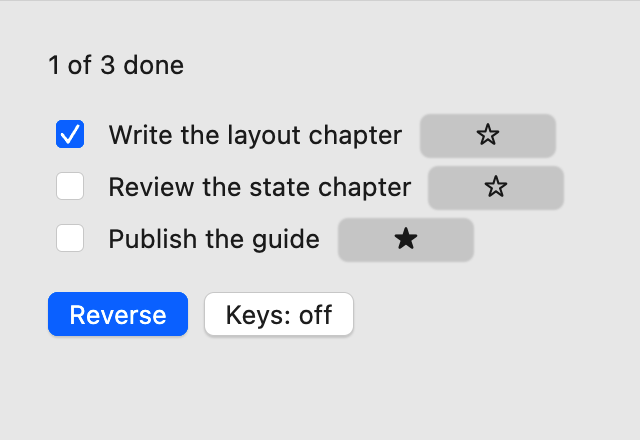
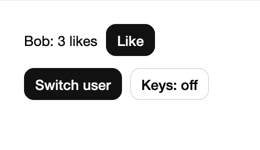

# 第 11 章　组件身份与 key

第 4 章介绍过协调的规则：同一父级下，key 和类型都相同的描述会保留原来的实例，否则卸载旧实例、创建新实例。规则本身很短，但它决定了本地状态是留下还是丢失，是跟着数据走还是留在原地。本章用两个例子把这些后果看清楚。读完本章，你会知道：

- 列表重新排序时，为什么本地状态会“错位”，key 怎样解决它；
- `if`、`else` 两个分支放了同一种组件时，为什么状态会“串”到另一个对象上；
- 怎样有意地用 key 丢弃一棵子树的状态；
- 关于 key 的几条约束。

## 11.1　匹配的规则

先回顾一下第 4 章的表格：

| 情况 | 结果 |
| --- | --- |
| 同一个显式 key，同一种类型 | 保留原实例，只替换 Props；它在兄弟之间移动了位置也没关系 |
| 没有显式 key，位置相同，类型相同 | 保留原实例 |
| key 或类型变了 | 卸载旧实例，创建新实例 |
| 从描述中消失，或者换到了另一个父级下 | 卸载；以后再出现时是新实例 |

key 的类型是 `ViewKey`，有三个取值：

- `ViewKey.Position`：默认值，按在兄弟中的位置配对；
- `ViewKey.Text("...")`：按一个字符串配对；
- `ViewKey.Number(...)`：按一个 `Long` 配对。

key 写在 `component(props, create, key)` 的最后一个参数里，大多数控件的配置块中也有 `key` 属性。

## 11.2　列表重排：本地状态跟谁走

保存为 `keys.scoop`：

```scoop
{{#include ../../examples/ch11/keys.scoop}}
```

```sh
scoop run keys.scoop --release
```

窗口中是三条任务，每条前面有一个复选框，后面有一个星标按钮。顶部显示完成的数量，底部是 Reverse 和 Keys 两个按钮。

两种状态放在了不同的地方：

- **完成状态**保存在 `TaskStore` 里，通过 Props 和 Binding 交给每一行；
- **星标**是 `TaskRow` 组件自己的本地状态 `starred`。

每一行的 key 由 `TaskList` 决定：`Keys: on` 时是 `ViewKey.Number(task.id)`，`Keys: off` 时是 `ViewKey.Position`。

按下面的步骤操作：

1. 保持 `Keys: on`。勾选第一条任务 “Write the layout chapter”，再点亮它的星标，然后点 Reverse。任务的顺序反了过来，这条任务移到了最后一行，勾选和星标都跟着它走了：

   

   每一行的 key 是任务的 id，所以每个 `TaskRow` 实例跟着自己的任务移动，它的本地状态也一起移动。

2. 点 `Keys: on`，切换为 `Keys: off`。星标全部熄灭了，勾选却还在。key 从 `Number` 变成了 `Position`，框架认为这些都是新的组件，卸载了所有旧实例，再创建新实例，本地状态回到初始值。勾选保存在 Store 里，不受影响。

3. 点亮最后一行的星标，再点 Reverse。任务的顺序又反了过来，星标却留在最后一行，现在亮在 “Publish the guide” 上：

   

   按位置配对时，第三个 `TaskRow` 实例还是那个实例，只是 Props 换成了另一条任务。它的星标属于实例，不属于任务。

复选框在两种模式下都正确，因为完成状态保存在 Store 中，通过 Props 传入。出错的只是存放在组件实例中的星标。由此可以得出两条规则：

- **列表项可能插入、删除或重新排序，并且项中有本地状态（展开状态、输入框内容、焦点、动画）时，用来自数据的稳定标识作为 key，** 例如数据库的 id。不要用数组下标作 key，它和 `Position` 没有区别。
- **更稳妥的做法是不在列表项里保存重要的状态。** 星标如果放进 Store，像完成状态一样通过 Props 传入，无论用不用 key 都不会出错。本地状态只留给那些丢了也无所谓的界面细节。

第 10 章的阅读清单也用了 `ViewKey.Number(book.id)`。删除第二本书之后，第一本和第三本书的实例都被保留下来，没有因为位置变化而重建。

## 11.3　条件分支：状态串到了另一个对象上

列表之外，还有一种更隐蔽的情况。保存为 `branches.scoop`：

```scoop
{{#include ../../examples/ch11/branches.scoop}}
```

窗口里显示一张 Alice 的资料卡，带一个 Like 按钮，点一下点赞数加一。Switch user 在 Alice 和 Bob 之间切换。关键在这一行：

```scoop
if (showAlice.value) add(alice) else add(bob)
```

两个分支看起来是两个不同的组件，但在框架看来，它们是**同一个位置上的同一种组件**：类型都是 `Profile`，Props 的类型都是 `String`，key 都是默认的 `Position`。

保持 `Keys: off`，给 Alice 点三个赞，再点 Switch user：



Bob 一个赞都没收到，却显示 `Bob: 3 likes`。框架保留了原来的 `Profile` 实例，只把 Props 从 `"Alice"` 换成了 `"Bob"`，点赞数作为实例的本地状态原封不动地留了下来。

这类错误在真实的应用中可能很严重，比如一个“编辑资料”表单在切换用户之后保留了上一个用户输入的内容。Scoop 的 `if`、`when` 没有隐含的“源码位置”身份，两个分支在同一位置返回相同类型和 key 的描述时，就会被当作同一个组件。

点 `Keys: off` 切换为 `Keys: on`。现在两个分支分别使用 `ViewKey.Text("Alice")` 和 `ViewKey.Text("Bob")`：

- 切换为 `Keys: on` 的一瞬间，key 从 `Position` 变成了 `Text("Bob")`，组件被重新挂载，显示 `Bob: 0 likes`。
- 给 Bob 点一个赞，再切换到 Alice，显示 `Alice: 0 likes`，不再串号。
- 再切回 Bob，显示 `Bob: 0 likes`，刚才的一个赞不见了。切走时 Bob 的组件被卸载，本地状态随之丢失。

最后这一点说明，key 只能决定“是不是同一个实例”，不能让一个已经卸载的实例保留状态。要让每个用户的点赞数都保留下来，就要把它放进 Store，以用户为单位保存，这又回到了第 10 章的结论。需要让暂时不显示的界面保持挂载时，一些容器提供了专门的选项，比如第 19 章的 Tabs 可以设置 `retention = ContentRetention.KeepMounted`。

## 11.4　有意地丢弃状态

反过来，换 key 也是一种工具：**想主动丢弃一棵子树的全部本地状态时，给它换一个 key。** 第 4 章的 Remount right 就是这样做的。常见的场合有：

- 切换到另一个对象的详情页，比如另一个用户、另一个文档，用对象的 id 作 key；
- 一个以父级的值为起点的草稿编辑器，父级的值变了要重新开始（第 9 章的陷阱一）；
- 一个动画或输入状态需要“复位”。

这样做比在组件里手动清空每一个字段可靠得多：新实例的字段从初始值开始，不会遗漏哪个状态。

## 11.5　关于 key 的几条约束

- **key 只在直接父级的子项之间有效。** 它不是全局的 id。把一个组件从一个父级移到另一个父级，即使 key 相同，也会重新挂载。
- **同一父级下的显式 key 必须互不相同。** 两个兄弟用了同一个 `ViewKey.Text("same")`，程序会以 `IllegalArgumentException` 退出，对应的消息是 `duplicate sibling ViewKey`。
- **混用显式 key 和默认的 Position 时，Position 按完整兄弟序列中的索引计算。** 在前面插入一个子项，会改变后面那些没有 key 的子项的位置。
- **工厂函数每次都必须创建新实例。** `{ p, s -> TaskRow(p, s) }` 每次挂载都会调用；不要把实例缓存起来重复返回，框架会拒绝把同一个实例挂载两次。
- **类型也是身份的一部分。** 同一位置上换成另一个组件类，或者 Props 的类型变了，都会重新挂载。

## 常见误用

- **用数组下标或默认位置标识会重排的列表项。** 本地状态会错位。用来自数据的稳定 key。
- **在 `if`、`else` 两个分支的同一位置放同一种组件，用来显示不同的对象。** 状态会串到另一个对象上。给每个分支一个对象自己的 key。
- **以为 key 能让卸载的组件保留状态。** 卸载就是丢弃。要保留的数据放进 Store。
- **在组件中手动清空一个个字段来“重置”。** 换一个 key，让组件重新挂载。
- **同一父级下出现重复的 key。** 程序会抛出异常。key 必须在兄弟之间唯一。

## 小结

- 同一父级下，key 和类型相同就保留实例及其本地状态，否则卸载重建。`ViewKey` 有 `Position`、`Text`、`Number` 三种。
- 会重排的列表项用来自数据的稳定 key；更稳妥的是不在列表项里保存重要状态。
- 条件分支没有隐含的身份：两个分支在同一位置放同类型的组件时，状态会串到另一个对象上；给每个分支一个自己的 key。
- key 只决定实例的身份，不能让卸载的实例保留状态；需要保留的数据放进 Store。
- 换 key 可以有意地丢弃一棵子树的本地状态。
- key 只在直接父级内有效，兄弟之间必须唯一；工厂函数每次都创建新实例。

## 练习

1. 在 `keys.scoop` 中，把星标从 `TaskRow` 的本地状态挪进 `Task` 和 `TaskStore`。之后无论 key 开还是关，Reverse 都不会让星标错位。
2. 给 `TaskStore` 增加一个“在最前面插入一条任务”的操作。在 `Keys: off` 时点亮第一行的星标再插入，星标会出现在哪里？`Keys: on` 时呢？
3. 修改 `branches.scoop`，用 Store 以用户名为单位保存点赞数，让切换用户后各自的点赞数都保留下来。
4. 在 `branches.scoop` 中把 Bob 的组件换成另一个类 `GuestProfile`（内容可以和 `Profile` 一样），在 `Keys: off` 时切换用户，点赞数还会串号吗？为什么？
5. 写一个组件，在同一个 `column` 中用 `component(..., ViewKey.Number(1L))` 添加两个子组件。运行时会发生什么？
