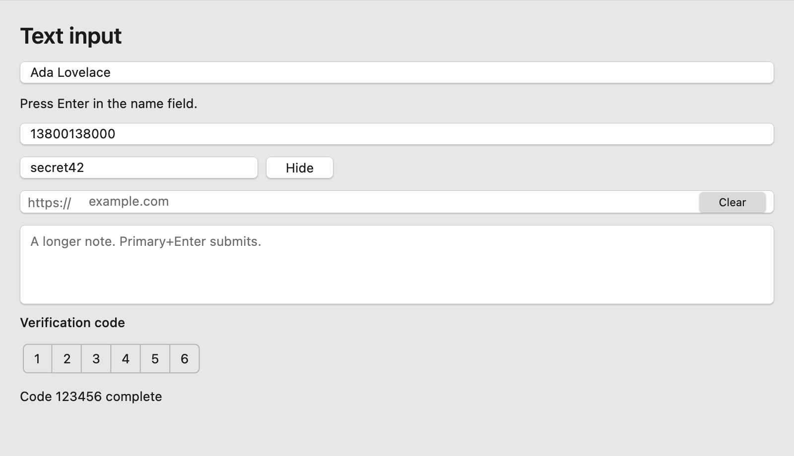

# 第 12 章　文本输入

前三部分的例子几乎只用按钮和文字。从本章开始的第四部分讨论用户怎样把信息交给程序：打字、选择、键盘操作、手势、复制粘贴和拖放。本章先讲文本输入。读完本章，你会知道：

- 为什么文本的编辑模型由你持有，而不是由输入框持有；
- `input` 和 `textarea` 的常用配置，回车提交是怎样工作的；
- 怎样用编辑策略限制长度、过滤内容、改写粘贴进来的文字；
- 密码框怎样同时做到“显示可切换”和“内容受保护”；
- 输入组和验证码输入；
- 输入用途、软键盘和文本上下文菜单。

## 12.1　一个文本输入的示例

下面的程序把常见的几种输入框放在一起。保存为 `text_inputs.scoop`：

```scoop
{{#include ../../examples/ch12/text_inputs.scoop}}
```

```sh
scoop run text_inputs.scoop --release
```

这个例子用的是 macOS 主题 `macosTheme`，控件的外观和前几章的 shadcn 主题不同。它改编自官网指南，在 builder 块中显式写出了 `this.`，作用和省略时完全相同（第 5.7 节）；`render()` 开头把各个字段取到局部变量里，原因见第 2 章：builder 块里不能隐式使用外层的接收者。

窗口中从上到下依次是：

- 姓名框，按回车后在下面显示问候；
- 手机号框，只接受数字；
- 密码框，旁边的 Show 按钮切换明文显示；
- 一个带 `https://` 前缀和 Clear 按钮的网址框；
- 一个多行的备注框；
- 一个六格的验证码输入，填满后显示结果。

依次在各个框中输入内容，再点 Show，窗口是这样的：



## 12.2　编辑模型由你持有：TextEditorState

例子中的每个输入框都对应一个 `TextEditorState` 字段：

```scoop
private val name = TextEditorState()
private val site = TextEditorState("scoop-lang.org")
```

`input(name) { ... }` 只是**借用**这个模型来显示和编辑，文字、选区、输入法的组合状态和撤销历史都保存在 `TextEditorState` 里。这样设计有几个直接的好处：

- **输入框重建时内容不会丢。** 输入框被卸载再挂载、换了一种外观，只要传入的还是同一个模型，内容、光标和撤销历史都还在。
- **程序可以直接读写内容。** 读 `editor.text` 得到当前文字；Clear 按钮调用 `site.replaceAll("")` 清空网址。`replace(range, text)` 替换一段，`undo()`、`redo()` 撤销和重做，`selection` 是当前选区。
- **读取内容就是依赖。** `editor.text` 背后是一个 State，在 `render()` 中读它，用户每次编辑都会让这个组件重新 `render()`。第 13 章的资料表单用这一点实时显示字数和错误。

所以，`TextEditorState` 应该放在组件的字段或业务 Store（第 10 章）中，和 `state(...)` 一样，**不要在 `render()` 中创建**，否则每次 `render()` 都会得到一个空的新模型。

需要把内容交给业务时，读 `editor.text` 即可。一个表单的全部文字字段通常都放进同一个 Store，第 13 章会这样做。

## 12.3　input 与 textarea

`input(editor) { ... }` 是单行输入框，`textarea(editor) { ... }` 是多行输入框，两者的配置大部分相同。常用的有：

| 属性 | 作用 |
| --- | --- |
| `placeholder` | 内容为空时显示的提示文字 |
| `enabled`、`readOnly` | 禁用；只读 |
| `invalid` | 标记为出错状态，外观随主题变化，第 13 章使用 |
| `labelTarget`、`focus` | 和标签关联（第 13 章），焦点选项（第 14 章） |
| `policy` | 编辑策略（12.4 节） |
| `onEdited` | 每次编辑之后调用 |
| `onSubmit` | 用户提交时调用 |
| `rows` | `textarea` 的可见行数 |

### 提交

姓名框设置了 `onSubmit`：

```scoop
this.onSubmit = { editor -> greeting.value = f"Hello, ${editor.text}!" }
```

在姓名框中输入 `Ada` 再按回车，下面的文字变为 `Hello, Ada!`。

多行备注框也设置了 `onSubmit`，但在多行框里，回车需要用来换行。所以 `textarea` 的默认提交键是 **Primary+回车**（macOS 上是 ⌘回车，其他平台是 Ctrl+回车），由 `submit` 属性控制，可选 `TextSubmitKeys.None`、`Enter`、`PrimaryEnter`。在备注框中输入 `Line one` 后按回车，插入了一个换行；再按 ⌘回车，显示 `Note saved (9 chars)`：8 个字符加一个换行。接着按 ⌘Z，刚才的换行被撤销，内容回到 `Line one`。

`textarea` 中的 Tab 键默认移动焦点，和其他控件一致；需要在正文中插入制表符时，把 `tab` 设为 `TextTabBehavior.Insert`。

### 键盘编辑与剪贴板

光标移动、选择、删除、撤销、复制、剪切、粘贴这些标准的编辑操作，输入框都自己处理，你不需要写任何代码。用 `runUiApplication` 启动的程序在 macOS 上没有“编辑”菜单（应用菜单见第 28 章），但在输入框中按 ⌘V 照样能粘贴，因为编辑器自己处理了这些快捷键。12.4 节的粘贴实验就是这样做的。

## 12.4　编辑策略：长度、内容与粘贴

`policy` 决定一次编辑能不能生效，以及生效之前要不要改写。用 `textEditPolicy { ... }` 构造：

```scoop
this.policy = textEditPolicy {
    this.maxLength = Some(11L)
    this.paste { candidate -> stripSeparators(candidate) }
    this.accepts { text -> digitsOnly(text) }
}
```

策略中的各项按固定的顺序执行：

1. **单行时替换换行。** `input` 总是单行的，粘贴进来的换行会被替换成空格。
2. **`paste`**：只处理粘贴、拖放和辅助功能写入的文字。
3. **`transform`**：处理所有来源的编辑，包括键盘输入。
4. **`accepts`**：逐段检查这次编辑新插入的文字，有一段返回 false，**整次编辑都被丢弃**。
5. **`maxLength`**：限制总长度，超出的部分被截掉。

`paste` 和 `transform` 的回调接收一个 `TextEditCandidate`，其中 `before` 是编辑前的内容，`after` 是编辑后的内容，`source` 说明这次编辑来自哪里：键盘输入、粘贴、编辑命令、程序、辅助功能还是拖放。回调返回一个 `TextEditDecision`：

- `Accept`：原样接受；
- `Reject`：拒绝整次编辑；
- `Transform(replacements)`：对 `after.text` 做一组替换后再接受。

例子中的 `stripSeparators` 遍历编辑后的文字，把每个空格和短横线替换成空串。`TextEditReplacement` 的范围是 UTF-8 字节偏移，所以累加偏移时用的是 `character.toString().byteLength`，而不是字符的个数。

在三个输入框中分别试一下：

- **长度。** 姓名框的 `maxLength` 是 20。写入 `Augusta Ada King-Noel, Countess of Lovelace`，框中只留下前 20 个字符 `Augusta Ada King-Noe`，多出的部分被截掉，而不是整段被拒绝。长度按用户看到的字符计算，一个由多个码点组成的表情也只算一个。
- **内容。** 手机号框一次写入 `138abc`，整次编辑被拒绝，输入框仍然是空的；写入 `13800138000` 则一切正常。
- **粘贴。** 在别处复制 `138-0013 8000`，在手机号框中按 ⌘V，框中得到 `13800138000`：`paste` 先去掉了空格和短横线，剩下的数字再通过 `accepts` 的检查。

几点建议：

- **策略只保证“输入框里不会出现什么”，不是表单校验。** 一个只有 3 位的手机号完全能通过上面的策略。内容是否完整、是否合法，交给业务模型判断，第 13 章会讲。
- **能改写就不要拒绝。** 用户粘贴了一段带空格的号码，直接去掉空格比让粘贴“没反应”友好得多。
- **`accepts` 要写成对片段的判断。** 它看到的是新插入的那一段，不是整个文本。

## 12.5　密码框：显示投影与受保护文本

密码框用了两个独立的属性：

```scoop
this.protectedText = true
this.projection = if (revealed.value) textProjection() else textMask()
```

- **`projection` 只决定怎么显示。** `textMask()` 把每个字符画成圆点，`textProjection()` 原样显示。`textProjection` 还可以接收一个函数，对显示的文字做一组替换，模型中的文字不受影响。Show 按钮切换的是这个属性，切换时编辑模型和输入法连接都不变，光标也不会跳。
- **`protectedText` 声明这是敏感内容。** 有了这个标记，默认不能复制和剪切，平台得到的输入用途是密码，辅助功能读不到其中的文字。点 Show 显示明文之后，辅助功能读到的仍然是空的值，因为标记还在。

两者分开，是因为“看得见”和“受保护”是两件事：用户为了核对而显示密码时，密码依然是密码。所以显示明文时**不要**去掉 `protectedText`。

复制策略由 `copy` 属性控制，取值是 `TextCopyPolicy`：`Default` 在受保护或使用了遮罩时禁止复制，`Allow` 明确允许复制原文，`Deny` 始终禁止。粘贴、删除和撤销不受影响。

## 12.6　输入组与验证码

网址框用 `inputGroup { ... }` 把一个输入框和前后的附加内容组合成一个整体：

```scoop
this.inputGroup {
    this.addon { this.text("https://") }
    this.input(site) { this.placeholder = "example.com" }
    this.addon(InputGroupAlign.InlineEnd) {
        this.button("Clear", { site.replaceAll("") })
    }
}
```

`addon` 默认放在输入框之前，`InputGroupAlign.InlineEnd` 放在之后。这里的“前”和“后”跟随书写方向，在从右到左的界面中会自动对调（第 5 章）。点 Clear，网址框被清空。

验证码用 `inputOtp(editor, 6L) { ... }`，第二个参数是位数。它看起来是六个格子，背后仍然是**一个** `TextEditorState`，所以粘贴一整串验证码、删除、撤销都和普通输入框一样。`pattern` 决定接受哪些字符，默认的 `InputOtpPattern.Digits` 只接受数字，另有 `Alphanumeric` 和接收自定义策略的 `Custom(policy)`。全部填满时调用 `onComplete`：输入 `123456`，下面显示 `Code 123456 complete`。

## 12.7　输入用途与软键盘

`inputPurpose` 告诉平台这个框里要输入什么，取值有 `Normal`、`Digits`、`Decimal`、`Email`、`Url`、`Telephone`、`Password`、`Search`。在有软键盘的设备上，平台据此显示合适的键盘，比如电话号码键盘或带 `@` 的邮箱键盘：

```scoop
this.input(phone) {
    this.inputPurpose = TextInputPurpose.Telephone
}
```

它只是一个**提示**：不校验内容，也不能替代编辑策略。设置了 `protectedText` 的输入框总是以 `Password` 发布；验证码输入默认按 `Digits` 提示数字键盘。

`softwareKeyboard` 默认为 true：用户用手指点中输入框时，请求显示一次软键盘。不同平台的支持程度不同。按工具链的文档，Windows 和 Linux 的 GTK 后端会使用这些提示，macOS 没有软键盘，相应的请求返回 Unsupported。本书写作时只在 macOS 上运行过示例，没有验证软键盘的实际表现。

## 12.8　文本上下文菜单与系统文本服务

输入框自带一个上下文菜单，通过右键、触控板的辅助点击或键盘上的菜单键打开，提供剪切、复制、粘贴、全选、撤销等操作。这些动作走的是和键盘快捷键相同的路径，同样遵守编辑策略和复制策略：在密码框中，复制和剪切是不可用的。

菜单用 `contextMenu { ... }` 配置：

- `mode`：`PreferSystem`（默认，尽量使用平台的原生菜单）、`StandardNative`、`Disabled`；
- `labels`：逐项本地化菜单文字；
- `systemServices`：是否在菜单中加入平台的文本服务，比如 macOS 的“服务”子菜单。服务返回的文字同样经过 `paste` 策略，并且可以用一次撤销还原。

`automaticTextReplacement` 控制是否启用平台的自动文本替换，默认关闭。

本书写作时，用自动化工具在后台向输入框发送的右键没有打开菜单，所以这一节的内容来自工具链的文档，没有在窗口中逐项核对。你可以在示例中右键点一下各个输入框，看看你的平台上菜单的样子。

## 常见误用

- **在 `render()` 中创建 `TextEditorState`。** 每次 `render()` 都得到一个空的新模型，用户输入的内容一闪而过。把它放在字段或 Store 中。
- **把编辑策略当作表单校验。** 策略只能挡住不该出现的字符，不能判断内容是否完整。完整性交给业务模型。
- **用 `accepts` 检查整段文字。** 它收到的是新插入的片段。
- **在 `Transform` 中按字符个数计算范围。** 替换范围是 UTF-8 字节偏移。
- **显示密码明文时去掉 `protectedText`。** 显示方式用 `projection` 切换，保护标记一直保留。
- **把 `inputPurpose` 当成限制。** 它只是给平台的提示，用户仍然可以输入任何字符。

## 小结

- 文本的编辑模型 `TextEditorState` 由调用方持有，控件只是借用；内容、选区和撤销历史都在模型里，读 `text` 会成为依赖。
- `input` 是单行输入框，`textarea` 是多行输入框；`onSubmit` 在回车（`textarea` 默认是 Primary+回车）时调用。
- 编辑策略按“替换换行、`paste`、`transform`、`accepts`、`maxLength`”的顺序执行；`accepts` 有一段不通过就丢弃整次编辑，`maxLength` 截掉超出的部分。
- 密码框用 `projection` 切换显示，用 `protectedText` 声明敏感内容，两者相互独立。
- `inputGroup` 组合前后附加内容，`inputOtp` 用一个模型实现多格验证码。
- `inputPurpose` 和 `softwareKeyboard` 是给平台的提示；上下文菜单和系统文本服务用 `contextMenu { ... }` 配置。

## 练习

1. 给姓名框加一个 `onEdited`，在下面实时显示 `N / 20`。它和第 13 章资料表单中 Bio 的字数统计有什么不同？
2. 让手机号框在第 3 位和第 7 位数字后显示一个空格，模型中仍然只存数字。提示：用 `textProjection { snapshot -> ... }` 返回插入空格的替换，而不是在 `transform` 中改写文字。
3. 把备注框的 `submit` 改为 `TextSubmitKeys.Enter`，这时怎样在备注中换行？
4. 删掉密码框的 `protectedText = true`，分别在隐藏和显示明文两种状态下选中文字、按 ⌘C，再到别处粘贴。结果说明了 `TextCopyPolicy.Default` 的哪条规则？
5. 写一个 Store，持有姓名和手机号两个 `TextEditorState`，以及一个 `canSubmit` 计算属性（两项都非空、手机号为 11 位）。用它控制一个 Submit 按钮的 `enabled`。
