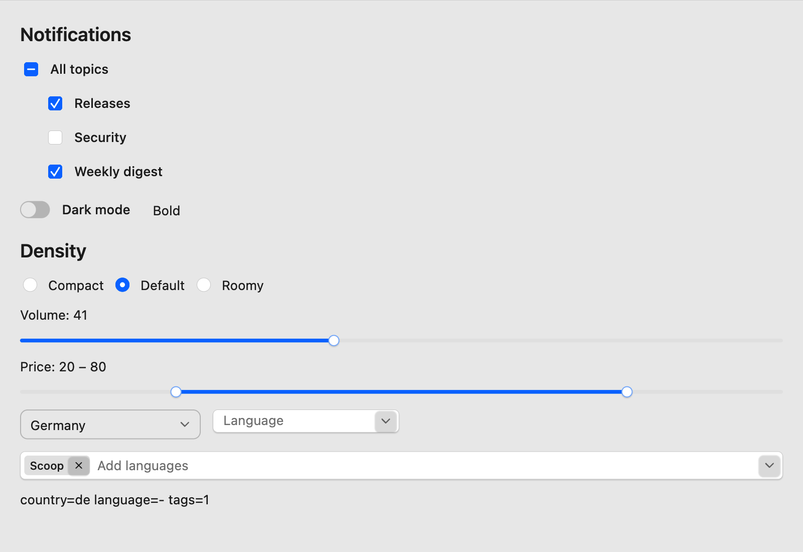
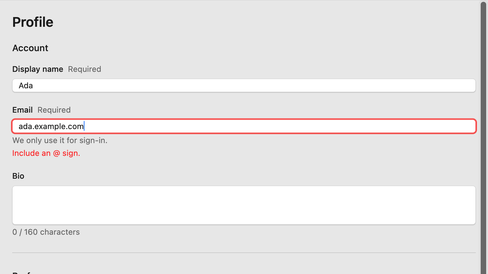

# 第 13 章　选择控件与表单

上一章讲了怎样输入文字，本章讲另一半：从给定的选项中做选择，以及把多个输入组织成一个表单。读完本章，你会知道：

- 选择控件为什么都通过 Binding 接收值；
- 复选框、开关、单选组、滑块、下拉框和组合框的用法；
- 怎样把标签、说明、错误和控件关联起来，让点击标签和读屏器都能正常工作；
- 表单校验应该放在哪里；
- 怎样写一个完整的资料表单。

## 13.1　选择控件一览

保存为 `choices.scoop`：

```scoop
{{#include ../../examples/ch13/choices.scoop}}
```

```sh
scoop run choices.scoop --release
```

所有的值都放在 `Preferences` 这个普通的类里，组件只负责显示。每个控件都通过一个 Binding 读写其中的一项（第 9 章）：控件读取 Binding 显示当前值，用户操作时直接写回。所以控件自己不保存值，`Preferences` 中的数据就是唯一的数据来源，底部那行 `country=... language=... tags=...` 读的也是它。

下图是做了几次操作之后的样子：取消了 Security，滑动了音量，在 Country 中选了 Germany。



## 13.2　复选框、开关与切换按钮

`checkbox` 有两种 Binding：

- `checkbox(binding: Binding<Boolean>)`：普通的勾选和不勾选；
- `checkbox(binding: Binding<CheckState>)`：三态，`CheckState` 有 `Checked`、`Unchecked`、`Indeterminate`（部分选中）。

All topics 用的是三态复选框，它的 Binding 是一个派生 Binding（第 9 章）：

- **读取时**统计三个子项，全选为 `Checked`，全不选为 `Unchecked`，否则为 `Indeterminate`；
- **写入时**把三个子项全部设为同一个值。

启动时只有 Releases 被勾选，All topics 显示为一条横线，表示部分选中。点 All topics，四个复选框全部变为勾选；再取消 Security，All topics 又回到部分选中。这里没有任何代码去“同步”总开关的状态，它每次都是从子项算出来的。

用户点击部分选中的复选框时，写入的值是 `Checked`。这也是大多数平台的惯例。

`switchControl(binding)` 是开关，和 `Binding<Boolean>` 的复选框含义相同，外观表示“立即生效的设置”。`toggle(label, binding)` 是一个可以按下和弹起的按钮，常用于工具栏中的加粗、斜体这类状态。

## 13.3　单选组与滑块

### 单选组

```scoop
this.radioGroup(model.density.binding()) {
    this.axis = FlexAxis.Horizontal
    this.item(Choice(ViewKey.Number(0L), 0, "Compact"))
    this.item(Choice(ViewKey.Number(1L), 1, "Default"))
    this.item(Choice(ViewKey.Number(2L), 2, "Roomy"))
}
```

`Choice(key, value, label)` 描述一个选项：

- `key` 是选项的身份，作用和第 11 章的 key 相同；
- `value` 是选中时写进 Binding 的值，类型 `T` 需要能比较相等；
- `label` 是显示的文字。

单选组的 Binding 类型是 `Binding<T?>`：`None` 表示一个都没选。`density` 的初值是 `Some(1)`，所以 Default 被选中。

### 滑块

滑块的值是一个 `Array<Double>`，数组有几个元素，滑块就有几个滑块头：

```scoop
this.slider(model.volume.binding(), RangeSpec(0.0, 100.0, Some(1.0)))
this.slider(model.price.binding(), RangeSpec(0.0, 100.0, Some(5.0), minimumGap = 10.0))
```

`RangeSpec(minimum, maximum, step, minimumGap)` 规定取值范围、步长，以及多个滑块头之间的最小间距。音量只有一个滑块头，步长为 1；价格有两个滑块头，步长为 5，两个值至少相差 10。

滑块可以拖动，也可以在获得焦点后用方向键调节，读屏器则通过“增大”“减小”操作调节。用辅助功能对音量滑块执行一次“增大”，值从 40 变为 41，正好是一个步长。

## 13.4　下拉框与组合框

### select

`select` 是一个下拉框，从固定的几个选项中选一个：

```scoop
this.select(model.country.binding()) {
    this.placeholder = "Country"
    this.item(Choice(ViewKey.Text("cn"), "cn", "China"))
    this.item(Choice(ViewKey.Text("de"), "de", "Germany"))
    // ...
}
```

点开 Country，选择 Germany，下拉框显示 Germany，底部显示 `country=de`：写进 Binding 的是选项的 `value`，而不是显示的文字。这样，界面上的文字可以随语言变化，业务数据保持不变。

### combobox

选项很多时，`combobox` 让用户输入文字来筛选。它需要第三个参数：一个 `TextEditorState`，保存用户输入的查询文字。和第 12 章一样，这个编辑模型由你持有。

```scoop
this.combobox(model.language.binding(), model.languages, model.languageQuery) {
    this.placeholder = "Language"
    this.showClear = true
}
```

在 Language 中输入 `ru`，候选列表中只剩下 Rust；点 Rust，框中显示 Rust，底部显示 `language=Rust`。`showClear` 在框的右侧显示一个清除按钮。

`combobox` 的 Binding 类型决定了它是单选还是多选：

- `Binding<T?>`：单选；
- `Binding<Array<T>>`：多选，已选的项以标签的形式显示在框里，每个标签带一个删除按钮。

示例中的第二个组合框是多选的，初值是 `["Scoop"]`。在其中输入 `sw`，点候选中的 Swift，框里多出一个 Swift 标签，底部变为 `tags=2`。查询文字被清空，候选列表保持打开，已选的 Scoop 和 Swift 旁边各有一个勾，可以接着选择。`valueText` 决定标签上显示什么文字。

选项数量很大，或者需要从网络加载时，可以传一个 `ChoiceSource<T>` 代替数组，按查询文字提供候选。

## 13.5　标签与控件的关联：FieldTarget

一个复选框旁边的文字，在用户看来是“它的标签”，但对框架来说，它们只是并排放着的两个控件。要让二者真正关联起来，需要一个 `FieldTarget`：

```scoop
this.checkbox(model.topics[index].binding()) {
    this.labelTarget = Some(model.topicTargets[index + 1L])
}
this.fieldLabel(titles[index], model.topicTargets[index + 1L])
```

控件通过 `labelTarget` 登记到这个目标上，`fieldLabel` 也指向同一个目标。关联之后：

- **点击标签就是点击控件。** 点文字 Security，它前面的复选框随之切换。复选框只有 22 个单位见方，能点的地方扩大到了整行文字。
- **读屏器读出控件的名字。** 用辅助功能查看，复选框的名字就是 `Security`，开关的名字是 `Dark mode`。没有关联时，读屏器只会说“复选框”，用户不知道它是做什么的。

`FieldTarget` 是一个普通的对象，和 `FocusHandle`（第 14 章）一样，在字段或 Store 中创建，跨多次 `render()` 保持不变。

## 13.6　field：把标签、说明与错误组合起来

表单中的每一项通常由几部分组成：标签、控件、说明、错误信息，有时还有“必填”的标记。`field(control) { ... }` 把它们组合在一起，并负责其中的关联。下面的资料表单就是这样写的。保存为 `profile.scoop`：

```scoop
{{#include ../../examples/ch13/profile.scoop}}
```

```sh
scoop run profile.scoop --release
```

```scoop
this.field(emailInput) {
    this.label("Email", form.emailTarget)
    this.required = true
    this.description("We only use it for sign-in.")
    this.errors = form.emailErrors
}
```

- `label(text, target)` 显示标签，并通过 `target` 和控件关联；
- `required = true` 在标签旁显示 Required；
- `description(...)` 是输入框下方的说明文字；
- `errors` 是一组错误信息，非空时显示在说明下方。

关联到同一个目标后，读屏器会读出控件的名字 `Email`，说明和错误则作为补充信息一起读出。用辅助功能查看，邮箱框的帮助文本是说明加上当前的错误：`We only use it for sign-in.` 和 `Email is required.`。

几个容器把多个 field 组织起来：

- `fieldGroup { ... }` 把一组 field 纵向排列；
- `fieldSet(content) { legend("Account") }` 给一组 field 一个标题，读屏器把它们当作一个分组；
- `fieldSeparator()` 是分组之间的分隔线；
- 复选框这类控件常常放在标签前面并横向排列，用 `orientation = FieldOrientation.Horizontal` 和 `controlPlacement = FieldControlPlacement.Start`，见 Monthly newsletter 一项；
- 单选组本身没有一个可以关联的输入框，用 `title("Plan")` 给它一个标题。

注意 `profile.scoop` 把所有的控件都在 builder 块**之外**构造好，存进局部变量，再交给 `field(...)`。在 `fieldGroup { ... }` 的块中，`input(...)` 会解析成块的成员，把输入框直接追加进去，而不是返回一个 View（第 5.7 节）。

## 13.7　校验：业务决定错误，控件只负责呈现

`ProfileForm` 把校验规则写成计算属性：

```scoop
val emailErrors: Array<String>
    get() {
        if (!attempted.value) return []
        if (email.text.charLength == 0L) return ["Email is required."]
        if (!email.text.contains("@")) return ["Include an @ sign."]
        return []
    }
```

控件只做两件事：`errors` 显示错误信息，`invalid` 让输入框显示出错的外观。**什么算错误、什么时候显示，都由业务模型决定。** 这样分工有几个好处：规则可以不打开窗口就测试；同一条规则可以在保存时、提交到服务器前重复使用；控件也不需要知道“邮箱”是什么。

按下面的步骤试一下：

1. 什么都不填，直接点 Save。两个必填项下面出现了 `Name is required.` 和 `Email is required.`，输入框的边框变成红色。
2. 在 Display name 中输入 `Ada`，它的错误立即消失。
3. 在 Email 中输入 `ada.example.com`，错误立即变成 `Include an @ sign.`：

   

4. 把邮箱改成 `ada@example.com`，错误消失。点 Save，表单底部显示 `Saved Ada <ada@example.com>`。

错误之所以能“立即”更新，是因为 `render()` 通过 `emailErrors` 读了 `email.text`：用户每输入一个字符，读取了它的组件就重新 `render()`（第 12.2 节）。Bio 下方的字数统计 `0 / 160 characters` 也是这样实时更新的。

`attempted` 控制错误什么时候开始显示。用户还没提交过时，空的必填项不应该一上来就满屏标红。这是一个界面上的决策，但它和规则放在一起，同样可以测试。

`save()` 还做了一件事：有错误时，用 `FocusHandle.requestFocus()` 把焦点移到第一个出错的输入框，用户可以直接修改。焦点句柄第 14 章详细介绍。

## 常见误用

- **让控件保存自己的值，再靠回调同步回模型。** 选择控件都接收 Binding，值只保存一份。
- **只把标签文字放在控件旁边。** 点击标签没有反应，读屏器也读不出控件是什么。用 `FieldTarget` 把它们关联起来，或者使用 `field`。
- **用显示的文字作为选项的值。** 文字会随语言变化。`Choice` 的 `value` 用稳定的代码，比如 `"de"`。
- **在 `fieldGroup` 等块中直接写 `input(...)` 作为 `field` 的参数。** 它会解析成块的追加成员。在块外构造好再传入。
- **在控件里写校验规则。** 规则放在业务模型中，控件只负责显示 `errors` 和 `invalid`。
- **一打开表单就显示所有必填项的错误。** 用一个“是否已尝试提交”的状态控制显示时机。

## 小结

- 选择控件都通过 Binding 读写业务数据，自己不保存值。
- `checkbox` 支持 `Boolean` 和三态的 `CheckState`；三态的总开关可以用派生 Binding 从子项算出来。
- 单选组、下拉框、组合框用 `Choice(key, value, label)` 描述选项，写进 Binding 的是 `value`；组合框的 Binding 类型决定单选还是多选，查询文字保存在你持有的 `TextEditorState` 中。
- 滑块的值是一个数组，元素的个数就是滑块头的个数；`RangeSpec` 规定范围、步长和最小间距。
- `FieldTarget` 把标签和控件关联起来：点击标签就是点击控件，读屏器读出控件的名字。
- `field` 组合标签、说明、错误和必填标记；校验规则写在业务模型中，控件只负责呈现。

## 练习

1. 给 `Preferences` 增加一个 `fun reset()`，把所有的值恢复为初值，并在界面上加一个 Reset 按钮。注意 `TextEditorState` 怎样清空。
2. 把价格滑块改成三个滑块头，看看 `minimumGap` 对中间的滑块头有什么影响。
3. 给 Country 增加一个 “其他” 选项，选中它时在下面显示一个输入框，让用户填写国家名称。
4. 在 `ProfileForm` 中增加一条规则：Bio 中不能包含 `http`。错误信息显示在 Bio 的 field 中。
5. 把 `ProfileForm` 的校验规则改写成 Cone 中的单元测试（第 3 章）：空表单保存后有两个错误；名字和邮箱合法时保存成功。
