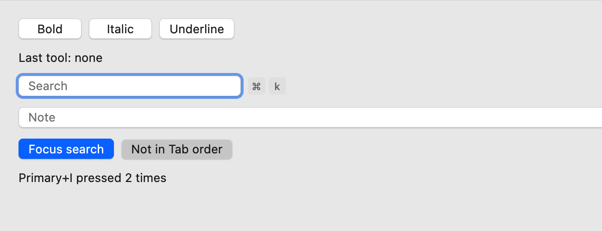

# 第 14 章　焦点与键盘

很多用户完全用键盘操作程序：Tab 在控件之间移动，空格和回车激活按钮，方向键在一组按钮中移动，快捷键直接执行命令。读屏器的用户更是离不开焦点。好在 Scoop 的控件默认就能用键盘操作，你要做的主要是在默认行为不合适的地方加以调整。读完本章，你会知道：

- 默认的 Tab 顺序是怎样决定的；
- 怎样用 `FocusOptions` 调整 Tab 顺序、把控件移出 Tab 顺序；
- 怎样用 `FocusHandle` 在程序中移动焦点；
- 怎样让方向键在一组控件中移动焦点；
- 怎样注册窗口内的快捷键；
- 焦点环什么时候显示。

## 14.1　一个键盘示例

保存为 `keyboard.scoop`：

```scoop
{{#include ../../examples/ch14/keyboard.scoop}}
```

```sh
scoop run keyboard.scoop --release
```

窗口中从上到下是：一个由 Bold、Italic、Underline 三个按钮组成的工具栏；一个搜索框，旁边显示快捷键 ⌘K；一个备注框；Focus search 和 Not in Tab order 两个按钮；最后一行显示 Primary+I 被按下的次数。



下面的几节逐一解释这个窗口的键盘行为。凡是写着“按下”“试一下”的地方，都是在真实窗口中按键后观察到的结果。

## 14.2　默认的 Tab 顺序

不做任何设置时，Tab 按控件**挂载的逻辑顺序**移动焦点，通常就是从上到下、从左到右的顺序；Shift+Tab 反向移动。按钮、输入框、复选框、滑块等可以交互的控件默认都在 Tab 顺序中，文字和图片则不在。到达最后一个控件后，再按 Tab 回到第一个：窗口的根是循环的。

被禁用的控件、还没有放置到窗口中的控件会被跳过。滚动区域中暂时看不见的控件仍然在 Tab 顺序中，焦点移到它时，滚动区域会把它滚动到可见的位置。

## 14.3　FocusOptions：调整 Tab 顺序

控件的 `focus` 属性接收一个 `FocusOptions`：

```scoop
public struct FocusOptions(
    val handle: FocusHandle? = None,
    val tabStop: Boolean = true,
    val order: Int = 0,
    val visibility: FocusVisibility = FocusVisibility.Automatic
)
```

示例用到了其中的三项：

- **`order`**：Tab 先按 `order` 从小到大排序，相同的再按挂载顺序。默认都是 0，搜索框设为 -1，所以它排在所有控件之前。启动后按第一次 Tab，焦点直接落在搜索框上，而不是挂载顺序中第一个的 Bold。
- **`tabStop = false`**：退出 Tab 顺序。Not in Tab order 按钮仍然可以用鼠标点击，也可以被程序聚焦，但 Tab 会跳过它：从 Focus search 再按 Tab，焦点越过它，回到了搜索框。
- **`handle`**：一个焦点句柄，用于在程序中操作这个控件的焦点，见下一节。

`order` 要慎用。Tab 顺序和视觉顺序不一致，会让键盘用户摸不着头脑。示例把搜索框提到最前，是因为它是窗口中最常用的入口；大多数情况下，调整布局让挂载顺序本身合理，比设置 `order` 更好。

## 14.4　FocusHandle：在程序中移动焦点

`FocusHandle` 是一个普通的对象。把它通过 `FocusOptions(Some(handle))` 交给一个控件，就可以在程序中操作这个控件的焦点：

```scoop
private val searchFocus = FocusHandle()
// ...
this.focus = FocusOptions(Some(searchFocus), order = -1)
// ...
searchFocus.requestFocus()
```

和 `TextEditorState`、`FieldTarget` 一样，焦点句柄在字段或 Store 中创建，不要在 `render()` 中创建。一个句柄同时只能交给一个控件。

`FocusHandle` 提供：

| 成员 | 作用 |
| --- | --- |
| `requestFocus()` | 请求焦点，返回 `Boolean` 表示请求是否被接受 |
| `clearFocus()` | 放弃焦点 |
| `hasFocus` | 当前是否拥有焦点 |
| `isFocusVisible` | 当前是否应该显示焦点环（14.7 节） |
| `isPending` | 请求是否还在等待兑现 |
| `isAttached` | 是否已经交给了一个挂载中的控件 |

请求不一定立即生效。目标在滚动区域中看不见时，框架先逐层把它滚动出来；目标还没有放置到窗口中时，等它放置之后再聚焦。这段时间里 `isPending` 为 true。新的请求会取消旧的请求。

**不能在 `render()`、`measure()`、`scene()` 或 `draw()` 中请求焦点**，这和第 8 章“不能在 `render()` 中写状态”是同一条规则。请求焦点应该放在事件回调或 `onMount()` 中。第 13 章的资料表单在保存的回调中把焦点移到第一个出错的输入框，就是典型的用法。

注意示例的按钮回调写成了：

```scoop
{
    searchFocus.requestFocus()
    Unit
}
```

`requestFocus()` 返回一个 `Boolean`，而按钮和快捷键的回调要求返回 `Unit`。lambda 的最后一个表达式就是返回值，所以要补一个 `Unit`。

## 14.5　方向键导航与焦点范围

工具栏中的三个按钮如果都进入 Tab 顺序，键盘用户每次都要按三次 Tab 才能越过工具栏。更好的做法是：**整个工具栏在 Tab 顺序中只占一个位置，进入之后用方向键在按钮之间移动。** 这种做法叫做 roving 焦点，示例在 `onMount()` 中这样设置：

```scoop
val items = Array<NavigationItem>(tools.size) { index -> NavigationItem(tools[index]) }
scope.keyNavigation(
    navigationOptions {
        this.addAll(items)
        this.layout = NavigationLayout.Horizontal
        this.loop = true
    }
)
```

每个按钮通过 `FocusOptions(Some(tools[index]))` 拿到自己的焦点句柄，`keyNavigation` 把这组句柄接入方向键：

- `layout` 为 `Horizontal` 时用左右方向键，`Vertical` 时用上下方向键，`Grid` 时按 `NavigationItem` 的行列在二维中移动；
- Home 和 End 移到组的第一个和最后一个；
- `loop = true` 时，在两端继续按方向键会绕到另一端；
- 横向的方向跟随书写方向，在从右到左的界面中左右自动对调。

在窗口中试一下：从搜索框按 Tab，焦点进入工具栏，落在 Bold 上；按左方向键，焦点绕回到了组尾的 Underline；再按 Tab，焦点直接离开工具栏，落在备注框上，没有经过 Italic。组中只有一个成员在 Tab 顺序中。按工具链的文档，离开之后再回来时，焦点会落在上次聚焦的成员上。

`keyNavigation` **只移动焦点**。按钮被聚焦后按空格或回车激活，那是按钮自己的行为；如果这组控件需要“焦点移到哪里就选中哪里”的语义，比如单选组，需要控件自己处理。现成的 `radioGroup`、`tabs`、菜单等控件已经内置了合适的键盘行为，不需要再加 `keyNavigation`。

### 焦点范围

`scope.focusScope(FocusScopeOptions(...))` 在一个组件中建立焦点范围，把组件内的可聚焦控件作为一组：

- `loop = true` 时，Tab 在组内循环，不会离开这个组件。对话框通常需要这样做，第 18 章的弹层已经内置了这种行为；
- `loop = false`（默认）时，到达组的边界后由父级继续移动；
- `defaultFocus` 和 `fallback` 决定对整个范围请求焦点时落在哪个控件上。

## 14.6　快捷键

示例注册了两个快捷键：⌘K 把焦点移到搜索框，⌘I 给计数加一。

```scoop
scope.resource {
    ShortcutScope(
        scope.input,
        [
            shortcutBinding(primaryChord("k"), { searchFocus.requestFocus(); Unit }),
            shortcutBinding(primaryChord("i"), { count.value += 1 })
        ]
    )
}
```

上面的代码为了紧凑，把第一个回调写在了一行里，示例文件中是分两行写的。

- **`ShortcutChord(key, modifiers)` 描述一个组合键。** `ShortcutKey.Logical(LogicalKey.Character("k"))` 表示“当前键盘布局下产生 k 的那个键”，适合和字母相关的命令；需要固定键位时，比如游戏中的 WASD，用 `ShortcutKey.Physical`。
- **`ShortcutModifiers(primary = true)` 表示 Primary 修饰键。** 它在 macOS 上是 Command，在 Windows 和 Linux 上是 Ctrl。用 Primary 而不是直接写 Command 或 Ctrl，同一份代码就能在各个平台上使用惯用的快捷键。
- **`ShortcutScope(scope.input, bindings)` 在这个组件所在的窗口中登记这组快捷键。** 它包在 `scope.resource { ... }` 中，组件卸载时自动注销（第 10 章）。

在备注框中按 ⌘K，焦点跳到了搜索框。在搜索框中连按两次 ⌘I，最后一行变为 `Primary+I pressed 2 times`：输入框自己不处理 ⌘I，按键就交给了窗口的快捷键。反过来，按工具链的文档，控件自己处理的按键优先于 `ShortcutScope`，所以 ⌘C、⌘V 这类组合键在输入框中会先被输入框使用。

快捷键要显示给用户，用户才会知道它们。搜索框旁边的 `kbdGroup(primaryChord("k"))` 按当前平台的写法显示组合键，在 macOS 上显示为 ⌘ 和 k 两个按键标签。

需要在**整个应用**中有效的快捷键，用 `UiHost.shortcutScope(bindings)` 登记，第 27 章介绍。窗口内控件自己的按键处理和 `ShortcutScope` 优先于应用级的绑定。

## 14.7　焦点环什么时候显示

截图中搜索框有一圈蓝色的焦点环。焦点环告诉键盘用户“现在按键会作用在哪里”，但对用鼠标的用户来说，点一下按钮就出现一圈焦点环，往往显得多余。所以 `FocusOptions.visibility` 的默认值 `FocusVisibility.Automatic` 是这样规定的：

- 文本输入框获得焦点时，总是显示焦点环，因为用户需要知道光标在哪里；
- 其他控件只在焦点**不是**由鼠标或触摸点击得来时显示焦点环，比如按 Tab、方向键，或者程序请求的焦点。

`Always` 和 `Never` 分别表示总是显示和从不显示。控件库中的控件都已经按 `isFocusVisible` 绘制焦点环。自绘控件（第 23 章）通过 `FocusHandle.isFocusVisible` 或输入区域的 `isFocusVisible` 判断是否绘制。

**不要为了“好看”去掉焦点环。** 对键盘用户来说，看不见焦点等于看不见鼠标指针。

## 常见误用

- **用 `order` 修补混乱的布局。** Tab 顺序和视觉顺序不一致会让人困惑。优先调整挂载顺序。
- **一组按钮全部进入 Tab 顺序。** 键盘用户要按很多次 Tab 才能越过。用 `keyNavigation` 让整组只占一个 Tab 位置。
- **在 `render()` 中请求焦点。** 会抛出异常。在回调或 `onMount()` 中请求。
- **在 `render()` 中创建 `FocusHandle`。** 每次都是新的句柄，之前的请求和关联都会失效。
- **直接写 Command 或 Ctrl。** 用 `primary = true`，让各个平台使用惯用的修饰键。
- **注册快捷键后忘了注销。** 用 `scope.resource { ShortcutScope(...) }`，让它跟随组件的生命周期。
- **把焦点环设为 `Never`。** 键盘用户会失去方向。

## 小结

- 默认的 Tab 顺序就是挂载的逻辑顺序，窗口的根是循环的；被禁用和未放置的控件被跳过。
- `FocusOptions` 的 `order` 调整顺序，`tabStop = false` 退出 Tab 顺序，`handle` 交给控件一个焦点句柄。
- `FocusHandle.requestFocus()` 在程序中移动焦点；请求可能需要等待，不能在 `render()` 等阶段中请求。
- `scope.keyNavigation(...)` 让一组控件只占一个 Tab 位置，用方向键在其中移动；`scope.focusScope(...)` 建立焦点范围。
- `ShortcutScope` 和 `shortcutBinding` 注册窗口内的快捷键，`primary = true` 在 macOS 上是 Command、在其他平台上是 Ctrl；`kbdGroup` 显示组合键。
- 焦点环默认只在键盘或程序得来的焦点上显示，文本输入框例外。

## 练习

1. 去掉搜索框的 `order = -1`，启动后按 Tab，焦点先落在哪里？
2. 把工具栏的 `loop` 改为 false，在 Bold 上按左方向键会发生什么？
3. 给示例增加一个快捷键 Primary+Shift+N，把焦点移到备注框。提示：`ShortcutModifiers` 还有 `shift` 参数。
4. 在示例的下半部分加一个包含两个按钮的小组件，用 `scope.focusScope(FocusScopeOptions(loop = true))` 让 Tab 只在这两个按钮之间循环。这样做之后，键盘用户还能离开这个组件吗？这说明了什么时候才应该使用循环的焦点范围？
5. 把工具栏改成一个三行三列的按钮网格，用 `NavigationLayout.Grid` 和 `NavigationItem(handle, row, column)` 接入四个方向键。
