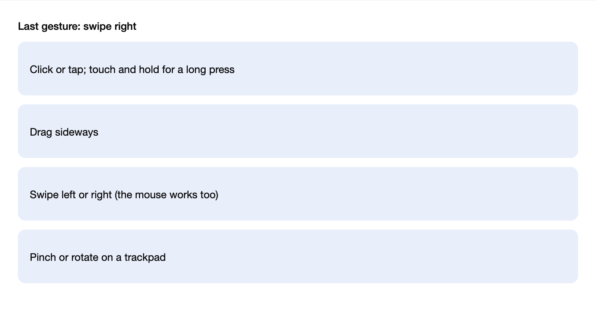
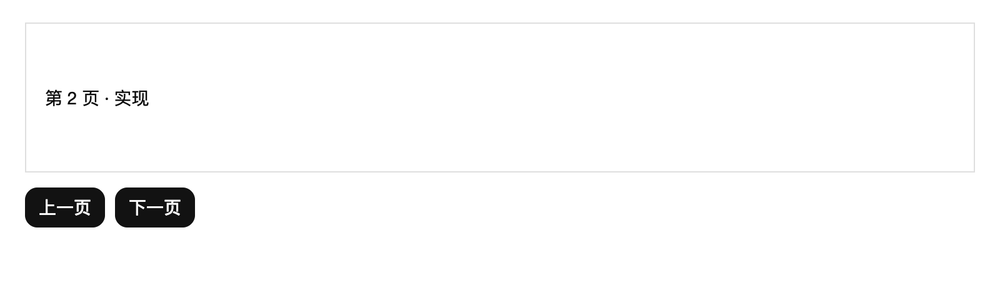

# 第 15 章　指针、触摸与手势

按钮、复选框、滑块这些控件已经处理好了鼠标、触摸和键盘。只有在你自己画的区域上需要识别点击、拖动或手势时，才需要本章的内容。读完本章，你会知道：

- 为什么一个操作应该同时有鼠标、触摸、键盘和读屏器几种入口；
- 怎样在自绘区域上识别点击、长按、拖动、轻扫、捏合与旋转；
- 鼠标和直接触摸在这些手势中分别是怎样处理的；
- 手势和普通控件放在一起时，输入是怎样分配的。

## 15.1　同一个操作，多个入口

在开始写手势之前，先记住一条原则：**手势只是快捷方式，不能是完成操作的唯一途径。** 一个只能用双指轻扫翻页的界面，鼠标用户翻不了页，键盘用户和读屏器用户也翻不了页。

控件库中的按钮就是一个好榜样。一个按钮可以：

- 用鼠标点击；
- 在触摸屏上用手指轻点；
- 获得焦点后按空格或回车；
- 由读屏器执行“按下”操作。

四种入口调用的是同一个回调。本书验证示例时，大多数按钮都是通过辅助功能的“按下”操作点击的，走的正是读屏器的那条路径。

本章的第二个例子用轻扫翻页，同时提供了“上一页”“下一页”两个按钮。这不是多余的：它们就是翻页功能的键盘入口和读屏器入口。

## 15.2　一个手势面板

下面的程序有四块面板，各识别一种手势，最上面一行显示最后识别到的手势。保存为 `gesture_pads.scoop`：

```scoop
{{#include ../../examples/ch15/gesture_pads.scoop}}
```

```sh
scoop run gesture_pads.scoop --release
```



每块面板是一个自绘的 `Element`。自绘控件第 23 章才详细介绍，这里只需要知道三件事：

- **`scope.createArea()` 创建一块输入区域。** 区域是接收指针事件的单位，手势都登记在区域上。
- **`scene()` 中的 `context.place(area, bounds)` 决定区域在哪里。** 区域放在哪里、有多大，指针就在哪里命中它。
- **`context.children()` 画出子项**，这里是面板上的说明文字。

`Pad` 在构造时（`init` 块中）根据面板的种类登记手势。手势的回调保存下来，以后每次识别到手势时调用。回调中调用的是 `props.value.report`，在执行时读取最新的 Props，这正是第 9 章的规则：长期保存的回调不要提前取出 Props 中的值。

每个 `scope.press(...)`、`scope.drag(...)` 都返回一个可以关闭的对象，它属于这个组件的 scope，组件卸载时自动关闭，不需要手动注销。

## 15.3　press 与 longPress

第一块面板登记了两种手势：

```scoop
scope.press(area) { report("press") }
scope.longPress(area) { _ -> report("long press") }
```

`press` 识别一次点击：鼠标在区域内按下又在区域内释放，或者手指在区域内轻点。`PressOptions` 的 `touchThreshold` 默认为 8 个单位：手指移动超过这个距离就不再算轻点，移回来也不会恢复。区域获得键盘焦点时，按空格也会触发它；`acceptsEnter` 默认为 true，这时回车同样可以触发。

点一下第一块面板，顶部显示 `Last gesture: press`。

`longPress` 识别长按，`LongPressOptions` 的 `delay` 默认 500 毫秒，`threshold` 默认 8 个单位。**它只识别直接接触，也就是手指和触控笔，不识别鼠标。** 用鼠标在第一块面板上按住约一秒再松开，顶部仍然显示 `press`：长按没有被识别，松开时触发的是普通的点击。

这是有意的设计。鼠标用户期待的是右键菜单，而不是长按。所以，“长按显示菜单”这类需求，应该交给控件库的上下文菜单（第 18 章）：它对鼠标响应右键和平台的辅助点击，对键盘响应菜单键，对触摸响应长按，三种入口打开同一个菜单。只有在确实只需要服务触摸用户的地方，才直接使用 `longPress`。

普通的短按不会被 `longPress` 消费，长按成功后也不会再补发一次点击。

## 15.4　drag：拖动

第二块面板识别横向拖动：

```scoop
scope.drag(area, DragOptions(DragAxis.Horizontal)) { event ->
    when (event) {
        case Started(_) -> report("drag started")
        case Moved(val sample) -> report(f"dragging, moved ${sample.displacement.toInt()}")
        case Ended(val sample) -> report(f"drag ended, moved ${sample.displacement.toInt()}")
        case Cancelled(_, _) -> report("drag cancelled")
    }
}
```

`DragEvent` 有四个阶段：

- **`Started`**：沿 `axis` 的移动超过了 `threshold`（默认 4 个单位），拖动开始。在这之前，按下只是一个“候选”，如果没有移动就松开，它仍然可以是一次点击；
- **`Moved`**：拖动中的每一次移动；
- **`Ended`**：正常结束；
- **`Cancelled`**：被取消，比如单指拖动的途中出现了第二个触点。取消的拖动不应该提交任何结果。

`DragSample` 包含起点 `start`、当前位置 `position`、沿主轴的位移 `displacement`、速度 `velocity`，以及输入来源 `input`：`DragInput.Mouse(button)` 或 `DragInput.Contact(id, kind)`。

在第二块面板上按住鼠标向右拖动 200 个单位，松开后顶部显示 `drag ended, moved 200`。

`DragOptions` 的 `mouse` 和 `contacts` 默认都是 true，分别控制是否接受鼠标和直接接触；`button` 选择接受哪个鼠标按钮，默认是左键。拖动一旦开始，就接管了这次按下：区域内其他控件的点击候选被取消，松开时不会再触发点击。

## 15.5　swipeGesture：轻扫

第三块面板识别轻扫：

```scoop
scope.swipeGesture(area, SwipeGestureOptions(mouse = true)) { sample ->
    report(f"swipe ${swipeName(sample.direction)}")
}
```

轻扫是一次又快又短的滑动，结束时回调**只调用一次**，`sample.direction` 是 `Left`、`Right`、`Up` 或 `Down`。`SwipeGestureOptions` 的默认值是：

| 选项 | 默认值 | 含义 |
| --- | --- | --- |
| `axis` | `Horizontal` | 识别哪个方向的轻扫 |
| `native` | true | 接受平台原生的轻扫，比如触控板的多指轻扫 |
| `contacts` | true | 接受手指和触控笔的快速滑动 |
| `mouse` | false | 接受鼠标的快速拖动 |
| `distance` | 48 | 直接输入至少要移动的距离 |
| `maxDuration` | 500 毫秒 | 直接输入最长的用时 |

注意 `mouse` 默认是 false。示例为了能用鼠标演示，打开了它。用鼠标在第三块面板上向左快速一甩，顶部显示 `swipe left`；再向右慢慢拖过同样的距离，用时约 0.8 秒，超过了 500 毫秒，不算轻扫，顶部仍然显示 `swipe left`；最后向右快速一甩，显示 `swipe right`，也就是上图的样子。

平台原生的轻扫使用系统给出的方向，不套用 `distance` 和 `maxDuration` 的门槛。本书写作时没有用触控板和触摸屏验证 `native` 和 `contacts` 两种来源。

### 轻扫翻页

下面是官网指南中的轻扫翻页示例，本书修正了其中的一处样式写法（见本节末尾）。保存为 `swipe_pages.scoop`：

```scoop
{{#include ../../examples/ch15/swipe_pages.scoop}}
```

```sh
scoop run swipe_pages.scoop --release
```



和手势面板相比，这个例子有几点不同：

- **手势区域包住的是别的控件。** `PageSwipe` 把卡片作为自己的子项，在 `onMount()` 中调用 `scope.routeChildren(area)`，让子项的输入经过自己的区域，这样在卡片上的任何位置轻扫都能被识别。`routeChildren` 要求组件已经挂载，所以它和手势一起写在 `onMount()` 中，而不是 `init` 中。
- **没有打开 `mouse`。** 这是轻扫的默认行为：用鼠标在卡片上快速一甩，页面不会变化。翻页的鼠标入口是下面的两个按钮。
- **标题声明为“礼貌”的实时区域。** `ComponentSemantics(live = SemanticLive.Polite)` 让读屏器在页码变化时读出新的标题，而不需要用户把焦点移过去。第 31 章会详细介绍。

点“下一页”，标题变为 `第 2 页 · 实现`。

> **注意：style 块中的 border**
>
> 官网指南中的这个示例原本写的是 `style { border = Some(Border.all(1.0, palette.border)) }`。它能通过编译，运行时却没有边框。原因是 `frame` 块中的 `style { ... }` 成员要求 `border` 是 `StyleValue<Border?>`，`border = Some(...)` 在那里类型不对，于是编译器选中了另一个同名的顶层函数 `scoop.ui.style.style(...)`。这个函数构造了一个 `Style` 值，然后这个值被直接丢弃，没有任何警告。正确的写法是调用 `border(...)` 函数：`style { border(Some(Border.all(1.0, palette.border))) }`。第 22 章会详细讨论样式块中的这类问题。

## 15.6　transformGesture：捏合与旋转

第四块面板识别缩放和旋转：

```scoop
scope.transformGesture(area) { event ->
    when (event) {
        case Changed(val sample) -> report(f"scale ..., rotation ...")
        case Discrete(val sample) -> report(f"scale ...")
        else -> {}
    }
}
```

上面省略了格式化的细节。`TransformGestureEvent` 有 `Started`、`Changed`、`Ended`、`Cancelled` 和 `Discrete` 五种：

- 连续的手势依次产生 `Started`、若干个 `Changed`，最后是 `Ended` 或 `Cancelled`；
- `Discrete` 是一次性的离散变换，不属于某个连续的手势。

样本中的 `scale` 是从开始到现在的累计倍率，`rotation` 是累计的顺时针旋转角度，单位是弧度，示例乘以 57.3 换算成度；`scaleDelta` 和 `rotationDelta` 是这一次的增量。`input` 说明来源：`Native` 是触控板等平台的原生手势，`Contacts` 是触摸屏上的两个手指。

`TransformGestureOptions` 的 `magnify`、`rotate`、`contacts` 分别控制是否识别缩放、旋转和触摸屏上的双指变换。

本书写作时用的自动化工具只能模拟鼠标，无法模拟触控板的捏合与旋转，所以这块面板没有经过实际验证。在带触控板的 Mac 上运行示例，在第四块面板上捏合或旋转两指，可以看到倍率和角度的变化。

## 15.7　连续点击：双击与三击

双击选词、三击选行这类操作需要知道“这是连续的第几次点击”。这个次数由窗口层提供：每次鼠标按下和释放的事件中都带有一个从 1 开始的连续点击次数，平台按系统的双击间隔和距离计算。AppKit 和 GTK 直接使用系统给出的次数，Windows 由窗口库按系统的设置补齐三击及更多次点击。

控件库的文本控件已经用它实现了双击选词、三击选行（第 7 章的 `selectableStyledText` 就是一例）。触摸屏上的连续轻点则由文本控件的 `TextTouchOptions` 单独处理，`multiTap` 默认开启。

如果你的自绘控件需要区分单击和双击，应该读取事件中的这个次数，而不是自己用定时器和距离重新计算：自己算出来的结果和系统设置不一致，用户会觉得“双击不灵”。读取原始指针事件的方法见第 23 章。

## 15.8　触摸滚动与输入的接管

当几种输入处理落在同一个位置时，比如滚动区域里放着可以拖动的面板，面板里又有按钮，框架按照“候选与接管”的方式分配输入：

- **按下只产生候选。** 手指或鼠标刚按下时，按钮、拖动、滚动都只是候选者，谁也没有拿到这次输入。
- **先满足条件的接管。** 移动超过了拖动的阈值，拖动接管，按钮的点击候选被取消；没有移动就松开，按钮得到一次点击。
- **接管之后不再转手。** 一次按下序列只有一个最终的处理者。被取消的候选不会在松开时“补”触发。

触摸滚动也遵守这套规则。`scrollArea` 等滚动容器对手指和触控笔的拖动做出滚动，选项是 `TouchScrollOptions`：`threshold` 默认 8 个单位，`lockAxis` 默认锁定在首先移动的方向上。子项自己的 `drag` 优先于滚动；`claimAtBoundary = false` 时，滚动区域在已经滚到头的方向上放弃这次输入，让外层的拖动接管，抽屉之类的控件就是这样和内部的滚动配合的。

鼠标的滚轮和触控板的双指滚动是另一类输入，第 17 章会和滚动的其他细节一起讨论。

## 常见误用

- **手势是完成操作的唯一途径。** 鼠标、键盘和读屏器的用户会被挡在外面。给每个手势配一个按钮、菜单项或快捷键。
- **用 `longPress` 实现鼠标的菜单。** 它不识别鼠标。用上下文菜单，它同时处理右键、菜单键和长按。
- **以为轻扫默认支持鼠标。** `SwipeGestureOptions.mouse` 默认是 false。
- **在 `Cancelled` 中提交拖动的结果。** 取消就是作废，把状态恢复到拖动之前。
- **在手势回调中使用构造时取出的 Props。** 回调在执行时读 `props.value`。
- **自己用定时器判断双击。** 读取事件中的连续点击次数。
- **在 `init` 中调用 `routeChildren`。** 它要求组件已经挂载，放在 `onMount()` 中。

## 小结

- 手势只是快捷方式；同一个操作要有鼠标、触摸、键盘和读屏器几种入口。
- 手势登记在 `scope.createArea()` 创建的输入区域上，区域在 `scene()` 中放置；登记返回的对象随组件卸载自动关闭。
- `press` 识别点击和轻点；`longPress` 只识别手指和触控笔，鼠标用户用上下文菜单。
- `drag` 有 `Started`、`Moved`、`Ended`、`Cancelled` 四个阶段，过了阈值才开始，开始后接管这次输入。
- `swipeGesture` 识别快速轻扫，只回调一次；鼠标默认不参与，需要时打开 `mouse = true`。
- `transformGesture` 识别捏合与旋转，样本中是累计的倍率和弧度。
- 连续点击次数由平台提供；多个输入处理之间按“候选、接管、不再转手”的规则分配输入。

## 练习

1. 把第二块面板的 `DragAxis.Horizontal` 改成 `Vertical`，在上面横向拖动，会发生什么？
2. 在手势面板中再加一块面板，同时登记 `press` 和 `drag`。轻点和拖动分别触发哪一个？
3. 把第三块面板的 `distance` 改为 200，再用鼠标快速甩一下，还能识别为轻扫吗？
4. 修改轻扫翻页示例，让它在页码变化时打印一行日志（记得 `flushOutput()`）。分别用按钮和用触控板轻扫翻页，日志有区别吗？如果你没有触控板，暂时打开 `mouse = true` 来试。
5. 给手势面板的第一块面板加一个 `contextMenu`（第 18 章），让鼠标右键也能打开一个菜单。
