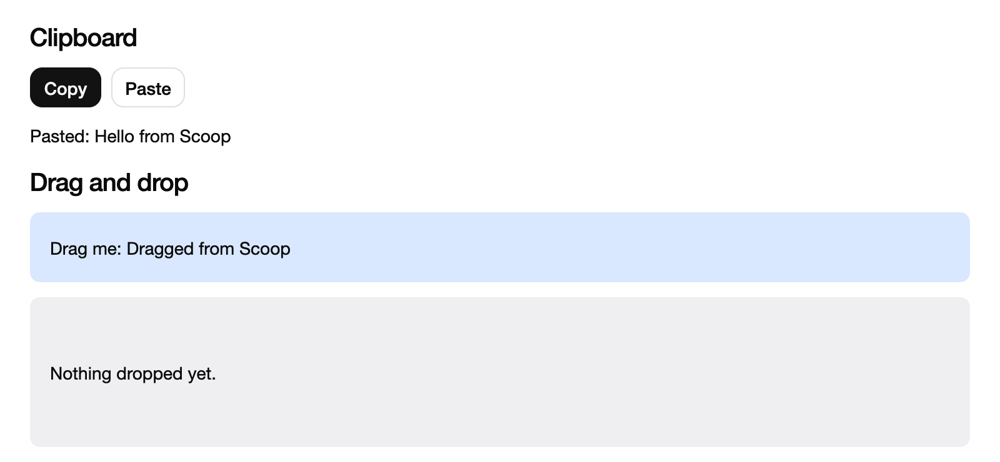

# 第 16 章　剪贴板与拖放

复制粘贴和拖放是程序之间交换数据的两条主要途径。输入框已经自己处理了文字的复制、粘贴和拖放（第 12 章），本章讲的是你自己的控件怎样参与进来：一个“复制链接”按钮，一块可以把文件拖进来的区域，一个可以拖出去的卡片。读完本章，你会知道：

- 怎样读写系统剪贴板，怎样在一次复制中提供多种格式；
- 怎样让一块区域接收拖放，怎样在拖动经过时给出反馈；
- 怎样从一块区域发起拖放；
- 窗口层的原生拖放接口和文本控件中的拖放；
- 哪些拖放行为需要在真实桌面上手动验收。

## 16.1　一个示例

保存为 `transfer.scoop`：

```scoop
{{#include ../../examples/ch16/transfer.scoop}}
```

```sh
scoop run transfer.scoop --release
```

窗口分为两部分。上半部分是剪贴板：Copy 按钮复制一段文字，Paste 按钮读取剪贴板并显示出来。下半部分是拖放：浅蓝色的条可以拖出一段文字，灰色的区域可以接收拖进来的文字或文件。



## 16.2　剪贴板

剪贴板从窗口或应用取得。组件中可以通过 `scope.nativeWindow.clipboard` 拿到它：

```scoop
private fun paste() {
    pasted.value = when (scope.nativeWindow.clipboard.readText()) {
        case Some(val value) -> f"Pasted: ${value}"
        case None -> "The clipboard has no plain text."
    }
}
```

`Clipboard` 有三个方法：

- **`readText(mediaType = "text/plain"): String?`**：读取一种文本格式。剪贴板中没有这种格式时返回 `None`；有，但内容是空的，返回 `Some("")`。两者是不同的。
- **`writeText(text)`**：用一段纯文本替换剪贴板的内容。
- **`writeTexts(representations)`**：把同一份内容的**多种表示**作为一个条目放进剪贴板，见下文。

在终端中执行 `printf 'Line one\r\nLine two from Terminal' | pbcopy`，再点 Paste，窗口显示两行文字，中间的 CRLF 变成了一个 LF：读写纯文本时，换行统一为 LF。再把剪贴板清空，点 Paste，显示 `The clipboard has no plain text.`。

### 一次复制，多种表示

Copy 按钮写入了两种表示：

```scoop
scope.nativeWindow.clipboard.writeTexts(
    [
        ClipboardText("text/plain", "Hello from Scoop"),
        ClipboardText("text/html", "<b>Hello</b> from Scoop")
    ]
)
```

`ClipboardText(mediaType, text)` 用 MIME 类型标识格式。粘贴的程序从中选择自己最能理解的一种：富文本编辑器取 HTML，保留加粗；终端取纯文本。复制一段 Markdown 文档时，常见的做法是同时提供 `text/plain`（看到的文字）和 `text/markdown`（可以继续编辑的源码）。

点 Copy 之后，用一个小程序查看系统剪贴板，同一个条目中有 `public.utf8-plain-text` 和 `public.html` 两种类型，HTML 的内容正是 `<b>Hello</b> from Scoop`。在 macOS 上，MIME 类型被映射为系统的标准类型，其他程序可以直接识别。

规则不多：

- 媒体类型必须是具体的 `text/<子类型>`，不能带参数，也不能用通配符；大小写不敏感；
- 列表不能为空，同一种类型不能出现两次；
- 文字中不能含有 NUL 字符；
- 只有 `text/plain` 会统一换行，其他格式原样保留；
- 库不解析 HTML 或 Markdown，内容是否正确由你负责。

参数有误时，`writeTexts` 在接触系统剪贴板之前就会抛出异常，剪贴板保持原样。剪切操作应该在全部表示写入成功之后，再删除原来的内容。

> **验证多种表示时的一个坑**
>
> 编写本节时，作者第一次点 Copy 后去查看剪贴板，只看到了纯文本，HTML 不见了。用 Swift 直接写入两种表示做对照，结果也一样：一两秒之后，剪贴板的修改计数又增加了一次，HTML 被去掉了。原来是电脑上的另一个程序在每次复制之后改写了剪贴板。换成一个持续监视剪贴板变化的小程序，才看到 Scoop 写入的那一刻，两种表示都在。如果你的用户反馈“复制出去的格式丢了”，先排除剪贴板管理工具这类程序的影响。

### 什么时候读剪贴板

只在用户**明确要求粘贴**时读取剪贴板：点了粘贴按钮、按了 ⌘V、选了菜单中的粘贴。不要在程序启动或窗口获得焦点时“看看剪贴板里有什么”，剪贴板中可能有用户的密码和其他隐私数据，一些平台也会因此向用户发出提示。

剪贴板的操作要在 UI 线程上进行（第 8 章），并且要求应用仍在运行。从窗口取得的剪贴板不依赖这个窗口，窗口关闭后仍然可以使用。

Linux 上还有一个独立于剪贴板的“主选区”（PRIMARY）：选中文字即复制，鼠标中键粘贴。它通过 `primarySelection` 访问，macOS 和 Windows 上不可用，使用前先检查 `isAvailable`。

## 16.3　接收拖放：dropTarget

`DropZone` 是一个自绘的 Element，它的输入区域登记为拖放目标：

```scoop
private val target = scope.dropTarget(
    area,
    DropAreaHandlers(
        offer = { offer, _ ->
            if (offer.formats.contains(DragFormat.Files) && offer.effects.copy)
                DropDecision.Accept(DragFormat.Files, DragEffect.Copy)
            else if (offer.formats.contains(DragFormat.Text) && offer.effects.copy)
                DropDecision.Accept(DragFormat.Text, DragEffect.Copy)
            else
                DropDecision.Reject
        },
        drop = { dropped, _ ->
            props.value(describe(dropped.content))
            true
        }
    )
)
```

`DropAreaHandlers` 有三个回调，第二个参数都是区域内的局部坐标：

- **`offer(offer, position)`**：拖动经过这块区域时调用，可能调用很多次。`DropOffer` 中只有**元数据**：提供了哪些格式（`formats`）、允许哪些操作（`effects`）、修饰键、是否来自本程序（`local`），**没有内容**。回调返回 `DropDecision.Accept(format, effect)` 选定一种格式和一种操作，或者返回 `Reject`。选定的格式和操作必须是对方实际提供的，否则等同于拒绝。
- **`drop(request, position)`**：用户在这块区域上松开时调用。这时才把选定格式的内容复制出来，放在 `request.content` 中：`DragContent.Text(text)`、`DragContent.Url(url)` 或 `DragContent.Files(paths)`。返回 true 表示**已经实际接收**了数据。
- **`leave()`**：拖动离开这块区域，可以省略。

拖放的格式只有三种：`DragFormat.Text`、`Url` 和 `Files`；操作有 `Copy`、`Move` 和 `Link` 三种。

几条规则：

- **在 `offer` 中只做判断，不做事。** 它会被频繁调用，而且这时数据还没有到手。
- **`drop` 返回 true 之前，数据必须已经处理完。** 不能先放进一个队列，再返回 true 表示“稍后处理”。
- **文件路径不代表文件内容。** `Files` 中是一组路径，读取文件、检查格式是你的事，而且最好放到后台去做（第 29 章）。
- **子区域拒绝时，交给父区域。** 一块区域拒绝了某种格式，拖放会沿逻辑上的父级继续寻找愿意接收的目标。官方示例就是这样做的：两个子区域只接收文字和 URL，文件则交给它们共同的背景区域。

### 拖动经过时的反馈

`dropTarget` 返回一个 `DropArea`，它的 `hover` 属性在有可接收的数据经过时为 `Some(DropHover(position, format, effect))`，否则为 `None`。`hover` 背后是一个 State，在 `scene()` 或 `render()` 中读取它，变化时就会重画：

```scoop
val color = when (target.hover) {
    case Some(_) -> Color(0.80, 0.92, 0.82)
    case None -> Color(0.95, 0.95, 0.96)
}
```

拖动结束或离开时，`hover` 自动回到 `None`。被拒绝的拖动不会设置 `hover`，所以只有“能放”的时候才高亮，用户一看就知道这里接不接。

## 16.4　发起拖放：dragSource

`DragChip` 的区域登记为拖放的来源：

```scoop
private val source = scope.dragSource(area) { _ ->
    Some(DragSourceData(DragContent.Text("Dragged from Scoop")))
}
```

用鼠标左键按下，移动超过阈值（`DragSourceOptions.threshold`，默认 4 个单位）之后，框架调用这个函数准备数据：

- 返回 `Some(DragSourceData(...))`：接管这次按下，启动系统的拖动会话。原来的点击候选被取消，松开时不会触发点击；
- 返回 `None`：这次不拖动，按下仍然可以成为一次普通的点击。

`DragSourceData` 的参数：

| 参数 | 含义 |
| --- | --- |
| `content` | 要拖出的内容，`DragContent.Text`、`Url` 或 `Files` |
| `effects` | 允许的操作，默认只允许 Copy |
| `localData` | 只给本程序内的接收方看的任意对象，不会写进系统的拖动数据 |
| `preview` | 拖动时跟随指针的预览图 |
| `onCompleted` | 拖动结束时调用，参数是 `DragResult` |

几点说明：

- **数据在开始拖动时才准备。** 不要在每次移动时读取全文或文件。
- **只响应左键。** 右键和打开上下文菜单的点击不会开始拖动。`DragSourceOptions` 的 `mouse` 和 `contacts` 分别控制是否接受鼠标和直接接触。
- **自定义预览**在准备函数中用 `start.renderPreview(bounds) { canvas -> ... }` 绘制一次，再通过 `preview = Some(image)` 传入。
- **Move 要自己删除数据。** `DragResult` 是 `Dropped(effect)`、`NotDropped` 或 `Failed(error)`。允许 Move 时，收到 `Dropped(DragEffect.Move)` 后，先确认原来的数据还在、还没被改过，再由业务删除它。框架不会替你删除任何东西。

### 本节没有完成的验证

本书的其他示例都在真实窗口中验证过，但示例中的拖放部分是个例外。系统的拖动会话需要真正的鼠标按下和移动，本书使用的自动化工具只能向窗口发送合成的鼠标事件，无法启动它：把浅蓝色的条拖到灰色区域上，灰色区域没有任何变化。工具链自己的测试也有同样的限制，它们直接调用系统的拖放协议方法来测试接收的逻辑，并说明这不等同于真实的拖动会话，真实的拖放要在桌面上手动验收。

所以，下面是**预期**的行为，请你在自己的电脑上试一试：

- 把浅蓝色的条拖到灰色区域上，经过时灰色区域变为浅绿色，松开后显示 `Dropped text: Dragged from Scoop`；
- 从访达拖一个或几个文件进来，显示 `Dropped N file(s)`；
- 从浏览器或文本编辑器拖一段文字进来，显示其中的文字；
- 拖动离开灰色区域，颜色恢复。

本章的剪贴板部分则都在真实窗口中验证过。

## 16.5　窗口层的原生拖放

`scope.dropTarget` 和 `scope.dragSource` 建立在窗口库 `scoop.window` 的接口之上。不使用 `scoop.ui`、直接基于窗口库编写程序时，可以使用这一层：

- **`Window.registerDropTarget(DropHandlers(offer, drop, leave))`** 把整个窗口登记为拖放目标，每个窗口只能登记一个。回调的含义和 `DropAreaHandlers` 相同，只是没有局部坐标参数，位置在 `DropOffer.position` 中，是窗口的逻辑坐标。
- **`Window.beginDrag(content, effects, localData, onCompleted)`** 从当前的鼠标按下序列发起拖动。如果启动之前按键就已经松开，以 `NotDropped` 结束。

用 `scoop.ui` 时，优先使用 `scope.dropTarget` 和 `scope.dragSource`：它们按控件的实际几何分配拖放，处理好了区域的父子关系、禁用和卸载。

## 16.6　文本控件中的拖放

`input`、`textarea` 等文本控件已经内置了拖放：

- **接收**：默认接收纯文本和 URL，落点处显示一个临时的光标，靠近边缘时自动滚动。拖进来的文字和粘贴一样经过编辑策略的 `paste` 阶段（第 12 章）。`acceptDrops = false` 关闭接收。
- **拖出**：选中一段文字后，在选区内按下并拖动，就能把它拖出去。`drag` 属性接收 `TextDragOptions`，可以配置阈值、允许的操作、预览和完成回调，`TextDragOptions(enabled = false)` 关闭拖出。
- **移动与复制**：拖动文本控件中的选区，默认是移动；macOS 上按住 Option、Windows 和 Linux 上按住 Control 是复制。在同一个输入框中移动，撤销一次就能还原。
- **受保护的文本**：设置了 `protectedText` 或使用遮罩的输入框默认不能拖出，和不能复制是同一条规则。

## 16.7　官方的拖放示例

工具链附带了一个更完整的拖放示例：两个窗口，一块只接收文字的区域、一块只接收 URL 的区域、一个接收文件的背景，下面还有一个多行编辑框。它还演示了怎样让同一块区域同时支持点击、键盘、⌘C、⌘V 和读屏器，这些入口和拖放写入同一份状态。示例的目录是工具链中的 `src/scoop.ui/examples/drop-target`，复制出来就可以运行：

```sh
cp -R ~/.scoop/toolchains/<版本目录>/src/scoop.ui/examples/drop-target .
cd drop-target
scoop run --release
```

`<版本目录>` 换成 `ls ~/.scoop/toolchains` 中你当前使用的那个。本书在写作时确认了它可以这样构建，拖放的行为同样需要你手动试验。工具链的说明文档记录了上游开发者在 macOS 上手动确认过的项目：同一个编辑框内的移动、拖到彩色区域的复制，以及跨窗口和与外部程序之间的双向文本拖放。

## 常见误用

- **在程序启动时读取剪贴板。** 只在用户要求粘贴时读取。
- **把 `readText` 返回的 `None` 当作空字符串。** 两者含义不同：一个是没有这种格式，一个是内容为空。
- **只写一种格式。** 能提供多种表示时，用 `writeTexts`，让粘贴的程序选择。
- **在 `offer` 中读取内容或修改状态。** 它只有元数据，而且会被频繁调用。
- **`drop` 先排队再返回 true。** 返回 true 时数据必须已经处理完。
- **允许 Move，却不在完成回调中删除原数据，或者不检查就删除。** 收到 `Dropped(Move)` 后核对原数据，再由业务删除。
- **把文件路径当作文件内容已经可用。** 读取文件是另一件事，放到后台去做。
- **拖放是导入数据的唯一途径。** 同时提供“打开文件”的按钮或菜单（第 28 章）和粘贴，照顾键盘和读屏器的用户。

## 小结

- 剪贴板通过 `scope.nativeWindow.clipboard` 取得；`readText` 返回 `String?`，`writeText` 写纯文本，`writeTexts` 把多种表示放进同一个条目，纯文本的换行统一为 LF。
- `scope.dropTarget(area, DropAreaHandlers(offer, drop, leave))` 接收拖放：`offer` 根据元数据选定格式和操作，`drop` 拿到内容并在处理完后返回 true；`hover` 用来绘制经过时的反馈。
- `scope.dragSource(area) { start -> ... }` 在移动超过阈值后准备数据，返回 `None` 则保留普通点击；默认只允许 Copy，Move 由业务删除原数据。
- 窗口层有 `registerDropTarget` 和 `beginDrag`；用 `scoop.ui` 时优先使用组件层的接口。
- 文本控件已经内置了拖放，接收的文字经过编辑策略，受保护的文本不能拖出。
- 真实的拖动会话需要真实的鼠标操作，要在桌面上手动验收。

## 练习

1. 给示例增加一个 Paste HTML 按钮，读取 `text/html` 并显示出来。先点 Copy 再点它，看看读到的是什么；再从浏览器中复制一段网页文字试试。
2. 修改 `DropZone`，只接收文件，并在区域中列出每个文件的文件名。
3. 让 `DragChip` 允许 Move（`DragEffects(true, true, false)`），在 `onCompleted` 中收到 `Dropped(DragEffect.Move)` 时把条上的文字改为 `(moved)`。在 macOS 上分别拖到灰色区域和一个文本编辑器中，结果有什么不同？
4. 给 `DropZone` 加一个 `leave` 回调，在终端打印一行日志。拖进来再拖出去，日志打印了几次？
5. 把 `DragChip` 的拖出内容改为 `DragContent.Url("https://scoop-lang.org")`，再拖到浏览器的地址栏中试试。
