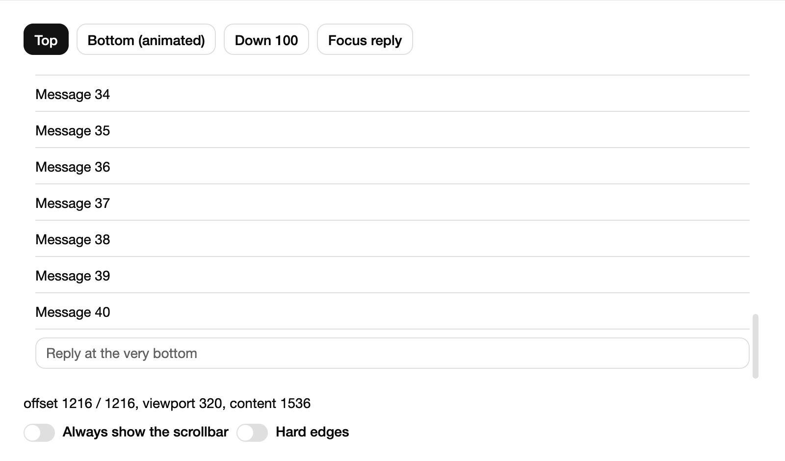
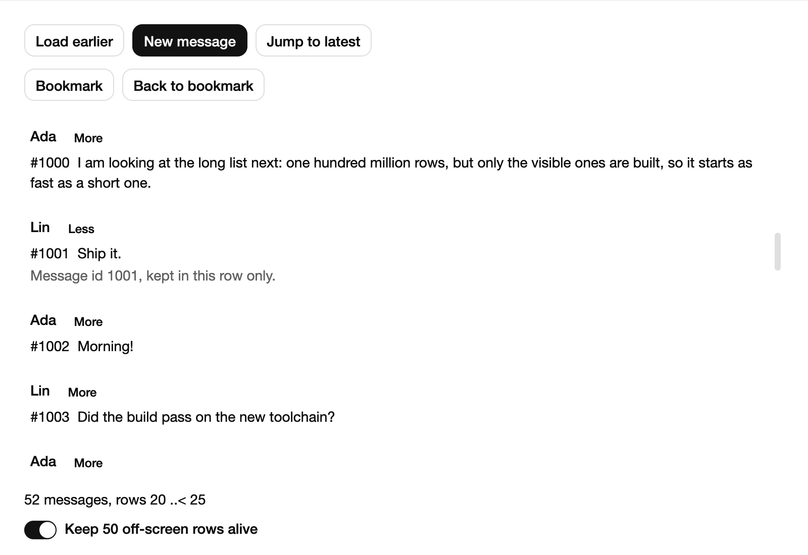
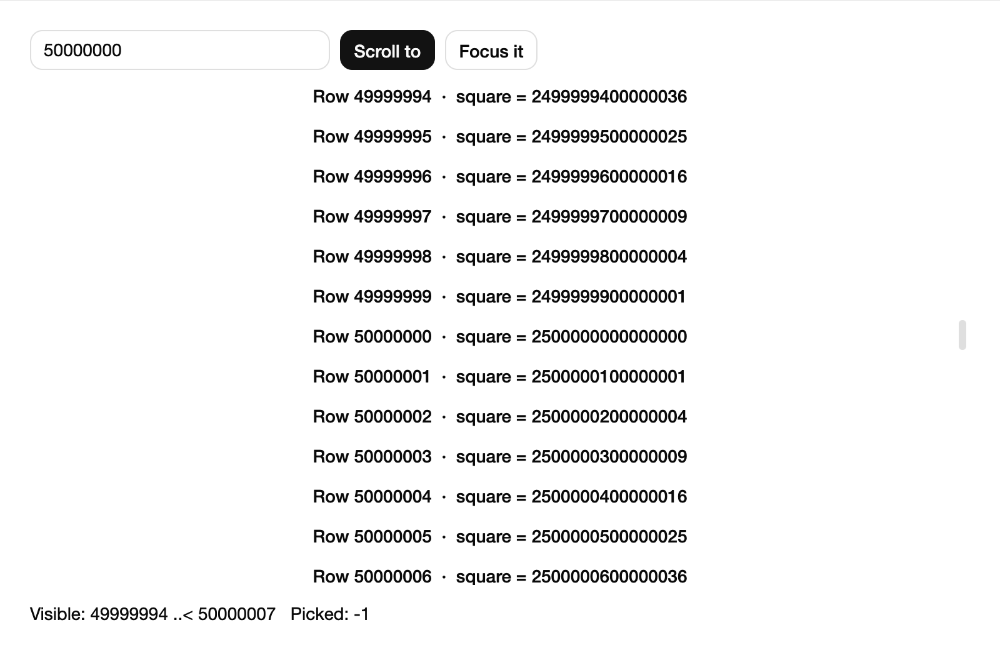

# 第 17 章　滚动与长列表

第四部分讲的是用户怎样把信息交给程序。从本章开始的第五部分讨论怎样组织一个内容多于一屏的界面：滚动、弹层、导航和数据展示。本章先讲滚动。读完本章，你会知道：

- `scrollArea` 怎样让一块内容可以滚动，`ScrollState` 怎样读取和控制滚动位置；
- 滚动条的显示方式和边界的回弹效果怎样配置；
- 为什么长列表要用 `virtualList`，怎样为它提供数据；
- 怎样按行定位、保存和恢复阅读位置，怎样让列表跟随新增的内容；
- 滚出视野的行什么时候被销毁，怎样保留它们。

## 17.1　一个滚动区域

保存为 `scroll_area.scoop`：

```scoop
{{#include ../../examples/ch17/scroll_area.scoop}}
```

```sh
scoop run scroll_area.scoop --release
```

窗口中间是一个 320 高的滚动区域，里面有 40 条消息和最下面的回复框。上面的四个按钮分别跳到顶部、平滑地滚到底部、向下滚动 100、把回复框滚入视野并聚焦；下面一行实时显示滚动位置，最下面是两个开关，17.3 节使用。点 “Bottom (animated)” 之后，窗口是这样的：



`scrollArea(content) { ... }` 接收一个视图作为内容。内容按自己的自然高度布局，比视口高的部分可以滚动。它支持鼠标滚轮、触控板、拖动滚动条，以及手指和笔尖的拖动；视口获得焦点后，还可以用方向键、Page Up、Page Down、Home 和 End 滚动。直接接触先按轻点处理，移动超过阈值之后才开始滚动，所以从一个按钮上起手也能滚动列表，而不会误点那个按钮。

常用的配置：

| 属性 | 作用 |
| --- | --- |
| `height`、`width` | 视口的大小。滚动方向上父级没有给出有限的空间时必须设置 |
| `axes` | 滚动方向：`ScrollAxes.Vertical`（默认）、`Horizontal`、`Both` |
| `state` | 自己持有的 `ScrollState`，用来读取和控制位置（17.2 节） |
| `scrollbars` | `ScrollbarVisibility.Auto`（默认，内容溢出时显示）、`Always`、`Hidden` |
| `scrollbarBehavior`、`scrollPhysics` | 滚动条的行为和边界效果（17.3 节） |
| `lineStep` | 方向键和传统滚轮一次滚动的距离，默认 40 |
| `chain` | 滚到边界后，剩余的滚动是否交给外层的滚动区域（17.3 节） |
| `paintCache` | 绘制缓存（17.6 节） |

`scrollArea` 会构建并保持**全部**内容。滚动只是移动内容的位置，不会重新构建它。几十到几百个子视图时这没有问题，再多就该换成 17.4 节的 `virtualList`。

## 17.2　ScrollState：读取与控制位置

和 `TextEditorState` 一样，滚动位置由调用方持有，控件只是借用：

```scoop
private val scroll = ScrollState()
```

```scoop
scrollArea(messages) {
    state = Some(scroll)
    height = Some(320.0)
}
```

不传 `state` 时，滚动区域使用自己内部的状态，你就既读不到也改不了位置了。

### 读取

`ScrollState` 有四个属性：

- `offset`：当前的滚动位置，一个 `Point`；
- `maximum`：最大可滚动的位置；
- `viewport`：视口的大小；
- `content`：内容的大小。

示例中的标签在 `render()` 中读取它们：

```scoop
label(
    f"offset ${scroll.offset.y.toInt()} / ${scroll.maximum.y.toInt()}, " +
        f"viewport ${scroll.viewport.height.toInt()}, " +
        f"content ${scroll.content.height.toInt()}"
)
```

读取就是依赖（第 8 章），所以每次滚动，这个组件都会重新 `render()`，标签上的数字随之变化。窗口刚打开时显示 `offset 0 / 1216, viewport 320, content 1536`：内容高 1536，视口高 320，最多可以滚动 1536 − 320 = 1216。用滚轮向上滚动几下，数字立即跟着变。

这些值来自**最近一次真正呈现到屏幕上的画面**（第 4.9 节），而不是你刚刚提出的请求。第一帧呈现之前，它们都是零，`hasSnapshot` 为 false。

在 `render()` 中读取 `offset` 会让组件在每次滚动时重新 `render()`。像示例这样显示一个数字没有问题，但不要在一个很大的组件里读它，否则滚动一下就要重建整个组件。只在真正需要位置的小组件中读取。

### 控制

控制位置的方法有四个：

- `scrollTo(Point(x, y))`：跳到指定位置；
- `scrollBy(Point(dx, dy))`：相对滚动，返回按当前范围计算的实际位移；
- `animateTo(Point(x, y))`：平滑滚动，默认用 300 毫秒，第二个参数可以换一个动画规格；
- `reveal(rect, horizontal, vertical)`：滚动到让内容坐标中的一个矩形可见，两个方向的对齐方式分别是 `ScrollAlignment.Nearest`（默认，移动最少的距离）、`Start`、`Center` 或 `End`。

四个按钮分别调用了前三个方法和一次聚焦：

```scoop
button("Top", { scroll.scrollTo(Point(0.0, 0.0)) })
button("Bottom (animated)", { scroll.animateTo(Point(0.0, scroll.maximum.y)) })
```

依次试一下：点 Down 100，位置变为 100；点 “Bottom (animated)”，内容平滑地滚到底，中途读到的位置是 464 这样的中间值，最后停在 1216；点 Top，立即回到 0。

几条规则：

- **只在事件回调中控制位置。** 和写 State 一样，`render()` 中不能调用这些方法（第 4.5 节）。
- **请求先登记，下一帧才生效。** 调用 `scrollTo` 之后马上读 `offset`，读到的还是旧值。连续的 `scrollBy` 会在尚未呈现的目标上累加。
- **用户的滚动会取消平滑滚动。** 动画进行中用户转动滚轮，动画立即停下。
- **`animateTo` 要求 `ScrollState` 已经交给一个滚动区域。** 还没有交给任何滚动区域时调用它会抛出异常；已经交给滚动区域、但第一帧还没有呈现时，动画会排队等待。

### 滚动到一个控件

“Focus reply” 按钮没有计算任何位置，它只是请求回复框获得焦点：

```scoop
button(
    "Focus reply",
    {
        replyFocus.requestFocus()
        Unit
    }
) { variant = ButtonVariant.Outline }
```

控件通过 `FocusHandle`、Tab 键或方向键获得焦点时，框架会自动把它滚入视野（第 14 章）。嵌套的滚动区域逐层处理，先调整最近的一层，再调整外层。点 Focus reply，内容滚到底部附近，回复框出现在视口中并获得焦点。所以“滚动到某个控件”最简单的写法就是聚焦它，不需要自己计算坐标。

> **深入一点：观察滚动的来源**
>
> 有时需要知道一次滚动是谁发起的，比如“用户自己往上翻了，就停止自动滚到底部”。`scroll.observeIntent { event -> ... }` 在每次有新的位置意图时调用，`event` 是 `ScrollIntent.User`（滚轮、拖动、键盘）、`Programmatic`（程序调用）或 `LayoutCorrection`（框架为了保持阅读位置所做的修正）。它返回一个 `Closeable`，用 `scope.resource { ... }` 登记，组件卸载时自动关闭。17.5 节的 `FollowEnd` 已经替你处理了最常见的这种需求。

## 17.3　滚动条与边界

### 滚动条的行为

`scrollbars` 决定滚动条是否显示，`scrollbarBehavior { ... }` 决定它怎样显示。最重要的是 `preset`：

- **`ScrollbarPreset.FollowSystem`**（默认）：跟随系统的设置。macOS 的“显示滚动条”为自动隐藏时，滚动条平时是细的、半透明的，停止滚动约一秒后淡出，指针移到边缘或拖动时变宽；系统要求始终显示时，滚动条一直以正常宽度显示。
- **`Static`**：始终以正常宽度显示，不淡出，不随悬停变化。
- **`Custom`**：从自动隐藏的预设开始，再由你调整各项参数。

示例的第一个开关在 `FollowSystem` 和 `Static` 之间切换：

```scoop
scrollbarBehavior {
    preset = if (staticBars.value)
        ScrollbarPreset.Static
    else
        ScrollbarPreset.FollowSystem
}
```

`Custom` 之下可以调整的项目很多，常用的有：

| 属性 | 作用 |
| --- | --- |
| `autoHide` | `Some(false)` 关闭自动隐藏 |
| `idleDelay` | 停止滚动多久之后淡出，默认 1 秒 |
| `idleWidth`、`hoverWidth`、`dragWidth` | 平时、悬停、拖动时的宽度 |
| `placement` | `ScrollbarPlacement.Overlay` 覆盖在内容上（默认），`Gutter` 在内容旁边留出固定的位置 |
| `trackPress` | 点击轨道时 `ScrollbarTrackPress.Page` 翻一页（默认），`Jump` 直接跳到点击的位置 |

`Overlay` 不占用内容的宽度，滚动条出现和消失时内容不会挪动；`Gutter` 为滚动条留出固定的一条，内容的宽度始终一致，适合需要严格对齐的表格。`textarea` 默认使用 `Gutter`，其余的滚动控件默认使用 `Overlay`。

几个与无障碍有关的细节由框架处理：系统要求“减少透明度”时，滚动条不再半透明；要求“减少动画”时，淡入淡出变为立即切换。

> **注意：后台窗口中的滚动条**
>
> 滚动条的淡入淡出只在窗口处于前台、获得焦点且没有被遮挡时进行。本书写作时，作者用自动化工具在后台操作示例窗口，`Static` 和 `Custom` 的区别可以看到：换成 `Custom` 后，停止滚动约一秒，滚动条淡出；`Static` 一直显示。但 `FollowSystem` 在后台窗口中没有淡出，上面关于它的描述来自工具链的源码和文档。请在前台的窗口中自己试一下。

### 边界效果

滚到尽头之后还继续滚，会发生什么，由 `scrollPhysics` 决定。它接收一个 `ScrollPhysicsOptions`，其中的 `boundary` 有三种取值：

- **`ScrollBoundary.Platform`**（默认）：macOS 上是弹性边界，内容可以被拉过头一点，松手后弹回；Windows 和 Linux 上是硬边界。
- **`Hard`**：硬边界，滚到尽头就停住。
- **`Elastic`**：在任何平台上都使用弹性边界。

示例的第二个开关切换为硬边界：

```scoop
scrollPhysics = if (hardEdges.value)
    ScrollPhysicsOptions(boundary = ScrollBoundary.Hard)
else
    ScrollPhysicsOptions()
```

弹性边界只对触控板这样带连续相位的滚动和手指拖动起作用，传统的滚轮一格一格地滚，到了尽头就停住，不会回弹。`ScrollPhysicsOptions` 还可以调整阻力（`resistance`）、最多拉过头多少（`maxOverscroll`）和回弹的弹簧参数；`inertia` 接收 `ScrollInertiaOptions`，控制手指和笔尖松开后的惯性滑动，`ScrollInertiaOptions(enabled = false)` 关闭惯性。

回弹和惯性都是动画。系统要求“减少动画”时，回弹归零，惯性立即停止，平滑滚动直接到达目标；主题中设置了减少动画（第 21 章）也是一样。

用触控板在示例中滚到顶部再继续往上推，默认设置下内容会被拉开一点再弹回；打开 Hard edges 之后，内容停在原处。本书写作时，自动化工具只能发送传统的滚轮事件，所以这一点没有在窗口中核对。

### 嵌套滚动与触摸

一个滚动区域放在另一个滚动区域中时，内层滚到边界后，剩余的滚动交给外层，这是 `chain = ScrollChain.Chain`（默认）。设置为 `ScrollChain.Contain`，滚动就停在内层，不会带动外层。弹层中的列表常常需要这样做，避免列表滚到底之后背后的页面跟着滚动。

手指和笔尖的拖动由 `touchScroll` 配置，接收 `TouchScrollOptions(enabled, threshold, lockAxis)`：移动超过 `threshold`（默认 8 个单位）才开始滚动，`lockAxis` 为 true 时锁定在起手的主方向上。

## 17.4　虚拟列表：只构建看得见的行

`scrollArea` 构建全部内容。一万行的列表就要创建一万个视图，即使屏幕上只看得见十几行。`virtualList(source, extent) { ... }` 只为看得见的行（加上 `overscan` 指定的预留长度）构建视图，滚动时创建新露出的行，销毁滚出去的行。它的开销和总行数无关。

下面的示例是一个聊天记录，保存为 `chat_log.scoop`：

```scoop
{{#include ../../examples/ch17/chat_log.scoop}}
```

```sh
scoop run chat_log.scoop --release
```

窗口上方是五个按钮：加载更早的消息、收到一条新消息、跳到最新、记下当前位置、回到记下的位置。中间是消息列表，每条消息有一个 More 按钮，展开后多显示一行。下面一行显示消息总数和当前可见的行，最下面的开关决定是否保留滚出视野的行（17.6 节）。依次点 More 展开 #1001、Load earlier、Bookmark、Jump to latest、Back to bookmark 和 New message，再打开开关，窗口是这样的：



### 数据源：ItemSource

`virtualList` 的数据通过 `ItemSource` 接口提供：

```scoop
public interface ItemSource {
    public val count: Long
    public fun keyAt(index: Long): ViewKey
    public fun indexOfKey(key: ViewKey): Long?
    public fun build(index: Long): View
}
```

- `count` 是总行数；
- `keyAt` 和 `indexOfKey` 在下标和**稳定的 key** 之间互相转换。列表按 key 识别行：按行定位、聚焦、阅读位置、保留状态都靠它。同一条数据的 key 不能随滚动或插入而变化，这和第 11 章的 key 是同一个道理；
- `build` 为一行创建视图，只在这一行需要显示时调用。

示例中的 `Conversation` 用消息的 id 作为 key。id 是连续的，所以 `indexOfKey` 不用查找，减去第一条的 id 就是下标：

```scoop
public override fun indexOfKey(key: ViewKey): Long? {
    if (messages.size == 0L) return None
    return when (key) {
        case Number(val id) -> {
            val index = id - messages[0L].id
            if (index >= 0L && index < messages.size) Some(index) else None
        }
        else -> None
    }
}
```

`indexOfKey` 会在定位和恢复阅读位置时被调用，数据量大时不要写成逐行查找。

### 数据变化：换一个新的快照

`Conversation` 是**不可变**的：它持有一个数组，从不修改。数据变化时，`ChatStore` 创建一个新的 `Conversation`，写入 State：

```scoop
private fun publish() {
    conversation.value = Conversation(messages.toArray())
}
```

`render()` 读取 `store.conversation.value`，把新的数据源交给 `virtualList`。列表比较的是数据源**对象本身**：传入的还是原来那个对象，列表就认为数据没有变；换了一个新对象，列表用新数据源的 `indexOfKey` 查出已经显示的每一行现在的位置，key 还在的行保留原来的实例，只更新内容，key 不在了的行被销毁，新露出的行再调用 `build` 创建。

所以不要在原地修改数据源的内容而不换对象，列表不会发现这样的修改。另外，`keyAt` 和 `indexOfKey` 必须互相一致，两行也不能共用一个 key，否则列表在换数据源时会报错。

### 行高：ItemExtent

第二个参数 `ItemExtent` 告诉列表每一行有多高：

- **`ItemExtent.Fixed(32.0)`**：每行同样高。列表可以直接算出任意一行的位置，定位最快，17.7 节的一亿行列表用的就是它。
- **`ItemExtent.Variable(56.0)`**：行高各不相同，参数是估计值。还没有显示过的行按估计值计算，显示之后记下实际的高度。

聊天记录中的消息有长有短，展开之后还会变高，所以用 `Variable`。估计值不需要精确，但尽量接近常见的行高，这样滚动条的位置和长度更稳定。

`overscan` 指定在视口前后额外构建多长的内容，默认是 0。设置一个适当的值，快速滚动时新露出的行已经准备好了。

## 17.5　按行定位与阅读位置

虚拟列表的大部分行并不存在，所以不能用 `FocusHandle` 或像素位置去找它们。要操作某一行，使用 `VirtualListHandle`：

```scoop
private val list = VirtualListHandle()
```

```scoop
virtualList(conversation, ItemExtent.Variable(56.0)) {
    handle = Some(list)
    ...
}
```

### 按 key 定位

`scrollToItem(key, alignment)` 滚动到指定的行，`alignment` 和 `reveal` 的相同。Jump to latest 把最后一条消息滚动到视口底部：

```scoop
when (conversation.lastKey) {
    case Some(val last) -> list.scrollToItem(last, ScrollAlignment.End)
    case None -> {}
}
```

点 Jump to latest，底部的文字变为 `30 messages, rows 24 ..< 30, at the end`。即使目标行还没有显示过、只有估计的高度，列表也会先按估计滚过去，再用实际测量的高度修正，最终停在正确的位置。修正完成之前，`isPending` 为 true。

`scrollToItem` 返回 false 表示这次请求无效：列表还没有挂载，或者 key 不在数据源中。本书写作时试过在组件的 `onMount` 中调用它，返回的就是 false，因为这时列表还没有和句柄连接起来。

### 阅读快照

`list.reading` 是最近一次呈现时的阅读快照 `VirtualReadingSnapshot?`。第一帧之前是 `None`。它有三个字段：

- `visible`：可见行的下标范围，不含 `overscan` 预留的行，`start ..< end`；
- `anchor`：阅读锚点 `VirtualReadingAnchor(key, offset)`，即第一个可见行的 key，以及视口顶边落在这一行内的位置；
- `atEnd`：是否已经滚到末尾。

在 `render()` 中读取它会建立依赖，滚动时组件重新 `render()`，示例底部的文字就是这样实时更新的。

### 保存和恢复阅读位置

阅读锚点用 key 而不是像素描述位置，所以在数据变化之后仍然有意义。Bookmark 把它存起来，Back to bookmark 把它交给 `restore`：

```scoop
bookmark.value = when (list.reading) {
    case Some(val value) -> value.anchor
    case None -> None
}
```

```scoop
when (bookmark.value) {
    case Some(val value) -> list.restore(value)
    case None -> {}
}
```

在某处点 Bookmark，再点 Jump to latest，最后点 Back to bookmark，列表回到原来的位置，底部的可见范围也恢复为原来的值。数据源中已经没有这个 key 时，`restore` 返回 false，不会按旧的下标去猜另一条数据。把锚点保存到文件中，下次启动时恢复，就能实现“回到上次读到的地方”。

### 数据变化时保持阅读位置

`anchor` 属性决定数据变化时列表怎样调整位置，有三种取值：

- **`VirtualListAnchor.KeepVisible`**（默认）：保持第一个可见行不动。前面插入了新行，或者前面的行变高了，用户正在看的内容也不会被推走。
- **`FollowEnd`**：除了上面的行为，如果原来已经在末尾，新增的内容追加在末尾时自动跟过去。向上翻阅时则不跟随。
- **`None`**：只保留数值上的偏移，按新的范围收敛。

聊天记录用的是 `FollowEnd`。下面三个实验分别对应三种情况：

- **在末尾时收到新消息。** 点 Jump to latest，再点 New message，底部变为 `31 messages, rows 26 ..< 31, at the end`：列表跟着滚到了新消息。
- **在中间时收到新消息。** 向上滚一段，或者点 Back to bookmark，再点 New message，消息总数加一，可见范围不变：用户正在看历史记录，不应该被拉回底部。
- **在前面插入历史。** 滚到顶部，点 Load earlier，前面多了 20 条消息，底部变为 `51 messages, rows 20 ..< 25`，屏幕上仍然是原来的 #1000 到 #1004。下标变了，看到的内容没变。

后两种情况就是 `KeepVisible` 的行为，`FollowEnd` 在此基础上增加了第一种。

> **从其他框架过来**
>
> 在很多框架中，向列表前面插入数据会让内容跳动，需要自己记住插入前的位置再补偿回去。Scoop 的虚拟列表按 key 保持阅读位置，这件事是默认行为。第 20 章的会话组件 `messageScroller` 在此基础上进一步处理了聊天界面的其他需求：初始停在末尾、新一轮对话从顶部开始显示等。

## 17.6　保留行状态与绘制缓存

### 滚出视野的行会被销毁

默认情况下，行滚出视野（和 `overscan`）之后就被销毁，`retention` 是 `ItemRetention.Dispose`。滚回来时，列表调用 `build` 重新创建它。行中如果有组件自己的状态，比如示例中 `MessageRow` 的 `expanded`，这时就丢了：

```scoop
class MessageRow(private val props: Props<Message>, scope: ComponentScope) : Component(scope) {
    private val expanded = state(false)
    ...
}
```

试一下：点 #1001 的 More 展开它，点 Jump to latest 滚到底，再滚回顶部，#1001 又收起来了。

正在交互的行例外：拥有焦点的行、按下还没有松开的行、正在进行文字输入的行，即使滚出视野也会暂时保留，交互结束后才销毁。所以用户在输入框中输入时把它滚出去，输入也不会中断。

### 保留一部分行

`ItemRetention.KeepAlive(n)` 额外保留最近使用过的 n 个离屏行，它们的状态和资源都留着，只是不测量也不绘制。打开示例下面的开关，就是把 `retention` 换成 `KeepAlive(50L)`：

```scoop
retention = if (this @ChatLog.keepAlive.value)
    ItemRetention.KeepAlive(50L)
else
    ItemRetention.Dispose
```

再做一遍上面的实验：展开 #1001，跳到底，再滚回顶部，#1001 仍然是展开的。

`KeepAlive` 有上限，超出时最久没用过的行仍会被销毁。所以它适合保留“丢了也无妨，但最好别丢”的状态，比如展开、动画和图片缓存。**用户输入的内容、选中的状态这些不能丢的数据，应该放进数据模型**，而不是行组件的字段。比如行中的输入框，`TextEditorState` 放在数据源或 Store 中，行被销毁再重建时，交给新的输入框的还是同一个模型（第 12 章）。

### 绘制缓存

`paintCache = PaintCachePolicy.Tiles()` 把已经绘制过的内容按图块缓存起来，滚动时只需要绘制新露出的部分。内容绘制很重时（大量文字、复杂的图形）可以打开它，普通的列表保持默认的 `None` 即可。`scrollArea` 也有同名的属性。

绘制缓存和 `retention` 是两回事：前者缓存像素，后者保留组件实例。两者可以分别打开。

## 17.7　一亿行的列表

最后看一个极端的例子。保存为 `huge_list.scoop`：

```scoop
{{#include ../../examples/ch17/huge_list.scoop}}
```

```sh
scoop run huge_list.scoop --release
```

列表有一亿行，每一行的文字在 `build` 中即时计算，程序没有为任何一行预先存储数据。尽管如此，窗口打开和滚动都和普通的列表一样快：作者的电脑上，这个程序运行时只占用约 100 MB 内存。在输入框中填入一个行号（默认是 `50000000`），点 Scroll to，这一行被滚动到列表中央：



这个例子用了几个前面没有讲的配置：

- **`ItemExtent.Fixed(32.0)`**：行高固定，列表直接算出第五千万行的位置，不需要测量前面的任何一行。用 `Variable` 也能定位到这里，但前面所有的行都只能按估计值计算。
- **`overscan = 64.0`**：视口上下各多构建 64 个单位的内容。底部显示的可见范围 `49999994 ..< 50000007` 不包括这些预留的行。
- **`navigation = ItemNavigation.Roving()`**：整个列表只占一个 Tab 停靠点。进入列表后，用上下方向键和 Home、End 在行之间移动，即将移到的行即使还没有构建，列表也会先把它准备好。不设置时（`ItemNavigation.None`），Tab 键在已经构建的行之间逐个移动，这在一亿行的列表中显然不合适。

Focus it 调用 `focusItem(key)`：先定位到这一行，再让行中第一个可以获得焦点的控件获得焦点。之后可以用方向键逐行移动，按空格键点击当前的行，底部的 Picked 随之变化。直接用鼠标点击某一行，效果也一样。`focusItem` 的第二个参数 `ItemFocusEdge.Last` 改为聚焦行中最后一个控件；还有一个重载接收一个函数，返回行中的某个具体的 `FocusHandle`，用于表格中的单元格这类场合。

本书写作时，键盘在行之间的移动没有在窗口中逐项核对，因为自动化工具无法向后台窗口发送按键。

### 读屏器怎样浏览一亿行

读屏器等辅助技术看到的列表同样不会展开成一亿个条目。在 macOS 上，超过 4096 行的虚拟列表按页提供给辅助技术，每页最多 100 行；列表外面包着一个分组，名称说明当前页的范围，比如 `Rows 49999995–50000094 of 100000000`，旁边是一个 “Go to row” 控件：输入从 1 开始的行号直接跳到那一页，递增和递减翻到下一页和上一页，还可以直达首页和末页。翻页只改变辅助技术的阅读范围，不会改变窗口中的滚动位置和键盘焦点；要让窗口显示某一行，执行这一行的 Scroll to Visible 动作。反过来，窗口滚动到当前页之外，或者某一行获得了焦点，阅读范围会跟过去。行数不超过 4096 的列表则一次提供全部条目。

本书写作时，用自动化工具读取这个窗口的完整无障碍树，程序的内存一直保持在 110 MB 左右。点 Scroll to 之后，分组的名称变为上面的 `Rows 49999995–50000094 of 100000000`；对 “Go to row” 执行末页动作，阅读范围变为 `Rows 99999901–100000000`，而窗口底部的可见范围仍然是 `49999994 ..< 50000007`。

## 常见误用

- **用 `scrollArea` 显示上千行。** 它会构建全部内容。行数多或者不确定时，用 `virtualList`。
- **在 `render()` 中调用 `scrollTo`。** 滚动位置和 State 一样，只能在事件回调中修改。
- **调用 `scrollTo` 后马上读 `offset`。** 读到的是上一帧的值，新位置要等下一帧呈现之后才生效。
- **在大组件中读取 `offset`。** 每次滚动都会重建整个组件。把读取位置的部分拆成小组件。
- **用会变化的值作为行的 key。** 比如用下标作为 key，前面插入一行，所有行的 key 都变了，阅读位置、保留的状态和焦点都会错位。用数据自己的 id。
- **原地修改数据源。** 列表不会发现。数据变化时创建新的数据源，写入 State。
- **把用户输入保存在行组件中。** 行滚出视野就会被销毁。把数据放在模型里，`KeepAlive` 只用来保留可以丢失的状态。
- **在 `onMount` 中调用 `scrollToItem`。** 这时列表还没有连接句柄，调用返回 false。在事件回调中调用，或者先检查返回值。

## 小结

- `scrollArea` 让一块内容可以滚动，它构建并保持全部内容；`ScrollState` 由调用方持有，`offset`、`maximum`、`viewport`、`content` 来自最近呈现的画面，读取即依赖。
- `scrollTo`、`scrollBy`、`animateTo`、`reveal` 在事件回调中控制位置，下一帧生效；滚动到某个控件，最简单的办法是聚焦它。
- `scrollbarBehavior` 的 `preset` 决定滚动条跟随系统、始终显示或自定义；`scrollPhysics` 决定边界是硬的还是弹性的，默认跟随平台，减少动画时回弹关闭。
- `virtualList(source, extent)` 只构建看得见的行；`ItemSource` 用稳定的 key 标识行，数据变化时换一个新的数据源；`ItemExtent.Fixed` 定位最快，`Variable` 适合行高不一的内容。
- `VirtualListHandle` 按 key 定位（`scrollToItem`）、聚焦（`focusItem`）和恢复阅读位置（`reading`、`restore`）；`anchor` 默认保持可见内容不动，`FollowEnd` 在末尾时跟随新内容。
- 滚出视野的行默认被销毁，`KeepAlive(n)` 保留有限个离屏行；不能丢的数据放在模型中。

## 练习

1. 给第一个示例的滚动区域设置 `axes = ScrollAxes.Both`，把每条消息改成一行很长的文字，看看水平滚动条出现在哪里。这时 Home 和 End 键滚动的是哪个方向？
2. 用 `scrollbarBehavior { preset = ScrollbarPreset.Custom; placement = ScrollbarPlacement.Gutter }` 配置第一个示例，比较滚动条出现和消失时内容的宽度有没有变化。
3. 在第一个示例中加一个按钮，用 `reveal` 把第 20 条消息滚动到视口中央。提示：每条消息的位置可以从 `scroll.content` 和消息的个数估算，也可以给第 20 条消息一个 `FocusHandle`，比较两种做法。
4. 把聊天记录的 `anchor` 改为 `VirtualListAnchor.None`，重做 17.5 节的三个实验，哪几个的结果变了？
5. 给 `MessageRow` 加一个“点赞”按钮，点赞数存在哪里才不会因为滚动而丢失？修改 `Message` 和 `ChatStore` 实现它。
6. 把一亿行列表的 `ItemExtent.Fixed(32.0)` 改成 `ItemExtent.Variable(32.0)`，再点 Scroll to，定位的速度和结果有什么不同？
