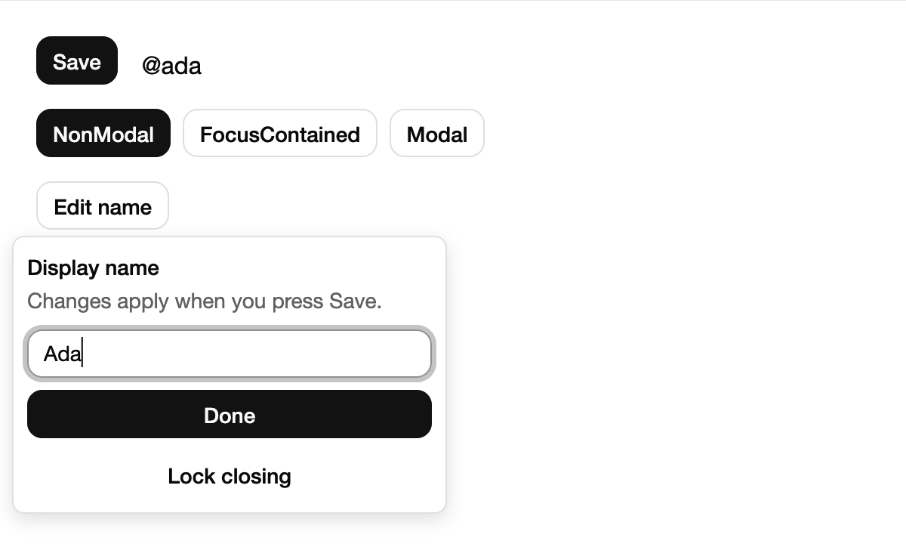
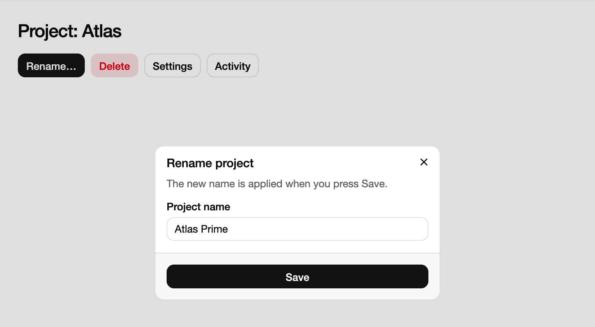
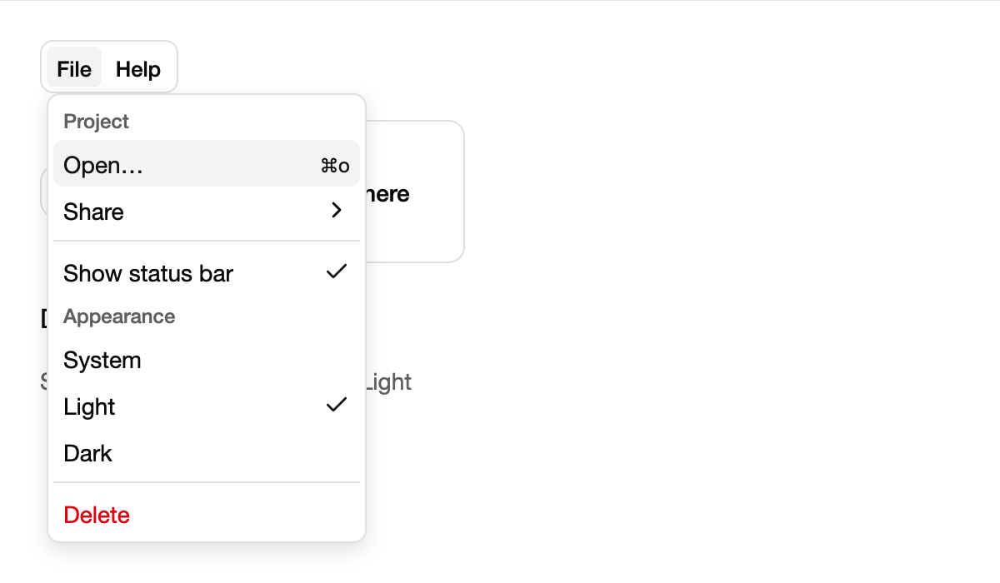
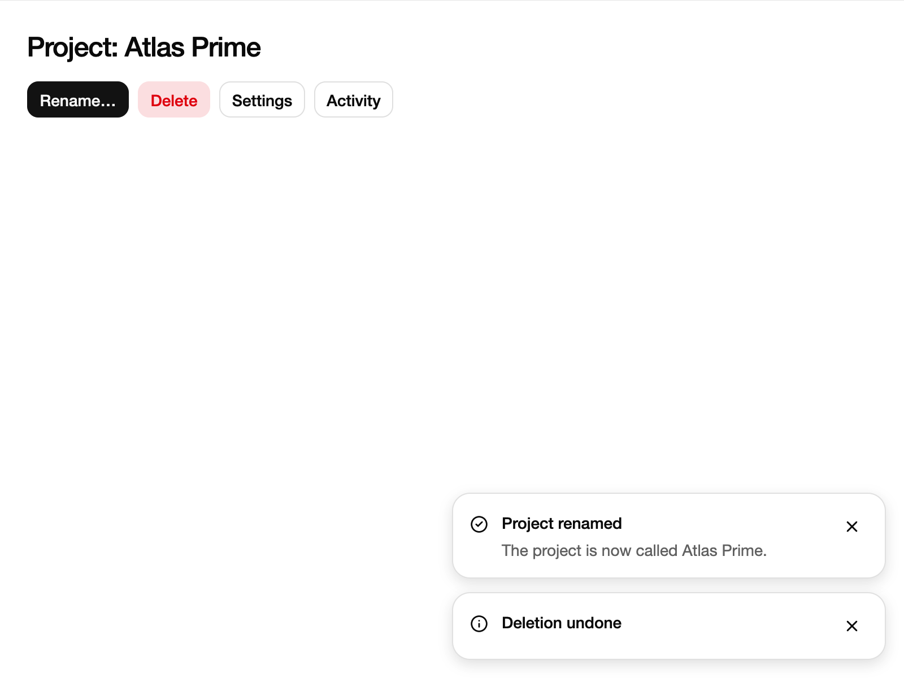

# 第 18 章　弹层

弹层是浮在普通内容上面的界面：鼠标悬停时的提示、点一下弹出的小表单、需要用户确认的对话框、从窗口一侧滑出的面板、菜单和通知。它们看起来各不相同，在 Scoop 中却遵循同一套规则。读完本章，你会知道：

- 为什么弹层是否打开由你持有的一个 `Binding<Boolean>` 决定；
- 用户想关闭弹层时，你怎样拦下这次关闭；
- 提示、悬浮卡片、Popover 的区别，三种模态方式的区别；
- 对话框、确认框、侧板和抽屉的写法；
- 菜单内容怎样在下拉菜单、右键菜单和菜单栏之间复用；
- 怎样显示通知；
- 弹层打开和关闭时，键盘焦点去了哪里。

## 18.1　一个示例

保存为 `popovers.scoop`：

```scoop
{{#include ../../examples/ch18/popovers.scoop}}
```

```sh
scoop run popovers.scoop --release
```

窗口最上面是 Save 按钮和文字 `@ada`：指针停在 Save 上会出现提示 “Save the current name”，停在 `@ada` 上片刻会弹出一张资料卡片。中间一排按钮切换 Popover 的模式。点 Edit name，按钮下方打开一个标题为 Display name 的弹层，光标已经在输入框中：



## 18.2　open 绑定是唯一的状态来源

所有由用户打开和关闭的弹层都遵循同一条规则：**是否打开由你持有的一个 `Binding<Boolean>` 决定。**

```scoop
private val open = state(false)
```

```scoop
popover(open.binding(), form) {
    trigger("Edit name")
    ...
}
```

弹层自己不再保存另一份“是否打开”。打开弹层就是把 `open.value` 改成 true，关闭就是改成 false。示例底部的文字读取同一个 State，弹层开着时显示 `open = true`，关上后显示 `open = false`。

这样做的好处和第 9 章的 Binding 一样：程序的任何地方都可以打开或关闭弹层，不需要拿到弹层的引用；弹层的状态和业务状态放在一起，保存、恢复、测试都很直接。

### 触发器是可选的

`trigger("Edit name")` 生成一个按钮，点击它把绑定设为 true。不写触发器也完全可以：用你自己的按钮、菜单命令或快捷键去修改状态即可，18.4 节的对话框就是这样做的。

### 用户的关闭请求可以被拦下

用户想关闭弹层的方式有很多：按 Escape、点击弹层外面、点关闭按钮、读屏器发出的关闭命令，或者你的代码调用 `OverlayHandle.requestClose()`。这些都是**关闭请求**，弹层先调用 `onCloseRequest(reason)`，它返回 false 时，弹层保持打开：

```scoop
onCloseRequest = { _ -> !locked.value }
```

`reason` 是 `OverlayCloseReason`，取值为 `Explicit`（关闭按钮或 `requestClose()`）、`Escape`、`OutsidePress`（点击外部）、`AnchorUnavailable`（锚定的控件消失了）和 `OwnerClosed`（外层的弹层关闭了）。可以按原因区别对待，比如只拦下点击外部：`reason != OverlayCloseReason.OutsidePress`。

示例中的 Done 按钮调用 `closer.requestClose()`，走的正是这条路径。点 Lock closing，按钮变为 Unlock closing，这时点 Done，弹层不会关闭，底部仍然显示 `open = true`；再点 Unlock closing，Done 就能关上它了。需要“保存进行中禁止关闭”这类行为时，就在 `onCloseRequest` 中判断。

**直接写状态不经过拦截。** `open.value = false` 是你自己的决定，弹层一定关闭。所以“禁止关闭”的逻辑应该放在 `onCloseRequest` 中，并且你自己的代码不要在这期间直接写状态。

另外两个回调：`onOpenChange` 在绑定的值真正改变时调用，`onClosed` 在关闭动画结束、弹层真正卸载之后调用。

## 18.3　提示、悬浮卡片与 Popover

这三种弹层都锚定在一个控件旁边，区别在于何时出现、能不能操作：

| 函数 | 何时出现 | 内容能否操作 | 典型用途 |
| --- | --- | --- | --- |
| `tooltip(trigger, text)` | 指针悬停、键盘聚焦或触摸长按触发控件 | 不能，只是一段文字 | 图标按钮的说明 |
| `hoverCard(trigger, content)` | 指针悬停一段时间或触摸长按 | 可以选择文字、点击链接 | 用户名、链接的预览 |
| `popover(open, content)` | 点击触发器或改变 `open` | 可以，可以有真正的输入框 | 小表单、筛选条件 |

`tooltip` 包装原来的按钮，不改变它的动作和焦点，默认带一个指向按钮的箭头。键盘聚焦时提示立即出现，指针悬停则要等一小段时间。本书写作时，用自动化工具让 Save 按钮获得键盘焦点后，提示 “Save the current name” 出现在按钮下方；读屏器则把这段文字读作按钮的帮助信息。

`hoverCard` 默认在指针停留 600 毫秒后打开，离开 300 毫秒后关闭。指针从触发控件移向卡片的途中，卡片不会消失，所以卡片中的链接可以点到。

`tooltip` 和 `hoverCard` 也可以接收可选的 `open` 绑定，但通常不需要。`popover` 则总是由 `open` 绑定控制。

### Popover 的三种模式

`mode` 决定 Popover 和背后内容的关系：

- **`OverlayMode.NonModal`**（默认）：点击外部会关闭 Popover，同时这次点击照常作用于背后的控件；Tab 键可以离开弹层。
- **`FocusContained`**：背后的内容仍然能接收指针和滚轮，但键盘焦点被限制在弹层内。
- **`Modal`**：阻挡背后的全部输入，直到弹层关闭。

示例中间的三个按钮切换这个属性。切换到 Modal 再打开 Popover，读屏器能看到的只剩弹层中的内容，背后的按钮从无障碍树中消失了；NonModal 时，背后的内容仍然在。

本书写作时，用于验证的自动化工具只能操作后台的窗口，它发出的左键点击和按键都没有送达示例程序（右键点击可以），所以“点击外部”和 Escape 的行为没有在窗口中核对，上面的描述来自工具链的文档和规范。请你在自己的电脑上，分别在三种模式下点一下弹层外面的按钮试试。

### 其他配置

Popover 常用的配置还有：

- `title`、`description`：标题和说明，读屏器也会读出来；
- `side`、`alignment`：首选的方向和对齐方式，空间不够时自动翻到另一边；
- `width`：宽度；
- `arrow = Some(PopupArrow())`：显示一个指向触发控件的箭头；
- `anchor`：锚定到别处的一个控件，而不是自带的触发器；
- `focus`、`handle`：初始焦点（18.7 节）和用于 `requestClose()` 的句柄。

`popover` 放在一个 `row` 中，是为了让触发按钮保持自己的宽度。直接放在 `column` 中时，`alignment = CrossAlignment.Start` 也能做到，但一个只有一项的 `row` 让意图更清楚。

> **注意：builder 块中的同名成员**
>
> 示例在 `column { ... }` 外面先创建了 `val handleName = typography("@ada", TypographyRole.P)`，再交给 `hoverCard`。直接写 `hoverCard(typography("@ada", TypographyRole.P), profile)` 会编译失败：在 builder 块中，`typography(...)` 解析为 builder 的同名成员，它把文字加为子项并返回 `Unit`，而不是返回一个 `View`。同样，Popover 的 builder 有 `mode` 和 `handle` 两个属性，如果 `render()` 中也有同名的局部变量，`mode = ...` 会被当作给局部变量赋值。示例把字段命名为 `overlayMode` 和 `closer`，就是为了避开这一点。

## 18.4　对话框、确认框、侧板与抽屉

模态的弹层打开时，背景变暗，指针、键盘和读屏器的操作都限于弹层之内。保存为 `dialogs.scoop`：

```scoop
{{#include ../../examples/ch18/dialogs.scoop}}
```

```sh
scoop run dialogs.scoop --release
```

窗口显示标题 `Project: Atlas` 和四个按钮。点 Rename…，背景变暗，中央是 Rename project 对话框，输入框中是当前的名称：



把名称改为 `Atlas Prime` 再点 Save，对话框关闭，标题变为 `Project: Atlas Prime`，右下角出现一条 “Project renamed” 通知。

四种模态弹层：

- **`dialog(open, content)`**：普通的对话框。默认在右上角显示关闭按钮，Escape 和点击背景都会发出关闭请求。`footer(view)` 放一个固定在底部的区域，正文较长时滚动的是正文，底部的按钮始终可见。
- **`alertDialog(open, content)`**：要求用户明确选择的确认框。初始焦点默认在取消按钮上，点击背景**不会**关闭它，也没有关闭按钮。`cancel(text)` 添加取消按钮，`action(text, onClick)` 添加操作按钮。
- **`sheet(open, content)`**：从窗口一边滑出的侧板，`side` 取 `SheetSide.Top`、`Bottom`、`Start`、`End`。Start 和 End 跟随书写方向，在从右到左的界面中自动对调。
- **`drawer(open, content)`**：默认从底部滑出的抽屉。它支持多个停靠高度、可以拖动的把手和嵌套的抽屉，用手指拖动把手或用触控板轻扫可以在停靠高度之间切换；在最低的位置继续向外轻扫，由 `swipeToClose` 决定是否发出关闭请求。抽屉默认没有关闭按钮。

依次点 Delete、Settings 和 Activity 试一下：Delete 打开确认框，标题是 `Delete Atlas Prime?`，下面是 Keep project 和 Delete 两个按钮，没有关闭按钮；Settings 从右侧滑出 Project settings 侧板，宽 384；Activity 从底部滑出 Recent activity 抽屉。

### 操作按钮不会替你关闭

确认框的 `action` 只执行你的回调，**不会**替你关闭确认框：

```scoop
action("Delete", { model.delete() }) { variant = ButtonVariant.Destructive }
```

```scoop
fun delete() {
    val toasts = this.toasts
    deleteOpen.value = false
    ...
}
```

`delete()` 自己把 `deleteOpen` 改回 false。这样设计是为了让需要时间的操作可以保持确认框打开：比如在删除完成之前显示一个进度，失败时在确认框中显示错误，成功后再关闭。

### 共同的配置

四种弹层共享同一组配置，在 builder 中直接以成员的形式出现：`title`、`description`、`header`、`footer`、`scrollable` 和 `scrollState`（长表单的滚动）、`focus`、`handle`、`backdrop`、`onOpenChange`、`onCloseRequest`、`onClosed` 等。学会一个，其他几个的写法就都会了。

### 打开前准备草稿

这个例子没有使用 `trigger(...)`，四个弹层都由页面上的普通按钮修改状态打开。Rename… 调用的 `startEdit()` 在打开之前重置草稿：

```scoop
fun startEdit() {
    // Reset the draft every time, so a cancelled edit leaves nothing behind.
    draft.replaceAll(name.value)
    editOpen.value = true
}
```

用户改了名字却点关闭按钮取消，下次打开时看到的仍然是当前的名称，而不是上次没有保存的草稿。表单类的对话框几乎都需要这样做：**打开时从业务数据复制一份草稿，保存时再写回去**，取消只是丢掉草稿。

## 18.5　菜单

菜单的内容用 `menu { ... }` 构建，得到一个 `MenuContent` 值。同一份内容可以交给不同的入口。保存为 `menus.scoop`：

```scoop
{{#include ../../examples/ch18/menus.scoop}}
```

```sh
scoop run menus.scoop --release
```

窗口最上面是一个有 File 和 Help 两项的菜单栏，下面是 Actions 按钮和一块写着 Right-click here 的区域。点菜单栏的 File：



### 菜单内容

`menu { ... }` 中可以使用这些条目：

- `item(key, text, onSelect)`：普通命令。配置块中可以设置 `shortcut`、`destructive`、`enabled`、`icon`；
- `checkboxItem(key, text, binding)`：勾选项，绑定一个 `Boolean`；
- `radioItem(key, text, value, binding)`：单选项，绑定同一个值的几个单选项构成一组；
- `submenu(key, text, menu { ... })`：子菜单；
- `label(key, text)`、`separator(key)`：分组标题和分隔线。

每个条目都需要一个稳定的 `ViewKey`，菜单靠它在重新 `render()` 时保持焦点和高亮的位置。

`shortcut` 只是显示在条目右侧的**标签**，菜单不会因此响应这个快捷键。真正的快捷键要另外登记（第 14 章）。示例中的 `⌘o` 就只是一个标签。

### 三个入口

示例把同一份 `fileMenu(model)` 交给了三个入口：

- **`dropdownMenu(open, content)`**：点击触发器弹出，`open` 绑定的规则和 Popover 一样。示例中的 Actions 按钮就是它。
- **`contextMenu(view, content)`**：包装一个已有的控件，右键点击、触摸长按，或者聚焦后按 Shift+F10，都会在指针处或控件旁边弹出菜单。普通的轻点仍然执行原控件的动作，`longPress` 可以调整长按的等待时间和移动容差。
- **`menubar(binding) { menu(key, text, content) }`**：横向的菜单栏。绑定的是当前展开的那一项的 key，类型为 `ViewKey?`，`None` 表示都没有展开。

依次试一下：

- 点 Actions，在弹出的菜单中选 Open…，菜单关闭，下面的文字变为 `Open`；
- 再打开菜单，选 Light，菜单**保持打开**，底部变为 `Appearance: Light`。勾选项和单选项切换之后菜单不关闭，方便连续调整，按 Escape 或点击外部关闭；
- 在 Right-click here 区域上右键点击，同一份菜单在指针处弹出，选 Delete，文字变为 `Deleted`；直接左键点击这块区域，执行的则是按钮自己的动作，文字变为 `Normal click`；
- 点菜单栏的 File 或 Help，打开对应的菜单。菜单打开时，在菜单栏上左右移动指针或按左右方向键，会切换到相邻的菜单。

菜单打开时，上下方向键移动高亮，直接键入字母可以跳到以它开头的条目。

### 原生菜单

上面这些都是在窗口内自绘的菜单，外观跟随主题。需要系统原生的右键菜单、应用菜单栏时，使用 `scoop.ui.component.desktop` 中的 `nativeContextMenu`、`nativeApplicationMenuBar` 等，它们使用另一种菜单内容 `NativeMenuContent`，第 28 章介绍。

## 18.6　Toast 通知

Toast 是窗口一角短暂出现的通知。它不使用 `open` 绑定，而是由一个 `ToastState` 管理一个队列。18.4 节的示例已经用过它：

1. 在模型中创建 `val toasts = ToastState()`；
2. 在页面中放一个 `toaster(model.toasts)`，它负责显示，`position` 选择六个位置之一：`ToastPosition.TopStart`、`TopCenter`、`TopEnd`、`BottomStart`、`BottomCenter`、`BottomEnd`；
3. 在回调中调用 `toasts.show(title) { ... }`。

```scoop
toasts
    .show("Project renamed") {
        kind = ToastKind.Success
        description(f"The project is now called ${next}.")
    }
```

`kind` 有 `Default`、`Success`、`Info`、`Warning`、`Error`、`Loading` 六种，决定图标和颜色。`description` 添加一行说明，`action(text, onClick)` 添加一个操作按钮。在示例中删除项目后，出现的 “Project deleted” 通知带有一个 Undo 按钮；点 Undo，这条通知关闭，换成一条 “Deletion undone”：



几条规则：

- **`show` 返回一个 `ToastId`**，之后可以用 `toasts.update(id, title) { ... }` 原地更新同一条通知，或者用 `dismiss(id)` 关闭它。常见的用法是先显示一条 `Loading` 通知，任务完成后把它更新为 `Success` 或 `Error`。
- **`update` 和 `dismiss` 在通知已经关闭时返回 false。** 所以后台任务迟到的结果不会让一条已经关掉的通知重新出现。
- **默认 5 秒后自动消失**，`duration = None` 表示不自动关闭。指针悬停、通知获得焦点，或者窗口失去焦点时，倒计时暂停。本书写作时，示例窗口一直在后台，“Project renamed” 就一直没有消失，直到被关闭。
- **一个 `ToastState` 同一时刻只能交给一个 `toaster` 显示。**

在后台任务中更新通知的完整写法见第 29 章。

## 18.7　焦点：打开时去哪里，关闭后回到哪里

弹层打开时，焦点移入弹层：默认是其中第一个可以获得焦点的控件，确认框是取消按钮。关闭后，焦点回到打开之前拥有焦点的那个控件。用键盘操作的用户按 Enter 打开一个对话框，处理完之后焦点回到原来的按钮上，可以接着操作，而不是被扔回窗口的开头。

这些行为由 `OverlayFocusOptions` 描述：

| 字段 | 默认值 | 含义 |
| --- | --- | --- |
| `initialFocus` | `None` | 打开后聚焦的 `FocusHandle` |
| `autoFocus` | `true` | 没有指定 `initialFocus` 时，是否自动聚焦第一个控件 |
| `restoreFocus` | `true` | 关闭后是否恢复焦点 |
| `restoreTarget` | `None` | 关闭后改为聚焦这个 `FocusHandle` |

Popover 示例把初始焦点交给输入框：

```scoop
focus = OverlayFocusOptions(Some(nameFocus))
```

输入框通过 `focus = FocusOptions(Some(nameFocus))` 绑定同一个 `FocusHandle`（第 14 章）。打开 Popover，焦点就在输入框中，可以直接输入。对话框示例也是这样，打开 Rename project 后可以直接修改名称。

也可以在配置块中逐项修改：

```scoop
focus {
    initialFocus = Some(nameFocus)
    restoreTarget = Some(triggerFocus)
}
```

本书写作时核对了恢复的行为：Save 按钮拥有焦点时打开 Popover，焦点进入输入框；点 Done 关闭之后，焦点回到了 Save 按钮。

弹层可以嵌套，比如在对话框中再打开一个侧板。每关闭一层，焦点回到上一层中原来的位置。

## 常见误用

- **另外保存一份“是否打开”。** 弹层的状态就是你传入的绑定，不要在别处再维护一个布尔值并试图同步它们。
- **用直接写状态来实现“禁止关闭”。** `open.value = false` 不经过拦截。在 `onCloseRequest` 中返回 false。
- **以为确认框的操作按钮会自动关闭。** `action` 只调用你的回调，关闭由你决定。
- **打开表单对话框时不重置草稿。** 用户取消后再打开，会看到上次没有保存的内容。打开时从业务数据复制一份。
- **以为菜单条目的 `shortcut` 会响应按键。** 它只是标签，快捷键要另外登记。
- **在 builder 块中直接写 `typography(...)` 作为参数。** 它解析为 builder 的同名成员，返回 `Unit`。先在块外创建视图。
- **把同一个 `ToastState` 交给两个 `toaster`。** 一个通知队列只能有一个显示的位置。

## 小结

- 由用户开关的弹层都由一个 `Binding<Boolean>` 控制；触发器可选；用户的关闭请求先经过 `onCloseRequest`，直接写状态则不经过拦截。
- `tooltip` 只显示文字，`hoverCard` 可以操作但由悬停打开，`popover` 由 `open` 控制并可以包含真正的输入框；`mode` 在 `NonModal`、`FocusContained`、`Modal` 之间选择与背景的关系。
- `dialog`、`alertDialog`、`sheet`、`drawer` 共享同一组模态配置；确认框的操作按钮不会替你关闭；表单对话框在打开时准备草稿。
- `menu { ... }` 构建的内容可以交给 `dropdownMenu`、`contextMenu` 和 `menubar`；勾选项和单选项切换后菜单保持打开；`shortcut` 只是标签。
- Toast 由 `ToastState` 管理，`toaster` 负责显示；`show` 返回的 `ToastId` 用于更新和关闭，通知关闭后它们返回 false。
- 弹层打开时焦点移入，关闭后回到原来的控件；`OverlayFocusOptions` 可以指定初始焦点和恢复的目标。

## 练习

1. 给 Popover 示例的 `onCloseRequest` 改为只拦下点击外部：`reason != OverlayCloseReason.OutsidePress`。分别用 Escape、点击外部和 Done 试试。
2. 给 Rename project 对话框加一个 Cancel 按钮，放在 Save 旁边。它应该调用什么来关闭对话框，`model.editOpen.value = false` 还是 `OverlayHandle.requestClose()`？两者有什么区别？
3. 修改 `ProjectModel.save()`，先显示一条 `Loading` 通知，再用 `update` 把它改为 `Success`。观察两者是不是同一条通知。
4. 给菜单示例的 `contextMenu` 换一份只有两项的菜单内容，再给 Help 菜单加一个子菜单。
5. 给 Settings 侧板加一个输入框，并通过 `focus` 让它在打开时获得焦点。关闭侧板后，焦点回到了哪里？
