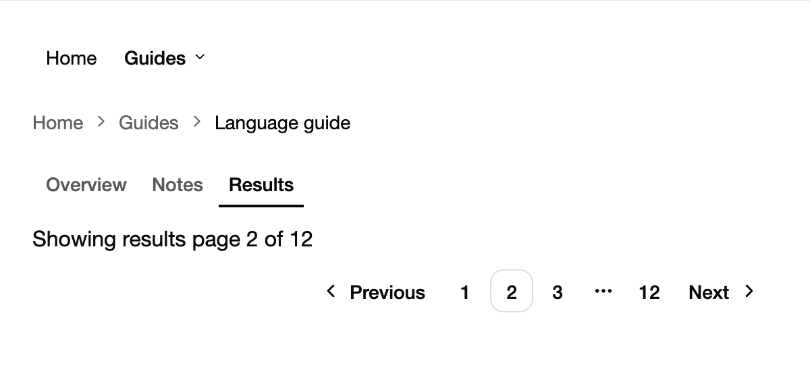
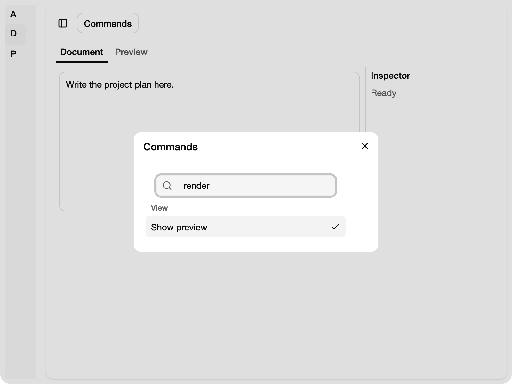

# 第 19 章　导航与工作区

一个应用通常不止一屏内容：有几个页面要切换，有一组工具要随时调出，有一块主要的编辑区要尽量宽敞。本章介绍组织这些内容的控件：导航菜单、面包屑、页签、分页、侧栏、可调面板和命令面板。读完本章，你会知道：

- 导航菜单、面包屑、页签和分页各自解决哪一层的导航；
- 页签切走之后，面板中的内容什么时候被销毁，怎样保留；
- 侧栏的几种收起方式，窄窗口时它会怎样变化；
- 可调面板的尺寸为什么放在你的状态中；
- 怎样做一个“⌘K”命令面板；
- 为什么同一个应用状态应该有多个入口，而不是多份副本。

## 19.1　一个导航的示例

保存为 `navigation.scoop`：

```scoop
{{#include ../../examples/ch19/navigation.scoop}}
```

```sh
scoop run navigation.scoop --release
```

窗口顶部是导航菜单：Home 和带下拉箭头的 Guides。下面是面包屑 `Home › Guides › Overview`，再下面是 Overview、Notes、Results 三个页签。在 Guides 的面板中选 Language guide，切到 Results 页签，再点一次 Next，窗口是这样的：



这个示例中的控件只负责**呈现**和**交互**，“当前在哪一页”由 `NavModel` 中的 State 决定：

```scoop
class NavModel {
    val page = state("Overview")
    val menuOpen = state<ViewKey?>(None)
    val tab = state<Int?>(Some(0))
    val resultPage = state(1L)
    ...
}
```

Scoop 的 UI 库没有内置的“路由器”。页面切换就是改一个 State，`render()` 根据它显示不同的内容。这和前几章的做法完全一样。

## 19.2　导航菜单与面包屑

### 导航菜单

`navigationMenu(open) { ... }` 是网站式的顶部导航，有两种条目：

- `link(key, text, onNavigate)`：直接跳转的链接；
- `item(key, text, panel)`：悬停或点击时展开一个内容面板。面板是一个普通的视图，其中用 `navigationMenuLink(text, onNavigate)` 放链接，也可以放表单、图片或任何内容。

```scoop
navigationMenu(Some(model.menuOpen.binding())) {
    link(ViewKey.Text("home"), "Home", { model.navigate("Overview") })
    item(ViewKey.Text("guides"), "Guides", guides)
}
```

`open` 是可选的 `Binding<ViewKey?>`，值是当前展开的面板的 key，`None` 表示都没有展开。传入这个绑定，程序就能控制面板：示例中的 `navigate` 在跳转之后把它设为 `None`，面板随之收起。

```scoop
fun navigate(target: String) {
    page.value = target
    // Close the open panel after a navigation.
    menuOpen.value = None
}
```

在 Guides 的面板中点 Language guide，面板收起，面包屑的最后一项和正文都变成了 Language guide。

本书写作时，自动化工具无法在后台窗口中悬停或左键点击，Guides 的面板是通过把 `menuOpen` 的初始值设为 `Some(ViewKey.Text("guides"))` 打开的，面板中的链接则在窗口中实际点击过。这也说明了 `open` 绑定的作用：面板的开合完全由这个值决定。

### 面包屑

`breadcrumb { ... }` 显示当前位置的层级路径：

```scoop
breadcrumb {
    item("Home", { model.navigate("Overview") })
    item("Guides", { model.navigate("Guides") })
    current(model.page.value)
}
```

`item(text, onNavigate)` 是可以点击的上级，`current(text)` 是当前所在的位置，不能点击。层级很深时，`ellipsis()` 把中间的几级折叠成一个省略号；`custom(view)` 可以放入任意控件，比如一个列出同级页面的下拉菜单。过长的条目在一行中显示省略号，空间不够时也可以换行。

## 19.3　页签与分页

### 页签

`tabs(selected) { item(choice, content) }` 在同一块区域中切换几个面板：

```scoop
tabs(model.tab.binding()) {
    variant = TabsVariant.Line
    // Keep the Notes editor alive while another tab is shown.
    retention = ContentRetention.KeepMounted
    item(Choice(ViewKey.Text("overview"), 0, "Overview"), overview)
    item(Choice(ViewKey.Text("notes"), 1, "Notes"), notes)
    item(Choice(ViewKey.Text("results"), 2, "Results"), results)
}
```

`selected` 是一个 `Binding<T?>`，每个页签用 `Choice(key, value, label)` 描述：稳定的 key、对应的值和标题。这和第 13 章的选择控件是同一套写法。

常用的配置：

| 属性 | 作用 |
| --- | --- |
| `variant` | `TabsVariant.Default`（分段按钮的样子）或 `Line`（下划线） |
| `axis` | `FlexAxis.Horizontal`（默认）或 `Vertical`，竖排页签 |
| `activation` | `TabActivation.Auto`（默认）方向键移到哪个页签就切换到哪个；`Manual` 时方向键只移动焦点，按 Space 或 Enter 才切换 |
| `retention` | 切走的面板怎样处理，见下文 |
| `onValueChange` | 选中的页签改变后调用 |

页签之间用方向键移动，Tab 键则从页签进入面板的正文。读屏器把页签读作一组单选按钮，当前的那个处于选中状态。

### 切走的面板去了哪里

默认情况下，`retention` 是 `ContentRetention.Dispose`：切走的面板被卸载，切回来时重新创建。`KeepMounted` 保留非活动面板的组件实例，它们继续接收逻辑上的更新，只是不参与布局、不接收输入，也不请求动画帧。

这里有一个容易混淆的地方。切到 Notes 页签修改输入框中的文字，再切到别的页签又切回来，修改还在。但这**不完全是** `KeepMounted` 的功劳：文字保存在 `NavModel` 的 `TextEditorState` 中（第 12 章），即使面板被卸载再重建，新的输入框借用的还是同一个模型，文字、选区和撤销历史都在。`KeepMounted` 真正保留的，是面板中**组件自己的**状态：组件字段中的 `state(...)`、没有交给你持有的滚动位置、正在播放的动画等等。

所以选择 `retention` 时可以这样考虑：

- 面板中要保留的东西都已经在模型里，或者面板很轻，用默认的 `Dispose`，非活动的面板不占用资源；
- 面板中有不便放进模型的局部状态，或者面板很重、重建一次的代价明显，用 `KeepMounted`。

### 分页

Results 页签中是一个分页控件：

```scoop
pagination(model.resultPage.binding(), 12L)
```

第一个参数是当前页码的 `Binding<Long>`，从 1 开始；第二个参数是总页数。控件自动决定显示哪些页码：当前页附近的几页、第一页和最后一页，中间用省略号代替。第一页时 Previous 按钮被禁用；总页数为零时整个控件停用。外部传入一个越界的页码时，控件保持原来的值，不会替你修正。

分页只负责页码。按页码取出哪些数据、显示在哪里，由业务决定，示例中只是把页码显示出来。

## 19.4　一个精简的工作区

桌面应用常见的工作区由几部分组成：一侧是导航的侧栏，中间是主要的编辑区，旁边是检查器之类的辅助面板，再加上一个随时可以调出的命令面板。下面的示例把它们组合在一起，保存为 `workspace.scoop`：

```scoop
{{#include ../../examples/ch19/workspace.scoop}}
```

```sh
scoop run workspace.scoop --release
```

窗口左侧是侧栏，标题是 Atlas，下面是 Document 和 Preview 两个导航条目。右侧顶部是侧栏的开关和 Commands 按钮，下面是 Document 和 Preview 两个页签，Document 页签中是左右分开的编辑区和 Inspector。点侧栏的开关，侧栏收窄为只显示 A、D、P 的图标栏；点 Commands 打开命令面板，输入 `render`：



结果中只剩 Show preview，它的 `keywords` 中包含 `render`。执行它，对话框关闭，页签切换到 Preview，显示编辑区中的文字。

下面三节分别介绍侧栏、可调面板和命令面板，19.8 节再回来看这个示例的整体结构。

## 19.5　侧栏

```scoop
val shell = sidebar(model.navigation.binding(), { shown -> navigationFor(model, shown.collapsed) }) {
    variant = SidebarVariant.Inset
    collapsible = SidebarCollapse.Icon
    rail = true
    header { shown -> typography(if (shown.collapsed) "A" else "Atlas", TypographyRole.Small) }
    inset(main)
}
```

`sidebar(open, content) { ... }` 的第一个参数是展开状态的 `Binding<Boolean>`。`inset(view)` 是侧栏旁边的主区域，`header` 和 `footer` 是侧栏顶部和底部的固定区域。

`content` 可以是一个视图，也可以像示例这样是一个函数 `{ shown -> ... }`。`shown` 是 `SidebarPresentation`，其中的 `collapsed` 说明侧栏当前是不是收起的图标栏，这样同一份内容可以在展开时显示文字、收起时只显示图标。`header` 也接收同样的函数。

主要的配置：

- **`collapsible`**：收起的方式。`SidebarCollapse.Offcanvas`（默认）整个移出视野；`Icon` 收窄为图标栏，宽度由 `iconWidth` 决定，默认 48；`None` 不能收起。
- **`variant`**：`Sidebar`、`Floating`、`Inset` 三种外观。示例用的 `Inset` 让主区域像一张浮在背景上的卡片。
- **`side`**：`SidebarSide.Start`（默认）或 `End`，跟随书写方向。
- **`width`**：展开时的宽度，默认 256。
- **`rail = true`**：在侧栏边缘放一条细栏，点击它切换展开状态。读屏器把它读作 “Toggle sidebar”。
- **`layout` 和 `breakpoint`**：默认的 `SidebarLayout.Auto` 根据可用的宽度选择布局，窄于 `breakpoint`（默认 768）时，侧栏改为从一侧滑出的抽屉，主区域占满整个宽度。`Desktop` 和 `Mobile` 固定使用其中一种。
- **`shortcut`**：切换侧栏的快捷键，默认是 Primary+B（macOS 上是 ⌘B），`shortcut = None` 关闭它。

侧栏中的导航条目用 `sidebarMenu { ... }` 编写：

```scoop
return sidebarMenu {
    this.collapsed = collapsed
    item(ViewKey.Text("document"), "Document", { model.tab.value = Some(0) }) {
        active = model.tab.value == Some(0)
        icon(documentIcon)
    }
    ...
}
```

`collapsed` 跟随 `shown.collapsed`，收起时条目只显示图标，指针停在图标上时以提示的形式显示文字。`active` 标出当前所在的条目。`sidebarTrigger(open)` 生成一个标准的侧栏开关按钮，示例把它放在主区域的左上角。

窄布局下，侧栏以抽屉的形式出现时，主区域保持原来的实例：编辑区中的文字和光标不会因为窗口变窄而丢失。

## 19.6　可调面板

编辑区和 Inspector 之间可以拖动调整宽度，这是 `resizable`：

```scoop
return resizable(model.sizes.binding()) {
    panel(ViewKey.Text("editor"), editor) { minimum = 200.0 }
    panel(ViewKey.Text("inspector"), inspector) {
        minimum = 120.0
        collapsible = true
    }
    withHandle = true
}
```

第一个参数是 `Binding<Array<ResizableSize>>`，每一项记录一个面板的 key 和它所占的比例：

```scoop
val sizes = state(
    [
        ResizableSize(ViewKey.Text("editor"), 0.7),
        ResizableSize(ViewKey.Text("inspector"), 0.3)
    ]
)
```

拖动把手时，控件把新的比例写回这个绑定。比例放在你的状态中，有几个直接的好处：可以把它保存到设置文件，下次启动时恢复；可以加一个“恢复默认布局”的按钮，直接写回初始值；同一个比例还可以交给另一个窗口使用。

几个配置：

- `panel` 的配置块中，`minimum` 和 `maximum` 是面板的最小和最大长度（逻辑单位，不是比例）；`collapsible = true` 时，拖到小于 `minimum` 的位置，面板折叠到 `collapsedSize`（默认 0），而不是停在一个过窄的宽度；
- `withHandle = true` 在分隔线上显示一个可见的把手；
- `orientation = Orientation.Vertical` 改为上下分割；
- `keyboardStep`：把手获得焦点后，每按一次方向键调整的距离，默认 10。

相邻的两个面板之间自动放置把手。把手可以用 Tab 键聚焦，再用方向键调整，所以不用鼠标也能调整布局。读屏器把它读作一个分隔条，名称是 “Resize panels”。面板用稳定的 key 保持挂载，调整尺寸只是重新布局，不会重建面板中的内容。

本书写作时，自动化工具无法在后台窗口中拖动或按键，所以拖动和键盘调整没有在窗口中核对。

## 19.7　命令面板

命令面板是一个带搜索框的命令列表。用户键入几个字母，列表只留下匹配的命令，按 Enter 执行高亮的那一个。

命令的内容用 `commandItems { ... }` 构建：

```scoop
fun workspaceCommands(model: WorkspaceModel): CommandContent = commandItems {
    group(ViewKey.Text("view"), "View") {
        item(ViewKey.Text("document"), "Show document", { model.tab.value = Some(0) })
        item(ViewKey.Text("preview"), "Show preview", { model.tab.value = Some(1) }) {
            keywords = ["read", "render"]
        }
        ...
    }
    ...
}
```

`group` 是带标题的一组，`item(key, text, onRun)` 是一条命令，`separator(key)` 是分隔线。`keywords` 提供额外的搜索词：输入 `render` 找不到标题中的任何字，但 Show preview 的关键词中有它。

`command(source, query) { ... }` 把内容显示出来。`query` 是一个 `TextEditorState`，保存搜索框中的文字：

```scoop
val palette = command(model.commands, model.query) {
    focus = FocusOptions(Some(model.queryFocus))
    onSelect = { _ -> model.commandsOpen.value = false }
}
```

- 默认使用模糊匹配（`CommandFilter.Ranked`），标题和关键词都参与评分，结果按匹配程度排序。自己提供搜索结果时用 `CommandFilter.Provided`，`Custom(score)` 替换评分函数。
- 方向键移动高亮时，焦点始终留在搜索框中，所以可以一边键入一边选择。
- 输入法正在组合的文字不参与搜索。
- `onSelect` 在命令执行之后调用，示例用它关闭对话框。

命令面板本身只是一个普通的控件，放进 `dialog` 就成了常见的 “⌘K 面板”：

```scoop
dialog(model.commandsOpen.binding(), palette) {
    title("Commands")
    focus { initialFocus = Some(model.queryFocus) }
}
```

对话框打开时直接聚焦搜索框（第 18.7 节）。`openCommands()` 在打开之前清空上次的搜索词，这和第 18.4 节“打开前准备草稿”是同一个做法。要用快捷键打开它，用第 14 章的 `ShortcutScope` 登记一个快捷键，在回调中调用 `model.openCommands()` 即可。

## 19.8　一份状态，多个入口

回头看 `WorkspaceModel`：

```scoop
class WorkspaceModel {
    val navigation = state(true)
    val tab = state<Int?>(Some(0))
    val commandsOpen = state(false)
    val log = state("Ready")
    val draft = TextEditorState("Write the project plan here.")
    ...
}
```

侧栏是否展开、当前的页签、面板的比例、对话框是否打开、编辑区的文字，工作区的全部“当前状态”都在这里。界面上的控件只是这些状态的入口：

- 切换到 Preview 页签有三个入口：点侧栏中的 Preview、点 Preview 页签、在命令面板中执行 Show preview。三者修改的都是 `model.tab`，所以侧栏的高亮和页签的选中状态始终一致；
- 切换侧栏有四个入口：侧栏开关、侧栏边缘的细栏、⌘B 快捷键和命令面板中的 Toggle sidebar，修改的都是 `model.navigation`。

本书写作时核对了其中几条路径：点侧栏收起为图标栏后，点图标栏中的 P，页签切换到 Preview；在命令面板中搜索 `render` 并执行 Show preview，对话框关闭，页签切换到 Preview。

如果每个入口各自保存一份“当前页签”，再想办法在它们之间同步，状态迟早会不一致。**让状态只有一份，让控件只是入口**，这是整个第三部分的原则在界面组织上的体现。

## 常见误用

- **为页面切换寻找一个路由库。** 页面切换就是改一个 State，`render()` 根据它显示内容。
- **导航之后忘记收起导航菜单的面板。** 传入 `open` 绑定，导航时把它设为 `None`。
- **以为 `KeepMounted` 是保留输入内容的唯一方法。** 输入的内容放在模型的 `TextEditorState` 中，切换页签不会丢失。`KeepMounted` 保留的是组件自己的状态。
- **把面板的比例保存在控件之外的另一份变量中。** 比例就在你传入的绑定里，直接保存和恢复它。
- **在命令面板中只依赖标题搜索。** 给命令加上用户可能想到的 `keywords`。
- **每个入口各自保存一份状态。** 侧栏、页签和命令面板都应该修改同一个 State。

## 小结

- 导航菜单、面包屑、页签和分页只负责呈现和交互，当前的位置由应用的 State 决定。
- `navigationMenu` 的 `link` 直接跳转，`item` 展开面板；可选的 `open` 绑定让程序控制面板的开合。`breadcrumb` 用 `item` 和 `current` 显示层级。
- `tabs` 用 `Choice` 描述页签；`retention` 默认卸载切走的面板，`KeepMounted` 保留组件实例；输入的内容放在模型中，不依赖 `retention`。`pagination` 用一个 `Binding<Long>` 表示当前页。
- `sidebar` 的 `collapsible` 决定收起方式，`content` 可以根据 `shown.collapsed` 显示不同的内容；窄于 `breakpoint` 时自动改为抽屉；默认 ⌘B 切换。
- `resizable` 的比例保存在你传入的 `Binding<Array<ResizableSize>>` 中；把手可以拖动，也可以用键盘调整。
- `command` 是带模糊搜索的命令列表，放进 `dialog` 就是命令面板。
- 一份状态，多个入口：侧栏、页签和命令面板修改同一个 State，显示自然一致。

## 练习

1. 给导航示例的面包屑加一个 `ellipsis()`，再把 Home 之后的层级增加到五级，看看它怎样显示。
2. 在导航示例的 Notes 页签中再放一个组件，它用 `state(0)` 记录自己被点击的次数。分别在 `Dispose` 和 `KeepMounted` 下切换页签，比较点击次数有没有保留。
3. 把工作区的 `collapsible` 改为 `SidebarCollapse.Offcanvas`、`side` 改为 `SidebarSide.End`，再把窗口拉窄到 768 以下，侧栏变成了什么样子？
4. 给工作区加一个 Reset layout 按钮，把 `model.sizes` 恢复为 `0.7` 和 `0.3`。
5. 用第 14 章的 `ShortcutScope` 给工作区登记 ⌘K，打开命令面板。
6. 给命令面板加一条 Clear draft 命令，执行时清空编辑区，并在 Inspector 中显示 `Draft cleared`。
