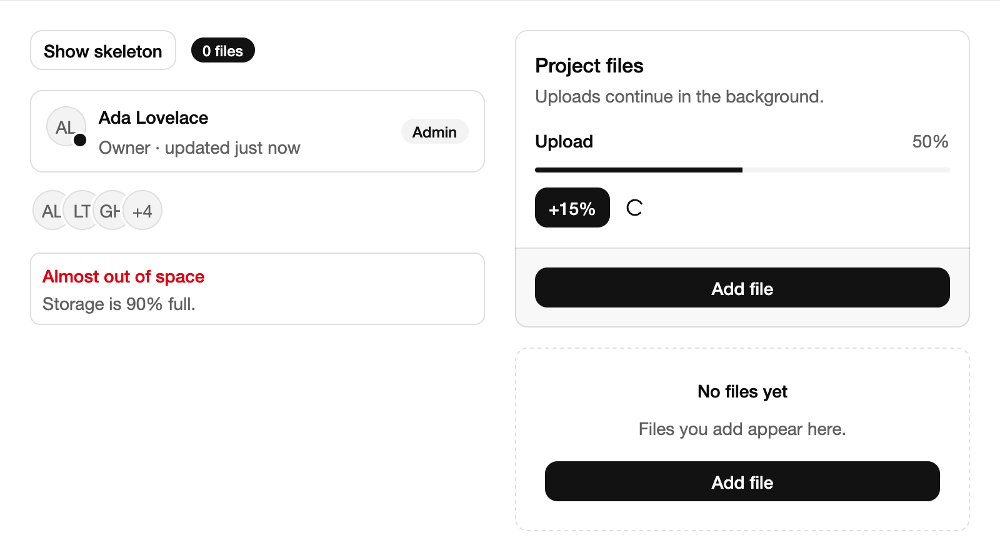
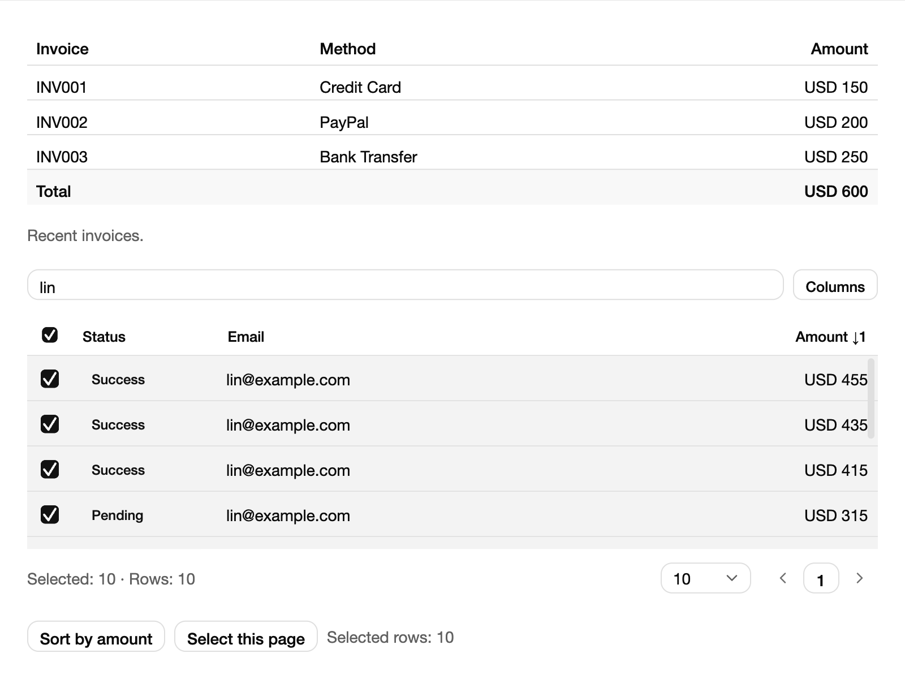
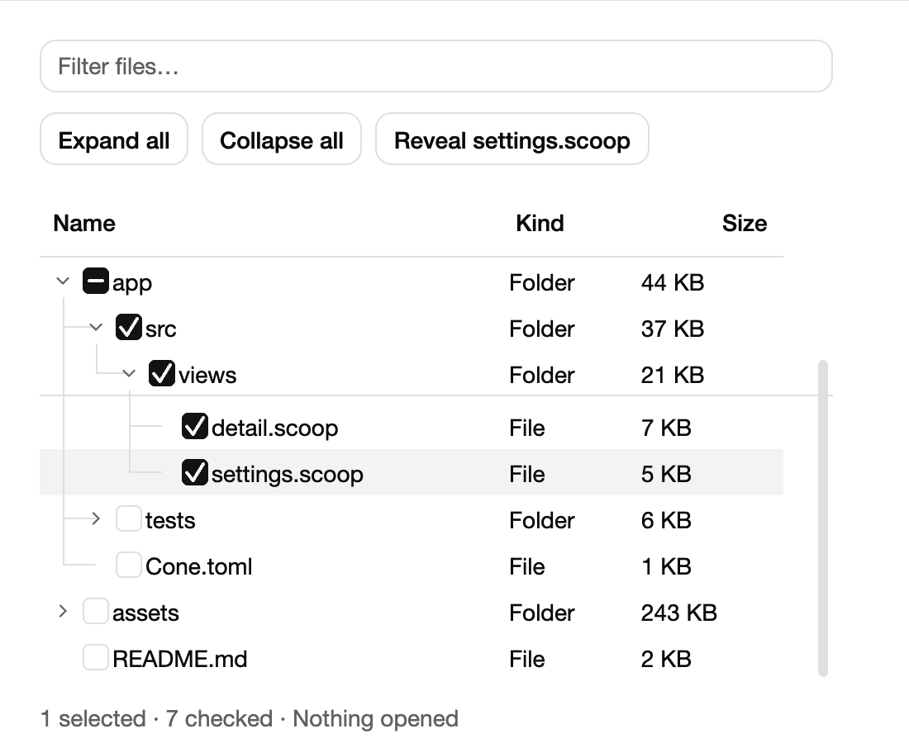
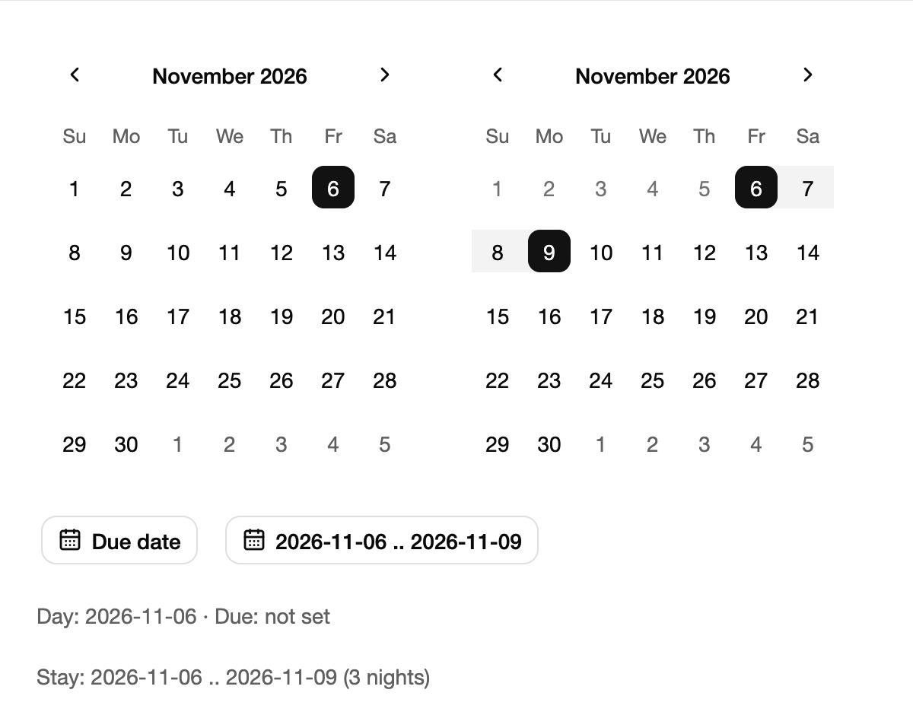
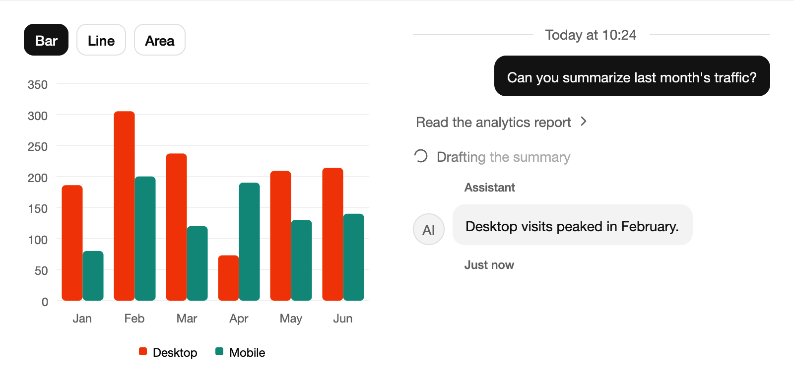
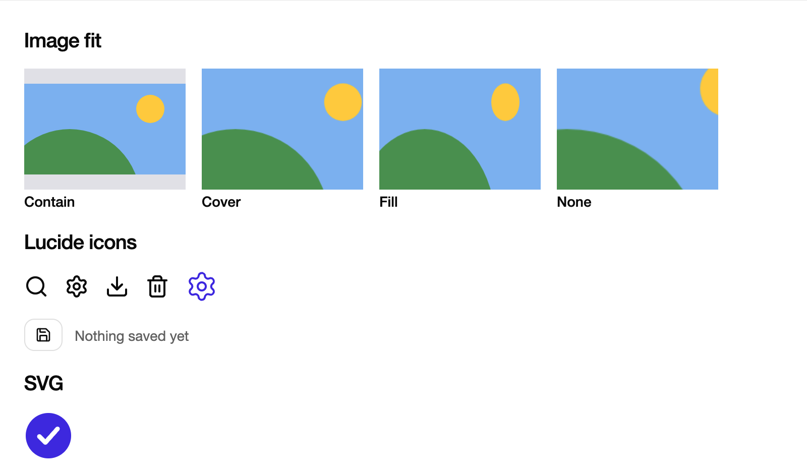

# 第 20 章　数据展示

前面几章组织的是界面的“骨架”：滚动、弹层、导航。本章讨论骨架里装的内容：一组资料、一张表格、一棵文件树、一个日历、一张图表、一段对话，以及图片和图标。这些控件数量多，但用法高度一致：**数据由你持有，控件负责呈现和交互**。读完本章，你会知道：

- 卡片、提示、空状态、条目、头像、骨架和进度这些内容块怎样组合；
- 固定表格和数据表格的区别，排序、筛选、分页和选择保存在哪里；
- 树怎样描述层级数据，勾选怎样在父子之间传播；
- 日历和日期选择器怎样表示单个日期、多个日期和日期范围；
- 图表的数据模型，会话界面由哪些部件组成；
- 图片的四种适配方式，怎样使用 Lucide 图标和 SVG。

本章的示例都比较短，每节一个。它们延续前两章的写法：在进入 `column { ... }` 这类 builder 块之前，先把要作为参数传入的视图创建好（第 18.3 节）。

## 20.1　内容块

保存为 `content.scoop`：

```scoop
{{#include ../../examples/ch20/content.scoop}}
```

```sh
scoop run content.scoop --release
```

窗口分为左右两栏。左栏开始时是一块灰色的骨架占位，点 Reveal content 后显示 Ada Lovelace 的资料条目和一组叠放的头像，下面是红色标题的存储空间提示。右栏的 Project files 卡片中有一个上传进度条和一个转动的 Spinner，下面是一个虚线边框的空状态。点 Reveal content，再点一次 +15%，窗口是这样的：



这一组控件都接收一个完整的正文视图，再用配置块补充标题、描述和其他区域：

| 控件 | 写法 | 用途与常用配置 |
| --- | --- | --- |
| Card | `card(content) { title(...); description(...) }` | 一组相关的内容；`header`、`footer`、`action` 区域，`size = CardSize.Sm` |
| Alert | `alert(content) { title(...) }` | 页面内的提示条；`variant = AlertVariant.Destructive`、`icon(view)` |
| EmptyState | `emptyState(content) { title(...) }` | 没有数据时的占位；`outlined = true` 显示虚线边框，`media(view)` 放图标 |
| Item | `contentItem { title(...); description(...) }` | 列表中的一行；`media(view)`、`actions(view)`，`variant = ItemVariant.Outline` |
| Avatar | `avatar("AL") { badge() }` | 头像，没有图片时显示文字，`badge()` 加一个状态点；`avatarGroup { ... count(4L) }` 叠放多个 |
| Badge | `badge("Admin")` | 小标签，`variant` 和按钮的相同 |
| Skeleton | `skeleton(content) { loading = pending }` | 加载占位 |
| Progress | `progress(Some(35.0)) { label(...); showValue = true }` | 进度条，`progress(None)` 表示总量未知 |
| Spinner | `spinner { running = busy }` | 时长不确定的忙碌指示 |

`title` 和 `description` 既可以传字符串，也可以传 `StyledText` 或任意视图。在 `column { ... }` 这类容器块中，条目对应的成员叫 `contentItem`，因为 `item` 在容器块中已经用来设置子项的伸缩参数（第 5 章）。

几点说明：

- **骨架不会重建正文。** `skeleton(profile) { loading = ... }` 在加载期间仍然挂载并测量 `profile`，只是不绘制、不接收输入。所以切换前后占位的尺寸一致，正文中组件的状态也不会丢失。不要用 `if (loading) skeleton else profile` 在两者之间切换，那样每次切换都会重建正文。只需要一块占位形状时，用不带正文的 `skeleton { width = Some(220.0); height = Some(12.0) }`，`shape = SkeletonShape.Circle` 画圆形。
- **进度值按 `minimum` 到 `maximum` 归一化**，默认是 0 到 100。数值变化时进度条有过渡动画。示例的 +15% 每次增加 15，到 100 时 Spinner 的 `running` 变为 false，停止转动。
- **停下来的动画不占资源。** Spinner、骨架和不确定的进度条在停止、隐藏或卸载之后不再请求动画帧（第 4.10 节）。

点卡片底部的 Add file，顶部的标签变为 `1 files`，下面的空状态随之消失：`if (model.files.value == 0)` 决定它是否出现在视图中。

## 20.2　表格

表格分两种：

- **`table { header { }; body { }; footer { } }`**：行数有限、内容固定的展示，比如发票明细。
- **`dataTable(state)`**：需要排序、筛选、分页、选择和调整列宽的数据集。

保存为 `tables.scoop`：

```scoop
{{#include ../../examples/ch20/tables.scoop}}
```

```sh
scoop run tables.scoop --release
```

窗口上方是三行发票和 Total 合计行组成的固定表格；下方是付款数据表，工具栏左侧是筛选框，右侧的 Columns 菜单可以隐藏列，每行左侧有选择框，底部是计数、每页行数和翻页按钮。在筛选框中输入 `lin`，点两次 Sort by amount，再点 Select this page，窗口是这样的：



### 固定表格

```scoop
fun invoiceTable(): View = table {
    header {
        row {
            head("Invoice")
            ...
        }
    }
    body {
        for (index in 0L ..< 3L)
            row(ViewKey.Number(index)) {
                cell(f"INV00${index + 1L}")
                ...
            }
    }
    footer {
        row {
            cell("Total") { span = 2L }
            ...
        }
    }
    caption("Recent invoices.")
}
```

`head(...)` 写表头单元格，`row(key) { cell(...) }` 写一行，`cell(...) { span = 2L }` 跨两列，`alignment = AxisAlignment.End` 右对齐，`caption(...)` 是表格的说明。`columns = Some([...])` 可以指定各列的宽度。

### 数据表格

`dataTable` 的数据和全部查询状态保存在你持有的 `DataTableState<Row>` 中：

```scoop
private val payments = DataTableState(TableData.Local(samplePayments()), paymentColumns())
```

它由三部分组成：

1. **行数据** `TableData.Local(rows)`：`rows` 是 `TableRows`，每一行是一个 `TableRecord(key, value)`。key 必须稳定且唯一，表格靠它在排序、翻页和数据更新之后保持选择和行内的编辑状态，所以要用数据自己的 id，不要用行号。
2. **列定义** `TableColumn(id, header, cell, size, ...)`：`cell` 是 `(Row) -> View`；提供了 `compare` 的列，点击表头就能排序；提供了 `filter` 的列，可以用 `setFilter(id, text)` 筛选；`alignment` 控制单元格的对齐。
3. **列宽** `TableColumnSize(track, minimum, ...)`：`track` 是 `GridTrack.Fixed(120.0)`（固定宽度）、`GridTrack.Auto`（按内容，`samples` 给出有代表性的文字）或 `GridTrack.Fraction(1.0)`（分配剩余的宽度）。

试一下：

- 在筛选框中输入 `lin`，只剩 lin@example.com 的行，底部的行数变为 10。筛选框的 `onEdited` 在每次编辑后调用 `setFilter`，过滤函数用的 `contains` 来自 `scoop.text`，需要单独导入；
- 点 Sort by amount，按金额升序排序，再点一次改为降序，Amount 表头上显示排序的方向。这个按钮调用的 `toggleSort("amount")` 和点击表头是同一个操作；
- 点 Select this page，当前页的行全部被勾选，表格底部和示例最下面一行都变为 10。示例最下面的那一行直接读取 `payments.selectedKeys`：表格的状态就是普通的可观察状态，在 `render()` 中读取它，就会随表格变化。

代码可以直接改变表格的状态：`setPage`、`setPageSize`、`toggleSort`、`setFilter`、`setSelected`、`selectPage`、`showColumn`、`resizeColumn`；数据变化时用 `replaceData` 整体替换。页码从 0 开始，默认每页 10 行，`pageSizes` 只决定下拉框中的可选项。

`TableData.Local` 由表格在本地完成筛选、排序和分页。数据在服务器上时改用 `TableData.Provided(currentPage, totalRows)`，在 `DataTableState` 的 `onQueryChange` 回调中按新的查询取回对应的一页，再用 `replaceData` 交给表格。

表格只挂载看得见的行（`bodyHeight` 决定正文的高度），数据量大时也能保持流畅。拖动表头之间的边界可以调整列宽，本书写作时，自动化工具无法在后台窗口中拖动，所以这一点没有在窗口中核对。自己绘制的表格也可以复用同样的调宽手柄：`tableColumnResize(header, width.binding())`，它和 `dataTable` 使用同一套逻辑。

## 20.3　树

文件目录、组织结构这类层级数据用 `tree(state)` 展示。保存为 `files.scoop`：

```scoop
{{#include ../../examples/ch20/files.scoop}}
```

```sh
scoop run files.scoop --release
```

窗口中是一个三列的文件树，`app` 和 `app/src` 初始展开，文件夹的大小是子项之和。勾选 `src`，再点 Reveal settings.scoop，窗口是这样的：



### 数据

树的数据和交互状态保存在你持有的 `TreeState<T>` 中：

1. **节点** `TreeNode(key, value, label, children)`：`key` 是稳定且唯一的 `ViewKey`，树靠它在展开、筛选和替换数据之后保持选择和勾选；`value` 是业务数据；`label` 是节点的名称，同时用于键盘查找、筛选和读屏器。`children` 是 `TreeChildren.Leaf`（叶子）、`Known(nodes)`（已知的子项）或 `Deferred`（展开时再加载）。
2. **数据** `TreeData(roots)`：一组根节点组成的不可变快照，之后用 `state.replaceData(next)` 整体替换。这和第 17 章“数据变化时换一个新的数据源”是同一个思路。
3. **列** `TreeColumns(columns, treeColumn)`：可选。每个 `TreeColumn` 的 `cell` 接收一个节点，`treeColumn` 指定哪一列带缩进、展开箭头和勾选框。不提供列时只有一列名称。

`TreeState` 的其余参数决定交互方式：

- `selection`：`TreeSelectionMode.None`、`Single` 或 `Multiple`；
- `checking = TreeChecking.Cascade()`：显示勾选框，勾选父项会勾选全部后代，部分后代被勾选时父项显示为半选；`TreeChecking.Independent(...)` 让每个节点各自勾选；
- `initialExpandedKeys` 或 `initialExpandAll`：初始展开的节点。

勾选 `src`，它的全部后代随之勾选，`app` 变为半选，底部的勾选数变为 7：`src` 自己、它的两个文件、`views` 和 `views` 中的三个文件。

### 定位、吸顶与筛选

Reveal settings.scoop 调用的是 `TreeHandle`：

```scoop
fun reveal() {
    val key = ViewKey.Text("app/src/views/settings.scoop")
    handle.scrollToItem(key, ScrollAlignment.Start, expandAncestors = true)
    files.select(key)
}
```

`expandAncestors = true` 先展开它的祖先，再滚动过去。树开启了 `sticky`，所以 `settings.scoop` 的祖先 `app`、`src`、`views` 固定在列表的顶部，向下滚动时仍然能看出当前在哪个目录中。

在筛选框中输入 `scoop`，`onEdited` 调用 `setQuery`，`TreeQueryMode.Filter` 只保留名称匹配的节点和它们的祖先，并临时展开路径：`Cone.toml`、`assets` 和 `README.md` 暂时隐藏，原本收起的 `tests` 被展开，露出其中的 `model.scoop`。清空筛选框后恢复原来的展开状态。改用 `TreeQueryMode.Highlight` 时只标出匹配的节点，不隐藏其他的行。

### 其他

- **树默认只挂载看得见的行。** 和虚拟列表一样，默认的虚拟模式需要显式的 `height` 或父级给出的有限高度，否则报错 `virtual tree requires a finite height`。节点很少、希望按内容撑开时，设置 `virtualize = false`。
- **展开、选择和勾选都可以读写。** `state.expandedKeys`、`selectedKeys`、`checkedKeys` 和 `halfCheckedKeys` 是可观察的状态，示例底部的计数直接读取它们；代码中用 `setExpanded`、`select`、`setChecked` 修改。
- **键盘操作。** 方向键在行之间移动，左右键折叠或展开，空格键勾选，Enter 激活。激活一行时调用 `onActivate`，示例在底部显示 `Opened ...`。多选模式下，`tree` 单击即可把一行加入或移出选择；`directoryTree(state)` 则像文件管理器那样单击只选一行，按住 Primary 键再增减，它还默认显示图标、单击展开并开启吸顶。
- **读屏器。** 每一行都是一个树节点，读屏器能读出层级、展开状态和勾选状态，并可以直接执行勾选。本书写作时，就是通过这个入口勾选 `src` 的。
- **列和表格的用法相近。** `compare` 让列可以排序，排序只在同级节点之间进行；`setColumnVisible`、`resizeColumn` 隐藏列和调整列宽，带缩进的树列不能隐藏。

`TreeChildren.Deferred` 节点在第一次展开时才通过 `TreeLoader` 加载子项，失败后可以重试；`drag = Some(TreeDrag(onDrop = ...))` 开启节点的拖放。工具链中的 shadcn Gallery（第 1 章）的 Tree 页面演示了这两项。

## 20.4　日历与日期选择器

日期使用标准库 `scoop.datetime` 中的 `LocalDate`，比如 `LocalDate(2026, 11, 6)`，`plusDays`、`daysUntil` 等方法用于日期运算。日期范围是控件库提供的 `DateRange(start, end)`，`nights` 是两端之间的天数。保存为 `dates.scoop`：

```scoop
{{#include ../../examples/ch20/dates.scoop}}
```

```sh
scoop run dates.scoop --release
```



日历按选择方式分三个函数，第二个参数是初次显示的月份：

- `calendar(binding, initialPage)`：单选，绑定 `LocalDate?`；
- `calendarMultiple(binding, initialPage)`：多选，绑定 `Array<LocalDate>`；
- `calendarRange(binding, initialPage)`：范围，绑定 `DateRange?`，点两次分别确定起止日期。

配置块中常用的有：

- `today`：标出“今天”。标准库不读取系统日期，所以需要由应用提供，示例用的是固定的 2026-11-06；
- `rules = CalendarRules(minDate = ..., maxDate = ...)`：限制可选的范围。右边的日历设置了 `minDate`，6 日之前的日期变灰，不能选择；
- `monthCount = 2L`：并排显示两个月；
- `caption = CalendarCaption.Dropdowns`：用月份和年份的下拉框代替标题；
- `locale`：月份和星期的名称、一周从哪天开始，以及翻月按钮的无障碍名称，比如 `CalendarLocale(previousMonth = "上个月", nextMonth = "下个月")`。

`datePicker(binding, initialPage)` 和 `dateRangePicker(binding, initialPage)` 把日历放进弹层：点按钮打开，选好日期后自动关闭。日历相关的配置写在 `calendar { ... }` 子块中，`presets` 提供“未来 7 天”这类快捷选项。点 Due date，在弹出的日历中选 20 日，弹层关闭，按钮和底部的文字都变成了 `2026-11-20`。

右边的日历和下面的范围按钮绑定的是同一个 `model.stay`，在任何一个上面重新选择范围，另一个随之更新。这又是第 19.8 节“一份状态，多个入口”的例子。

日历支持完整的键盘操作：方向键在日期之间移动，Page Up 和 Page Down 翻月。需要让用户直接输入日期时，给 `datePicker` 设置 `draft = Some(DatePickerDraft())`：输入框按严格的 `YYYY-MM-DD`（范围是 `start .. end`）解析，按 Enter 提交，解析失败时保留原文供用户修改；`parser` 可以换成自己的解析函数。

## 20.5　图表与会话组件

保存为 `report.scoop`：

```scoop
{{#include ../../examples/ch20/report.scoop}}
```

```sh
scoop run report.scoop --release
```



### 图表

`chart(model) { kind = ... }` 绘制折线图、面积图、柱状图、饼图、雷达图和径向图（`ChartKind.Line`、`Area`、`Bar`、`Pie`、`Radar`、`Radial`）。数据是 `ChartData(datums, series)`：`datums` 是横轴上的类别，比如月份；每个 `ChartSeries` 是一组数值，`None` 表示缺失。

数据交给 `ChartModel(data)` 持有：

```scoop
// The chart borrows its data from a model the app owns, like an editor state.
private val visitors = ChartModel(visitorData())
```

和 `TextEditorState`、`ScrollState` 一样，模型放在组件的字段或 Store 中，数据变化时用 `model.replaceData(newData)` 更新。常用的配置有 `curve`（`Linear`、`Step`、`Monotone`）、`stack`（堆叠）、`height`、`xAxis`、`yAxis`、`legend` 和 `tooltip`。

点上方的 Area，图表切换为面积图；点图例中的 Mobile，隐藏这个系列，图例中的 Mobile 变灰，再点一次恢复。指针悬停或用方向键移动时显示数值提示；用手指或笔尖轻点一个数据点会选中它并保留提示；读屏器可以按数据项在图表中导航。

f-string 中直接插入 `ChartKind` 这样的枚举会报错，它没有实现 `ToString`。示例写了一个 `kindName` 函数把它转成文字。

### 会话组件

聊天、助手对话这类界面由几种部件组成：

- `bubble(text) { variant; align }`：消息气泡，有七种外观，`align = MessageAlignment.End` 靠右；
- `message(content) { avatar; header(...); footer(...) }`：一条完整的消息，组合头像、发送者和时间；
- `marker(text)`：时间分隔或状态提示，`variant = MarkerVariant.Separator` 显示两侧的横线；
- `trace(title, content) { status }` 和 `traceLine(title) { status }`：展示助手执行的步骤，`TraceStatus` 有 `Complete`、`Running`、`Error`、`Pending`，`trace` 可以展开查看详情。

真实的聊天应用中消息很多，需要按需挂载、新消息到来时滚动到底部，这时用 `messageScroller(source, state)` 承载消息列表。它建立在第 17 章的虚拟列表之上：`transcript { item(key, scrollAnchor = true) { ... } }` 创建消息来源，每条消息有稳定的 key；`MessageScrollState` 决定初次打开时停在末尾、开头还是最后一个回合，新的一轮对话从顶部开始显示，用户向上翻阅时保持阅读位置，并可以选择自动跟随新消息。用户一滚动、一选择文字，自动跟随就停止。`messageScrollButton` 是“回到最新”的按钮。完整的用法见工具链 shadcn Gallery 中的会话页面（源码 `examples/shadcn/src/message_scroller.scoop`），本章不再单独举例。

## 20.6　图片与图标

保存为 `media.scoop`：

```scoop
{{#include ../../examples/ch20/media.scoop}}
```

```sh
scoop run media.scoop --release
```



这个示例需要两个额外的依赖：`scoop.graphics.svg`（SVG 文档）和 `scoop.icons.lucide`（图标）。

### 图片和适配方式

`imageView(image, naturalSize) { ... }` 显示一张由你持有的 `Image`。图片可以从 PNG 或 JPEG 数据解码（`Image.decode(bytes)`），也可以自己绘制。示例用 `RasterSurface` 画了一张 320×180 的风景，再用 `snapshot()` 取出图片：

```scoop
fun landscape(): Image {
    val surface = RasterSurface(320, 180)
    surface.draw { canvas -> ... }
    val image = surface.snapshot()
    surface.close()
    return image
}
```

图片是一种需要释放的资源。组件用 `scope.resource { ... }` 登记它，卸载时自动关闭：

```scoop
// The component owns these resources; the views below only borrow them.
private val picture = scope.resource { landscape() }
```

`imageView` 只是借用这张图片，替换或卸载时不会关闭它。第二个参数 `naturalSize` 是图片的自然尺寸，使用逻辑单位，图片的像素数和屏幕的缩放比例不会重复计入布局。

`fit` 决定图片怎样放进控件的区域，有四种取值：

- **`ContentFit.Contain`**（默认）：完整显示，保持比例，留出空白；
- **`Cover`**：填满区域，保持比例，裁掉多出的部分；
- **`Fill`**：拉伸到区域的大小，不保持比例；
- **`None`**：按自然尺寸显示，不缩放，超出的部分被裁掉。

示例中的四幅图都放进一个 4:3 的区域，而图片本身是 16:9。`Contain` 上下留出了灰边；`Cover` 填满了区域，左右两侧被裁掉；`Fill` 被拉伸，太阳变成了椭圆；`None` 按 320×180 的原始大小居中，只露出中间的一部分。`alignment` 决定图片在区域中的位置，`clip` 决定是否裁剪，`sampling` 和 `opacity` 控制采样和透明度。

> **注意：适配方式需要一个确定的区域**
>
> 编写这个示例时，作者第一次把 `imageView` 直接放进一个 160×120 的 `frame` 中，四种适配方式看起来一模一样。原因是 `frame` 只给子项一个最大尺寸（第 6 章），`imageView` 于是按图片的比例选了 160×90 的大小，自己的区域和图片的比例相同，适配方式自然没有区别。改为 `aspectRatio(image, 4.0 / 3.0)` 之后，`imageView` 得到一个确定的 4:3 区域，差别才显现出来。用 `Cover` 或 `Contain` 时，要确保控件的大小是由外部决定的。

`pathView(path, viewBox)` 用同样的方式显示一个 `Path`，`paint` 决定颜色和描边。

### Lucide 图标

`scoop.icons.lucide` 提供了 Lucide 图标库中的 31 个常用图标，每个图标是一个返回 `SvgAsset` 的属性，名字是 lowerCamelCase，比如 `search`、`settings`、`download`、`trash2`、`chevronRight`、`circleCheck`。完整的清单在库目录的 `icons.txt` 中。

```scoop
icon(settings) {
    size = 32.0
    color = Some(Color(0.31, 0.27, 0.90))
    absoluteStrokeWidth = true
}
```

`icon(asset) { ... }` 的 `size` 默认是 24，`color` 默认跟随主题的文字颜色，`strokeWidth` 默认是 2。`absoluteStrokeWidth = true` 时，图标放大后线条的粗细保持不变，示例中较大的紫色设置图标就是这样。

按钮的内容也可以是一个图标：

```scoop
val saveButton = button({ style -> style.icon(save) }, { saved.value = "Saved" }) {
    variant = ButtonVariant.Outline
    semantics = ComponentSemantics(name = Some("Save"))
}
```

第一个参数是一个函数，接收按钮当前的样式，返回按钮的内容，`style.icon(save)` 让图标跟随按钮的颜色和尺寸。只有图标的按钮没有文字，读屏器不知道它叫什么，所以要用 `semantics` 给它一个名称。示例的按钮在读屏器中读作 “Save”，点击后旁边的文字变为 `Saved`。

图标和图片默认是装饰性的，不出现在读屏器能看到的内容中，只有显式提供了 `semantics` 时才会出现。

只用到哪些图标，最终的程序中就只包含哪些图标：构建时，没有被引用的图标不会进入可执行文件。

### SVG

自己的 SVG 用 `SvgDocument.parse(source)` 解析，同样作为资源登记，再交给 `svgView`：

```scoop
private val checkBadge = scope.resource { SvgDocument.parse(badgeSvg) }
```

```scoop
val badge = svgView(this.checkBadge) {
    naturalSize = Some(Size(48.0, 48.0))
}
```

`svgView` 借用你持有的文档，`naturalSize` 决定它的自然尺寸，不设置时使用 SVG 自己的 `viewBox`。它也有 `fit`、`alignment` 和 `clip`。`icon` 则由控件自己解析和管理 `SvgAsset`，两者的区别在于文档归谁所有。

## 常见误用

- **在 `column { ... }` 中写 `item { title(...) }`。** 容器块中的 `item` 是伸缩子项；内容条目用 `contentItem { ... }`。
- **用 `if` 在骨架和正文之间切换。** 每次切换都会重建正文。用 `skeleton(content) { loading = ... }` 包住正文。
- **用行号作为表格行或树节点的 key。** 排序、翻页、插入之后，选择和行内的输入会错位。用数据自己的 id。
- **点击表头没有反应，或者筛选没有效果。** 列没有提供 `compare` 或 `filter`，或者 `setFilter` 的列 id 和 `TableColumn` 的 id 不一致。
- **树报 `virtual tree requires a finite height`。** 给 `height`，或者对小树设置 `virtualize = false`。
- **日历上没有标出今天。** 用 `today = Some(date)` 提供。
- **把 `imageView` 放进一个只限制最大尺寸的容器，期待 `Cover` 生效。** 用 `aspectRatio` 或其他方式给它一个确定的区域。
- **只有图标的按钮没有名称。** 用 `semantics` 提供读屏器能读出的名称。

## 小结

- 内容块都接收一个正文视图，再用配置块补充标题、描述和其他区域；骨架包住正文而不是替换它；进度条和 Spinner 停止后不占资源。
- `table` 用于固定的内容；`dataTable` 的行、列、排序、筛选、分页和选择都在 `DataTableState` 中，行的 key 用数据的 id，`TableData.Provided` 用于服务器端的数据。
- `tree` 的数据是 `TreeData` 快照，节点用稳定的 key；`TreeState` 决定选择和勾选的方式，`Cascade` 在父子之间传播勾选；`TreeHandle` 按 key 定位，`sticky` 固定祖先，`setQuery` 筛选或高亮。
- `calendar`、`calendarMultiple`、`calendarRange` 分别绑定一个日期、一组日期和一个范围；`today` 由应用提供；`datePicker` 和 `dateRangePicker` 把日历放进弹层。
- 图表的数据放在 `ChartModel` 中；会话界面由气泡、消息、分隔和步骤组成，长对话用 `messageScroller`。
- `imageView` 借用你持有的图片，`fit` 有四种方式，需要一个确定的区域才能看出区别；`icon` 显示 Lucide 图标，只有图标的按钮要提供名称；`svgView` 显示你解析的 SVG 文档。

## 练习

1. 给内容示例加一个 Loading 按钮，点击后把进度条改为 `progress(None)`，再点一次恢复。不确定的进度条看起来是什么样子？
2. 在表格示例中加一个 Columns 之外的按钮，调用 `payments.showColumn("email", false)` 隐藏 Email 列，再调用 `resetColumnWidth` 恢复某一列的宽度。
3. 把树示例的 `checking` 改为 `TreeChecking.Independent(...)`，再勾选 `src`，和 `Cascade` 有什么不同？
4. 给日期示例的单选日历设置 `rules = CalendarRules(maxDate = Some(today.plusDays(14L)))`，并把 `monthCount` 设为 2。
5. 在图表示例中加一个按钮，用 `replaceData` 把 Mobile 的数据换成另一组数值，观察柱子的变化。
6. 把媒体示例中的风景图换成一张 PNG 文件：用第 28 章的文件对话框选一张图片，读出字节后调用 `Image.decode`。注意图片的资源要由谁持有，换图时旧的图片要怎样关闭。
