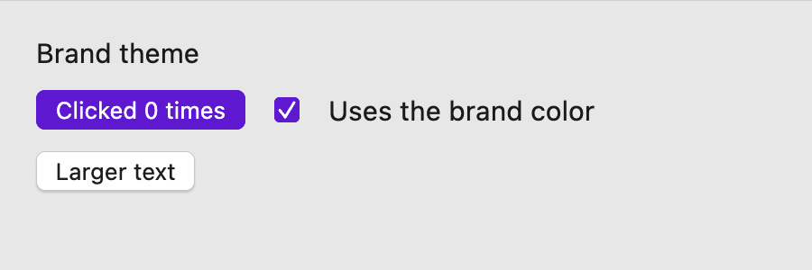
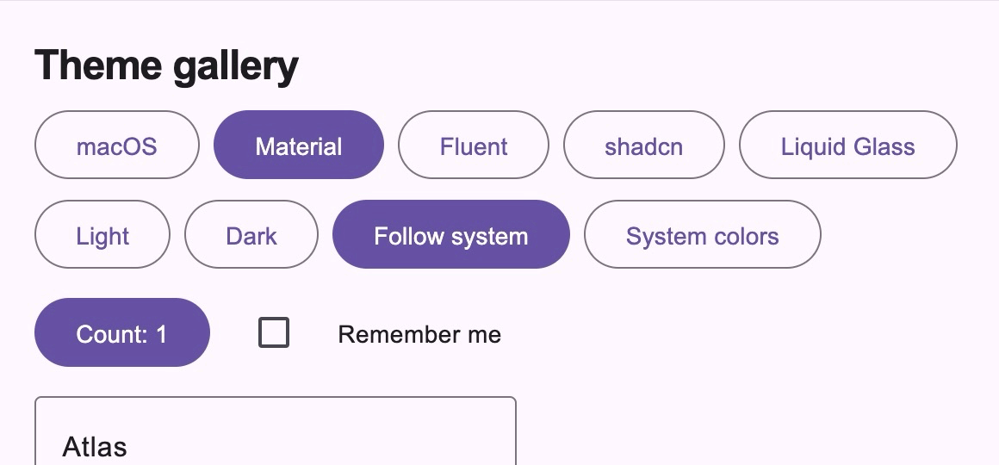
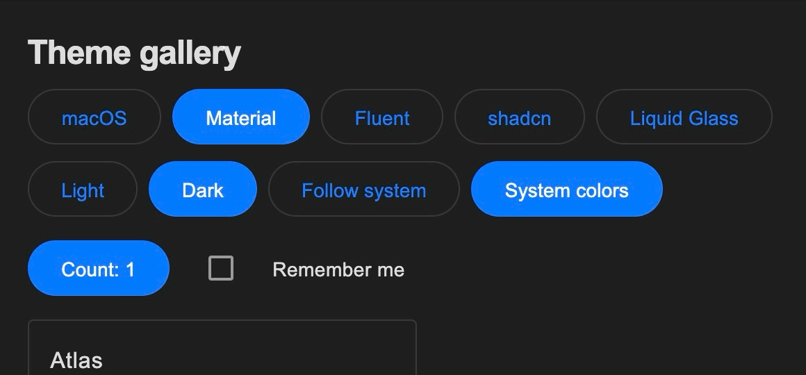
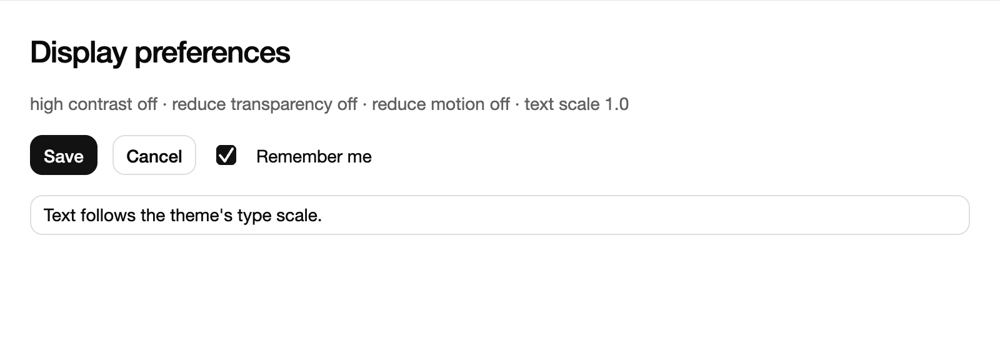
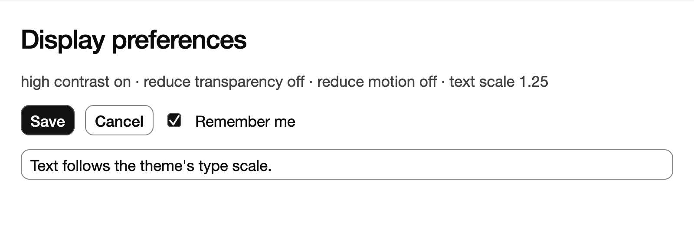
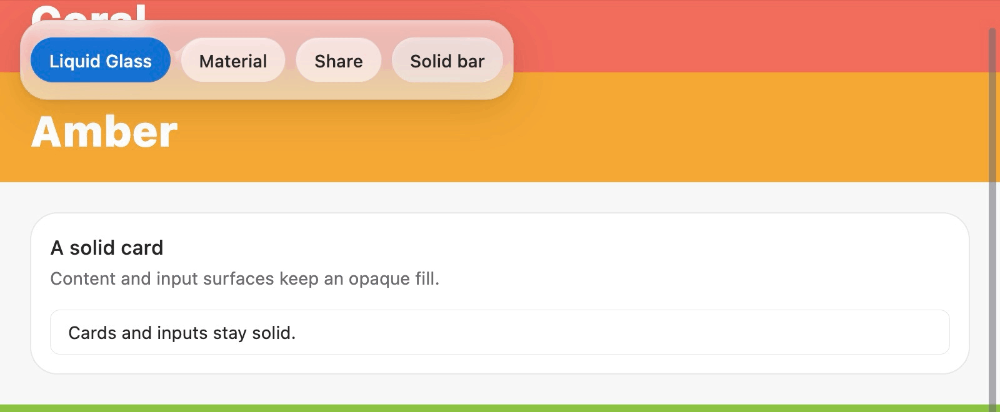
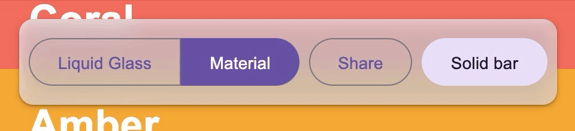
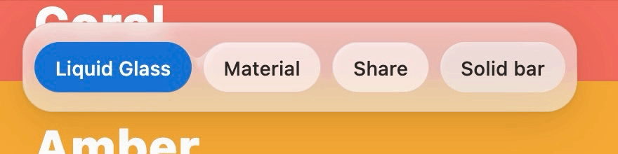
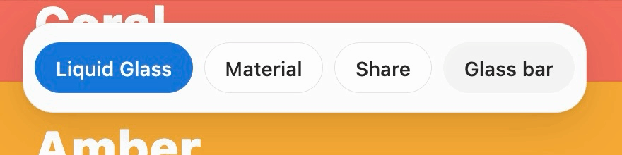

# 第 21 章　主题

前面所有的示例都在 `main` 中写过一行 `context(ThemeSource(...))`，控件的颜色、字号、圆角和阴影都来自这里的主题。第六部分讨论外观：本章讲整个应用的主题，下一章讲给某一块内容或某一个控件单独设置样式。读完本章，你会知道：

- 五套预设主题各自的取向，怎样选择；
- 主题由哪些数据组成，为什么改了主色按钮却没有变；
- 怎样在预设上修改，怎样从一个主题派生出另一个；
- 怎样在运行时切换主题，为什么切换不会丢失界面的状态；
- 怎样跟随系统的明暗和系统的强调色；
- 高对比度、减少透明度、文字缩放这些显示偏好怎样作用到主题上；
- Liquid Glass 主题怎样决定哪些表面是玻璃，怎样在任意一套主题中按用途打开或关闭玻璃。

## 21.1　五套预设

主题预设放在五个独立的 Cone 中，按需依赖其中一个或几个：

| Cone | 工厂函数 | 取向 |
| --- | --- | --- |
| `scoop.ui.style.macos` | `macosTheme` | 紧凑的 macOS 风格，采用 macOS Sequoia 的 Aqua 和 Dark Aqua 外观 |
| `scoop.ui.style.material` | `materialTheme` | Material 3 风格：胶囊形按钮、圆形的状态层 |
| `scoop.ui.style.fluent` | `fluentTheme` | Fluent 2 风格 |
| `scoop.ui.style.shadcn` | `shadcnTheme` | shadcn/ui 风格：黑白为主、简洁的轮廓，本书大部分示例用的就是它 |
| `scoop.ui.style.liquidglass` | `liquidGlassTheme` | Liquid Glass 风格：参照新版 macOS 的原生控件，系统字体、胶囊形按钮；操作按钮、导航、工具栏和弹层是透出背后内容的玻璃，正文和输入框保持不透明（21.7 节） |

五个工厂函数的形状相同：

```scoop
macosTheme(mode = ThemeMode.Light, palette = None) { ... }
```

`mode` 是 `ThemeMode.Light` 或 `Dark`；`palette` 是可选的配色，`None` 时使用这套预设自己的配色（21.5 节用它接入系统颜色）；最后的配置块用来在预设上修改（21.3 节）。返回值是 `ShapeTheme`，它实现了公共的 `Theme` 接口，所以控件、样式和你自己的绘图代码都不关心它来自哪套预设。

在单文件程序中，依赖头里同时写 `scoop.ui.style`（`ThemeSource`、`ThemeMode` 等公共类型）和所选的预设：

```scoop
//! dep: scoop:scoop.ui.style:0.1.0
//! dep: scoop:scoop.ui.style.macos:0.1.0
```

选择哪一套主要看应用的定位：只在 macOS 上发布、希望和系统的原生应用放在一起不显突兀，用 macOS；跨平台、希望各平台外观一致，shadcn 或 Material 更合适；面向 Windows 用户，用 Fluent；界面以图片、地图、媒体之类丰富的内容为主，工具栏和弹层浮在内容之上，可以考虑 Liquid Glass。注意 `macosTheme` 是 macOS Sequoia 的外观，没有玻璃；想要新版 macOS 那样的玻璃，要用 `liquidGlassTheme`。21.4 节的示例可以在五者之间切换，比较它们的样子。

主题只决定 Scoop **自己绘制**的内容的外观，不修改系统设置，也不改变原生窗口的标题栏（第 1.3 节）。

## 21.2　主题由什么组成

主题是一份不可变的数据，大致分为两层：

- **`tokens`**：整个界面共用的基础数值。`palette` 是语义配色，比如 `background`（页面背景）、`primary`（主色）、`card`、`border`、`ring`（焦点环）等，大部分是一对 `ColorPair(background, foreground)`，表示一种底色和放在它上面的文字颜色；`typography` 是文字样式，有 `body`、`caption`、`action` 三种；还有 `spacing`、`corners`、`motion`（悬停、按下、选中的过渡动画）、`effects`（`raised`、`floating` 两种阴影）、`glassSurfaces`（哪些表面使用玻璃，21.7 节），以及开关、滑块专用的 `controlMetrics`（轨道和可拖动部分的尺寸）和 `controlThumb`（可拖动部分的外观）。
- **部件**：`surfaces`（`plain`、`action`、`outlinedAction`、`elevated` 等表面，按钮、输入框、卡片都画在表面上）、`checkbox`、`radio`、`scrollbar`。每个部件有自己的尺寸、填充色、边框色、文字颜色、焦点环和阴影。

两层之间有一条重要的规则：**预设在创建时用 `tokens` 算出各部件的颜色，之后单独修改 `tokens`，已经算好的部件不会跟着变。** 改了 `palette.primary`，主按钮仍然是原来的颜色，因为主按钮用的是 `surfaces.action` 中已经算好的填充色。需要同步改变时，要把相关的部件也显式配置上，下一节的示例就是这样做的。

文字也一样：`typography.body` 是正文，`typography.action` 是按钮之类控件上的文字。只改 `body`，标签变了，按钮上的字不变。

所有页面都应该从主题读取颜色，而不是写死。前面的示例都在 `render()` 中这样给页面铺底色：

```scoop
val background = this.theme.read(scope).tokens.palette.background.background
```

`currentThemeSource()` 在组件构造时取得当前的 `ThemeSource`，`read(scope)` 读取当前的主题（21.6 节会解释它为什么不直接读 `current`）。这样页面的背景和标准控件会一起响应主题的切换和显示偏好。

## 21.3　在预设上修改

很多时候你只想在某套预设上换个品牌色、把正文调大一点。保存为 `brand.scoop`：

```scoop
{{#include ../../examples/ch21/brand.scoop}}
```

```sh
scoop run brand.scoop --release
```



配置块会在**完整的预设数据**上执行一次：

- 嵌套的块（`tokens { palette { ... } }`）只修改你写到的字段，其余字段保持预设的值；
- 直接给某个字段赋一个完整的值，则整体替换它，比如 `shadows = []` 去掉了主按钮的投影。

`brandTheme` 做了三处修改：把主色和焦点环换成紫色，正文字号改为 15，去掉主按钮的投影。按照上一节的规则，它除了 `palette { primary = ... }`，还分别配置了 `surfaces { action { ... } }` 和 `checkbox { appearance { ... } }`，紫色才出现在按钮和复选框上。

`StateColors(normal, hovered, pressed, disabled)` 给出部件在四种交互状态下的颜色，`StateColors.solid(color)` 表示四种状态用同一种颜色；`mixThemeColor(from, to, progress)` 把两种颜色按比例混合，方便从一个基础色派生出悬停和按下时的颜色。

### 用 copy 派生新主题

主题是不可变的值。`theme.copy { ... }` 以已有主题为起点，接受同样的配置块，返回一个新主题，原来的主题不受影响。示例的 Larger text 按钮就用它派生了一个正文更大的版本：

```scoop
source.current.value = if (large.value)
    brand.copy { tokens { typography { body { fontSize = 19.0 } } } }
else
    brand
```

点 Larger text，标题和 “Uses the brand color” 变大了，两个按钮上的文字却没有变：它们用的是 `typography.action`，而不是 `body`。按钮上的计数也还在，这是 21.4 节要讲的。再点一次 Normal text，切回原来的 `brand`，它从来没有被修改过。

`copy` 适合在一套基础主题上派生几个变体，比如“紧凑模式”或“大字模式”。`palette`、`typography` 等分组本身也有各自的 `copy`。

## 21.4　运行时切换主题

应用持有一个稳定的 `ThemeSource`，用 `context(source) { ... }` 包住 `runUiApplication`。`ThemeSource.current` 是一个 `State<Theme>`，给它赋一个新值就切换了主题。保存为 `themes.scoop`：

```scoop
{{#include ../../examples/ch21/themes.scoop}}
```

```sh
scoop run themes.scoop --release
```

窗口最上面一排按钮选择预设，第二排选择浅色、深色或跟随系统，System colors 切换系统配色（21.5 节），下面是一个计数按钮、一个复选框和一个输入框。点一次 Count，取消勾选 Remember me，把输入框中的文字改为 `Atlas`，再点 Material，窗口是这样的：



按钮变成了 Material 的胶囊形，背景变为淡紫色，计数仍然是 1，复选框仍然没有勾选，输入框中仍然是 `Atlas`。再点 Liquid Glass，按钮换成了浅色的胶囊，选中的按钮变为蓝色，计数、勾选和文字同样都还在。这个页面的背景是纯色，所以看不出 Liquid Glass 的玻璃，21.7 节会给它准备一个合适的背景。

**换主题不会重建界面。** 挂载树、组件实例和它们的 State 都保留，只是读到了新主题的组件重新 `render()` 或重新绘制。按钮的计数、复选框的勾选、输入框中的文字和光标、当前的焦点都不受影响。这也是主题要通过 `ThemeSource` 这个 State 来提供，而不是作为参数一层层传下去的原因：读取即依赖（第 8 章），只有真正读了主题的地方才会更新。

示例的结构值得看一下：`ThemeModel` 保存用户的三个选择（预设、明暗、是否使用系统配色），`apply()` 把它们组合成一个主题写入 `source.current`。用户的选择和最终的主题分开保存，这样任何一个选择变化时，都从头组合一次，不会出现“换了预设，明暗却被重置”这样的问题。

每套预设都是独立的 Cone，只依赖应用真正提供的风格即可。示例为了演示依赖了五个。

## 21.5　跟随系统明暗与系统配色

### 系统明暗

“跟随系统”需要两件事：启动时读取系统当前的外观，之后在系统外观变化时得到通知。示例在 `onMount` 中这样做：

```scoop
public override fun onMount() {
    val model = this.model
    val window = scope.nativeWindow
    model.systemChanged(window.observedTheme)
    scope.observeWindow(window) { event ->
        when (event) {
            case ThemeChanged(val value) -> model.systemChanged(value)
            else -> {}
        }
    }
}
```

- `scope.nativeWindow` 是组件所在的原生窗口；
- `observedTheme` 是窗口当前观察到的系统外观，类型是 `scoop.window.Theme?`。它和 UI 的 `Theme` 同名，示例用 `import scoop.window.Theme as WindowTheme` 换了一个名字；
- `observeWindow` 登记窗口事件的回调，组件卸载时自动注销。

收到 `WindowEvent.ThemeChanged` 后，模型只更新记录下来的系统外观；只有当前的选择是 Follow system 时，`apply()` 才会因此换主题。用户手动选了 Light 或 Dark，系统变化不会覆盖用户的选择。

在 macOS 的“系统设置 → 外观”中切换浅色和深色，选择了 Follow system 的窗口会随之变化。本书写作时示例以 Follow system 启动，按系统当前的浅色外观显示；为了不改动作者电脑的系统设置，切换系统外观的过程没有实际操作。

### 系统配色

macOS 上，`scoop.ui.style.macos` 还提供 `macosSystemPalette(mode)`：它读取系统在指定明暗外观下的语义颜色，**包括用户在系统设置中选的强调色**，返回一个普通的 `ThemePalette`。把它交给任意一套预设的 `palette` 参数：

```scoop
// The system palette is a snapshot: read it again every time the theme is rebuilt.
val palette = if (systemColors.value) Some(macosSystemPalette(resolved)) else None
```

预设拿到一份配色后，会用它生成文字和各部件的状态颜色，同时保留自己的几何形状和动效。所以系统配色和风格是两个独立的选择：Material 的胶囊按钮可以配上 macOS 的系统蓝。在示例中打开 System colors，选 Dark 和 Material：



Material 原本的紫色换成了系统的蓝色（作者的电脑使用默认的蓝色强调色），按钮的形状仍然是 Material 的。

几点说明：

- **它是一份快照。** `macosSystemPalette` 不注册任何监听，用户在系统设置中换了强调色，要由应用重新读取并发布新的主题。示例在每次 `apply()` 时都重新读取，系统明暗变化时也会走到这里。
- **只能在主线程调用**，在 UI 的回调和生命周期函数中调用即可。
- **只有 macOS 提供。** 这个函数只在 macOS 上编译，示例因此只能在 macOS 上构建。跨平台的应用需要把这部分代码放进只在 macOS 上编译的源码目录（Cone.toml 中带平台条件的 `[[sources]]`，见《Scoop 程序设计》第 28 章），在其他平台上使用预设配色。

## 21.6　显示偏好

系统的辅助功能设置中有几项会影响外观：增强对比度、减少透明度、减少动态效果，以及更大的文字。Scoop 把它们统称为显示偏好。

### 偏好怎样作用到主题上

`ThemeSource` 中保存的 `current` 是应用选择的**基础主题**；`read(scope)` 返回的是基础主题**加上这个窗口当前的偏好**之后的结果。内置的预设会这样处理偏好：

- **高对比度**：边框、次要文字等颜色变深，提高和背景的对比；主题提供的玻璃换成不透明的底色（21.7 节）；
- **减少透明度**：半透明的颜色和阴影换成不透明的，主题提供的玻璃也一样；
- **文字缩放**：按比例放大文字样式；
- **减少动画**：控件跳过过渡动画，直接呈现目标状态；第 17 章的滚动回弹也会关闭。

所以组件中应当总是用 `source.read(scope)` 读取主题，而不是直接读 `source.current.value`：后者是没有应用偏好的基础主题，自绘的背景会和标准控件对不上。`read(scope)` 在 `render()` 中调用时，会同时订阅主题和偏好的变化。

`theme.preferences` 是已经应用到这份主题上的偏好，类型是 `ThemePreferences`，有 `highContrast`、`reduceTransparency`、`reduceMotion` 和 `textScaleFactor` 四个字段。自己绘制的控件可以读取它，比如在 `reduceMotion` 为 true 时不播放动画。

### 覆盖系统的偏好

默认情况下，偏好跟随系统。`runUiApplication` 的 `preferences` 参数可以为这个窗口覆盖其中的一部分。保存为 `preferences.scoop`：

```scoop
{{#include ../../examples/ch21/preferences.scoop}}
```

```sh
scoop run preferences.scoop --release
```

`uiPreferences { ... }` 的每个字段默认是 `None`，表示跟随系统；赋一个 `Some(...)` 就覆盖它。示例打开了高对比度，并把文字放大到 1.25 倍。下面左边是去掉这两项覆盖之后的样子，右边是示例的样子：

 

右边的文字更大，Cancel 按钮、复选框和输入框的边框更深，灰色的状态行文字也更深。状态行读的就是 `theme.preferences`。

`uiPreferences` 中还有几项和主题无关的字段：`autoHideScrollbars`（第 17.3 节）、`caretBlinkInterval`（光标闪烁的间隔，`Duration.ZERO` 表示常亮）、`caretWidthPixels` 等。

`runUiApplication` 只在启动时接收这些覆盖。需要在运行中修改，比如在应用的设置页面中提供“高对比度”开关，要用第 27 章的 `UiHost` 自己创建窗口，它返回的 `UiWindow` 有一个可以随时赋值的 `preferences` 属性；把某一项改回 `None`，就重新跟随系统。

覆盖偏好主要用于两种场合：应用自己提供辅助功能设置；在开发时预览大字号和高对比度下的界面，而不必修改系统设置。本书写作时，用后者核对了示例的效果。

### 自绘内容的对比度

在自己选的颜色上画文字时，`contrastThemeColors(pair, canvas, minimum = 7.0)` 按实际的底色调整一对颜色，使文字和背景的对比度至少达到 `minimum`；边框之类的图形可以用 3.0。第 31 章讨论无障碍时还会用到它。

## 21.7　Liquid Glass 与玻璃表面

Liquid Glass 主题中，操作按钮、导航、工具栏和弹层是“玻璃”：先把背后已经画好的画面模糊、在边缘折射，再叠上一层半透明的底色，文字和图标画在最上面，保持清晰。这些玻璃是 Scoop 用着色器自己画出来的，不是系统提供的材质，所以和其他预设一样，与运行在哪个平台上无关；它参照了新版 macOS 的外观，但不追求和系统逐像素一致。

玻璃也不是 Liquid Glass 专有的。哪些表面使用玻璃、用什么样的玻璃，是主题 `tokens` 中的一项设置，任何一套预设都可以按用途打开。

### 一个示例

保存为 `glass.scoop`：

```scoop
{{#include ../../examples/ch21/glass.scoop}}
```

```sh
scoop run glass.scoop --release
```

窗口中是一列彩色的色带，中间夹着一张卡片，左上角浮着一条工具栏。玻璃要有背后的内容才看得出来，所以示例用 `stack` 把工具栏叠在可以滚动的色带上面。向下滚动一点，让工具栏跨在 Coral 和 Amber 两条色带之间：



工具栏的上半部分透出珊瑚红，下半部分透出琥珀黄，两种颜色在中间柔和地过渡；Coral 这个词经过工具栏的部分被抹成了一片颜色。工具栏中的按钮也是玻璃。下面的卡片和输入框则是不透明的白色。继续滚动，工具栏透出的颜色随着经过的色带变化：玻璃每一帧都重新处理当帧背后的画面。

`stack` 中子项的顺序很重要：玻璃处理的是**先于它画出来**的内容。示例先放滚动区域，再放工具栏，色带先画、工具栏后画，所以工具栏能透出色带。

### 表面的用途

主题怎么知道工具栏要用玻璃、卡片不用？靠的是表面的**用途** `SurfaceRole`。它和表面的种类 `SurfaceKind` 是两回事：种类对应 21.2 节 `surfaces` 中的 `plain`、`action`、`outlinedAction`、`elevated`，决定一块表面的形状和配色；用途说明它在界面中起什么作用。控件库中的控件都会告诉主题自己的用途：

| 用途 | 使用它的控件 |
| --- | --- |
| `Content` | `card`；也是 `frame` 的默认用途 |
| `Control` | `button`、`toggle`、`badge` |
| `Input` | `input`、`textarea`、`inputGroup`、`inputOtp` |
| `Navigation` | `tabs`、`sidebar` |
| `Toolbar` | `menubar` |
| `Popover` | 各种菜单、`select` 的列表、`popover`、`tooltip`、`hoverCard`、`navigationMenu` 的面板 |
| `Dialog` | `dialog`、`alertDialog`、`sheet`、`drawer` |
| `Notification` | `toaster` 中的通知 |

自己用 `frame` 搭的表面也可以声明用途。示例的工具栏是一个使用主题表面的 `frame`：

```scoop
val toolbar = frame(actions) {
    surface = Some(SurfaceKind.Elevated)
    surfaceRole = SurfaceRole.Toolbar
    padding = Some(Insets.all(8.0))
    // Clearing the material locally brings back the theme's opaque fill.
    if (solid.value) style { glass(None) }
}
```

`surface` 让它画出主题的浮起表面（第 5.4 节），`surfaceRole` 说明它是一条工具栏。不写 `surfaceRole`，用途就是默认的 `Content`，在 Liquid Glass 中是一块不透明的面板。没有 `surface` 的 `frame` 只是布局容器，没有表面，也就谈不上玻璃。

用途只影响主题给这块表面选择什么材质，不改变控件的布局、焦点和读屏器中的角色。

### 按用途选择材质

`tokens.glassSurfaces` 为八种用途各保存一个 `GlassMaterial?`，`None` 表示这种用途不用玻璃。`liquidGlassTheme` 的默认设置是：

| 用途 | 模糊 `blurSigma` | 折射 `refraction` | 边缘宽度 `edgeWidth` |
| --- | ---: | ---: | ---: |
| `Control` | 4 | 2 | 5 |
| `Navigation`、`Toolbar` | 8 | 3 | 9 |
| `Popover`、`Dialog`、`Notification` | 12 | 5 | 16 |
| `Content`、`Input` | — | — | — |

表面越大，模糊越强、边缘越宽：小按钮只在窄窄的一圈边缘上折射，浮层则把背后较大的一片区域磨砂。正文和输入框没有材质，长时间阅读和编辑的文字始终有稳定的底色。

其他四套预设的 `glassSurfaces` 全部是 `None`，所以默认没有玻璃。但这只是默认值，在配置块中可以给任何一套预设打开某几种用途。示例的 `materialGlass()` 就是这样做的：

```scoop
return materialTheme {
    tokens {
        glassSurfaces {
            toolbar = Some(frost)
            popover = Some(frost)
        }
    }
}
```

点工具栏上的 Material，主题换成了 Material：工具栏仍然是玻璃，按钮则是 Material 自己的按钮，不再是玻璃，因为这个主题的 `control` 仍然是 `None`。



`glassSurfaces { ... }` 是嵌套的配置块，和 21.3 节的规则一样，只改写到的用途，其余保持预设原来的值；各用途之间互不影响，打开工具栏不会顺带打开弹层。切换主题和 21.4 节一样只是给 `source.current` 换了一个值，工具栏的状态、输入框中的文字和滚动位置都保留着。

### 材质

`glassMaterial { ... }` 构造一个材质。它是一份不可变的参数，不持有任何原生资源，可以在多处共用：

| 字段 | 默认值 | 含义 |
| --- | --- | --- |
| `blurSigma` | 8 | 背后画面的高斯模糊程度，0 表示不模糊 |
| `refraction` | 8 | 边缘附近取样位置的最大偏移，0 表示不折射 |
| `edgeWidth` | 16 | 从外轮廓向内多宽的一圈有折射和高光 |
| `saturation` | 1.1 | 背后画面的饱和度倍数，1 表示不变 |
| `tint` | 白色，透明度 0.16 | 叠在背后画面上的染色 |
| `highlight` | 白色，透明度 0.36 | 边缘高光的颜色 |

三个长度都使用逻辑单位。绘制时依次模糊背后的画面、在边缘附近按法线方向偏移取样、调整饱和度、叠上染色、画出边缘高光，然后才是表面的底色、内容和边框，它们都不会被模糊。

`copy { ... }` 从已有的材质派生新材质。预设中现成的材质可以用 `theme.tokens.glassSurfaces.get(role)` 取出来，例如 `liquidGlassTheme().tokens.glassSurfaces.get(SurfaceRole.Toolbar)`，修改后再交给别的主题。材质只是描述，真正的滤镜由绘制它的控件创建、缓存和关闭，应用不需要管理这些资源。

### 局部关闭

点 Solid bar，工具栏的样式中多了一项覆盖：

```scoop
if (solid.value) style { glass(None) }
```

工具栏换回了主题给它的不透明底色，背后的颜色不再透出来。下面左边是玻璃的工具栏，右边是清除材质之后的：

 

`glass(None)` 和第 22 章的 `border(None)` 一样，是 `StyleOverride` 中的 `Set(None)`：明确不要材质，而不是沿用主题的选择。清除之后恢复的是主题原来的底色，文字的对比度不受影响。控件也可以这样关闭，按钮写在 `style { surface { style { glass(None) } } }` 中。

右边工具栏中的按钮看起来也是白色的。它们其实仍然是玻璃，只是背后变成了白色的工具栏：玻璃透出的永远是它背后实际画出来的东西，包括另一块玻璃。

### 文字的可读性

再看一眼示例的截图：工具栏背后的 Coral 字样完全看不清了。这是主题有意为之。玻璃背后可能是任何画面，主题按表面上文字的实际颜色，为玻璃上的底色算出足够的不透明度，保证无论背后是什么，文字和底色的对比度都不低于 4.5:1（原来的配色本身达不到 4.5:1 时，不低于原来的对比度）。所以背后的颜色和大块的明暗能透过来，细节则被盖住。

这个保证只覆盖主题自己生成的底色。在玻璃表面上用 `background(...)` 换了底色、用 `text { ... }` 换了文字颜色，或者在自己的内容上直接使用材质（第 22.3 节），对比度都要自己负责。`glassSurfaceFill(ColorPair(background, foreground), canvas)` 用和主题相同的算法求出这种底色：`canvas` 是一个不透明的页面背景色，返回的颜色画在材质之后、文字之前。

### 融合

示例把两个主题按钮放在一个 `buttonGroup` 中。在 Liquid Glass 下，按钮组中的按钮共用一块玻璃：两个胶囊之间连着一道细细的“水桥”，像两滴快要合在一起的水。按钮各自的颜色、焦点和读屏器中的名字仍然是独立的。这需要主题同时为 `Toolbar` 和 `Control` 提供材质，所以切换到 Material 之后，按钮组恢复成 Material 普通的相连按钮。按下按钮时，融合的轮廓还会随之形变；本书写作时，自动化工具只能直接触发按钮的动作，没有在窗口中核对按下过程中的形变。

要把几块任意的内容这样融合在一起，可以直接使用控件库的 `glassEffectContainer`，它和按钮组用的是同一套融合与形变的机制，见第 22.3 节。Gallery 的 Liquid Glass 页演示了更多融合与形变的效果，包括页签的玻璃底板。

### 显示偏好与玻璃

21.6 节的两项显示偏好会关闭主题的玻璃：打开高对比度或减少透明度后，`read(scope)` 返回的主题中 `glassSurfaces` 全部是 `None`，所有表面使用不透明的底色，按钮组也不再融合；关闭偏好，又从基础主题恢复原来的设置。减少动态效果则让融合的形变直接到达终点。本书写作时，给示例的 `runUiApplication` 加上 `preferences = uiPreferences { reduceTransparency = Some(true) }` 运行，工具栏和按钮都换成了不透明的白色，背后的色带不再透出，两个主题按钮恢复成普通的相连按钮。

这两项偏好只关闭主题**提供**的玻璃。在局部样式中明确设置的材质（第 22.3 节）由应用自己负责，需要时读取 `theme.preferences` 自行处理。

### 静止时的开销

玻璃每一帧都处理当帧背后的画面，不缓存旧的背景，所以滚动时透出的颜色总是对的。材质和轮廓不变时，滤镜会被复用；界面静止时，玻璃不会让窗口继续绘制。本书写作时用 `top` 查看，示例静止时 CPU 占用为 0%。

## 常见误用

- **改了 `palette.primary`，以为按钮会跟着变。** 部件的颜色在预设创建时已经算好，同时配置用到它的部件，或者通过 `palette` 参数交给工厂函数，让预设重新生成。
- **只改 `typography.body`，以为按钮上的字也会变。** 按钮用的是 `action`。
- **直接读 `source.current.value` 来取页面颜色。** 那是没有应用显示偏好的基础主题，用 `source.read(scope)`。
- **在 `render()` 中调用 `currentThemeSource()`。** 它要在组件构造时（字段初始化中）调用，并且 `runUiApplication` 要位于 `context(source) { ... }` 之内，否则报缺少上下文。
- **同时导入 `scoop.window.*` 和 `scoop.ui.style.*`。** 两边都有 `Theme`，用 `import scoop.window.Theme as WindowTheme` 单独导入窗口的那个。
- **根 `frame` 没有铺底色。** 窗口的内容区会是黑色。用主题的 `palette.background` 铺上。
- **以为 `macosSystemPalette` 会自动更新。** 它是快照，系统颜色变化后要重新读取并发布主题。
- **在纯色的背景上使用 Liquid Glass，以为玻璃没有生效。** 玻璃透出的是背后的画面，背后是纯色时，它看起来就是一块浅色的底板。
- **以为 `macosTheme` 带有新版 macOS 的玻璃。** 它是 macOS Sequoia 的外观。玻璃用 `liquidGlassTheme`，或者在任意一套预设中设置 `glassSurfaces`。
- **用 `frame` 搭的工具栏没有变成玻璃。** 要同时设置 `surface` 和 `surfaceRole`；只设置 `surface` 时用途是 `Content`，Liquid Glass 的 `Content` 不使用玻璃。
- **在 `stack` 中把浮在上面的表面声明在前面。** 玻璃只处理先于它画出来的内容，浮层要声明在被它盖住的内容之后。
- **在玻璃上换了底色或文字颜色，却没有检查对比度。** 主题只为自己生成的底色保证可读性，自定义的颜色用 `glassSurfaceFill` 或 `contrastThemeColors` 检查。

## 小结

- 五套预设分别在五个 Cone 中，工厂函数都是 `xxxTheme(mode, palette) { ... }`，返回实现了 `Theme` 的 `ShapeTheme`。
- 主题分为 `tokens` 和部件两层；部件的颜色在创建时由 `tokens` 算出，之后单独改 `tokens` 不会影响部件；按钮的文字用 `typography.action`。
- 配置块在完整的预设上修改，嵌套块只改写到的字段；`copy { ... }` 从已有主题派生新主题，原主题不变。
- 给 `ThemeSource.current` 赋值即可切换主题，界面不重建，所有状态都保留；用户的选择和最终的主题分开保存。
- `observedTheme` 和 `ThemeChanged` 用于跟随系统明暗；macOS 上 `macosSystemPalette(mode)` 读取包括强调色在内的系统配色，可以配合任意一套预设。
- `read(scope)` 返回应用了显示偏好的主题；`runUiApplication` 的 `preferences` 参数覆盖系统的偏好，运行中修改要用 `UiWindow.preferences`。
- Liquid Glass 的操作按钮、导航、工具栏和浮层使用玻璃，正文和输入框保持不透明；玻璃每帧处理当帧背后的画面，主题为玻璃上的文字算出足够的底色，静止时不产生新的帧。
- 主题按表面的用途 `SurfaceRole` 选择材质：`tokens.glassSurfaces` 为八种用途各保存一个 `GlassMaterial?`，任意一套预设都可以在配置块中打开；`frame` 同时设置 `surface` 和 `surfaceRole` 即可参与；`glass(None)` 在局部清除材质；高对比度和减少透明度关闭主题提供的玻璃。

## 练习

1. 在 `brand.scoop` 中把品牌色换成绿色，并让 `palette.primary` 和 `surfaces.action` 用同一个变量，确认两处一起变化。
2. 给 `brandTheme` 再加一个配置，把 `typography.action` 的字号也改为 15，比较按钮上的文字。
3. 在 `themes.scoop` 中加一个 Reduce motion 按钮，用 `copy { tokens { motion { preference = MotionPreference.Reduced } } }` 派生主题。打开后切换复选框，过渡动画还在吗？
4. 让 `themes.scoop` 记住用户的选择：退出时把预设和明暗写入一个文件，下次启动时读回来。哪些状态应该保存，哪些不需要？
5. 把 `preferences.scoop` 的 `textScaleFactor` 改为 `Some(1.5)`，再去掉 `highContrast`，看看哪些文字变大了，哪些没有。
6. 在 `glass.scoop` 中把两处 `liquidGlassTheme()` 都换成 `liquidGlassTheme { tokens { glassSurfaces { control = None } } }`。工具栏中的按钮有什么变化？两个主题按钮还连在一起吗？
7. 去掉 `glass.scoop` 中工具栏 `frame` 的 `surfaceRole` 一行，工具栏变成了什么样子？为什么？
8. 交换示例中 `stack` 的两个子项，工具栏还能透出色带吗？还能点到工具栏中的按钮吗？
9. 用 `glassMaterial { ... }` 调出一种几乎不模糊、只在边缘折射的材质，交给 `materialGlass()` 中的 `toolbar`，再滚动色带观察效果。
