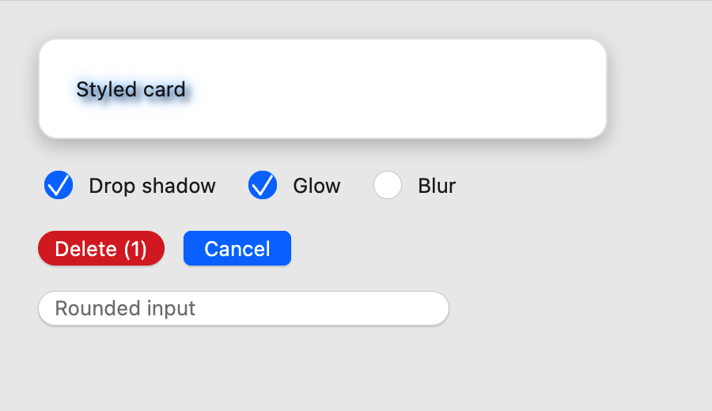
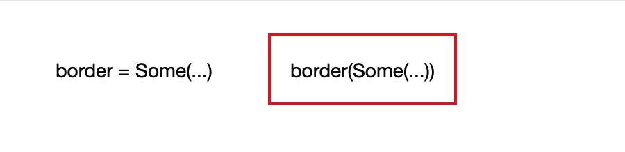

# 第 22 章　局部样式与效果

上一章的主题决定整个应用的外观。本章讨论局部的调整：给某一块内容加上背景、边框和阴影，给文字加上光晕，把某一个按钮改成红色。读完本章，你会知道：

- `styled` 怎样给任意内容加装饰，它为什么不影响布局；
- 一块样式按什么顺序绘制，外框阴影和内容阴影有什么区别；
- 按钮、复选框和输入框各自的样式对象怎样配置，怎样复用；
- `StyleOverride` 中 `Inherit` 和 `Set` 的区别，覆盖怎样一层层叠加；
- 样式块中一个能通过编译、却什么也不做的写法。

## 22.1　一个示例

保存为 `styles.scoop`：

```scoop
{{#include ../../examples/ch22/styles.scoop}}
```

```sh
scoop run styles.scoop --release
```

窗口中是一张带阴影的白色卡片，下面是三个圆形的复选框、一个红色的胶囊形 Delete 按钮、一个普通的 Cancel 按钮和一个圆角输入框。勾选 Drop shadow 和 Glow，再点一次 Delete，窗口是这样的：



## 22.2　styled：给一块内容加装饰

`styled(content) { style { ... } }` 用一个 `Style` 包住任意视图：

```scoop
val card = styled(frame(label("Styled card")) { padding = Some(Insets.all(24.0)) }) {
    style {
        background = Some(Paint(palette.card.background))
        border = Some(Border.all(1.0, palette.border))
        corners = Corners.all(12.0)
        boxShadows = [BoxShadow(Point(0.0, 4.0), 6.0, 6.0, Color.Black.withAlpha(0.2))]
        contentEffects = effectArray
    }
}
```

`Style` 的字段：

| 字段 | 含义 |
| --- | --- |
| `background: Paint?` | 圆角外框内的填充，`None` 表示透明 |
| `border: Border?` | 向内绘制的边框。`Border.all(width, color)` 四边相同，也可以按物理边或逻辑边（start、end）分别设置 |
| `corners: Corners` | 圆角。`Corners.all(radius)`，也可以分别指定四个角，或者按逻辑角指定 |
| `boxShadows: Array<BoxShadow>` | 外框阴影：`BoxShadow(offset, sigmaX, sigmaY, color)` |
| `contentEffects: Array<ContentEffect>` | 依次作用在内容像素上的效果，见下一节 |
| `clipContent: Boolean` | 为 true 时，用同一个圆角轮廓裁剪内容和子项的点击范围 |

`styled` **对布局是透明的**：它把收到的约束原样交给内容，自己的尺寸和基线就是内容的尺寸和基线。它不增加内边距，也不创建点击区域，点击的范围仍然来自内容本身。所以示例先用 `frame { padding = ... }` 在文字周围留出空间，再交给 `styled`；直接 `styled(label(...))` 的话，背景会紧贴着文字。

`styled` 的包装始终存在，即使 `Style` 是空的。增加或去掉效果只是更新它的 Props，不会重建内容，内容中组件的状态都会保留。勾选和取消效果时，卡片中的文字不会因此重新创建。

按逻辑边和逻辑角设置的边框、圆角，会在从右到左的界面中自动翻转（第 5 章）。

## 22.3　绘制顺序与内容效果

一个 styled 区域按固定的顺序绘制：

1. **外框阴影** `boxShadows`：以填满的圆角外框为形状投下阴影，和背景是否透明无关；
2. **背景** `background`；
3. **内容**：先绘制内容本身，再按数组的顺序应用 `contentEffects`；
4. **边框** `border`：向内绘制，压在内容的上面。

`ContentEffect` 有三种，作用对象都是内容实际画出来的像素。文字、图片、子控件都一样，不需要把文字转换成路径：

- **`ContentEffect.DropShadow(offset, sigmaX, sigmaY, color)`**：按内容的透明度投下阴影；
- **`Glow(sigmaX, sigmaY, color)`**：零偏移的着色模糊光晕，垫在原内容的下面；
- **`Blur(sigmaX, sigmaY)`**：模糊内容本身。它不采样背后的画面，所以不是“毛玻璃”效果。

`sigma` 是高斯模糊的标准差，和 `offset` 一样使用逻辑单位。效果按顺序串联：`[Blur(...), DropShadow(...)]` 先模糊再投影，反过来的顺序结果不同。示例按勾选的顺序把效果放进数组：

```scoop
// Content effects run in array order on the card's actual pixels.
val effects = ArrayList<ContentEffect>()
if (this.shadow.value)
    effects.add(ContentEffect.DropShadow(Point(3.0, 3.0), 2.0, 2.0, Color.Black.withAlpha(0.5)))
...
```

阴影和光晕可以画到布局框的外面，但不改变布局的尺寸、基线和点击范围；祖先的裁剪仍然限制它们的可见范围。勾选 Glow 之后，卡片的位置和大小都没有变，点击范围也没有变大。

`BoxShadow` 和 `ContentEffect.DropShadow` 的区别在示例中很容易看出：卡片的 `boxShadows` 让整张卡片浮了起来；勾选 Drop shadow 后，阴影只出现在**文字**下面。原因是卡片的内容是那行文字，白色的背景属于 `Style` 本身，不是内容。

> **深入一点：毛玻璃**
>
> 要模糊的是控件**背后**的画面时（比如浮在列表上的半透明工具栏），需要在自绘控件中使用 `StylePainter.scene(context, style, Some(filter)) { ... }`：它先处理已经绘制在样式圆角内的背景，再填充、绘制前景和描边。`filter` 可以是高斯模糊，也可以是自定义的着色器。工具链附带的 glass 示例（`scoop.ui.component/examples/glass`）演示了这种做法，第 23 章和第 25 章会讲到自绘控件和着色器。

## 22.4　控件的样式

基础控件除了跟随主题，还接受各自的样式对象，用来调整单个控件：

| 控件 | 样式类型 | 构造函数 | 常用字段 |
| --- | --- | --- | --- |
| Button | `ButtonStyle` | `buttonStyle { }` | `kind`（`SurfaceKind`）、`surface { }`、`text { }`、`states { }`、`transition(...)` |
| Checkbox | `CheckboxStyle` | `checkboxStyle { }` | `marker { }`（尺寸、圆角、勾号颜色）、`padding`、`states { }` |
| Input、Textarea | `TextFieldStyle` | `textFieldStyle { }` | `surface { }`、`text { }`、`placeholder { }`、`caretColor`、`selectionColor`、`states { }` |

示例中的 Delete 按钮用的是一个事先构造好的样式：

```scoop
val dangerButton = buttonStyle {
    surface {
        style {
            background(Some(Paint(danger)))
            border(None)
            corners(Corners.all(14.0))
        }
    }
    text { color = Some(Color.White) }
    states {
        hovered { background(Some(Paint(mixThemeColor(danger, Color.White, 0.15)))) }
        pressed { background(Some(Paint(mixThemeColor(danger, Color.Black, 0.25)))) }
    }
}
```

- `surface { style { ... } }` 修改按钮的表面：红色背景、去掉主题给的边框、14 的圆角让它成为胶囊形；
- `text { ... }` 修改文字，它接收的是 `SpanStyle`，字体、字号、颜色都在这里；
- `states { ... }` 描述交互状态下的覆盖：控件启用时，按悬停、按下、获得可见焦点的顺序依次叠加 `hovered`、`pressed`、`focused`；禁用时只叠加 `disabled`。每一项都是 22.5 节的 `StyleOverride`。

使用样式有两种写法：在控件的配置块中，`style { ... }` 在当前样式上修改，示例中的复选框和输入框就是这样做的；`style = dangerButton` 直接使用一个构造好的样式对象，适合在多处复用。

复选框通过 `marker { size = Some(18.0); style { corners(Corners.all(9.0)) } }` 变成了 18 点大的圆形；输入框的 `caretColor` 让光标变成红色，`surface { style { corners(...) } }` 让它有更大的圆角。

本书写作时，用自动化工具在后台窗口中无法悬停，所以 Delete 按钮悬停时变亮的效果没有在窗口中核对。

**局部样式要克制。** 主题保证了整个应用的一致性和显示偏好的处理：高对比度下，主题会加深边框；减少透明度时，主题会去掉半透明。你在局部样式中写死的颜色不会参与这些处理。所以，能用主题解决的就改主题（第 21 章），局部样式只用在真正需要与众不同的地方，比如危险操作的按钮；即使在局部样式中，也尽量从 `palette` 中取颜色，示例中卡片的背景和边框就是这样做的。

## 22.5　StyleOverride：Inherit 与 Set

控件样式中的 `surface { style { ... } }`、`states { hovered { ... } }`，以及 `frame { style { ... } }`，接收的都是 `StyleOverride`，而不是完整的 `Style`。区别在于：`Style` 的每个字段都有一个值；`StyleOverride` 的每个字段是 `StyleValue<T>`，有两种取值：

- **`StyleValue.Inherit`**：不改，继续使用输入（主题或上一层）提供的值；
- **`StyleValue.Set(value)`**：替换为 `value`。

两者的区别在可空的字段上尤其重要：`Set(None)` 表示“明确不要背景或边框”，`Inherit` 表示“沿用原来的”。构造器中和字段同名的方法（`background(...)`、`border(...)`、`corners(...)` 等）就是写入 `Set`，所以上一节的 `border(None)` 去掉了主题给按钮的边框。

下面这个控制台程序演示了这些规则，保存为 `overrides.scoop`：

```scoop
{{#include ../../examples/ch22/overrides.scoop}}
```

```sh
scoop run overrides.scoop --release
```

输出：

```text
{{#include ../../examples/ch22/overrides.expected}}
```

逐行看：

- `base` 是一个完整的 `Style`，背景、边框和圆角都有值；
- `noBorder` 只把 `border` 设为 `Set(None)`，`resolve(base)` 之后边框没了，背景和圆角仍然来自 `base`；
- 把 `border` 改回 `StyleValue.Inherit`，边框又回来了；
- `a.then(b)` 把两层覆盖合并：`b` 中的 `Set` 优先，`b` 中的 `Inherit` 保留 `a` 的值。`noBorder.then(square)` 既去掉了边框，又把圆角设为 0。控件的 `states` 就是这样一层层叠加在表面样式上的。

`resolve(inherited)` 把覆盖应用到一个完整的 `Style` 上，得到新的 `Style`；`copy { ... }` 从已有的覆盖继续修改，原来的不变。

文字的字体、字号和颜色不属于 `Style`，而是用 `text { ... }` 等块中的 `SpanStyle` 配置。

## 22.6　样式块中的陷阱

第 15 章提到过一个问题，这里详细看一下。保存为 `style_trap.scoop`：

```scoop
{{#include ../../examples/ch22/style_trap.scoop}}
```

```sh
scoop run style_trap.scoop --release
```



两个 `frame` 看起来只差一点写法，左边却没有边框。两种写法都能通过编译，也没有任何警告。

原因在于名称的解析。`frame { ... }` 中的 `style { ... }` 是 `FrameBuilder` 的成员，它的块接收者是 `StyleOverrideBuilder`，那里的 `border` 是 `StyleValue<Border?>` 类型的属性。`border = Some(...)` 是一个 `Border?`，放不进去。于是编译器继续向外寻找，找到了顶层函数 `scoop.ui.style.style { ... }`，这正是 22.2 节 `styled` 中用来构造完整 `Style` 的那个函数，在它的块中，`border = Some(...)` 完全合法。结果是这一行构造了一个 `Style` 值，然后这个值被丢弃，`frame` 的样式没有任何变化。

避免这个问题的办法：

- **在 `StyleOverride` 的块中，总是用同名的方法**：`border(...)`、`background(...)`、`corners(...)`。它们写入 `Set`，类型也不会出错；
- **在 `styled` 的 `style { ... }` 中，用赋值**：那里构造的是完整的 `Style`，字段就是普通的值；
- **样式没有生效时，先检查是哪一种块。** 控件和 `frame` 的 `style` 块都是覆盖；只有 `styled` 的 `style` 块是完整的样式。

## 常见误用

- **给 `styled` 加了背景，内容却紧贴着边缘。** `styled` 不加内边距，先用 `frame { padding = ... }` 包住内容。
- **以为光晕或阴影会扩大点击范围。** 效果不改变布局和命中范围，这是预期的行为。
- **用 `ContentEffect.Blur` 做毛玻璃。** 它只模糊内容自己。模糊背后的画面要用 `StylePainter` 和滤镜。
- **在 `frame { style { ... } }` 中写 `border = Some(...)`。** 能通过编译，却什么也不做。用 `border(Some(...))`。
- **想“去掉”背景时写 `background = StyleValue.Inherit`。** `Inherit` 是沿用原来的，去掉要写 `background(None)`，即 `Set(None)`。
- **在局部样式中到处写死颜色。** 它们不参与主题切换和显示偏好。尽量改主题，或者从 `palette` 中取色。

## 小结

- `styled(content) { style { ... } }` 给任意内容加背景、边框、圆角、外框阴影和内容效果；它对布局透明，不加内边距，不改变点击范围，增减效果不重建内容。
- 绘制顺序是外框阴影、背景、内容（再应用 `contentEffects`）、边框；`DropShadow`、`Glow`、`Blur` 作用在内容的像素上，按数组顺序串联。
- `ButtonStyle`、`CheckboxStyle`、`TextFieldStyle` 调整单个控件；`states` 描述交互状态下的覆盖；`style { }` 在当前样式上修改，`style = ...` 使用构造好的样式。
- `StyleOverride` 的每个字段是 `StyleValue`：`Inherit` 沿用，`Set(value)` 替换，`Set(None)` 明确清除；同名方法写入 `Set`；`then` 叠加两层覆盖，`resolve` 得到完整的 `Style`。
- 覆盖块中给字段赋普通值会选中顶层的 `style { }` 函数而被丢弃；在覆盖块中总是用同名方法。

## 练习

1. 把示例中卡片的 `contentEffects` 顺序改为先 Blur 后 DropShadow，与原来的顺序比较阴影的样子。
2. 给卡片设置 `clipContent = true`，再把卡片中的文字换成一张比卡片大的图片（第 20.6 节），看看圆角的裁剪效果。
3. 给 `dangerButton` 加一个 `disabled { ... }` 覆盖，再把 Delete 按钮设为禁用，比较禁用时的外观。
4. 用 `then` 把两个 `StyleOverride` 合并：第一个设置红色背景和 8 的圆角，第二个只设置 16 的圆角。预测 `resolve` 的结果，再用 `overrides.scoop` 的写法验证。
5. 在 `style_trap.scoop` 中，把左边的 `frame` 换成 `styled`，`border = Some(...)` 这时还有问题吗？为什么？
