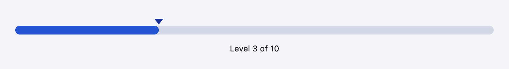
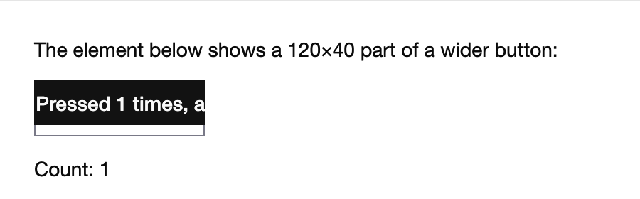

# 第 23 章　自绘 Element

到目前为止，界面都是用控件库中现成的控件拼出来的。第七部分讨论怎样编写自己的控件：自己决定尺寸、子项的位置、哪块区域接收输入、画什么。本章先讲基础，下一章讲怎样让自绘控件像内置控件一样支持焦点、主题、样式和读屏器，第 25 章讲 2D 图形和着色器，第 26 章讲弹层、滚动容器和按需列表。读完本章，你会知道：

- Component 和 Element 的分工，什么时候需要写 Element；
- Element 的生命周期，资源在哪里创建、由谁关闭；
- `measure` 怎样决定尺寸、测量和放置子项；
- `scene` 怎样安排输入区域、子项和绘制的顺序，变换和裁剪作用于什么；
- 怎样处理原始的指针事件，怎样用弹簧动画；
- 为什么自绘控件静止时也应该什么都不做，定时的工作和外部数据怎样驱动帧；
- 怎样在一帧真正呈现之后做事；
- 哪些开源项目可以作为编写自绘控件的参考。

## 23.1　Component 与 Element

前面写的都是 **Component**：它保存状态，在 `render()` 中返回一棵 View 描述，具体的测量和绘制交给描述中的其他节点。**Element** 则是真正“干活”的节点：`row`、`button`、`label` 归根结底都是 Element。第 4 章的四个角色中，Element 负责布局和绘制。

在 `render()` 中用 `element(props, create, children)` 描述一个 Element：

```scoop
return element(
    MeterInput(level.value, 10, { next -> level.value = next }),
    { props, mount -> Meter(props, mount) },
    [caption]
)
```

- **`props`** 是交给元素的输入，每次 `render()` 都生成一个新值；元素通过 `Props<P>.value` 读取最新的输入。这里把当前的级别和一个“请求修改”的回调一起传下去：元素自己不保存业务状态，只负责显示，并把用户的操作报告给上层。这和第 9 章 Props 与 Binding 的思路一样。
- **`create`** 只在首次挂载时调用，创建元素的实例；之后的 `render()` 只更新 Props，实例和它的字段都保留。
- **`children`** 是元素的子 View，元素在布局时按下标测量和放置它们。不需要 Props 时可以写 `element({ mount -> MyElement(mount) }, children)`。

Element 类继承 `Element<L>`，`L` 是 `measure` 交给 `scene` 的布局数据的类型，没有额外数据时用 `Unit`。

什么时候需要写 Element？现有的控件和容器组合不出来的时候：一个自绘的图表、一个需要逐像素控制的编辑器、一种新的布局方式。能用 Component 组合的就组合，Element 要处理的细节多得多，这一部分的几章会一一讲到。

## 23.2　一个完整的自绘控件

下面的程序画了一个可以点击或拖动的级别条：蓝色的填充用弹簧动画跟随当前的级别，上方的三角形标出位置，下方是一个普通的 Label 子项。保存为 `meter.scoop`：

```scoop
{{#include ../../examples/ch23/meter.scoop}}
```

```sh
scoop run meter.scoop --release
```



在条上点击或按住拖动，下面的文字立即变成新的级别，蓝色的填充则用弹簧动画滑到新的位置。

这个程序只使用了 `scoop.ui` 以及更下层的图形、Surface 和窗口接口；Label 来自控件库，只是作为子项演示。接下来按生命周期的顺序拆解它。

## 23.3　生命周期

| 阶段 | 调用时机 | 适合做什么 |
| --- | --- | --- |
| 构造 | 首次挂载，`create` 被调用时 | 初始化不需要窗口的普通字段 |
| `onMount()` | 节点挂入窗口后、首次测量前 | 创建 Path、图片等资源，创建输入区域和动画 |
| `update()` | 挂载完成后，以及每次收到新的 Props 后 | 把新的输入同步到资源和动画上，返回需要重做的工作 |
| `onUnmount()` | 节点卸载前 | 释放没有交给 scope 管理的东西，多数情况下不需要 |

`update()` 返回 `UiInvalidation`（第 4.8 节）：`Layout` 表示尺寸或子项的位置可能改变，需要重新 `measure`；`Scene` 表示只需要重新安排场景和绘制；`None` 表示什么都不用做。级别条的新级别只影响填充的宽度，所以返回 `Scene`。

`onMount()` 中创建的东西都交给 `ComponentScope` 管理：

- `scope.resource { ... }` 登记任何 `Closeable` 资源，比如 `path { ... }` 构造的 Path，或者图片、缓存；
- `scope.createArea(...)` 创建输入区域；
- `scope.animation(initial)` 创建绑定到窗口时间轴的 `Animatable`。

卸载时，作用域先停用输入和动画，调用 `onUnmount()`，再按登记的相反顺序关闭资源。所以示例中不需要为每个资源写 `use`，也不需要在 `onUnmount()` 中手动关闭。

**不要在 `measure`、`scene` 或 `draw` 中创建资源。** 它们每一帧都可能执行，在那里创建的资源会不断累积。需要随输入变化的资源（比如形状随 Props 改变的 Path），在 `update()` 中替换，并及时关闭旧的。

## 23.4　measure：约束、尺寸与子项

`measure(context, constraints)` 回答两个问题：我有多大，子项放在哪里。

`Constraints` 给出允许的宽高范围：`minWidth`、`maxWidth: Double?`、`minHeight`、`maxHeight: Double?`，最大值为 `None` 表示不限制（第 6 章）。`constraints.constrain(size)` 把期望的尺寸夹到范围内，`Constraints.tight(size)` 构造一个固定尺寸的约束。级别条是窗口的根元素，收到的是窗口尺寸的固定约束，所以它总是和窗口一样大；它把 96 点高的内容带放在垂直居中的位置。

子项通过 `MeasureContext` 处理：

1. `context.measureChild(index, constraints)` 测量第 `index` 个子项，返回它的 `LayoutMetrics`，即尺寸和可选的基线；
2. `context.placeChild(index, origin)` 把子项放在本元素局部坐标中的 `origin`。

几条规则：

- 一个子项在放置之前可以用不同的约束测量多次，比如先试探自然宽度再决定；每个子项每一帧最多放置一次。
- 没有放置的子项保持挂载和状态，只是这一帧不绘制、不接收输入。明确不想测量某个子项时，调用 `context.skipChild(index)`；`skipChild(index, hidden = true)` 还会把它移出输入和读屏器的浏览范围，适合随可用空间收起的面板。之后再放置它，用的还是同一个实例。
- `measure` 是只读的：不能写 State，也不能请求焦点或滚动。

级别条给 Label 一个和轨道同宽的约束，让 Label 自己用 `settings { alignment = TextAlignment.Center }` 居中文字：

```scoop
// Measure the caption as wide as the track, then place it below the track.
context.measureChild(0L, Constraints(maxWidth = Some(bar.width)))
context.placeChild(0L, Point(bar.x, bar.y + 28.0))
```

`measure` 返回 `LayoutResult(metrics, data)`。`metrics` 是 `LayoutMetrics(size, alphabeticBaseline, ...)`，提供基线的元素可以参与 `row` 的基线对齐（第 5 章）；`data` 是类型为 `L` 的布局数据，会原样交给 `scene`。布局数据持有需要关闭的资源时，传第三个参数 `dispose`，在这份布局被替换时调用。第 24 章的段落示例就是这样做的。

## 23.5　scene：输入区域、子项与绘制顺序

`scene(context, layout)` 用 `SceneContext` 描述这一帧的画面，它按调用的顺序执行：

- `context.place(area, rect)`：把输入区域放到局部坐标的矩形（或 Path）上。区域的命中范围以这里为准，而不是看画了什么；
- `context.draw { paint -> ... }`：提交一段绘制；
- `context.children()`：在这里绘制所有已经放置的子项。

在 `children()` 前后各写一个 `draw` 块，就得到“背景、子项、前景”三层。级别条先画轨道和填充，再画 Label，最后画三角形，所以三角形总在最上面。

### 变换与裁剪

`SceneContext` 还提供作用于**之后**的内容（包括子项和输入区域）的变换和裁剪：`translate`、`scale`、`rotate`、`concat(transform)`、`clipRect`、`clipPath`，以及配对使用的 `save()`、`restore()` 和 `saveLayer(opacity, filter)`。用 `withState { local -> ... }` 可以把这些修改限制在一个块里。

下面的 `Peek` 只显示子项中一个 120×40 的窗口，并把子项向左移 10。保存为 `peek.scoop`：

```scoop
{{#include ../../examples/ch23/peek.scoop}}
```

```sh
scoop run peek.scoop --release
```



按钮比窗口宽得多，只露出了中间的一段，左端被移出了窗口。点露出的部分，按钮照常响应，下面的计数增加。

这里有两种变换需要区分：

- **在 `SceneContext` 上做的变换和裁剪**，同时影响绘制和之后登记的命中区域。`Peek` 中的按钮被向左移了 10，它的点击区域也跟着移动；读屏器看到的按钮位置同样移动了：本书写作时读到的按钮左边缘在窗口的 x = 14 处，正是 `Peek` 的 24 减去 10。不过读屏器得到的仍是按钮完整的宽度，裁剪只作用于绘制和点击。
- **在 `draw` 块内对 Canvas 做的变换**（`paint.canvas.save()`、`translate`、`restore()`），只影响这一段绘制。级别条画三角形时用的是后者，它不需要改变点击范围。

## 23.6　draw：PaintContext 与 Canvas

`draw` 块收到一个 `PaintContext`：`paint.canvas` 是本帧的 `Canvas`，`paint.size` 是元素的尺寸，`paint.time` 是本帧的时间。级别条用到的 Canvas 方法有：

- `clear(color)`：用一种颜色填满；
- `drawRoundRect(rect, rx, ry, paint)`、`drawCircle(center, radius, paint)`、`drawPath(path, paint)`：画形状；
- `save()`、`translate(dx, dy)`、`restore()`：临时改变坐标。

`Paint(color)` 默认是填充，`Paint(color, PaintingStyle.Stroke, width)` 是描边，`Peek` 的边框就是这样画的。第 25 章会系统地介绍路径、渐变和图像。

两条规则：

- **Canvas 只在当次回调中有效**，不能保存到字段中留到以后使用；
- **`draw`、`scene` 和 `measure` 中都不能写 State。** 要改变状态，在输入回调或生命周期方法中进行。

## 23.7　输入与动画

### 原始的输入事件

`scope.createArea(focusable, textInput, parent, handler)` 创建一个 `InputArea`，`handler(context, event)` 接收路由到这个区域的事件。事件按阶段传递，`context.phase` 是 `RoutedPhase` 之一：

- `Capture`：从外向内，祖先先看到事件；
- `Target`：到达目标区域；
- `Bubble`：从内向外，祖先再看一次；
- `Default`：路由结束后的默认动作；
- `Notification`：状态通知。

级别条只处理自己作为目标时的指针事件：

```scoop
if (current.phase != RoutedPhase.Target)
    return
when (event) {
    case Pointer(InputPointerEvent.Button(_, MouseButton.Left, val button, _)) -> {
        dragging = button == ElementState.Pressed
        if (dragging)
            pick(current.localPosition!!)
        current.consume()
    }
    ...
}
```

`current.localPosition` 是指针在区域局部坐标中的位置，`current.consume()` 表示事件已经处理。处理器中调用的 `props.value.onChange(next)` 修改了上层组件的 State，上层重新 `render()`，新的 Props 到达后 `update()` 被调用。

处理原始事件要考虑的细节很多：拖出区域、按下后被取消、触摸和笔、键盘激活……第 15 章的 `press`、`drag` 等手势助手已经处理好了这些，**能用助手的就用助手**。级别条直接处理事件，是为了演示事件路由本身。

### 弹簧动画

动画用 `scope.animation(initial)` 创建，返回 `Animatable<T>`，支持 `Double`、`Point`、`Size` 和 `Color`。`animateTo(target, AnimationSpec.Spring())` 从当前值开始向目标运动；`target` 是目标值，`value` 是本帧的采样值。级别条在 `update()` 中启动动画：

```scoop
// New Props arrived: start a spring toward the new level.
val target = fraction()
if (fill!!.target != target)
    fill!!.animateTo(target, AnimationSpec.Spring())
return UiInvalidation.Scene
```

在 `scene` 中读取 `fill!!.value`，框架在动画进行期间自动安排后续的帧，并直接重新执行 `scene`，不会重新运行上层的 `render()`。动画中途来了新的目标，弹簧从当前的位置和速度继续运动，不会跳变。系统要求减少动画时（第 21.6 节），自己的动画也应该直接到达目标，可以读取主题的 `preferences.reduceMotion` 来判断。

> **注意：自绘控件对读屏器是不可见的**
>
> 本书写作时，级别条的点击和拖动没有用自动化工具核对：工具无法向后台窗口发送左键点击，而这个控件也没有任何无障碍信息，读屏器和自动化工具在窗口中只能看到下面的 “Level 3 of 10” 文字，看不到级别条本身。这正是一个自绘控件还没有完成的标志。第 24 章会给它加上焦点、键盘操作和无障碍信息。

## 23.8　停帧：静止时什么都不做

Scoop UI 只在有事要做时才绘制：State 改变、Props 更新、显式的帧请求或活动的动画。没有这些时，框架不遍历组件树，窗口不请求新的帧，CPU 占用为零（第 4.10 节）。级别条的动画结束后就停在最后一帧，直到下一次点击。

自绘时要配合这个原则：

- **不要在 `draw` 中启动动画或请求帧**，也不要用定时器“每帧刷新”；
- **只有视觉变化而没有状态变化时**，比如悬停高亮，在输入回调中调用 `scope.requestFrame()` 请求一帧，或者使用下一章的交互助手，它们的状态是可观察的；
- **尺寸变化需要重新布局时**，调用 `scope.requestLayout()`，或者在 `update()` 中返回 `Layout`。

### 定时的工作：createDeadline

有些视觉变化和时间有关，又不是动画：文字光标的闪烁、悬停一段时间后显示提示、拖动到边缘时的自动滚动。这时用 `scope.createDeadline { ... }` 创建一个截止时间，它返回 `WindowDeadline`：`schedule(time)` 安排在某个单调时间点（`MonotonicInstant`）执行回调，`cancel()` 取消，`isScheduled` 查询是否已经安排。回调在 UI 线程上执行，可以修改状态、请求帧；组件卸载时截止时间自动关闭。和“每 16 毫秒醒来一次”的定时器不同，它只在需要的那一刻唤醒窗口一次。

scoop-code-editor 的光标闪烁就是这样做的（`src/view/editor.scoop`）。回调中先检查编辑区仍然持有焦点、窗口可见且没有被完全遮住，才切换光标的可见性并请求一帧：

```scoop
private val blink = scope.createDeadline {
    if (!ended && area.isFocusActive && scope.nativeWindow.isVisible &&
        !scope.nativeWindow.isOccluded) {
        caretVisible = !caretVisible
        scope.requestFrame()
    }
}
```

窗口在后台被遮住时，光标不再闪烁，窗口也就不再产生帧。

### 外部事件驱动的帧

数据来自外部时也一样：有新数据才请求帧。scoop-video 播放视频时并不连续重绘，而是由原生的播放器在有新的一帧画面要显示时回调 Scoop，元素在回调中用 `scope.dispatch { scope.requestFrame() ... }` 安排一帧（`scoop.ui.video/src/view.scoop`），`scene` 再取出这一帧画面。播放器只在有新的画面或者播放状态改变时才通知界面，所以暂停时没有回调，也就没有帧。

## 23.9　帧完成之后：onFrameComplete

第 4.9 节说过，交互以用户真正看到的画面为准：新的一帧被窗口接受（Accepted）之前，点击仍然按上一帧的位置判定。自绘控件有时也需要知道“这一帧有没有真的呈现出来”。`SceneContext` 的 `onFrameComplete { completion -> ... }` 登记一个回调，在这一帧结束后执行：

```scoop
context.onFrameComplete { completion ->
    if (completion.submission == FrameSubmission.Accepted) {
        // 这一帧已经呈现，用户看到的就是它。
    }
}
```

`FrameCompletion` 有三个字段：`time` 是这一帧的时间，`size` 是窗口内容的尺寸，`submission` 是 `Accepted` 或 `Discarded`。回调只在节点仍然挂载时执行，而且它已经不在 `scene` 之中，所以可以修改状态。

scoop-solar-system 的三维视图（`src/ui/viewport.scoop`）用它做了两件事：

- **按看到的画面做命中测试。** 每一帧被接受后，它记下这一帧的行星位置；点击时用记下的位置判断点中了哪颗行星，而不是用模型中已经向前推进的最新位置；
- **推进模拟时间。** 时钟运行时，它在一帧被接受之后才推进时间、更新模型，模型的变化又引出下一帧。项目的设计文档明确说明不使用固定间隔的定时器，帧的节奏由窗口决定；模拟时间按单调时钟计算（起点加上速率乘以经过的时间），而不是每帧累加一个步长，所以帧率高低不影响模拟的速度，窗口不再呈现时也不会白白推进和渲染。

```scoop
context.onFrameComplete { completed ->
    if (completed.submission == FrameSubmission.Accepted) {
        model.accepted = Some(frame)
        ...
        if (model.clock.running && !model.detailOpen.value && drawable)
            model.updateTime()
    }
}
```

scoop-grid 的根元素也用同样的方式，只在帧被接受后才把“当前阅读位置”“实测的列宽”等依赖几何的状态提交到模型中，被丢弃的试探性布局不会泄漏到状态里。

另外，登记了 `onFrameComplete` 的元素，它的场景不会被 `cachedScene`（第 24.6 节）缓存，所以只在确实需要时使用。

## 23.10　真实项目中的自绘控件

scoop-lang 组织在 GitHub 上有几个以自绘为主的开源项目，它们是阅读本部分时很好的参考：

| 项目 | 内容 | 主要的自绘元素 | 本书讨论的做法 |
| --- | --- | --- | --- |
| [scoop-grid](https://github.com/scoop-lang/scoop-grid) | 功能完整的数据表格：两个方向的虚拟化、冻结列、分组、透视、编辑 | `GridRoot`、`GridBody`、`GridRowView`、`GridCell` | 本章 23.9 节；第 26 章的按需列表与 `LayoutInput` |
| [scoop-code-editor](https://github.com/scoop-lang/scoop-code-editor) | 可嵌入的代码编辑器：多光标、折叠、诊断、行内提示 | `EditorInk` | 本章 23.8 节；第 24.7 节；第 26 章的自定义滚动 |
| [scoop-markdown](https://github.com/scoop-lang/scoop-markdown) | Markdown 的源码、所见即所得和分栏编辑器，以及预览 | `MdPreviewElement`、`MdSourceElement`、`MdRichElement` | 第 24.7 节；第 26 章的按需布局 |
| [scoop-terminal](https://github.com/scoop-lang/scoop-terminal) | 终端模拟器：字符网格、选区、内联图片、输入法 | `TerminalViewElement` | 第 24.7 节；第 25 章 |
| [scoop-video](https://github.com/scoop-lang/scoop-video) | macOS 上的视频播放组件，画面直接在 GPU 上转换颜色 | `VideoView` | 本章 23.8 节；第 25 章 |
| [scoop-solar-system](https://github.com/scoop-lang/scoop-solar-system) | 可交互的三维太阳系演示，用各平台的原生 GPU 接口渲染 | `SolarViewport`、`SolarLayout` | 本章 23.9 节；第 25 章 |

各项目的运行方法见各自的 README。书中引用的代码以本书写作时的版本为准，为了篇幅做了删节，阅读时以仓库中的最新代码为准。

读这些项目的代码时，可以留意两件事。一是它们都把业务状态放在元素之外：表格的数据模型、编辑器的文档、终端的屏幕缓冲区都是普通的类，元素只负责显示和把操作报告回去，和级别条的 `MeterInput` 是同一个思路。二是它们的设计文档中记录了开发过程中发现的框架问题，以及为此提交给 Scoop 的修改；本书介绍的不少接口，比如 `LayoutInput`，就是这样加入框架的。

## 常见误用

- **在元素中保存业务状态。** 元素只负责显示和报告操作，状态放在上层的 Component 或 Store 中，通过 Props 传入，通过回调修改。
- **在 `measure`、`scene`、`draw` 中创建资源。** 每一帧都会泄漏。在 `onMount()` 中用 `scope.resource { ... }` 创建。
- **把 Canvas 保存到字段中。** 它只在当次回调中有效。
- **在 `draw` 或 `measure` 中写 State。** 会报错，状态只能在输入回调或生命周期方法中修改。
- **用 `draw` 块内的 Canvas 变换移动子项。** 子项的位置和命中区域只受 `SceneContext` 上的变换影响。
- **同一个子项放置两次。** 每帧最多放置一次；不放置的子项不绘制、不接收输入。
- **用定时器驱动动画。** 用 `scope.animation`，框架只在动画进行时请求帧。

## 小结

- Component 组合描述，Element 负责尺寸、子项位置、输入区域和绘制；`element(props, create, children)` 描述一个 Element，实例只在首次挂载时创建，之后只更新 Props。
- 资源、输入区域和动画在 `onMount()` 中通过 scope 创建，卸载时自动关闭；`update()` 同步新的 Props，返回 `UiInvalidation`。
- `measure` 用 `measureChild` 和 `placeChild` 处理子项，返回尺寸和布局数据；没放置的子项保持挂载；`skipChild` 明确跳过。
- `scene` 按调用顺序放置输入区域、绘制和子项；`SceneContext` 上的变换和裁剪同时影响绘制和命中，`draw` 块内的 Canvas 变换只影响那一段绘制。
- 原始事件按 Capture、Target、Bubble 等阶段路由；能用第 15 章的手势助手就用助手。`Animatable` 在 `scene` 中读取，动画期间自动请求帧。
- 静止时不做任何事：不在 `draw` 中请求帧，视觉变化用 `requestFrame`，布局变化用 `requestLayout` 或返回 `Layout`；定时的工作用 `scope.createDeadline`，外部数据到达时再请求帧。
- `context.onFrameComplete` 在帧结束后执行，`submission` 为 `Accepted` 时，用户看到的就是这一帧；依赖几何的状态适合在这里提交。

## 练习

1. 给级别条加一个 `steps` 不同的第二个实例，比如 5 级，放在同一个窗口中。两个实例的状态会互相影响吗？
2. 让级别条在悬停时把轨道颜色加深一点：在处理器中记录悬停状态，并调用 `scope.requestFrame()`。
3. 把级别条的 `AnimationSpec.Spring()` 换成 `AnimationSpec.Tween(Duration.milliseconds(150L))`，比较两者的手感。快速连续点击时有什么不同？
4. 修改 `Peek`，用 `local.scale(1.5, 1.5)` 放大子项，点击放大后的按钮，点击范围是否也跟着放大了？
5. 在 `Peek` 的 `draw` 块中对 Canvas 调用 `translate(-10.0, 0.0)`，而不是在 `SceneContext` 上平移。子项的位置有没有变化？为什么？
6. 用 `scope.createDeadline` 给级别条加一个效果：松开鼠标一秒之后，三角形标记变成灰色，再次按下时恢复。想一想，回调中应该修改什么，又该请求什么。
