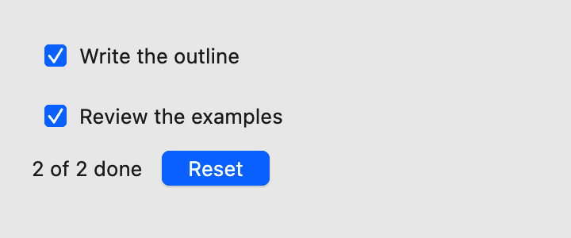
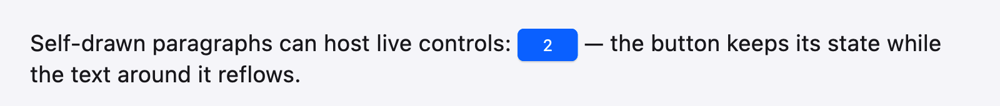
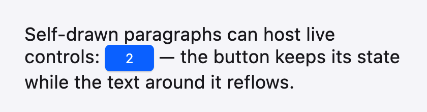
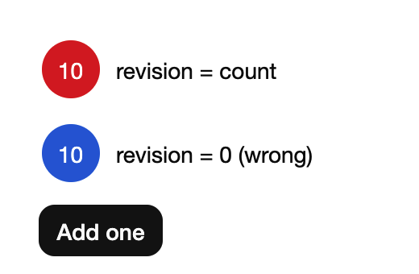

# 第 24 章　让自绘控件接入框架

上一章的级别条能画、能点、能动，但还算不上一个完整的控件：键盘用户无法聚焦它，读屏器看不到它，它的颜色也是写死的，不随主题变化。内置控件之所以“什么都支持”，是因为它们用了一组公开的接口：焦点目标、交互助手、语义节点、主题画笔、样式画笔、段落宿主。本章逐一介绍这些接口，自绘控件用上它们，就能和内置控件站在同一条起跑线上。读完本章，你会知道：

- 怎样让元素进入 Tab 顺序、响应按键、在键盘聚焦时画出焦点环；
- 怎样发布语义节点，让读屏器和自动化工具看到并操作自绘控件；
- 交互助手在 Element 中怎样使用，为什么在 `scene` 中读取它的状态就够了；
- 怎样用主题的几何查询和画笔画出“和主题一致”的复选框，怎样用公共的 `Style` 画背景和边框；
- 怎样在自绘元素中排版文字，把按钮嵌进一段文字中；
- `drawLayer` 缓存什么、不缓存什么，版本号写错了会怎样；
- 真实的项目是怎样组合这些接口的。

## 24.1　给级别条补上键盘和读屏器

下面是第 23 章级别条的完整版本，改动的地方都加了注释。保存为 `meter.scoop`：

```scoop
{{#include ../../examples/ch24/meter.scoop}}
```

```sh
scoop run meter.scoop --release
```

外观和上一章一样。区别在于：按 Tab 可以聚焦它，聚焦后轨道周围出现一圈淡蓝色的焦点环，方向键一次移动一级，Home 和 End 跳到两端；读屏器把它读作一个名为 Level 的滑块。

> **注意：** 本书写作时，Tab、方向键和焦点环没有用自动化工具核对：工具无法向后台窗口发送按键，后台窗口也不持有系统的键盘焦点。下面关于读屏器的部分是实际核对过的。

改动分为三部分：焦点、按键、语义。

### 可聚焦：focusTarget

要让元素参与键盘焦点，需要两步：

1. 用 `scope.createArea(focusable = true) { ... }` 创建可聚焦的输入区域；
2. 用 `scope.focusTarget(area, options)` 把它登记为焦点目标。

```scoop
// A focusable area joins the Tab order once it is registered as a focus target.
val region = scope.createArea(focusable = true) { current, event -> handle(current, event) }
area = Some(region)
slider.bindFocus(Some(scope.focusTarget(region)))
```

登记以后，它就和内置控件一样出现在 Tab 顺序中。`FocusOptions` 和第 14 章控件的 `focus { }` 配置是同一套：`handle` 是可选的 `FocusHandle`，用来在程序中请求焦点；`tabStop = false` 使它只能被点击或程序聚焦；`order` 调整顺序；`visibility` 决定焦点环什么时候显示（第 14.7 节）。最后一行的 `bindFocus` 把焦点目标交给语义节点，下面会讲到。

### 焦点环与焦点通知

内置控件只在键盘聚焦时显示焦点环，用鼠标点击时不显示（第 14.7 节）。区域的 `isFocusVisible` 已经按这条规则算好了，`scene` 中读取它即可：

```scoop
val ring = area!!.isFocusVisible
```

但这个属性**不是** State，读取它不会让框架在焦点变化时重新执行 `scene`。焦点变化时，框架会向区域发送两种通知：所有者变化时发送 `InputEvent.FocusChanged(Boolean)`，同一个区域的焦点环可见性变化时发送 `FocusVisibilityChanged(Boolean)`。它们在 `RoutedPhase.Notification` 阶段到达，只是告知，不需要消费。级别条收到它们时请求一帧：

```scoop
when (event) {
    // Focus changes are notifications: nothing to consume, just draw the ring again.
    case FocusChanged(_) -> scope.requestFrame()
    case FocusVisibilityChanged(_) -> scope.requestFrame()
    else -> {}
}
if (current.phase != RoutedPhase.Target) return
```

这两个分支写在阶段检查的前面，否则它们会被 `return` 跳过。24.2 节的交互助手会替你处理这件事：它的状态是可观察的。

### 按键

按键事件沿着焦点所在的路径路由，聚焦的区域在 `Target` 阶段收到 `InputEvent.Keyboard(KeyEvent)`。`KeyEvent` 的 `state` 区分按下和松开，`logicalKey` 是按当前键盘布局解释后的键，`isRepeat` 表示按住不放时的自动重复，`modifiers` 是修饰键。级别条只处理按下：

```scoop
case Keyboard(val key) -> {
    if (key.state == ElementState.Pressed && pressKey(key.logicalKey)) current.consume()
}
```

`pressKey` 把方向键、Home、End 换算成新的级别，对其他键返回 false。**只消费自己处理了的键**：没有消费的键会继续交给外层和框架的默认处理，比如 Tab 照常把焦点移到下一个控件。

内置的滑块还会在从右到左的界面中交换左右方向键的含义，并忽略带修饰键的按键，把它们留给快捷键；完整的规则可以参考 `scoop.ui.component` 中 `slider/keyboard.scoop` 的源码。另外，如果元素有可能包含自己的可聚焦子项，按键更适合放在 `RoutedPhase.Default` 阶段处理（用 `area.scope.addDefaultAction { ... }` 登记），让子项先有机会处理。

### 语义节点

读屏器看到的不是像素，而是一棵**语义树**（第 1.3 节）：每个节点有角色、名称、值、状态和可以执行的动作。内置控件都会发布自己的节点；自绘控件什么都不发布，读屏器就看不到它。上一章的级别条正是这样。

发布语义节点分三步：

1. **创建。** `scope.semantics(SemanticRole.Slider)` 创建一个节点，返回 `SemanticsHandle`。它和资源一样归 scope 所有，卸载时自动移除。`SemanticRole` 有 `Button`、`Checkbox`、`Slider`、`Text`、`TextField`、`ProgressBar`、`List`、`Table` 等三十多种。
2. **发布事实和动作。** `handle.update(properties, actions)`：

   ```scoop
   // Publish the same facts and actions that the pointer and the keys offer.
   val input = props.value
   slider.update(
       SemanticProperties(
           name = Some("Level"),
           range = Some(SemanticValueRange(0.0, input.steps.toDouble(), input.level.toDouble(), 1.0))
       ),
       SemanticActions(
           increment = Some { set(props.value.level + 1) },
           decrement = Some { set(props.value.level - 1) },
           setNumber = Some { value -> set((value + 0.5).toInt()) }
       )
   )
   ```

   `SemanticProperties` 描述节点的事实：名称、描述、值、是否启用、勾选状态、数值范围等，大部分字段默认为空。`SemanticValueRange(minimum, maximum, value, step)` 是滑块、进度条这类控件的数值。`SemanticActions` 是辅助技术可以请求的操作，每个动作返回 `SemanticActionResult`：`Completed` 表示完成，`Rejected`、`Unavailable` 等表示没有执行。
3. **报告位置。** 在 `scene` 中调用 `context.semantics(slider, bounds)`，和输入区域一样，位置使用当前的变换。

`update()` 在挂载后和每次收到新的 Props 后调用，正是发布语义的地方：级别变了，节点的值随之更新。

`bindFocus` 把真实的焦点目标借给语义节点：读屏器请求聚焦这个节点时，聚焦的就是那个输入区域；键盘焦点到达区域时，读屏器也知道焦点在这个节点上。

### 三个入口，一个出口

示例中的指针、按键和语义动作最终都调用同一个 `set(level)`：它把级别限制在范围内，再通过 `onChange` 报告给上层。这是写自绘控件的一条好习惯：**无论操作来自哪里，都走同一条路径**，这样限制、校验和副作用只写一次，读屏器用户和鼠标用户得到的结果也一定一样。

### 读屏器看到了什么

本书写作时，用自动化工具读取窗口的辅助功能树，级别条是这样的：

```text
AXSlider (Level) Value: 3   actions=[AXIncrement, AXDecrement, ...]
AXStaticText = "Level 3 of 10"
```

执行一次 `AXIncrement`，滑块的值变为 4，下面的文字同时变为 “Level 4 of 10”；把滑块的值直接设为 8，执行的是 `setNumber`，文字变为 “Level 8 of 10”。上一章的版本在同一个位置只有那行文字。

第 31 章会系统地讨论无障碍，包括名称和描述怎样写、实时区域、怎样用读屏器检查自己的应用。

## 24.2　用交互助手代替原始事件

级别条为了演示，直接处理了原始的指针事件。按钮一类的控件要处理的细节更多：拖出区域后松开不算点击、按下后被滚动接管要取消、空格键在松开时才触发、回车键在按下时触发……第 15 章介绍的 `scope.press`、`scope.drag` 等手势助手已经处理好了这些，它们在 Element 中的用法和在 Component 中一样。

下面的程序画了一个“任务行”控件：左边是主题风格的复选框标记，右边是标题，整行可以点击，悬停时显示背景，能用 Tab 聚焦、用空格切换。保存为 `tasks.scoop`：

```scoop
{{#include ../../examples/ch24/tasks.scoop}}
```

```sh
scoop run tasks.scoop --release
```



点击一行，勾选状态切换，下面的计数随之变化。

`TaskToggle` 在 `onMount()` 中创建区域、登记焦点目标，然后用 `scope.press` 接管点击：

```scoop
val region = scope.createArea(focusable = true)
area = Some(region)
checkbox.bindFocus(Some(scope.focusTarget(region)))
// Use the visible task label as the accessible name.
checkbox.mergeLabels = true
scope.routeSemanticsChildren(Some(checkbox))
press = Some(scope.press(region) { props.value.toggle() })
```

区域没有自己的处理器：`press` 在区域上登记了需要的处理器。`PressOptions(enabled, acceptsEnter, touchThreshold)` 可以禁用它、关掉回车键激活、调整触摸时允许的移动距离。

`press.interaction` 是一个 `InteractionState(hovered, pressed, focused, focusVisible)`，它背后是一个 State。在 `scene` 中读取它，悬停、按下或焦点变化时，框架自动重新执行这个元素的 `scene`，不需要像级别条那样自己处理焦点通知、调用 `requestFrame()`。

语义部分和级别条相似，多了两点：

- `mergeLabels = true` 把子树中纯文字的标签合并为这个节点的名称。任务行的子项是一个 Label，读屏器读到的就是 “Write the outline” 这个复选框，而不是一个没有名字的复选框加一段文字；
- `scope.routeSemanticsChildren(Some(checkbox))` 让子项的语义节点挂到 `checkbox` 下面，合并才能找到它们。

本书写作时，辅助功能树中的两行分别是 `AXCheckBox (Write the outline) Value: 0` 和 `AXCheckBox (Review the examples) Value: 1`；对第一行执行 `AXPress`（发布的 `toggle` 动作），它的值变为 1，计数变为 “2 of 2 done”，就是上图的样子。

第 15 章之外，`scoop.ui` 还提供了几个主要供控件作者使用的助手，它们同样通过 scope 创建，随挂载自动关闭：

| 助手 | 用途 |
| --- | --- |
| `scope.presence(open, options)` | 打开和关闭的呈现阶段，以及 0 到 1 的进入、退出进度，用于自己实现弹层的过渡 |
| `scope.hover(trigger, open, options)` | 悬停一段时间后打开、离开后关闭，处理指针在触发区和弹层之间移动的情况 |
| `scope.activeItems(source, active, options, reveal)` | 列表中的“当前项”随方向键移动，焦点留在原处，例如组合框的候选列表 |
| `scope.typeahead(source, currentKey, onMatch, options)` | 在不可编辑的列表中按字母快速跳转 |
| `scope.keyNavigation(options)` | 一组焦点目标之间的方向键与 Home、End 导航（第 14.5 节） |

## 24.3　用 ThemePainterCache 画主题部件

任务行的复选框标记不是自己画的，而是让主题来画。自绘控件不需要模仿各套主题的复选框：主题提供“几何查询”，`ThemePainter` 按同一份几何绘制。

- `theme.checkboxMetrics(options, direction)`：建议的尺寸、最小尺寸、焦点环的外扩距离等，在 `measure` 中用来决定标记的大小；
- `theme.checkboxGeometry(bounds, visual, options, direction)`：给定最终的位置，算出外框、勾号的线段和焦点环；
- `painter.drawCheckbox(canvas, geometry, visual)`：在 Canvas 上按这份几何绘制。

`visual` 是 `CheckboxVisual(mark, interaction)`：`mark` 是 `CheckMark.Off`、`On` 或 `Mixed`，`interaction` 是 `InteractionVisual(enabled, hovered, pressed, focusVisible, ...)`，任务行直接把 `press.interaction` 中的状态填进去。表面（`surfaceGeometry`、`drawSurface`）、单选框（`radioGeometry`、`drawRadio`）和滚动条（`scrollbarGeometry`、`drawScrollbar`）的用法相同。

画笔持有原生资源，由 `ThemePainterCache` 管理：在 `onMount()` 中用 `scope.resource { ThemePainterCache() }` 创建，绘制时调用 `painters.get(theme)` 取得当前主题的画笔。主题换了，`get` 会创建新的画笔并关闭旧的。任务行在 `update()` 中先调用一次 `painters!!.get(props.value.theme)`，让替换发生在绘制之前。

主题从哪里来？`TaskList` 在 `render()` 中用 `this.theme.read(scope)` 读取（第 21.6 节），再通过 `TaskInput` 交给每一行。这样做有两个好处：读取发生在 `render()` 中，主题或显示偏好变化时，`TaskList` 重新 `render()`，每一行收到新的 Props，`update()` 返回 `Layout`，尺寸和颜色一起更新；同时，元素拿到的是应用了窗口偏好的主题，画出的复选框和内置的复选框使用同一份主题数据，显示偏好对两者的作用相同。

## 24.4　用 StylePainter 套用公共 Style

第 22 章的 `Style`（背景、边框、圆角、阴影和内容效果）也可以在自绘元素中使用。在 `onMount()` 中用 `scope.resource { StylePainter() }` 创建，在 `scene` 中：

```scoop
decoration!!.scene(context, rowStyle) { content ->
    content.draw { paint -> painters!!.get(input.theme).drawCheckbox(paint.canvas, geometry, visual) }
    content.children()
}
```

`StylePainter.scene(context, style) { content -> ... }` 先画外框阴影和背景，再执行回调中的内容并应用 `contentEffects`，最后画边框，顺序和 `styled` 完全相同（第 22.3 节）。回调收到的仍然是一个 `SceneContext`，可以继续 `draw`、放置子项。任务行根据 `state.hovered` 决定有没有背景色，圆角取自主题的 `tokens.corners.medium`。

另外两种形式：`scene(context, bounds, style) { ... }` 指定一个矩形而不是整个元素；`paint(canvas, bounds, style)` 直接画在一个 Canvas 上，适合第 25 章的离屏绘制。`Style` 设置了 `glass` 时（第 22.3 节），`StylePainter` 自己创建并缓存所需的滤镜，形状或材质变化时替换，随 painter 一起关闭；要使用自己的滤镜，用 `scene(context, bounds, style, Some(filter)) { ... }` 这个带滤镜的版本，第 25 章会讲到。两者不能同时使用，同时提供时绘制前就会报参数错误。

## 24.5　文字：ParagraphHost 与行内子项

在自绘元素中排版文字，用 `scoop.ui.text` 的 `ParagraphHost`。它负责段落的布局、绘制和缓存，还能把普通的 UI 子项（按钮、图片、徽标）嵌进文字中，像一个“字”一样参与换行。内置的 Label 就是用它实现的。保存为 `note.scoop`：

```scoop
{{#include ../../examples/ch24/note.scoop}}
```

```sh
scoop run note.scoop --release
```

窗口中是一段文字，中间嵌着一个显示计数的按钮。点两次按钮：



把窗口拉窄，文字重新换行，按钮随文字移到下一行，计数仍然是 2：



几个要点：

- **构造内容。** `inlineText { ... }` 中用 `text(...)` 添加文字，用 `inline(key, view, alternateText)` 插入子 View。`InlineKey` 把文字中的占位和子 View 对应起来，`alternateText` 是这个子项在纯文本中的替代文字，复制和读屏时使用。结果是一个 `InlineText`，其中的 `content` 是带占位的 `StyledText`，`inlines` 是 `InlineView` 数组。
- **描述元素。** `inlineChildren(content, inlines)` 生成 children，顺序和文字中的占位一致。
- **测量和绘制。** 元素在 `onMount()` 中用 `scope.resource { ParagraphHost() }` 创建宿主；`measure` 中调用 `host.measure(context, constraints, fonts, content, settings, inlines)`，它测量并放置行内子项，返回 `ParagraphMeasurement`；`scene` 中调用 `host.scene(context, measured)` 绘制文字和子项。`scope.defaultFonts` 是窗口默认的字体集合。
- **关闭布局。** `ParagraphMeasurement` 持有排版结果，需要关闭。作为布局数据返回时，传第三个参数 `{ measured.close() }`（第 23.4 节），这份布局被替换时框架调用它。
- **行内子项的尺寸。** 行内子项默认按自然尺寸测量。按钮会占满给它的宽度，所以示例用 `size = Some(Size(48.0, 26.0))` 给了固定的尺寸。

文字或子项变化时，`ParagraphHost` 尽量复用已有的布局；行内子项的 key 稳定，所以重新换行不会让按钮丢失状态。

### 文字也要发布语义

`ParagraphHost` 只负责排版和绘制，**不发布语义节点**。官网教程中的同一个示例没有这一步，本书写作时用自动化工具检查，窗口中只能看到一个名为 “[counter]” 的分组和其中的按钮，那段文字本身是看不到的。示例因此加上了一个 `SemanticRole.Text` 节点，做法和内置的 Label 一样：

```scoop
public override fun update(): UiInvalidation {
    text.update(
        SemanticProperties(value = Some(props.value.content.toPlainText()), readOnly = true),
        SemanticActions()
    )
    return UiInvalidation.Layout
}
```

`toPlainText()` 把内容转换为纯文本，行内子项的位置用 `alternateText` 代替。`onMount()` 中的 `scope.routeSemanticsChildren(Some(text))` 让行内的按钮挂到文字节点的下面。加上之后，辅助功能树中是一个值为 “Self-drawn paragraphs can host live controls: [counter] — the button keeps …” 的文字节点，按钮位于其中。

### 只画一段排好的文字

如果文字中没有行内子项，也不需要 `ParagraphHost` 的缓存，还可以自己持有一个 `TextLayout`，在 `scene` 中用 `context.drawTextLayout(key, layout, revision, origin)` 画出来。它和段落控件使用同一条录制路径，`revision` 的含义和下一节的 `drawLayer` 相同。

> **深入一点：可编辑的文字**
>
> 需要可编辑的文字时，不要从键盘事件开始自己写。`scoop.ui.text` 的 `TextEditHost` 就是 Input 和 Textarea 内部使用的编辑宿主：它持有一个 `TextEditorState`（第 12 章），提供输入区域、焦点目标、输入法、选区、剪贴板、撤销和滚动，元素只需要在 `measure` 和 `scene` 中调用它的 `measure(constraints)` 和 `scene(context, measurement)`。只读、可选择的文字对应 `SelectableTextHost`。24.7 节有一个真实的例子。

## 24.6　绘制缓存：drawLayer

普通的 `draw` 块每次绘制都会执行。如果一块内容绘制的成本较高，并且有一个可靠的“版本号”，可以用 `drawLayer` 缓存它：

```scoop
context.drawLayer(key, bounds, revision) { paint -> ... }
```

- `key` 是元素持有的一个 `PaintKey()`，表示“这一块图层”。每个 key 在一次 `scene` 中只能使用一次；
- `bounds` 是图层的范围，块在它的局部坐标中绘制；
- `revision` 是版本号：和上一次相同，框架直接复用上一次画好的像素，不执行块；不同，就重新执行。

**版本号必须覆盖所有影响像素的输入**：数据、状态、时间、动画、主题和资源。漏掉一个，画面就会停留在旧的内容上。下面的程序故意演示了这个错误。保存为 `badges.scoop`：

```scoop
{{#include ../../examples/ch24/badges.scoop}}
```

```sh
scoop run badges.scoop --release
```

两个徽标都从 8 开始，计数大于 9 时圆应该变成红色。点两次 Add one：



上面的徽标用计数作为版本号，到 10 时变成了红色。下面的徽标的版本号始终是 0，框架认为圆的像素没有变化，一直复用最初画好的蓝色圆。注意两个徽标中的数字都是 10：数字是一个普通的子项，**不属于图层**，每一帧照常绘制。

这也说明了 `drawLayer` 节省的是什么：它只省去执行绘制块的开销，场景、输入区域和子项每一帧照常装配。拿不准的时候就用普通的 `draw`；`ParagraphHost`、Label 等内置部件已经在内部使用了这套机制，不需要再在外面包一层。

### 场景缓存：cachedScene

`drawLayer` 缓存的是一块绘制的像素。第 4.8 节提到的 `cachedScene(content, revision)` 缓存的则是一棵子树的**场景装配**：它在描述中声明一个缓存边界，边界内的元素如果没有失效，读到的状态也没有变化，框架可以重放上一次记录的场景命令，而不再调用它们的 `scene()`。读取了动画或帧时间的元素、登记了 `onFrameComplete` 的元素不会被缓存；`revision` 用来声明框架观察不到的外部输入，它变化时整个边界重新装配。控件库中的 Tree 就在内部使用了它。

本书写作时做了一个小实验：把第 4 章 `pipeline.scoop` 中的色条包进 `cachedScene`，点击 +3 后色条仍然打印了 `measure` 和 `scene`。被重新测量的元素照常装配场景，缓存只对布局没有变化的部分起作用。`cachedScene` 的适用场合和测量方法，第 32 章讨论性能时再细讲。

## 24.7　真实项目中的做法

scoop-lang 组织在 GitHub 上有几个以自绘为主的开源项目（第 23 章末尾有一张总览表）。它们对本章接口的用法，可以作为写自己的控件时的参考。下面引用的代码以本书写作时的版本为准，为了篇幅做了删节。

### 一个六十行的按钮：scoop-markdown 的 MdSourceAction

所见即所得编辑器在编辑代码块的源码时，会显示一排小按钮：Done、Apply 和 Copy code。它们是同一个自绘元素 `MdSourceAction`（`scoop.ui.markdown/src/rich/source_done.scoop`），把本章的几样东西组合在六十行左右的代码中：

```scoop
private val area = scope.createArea(focusable = true)
private val focus = scope.focusTarget(area)
private val press = scope.press(area) { props.value.action(scope) }
private val paragraph = scope.resource { ParagraphHost() }
private val key = PaintKey()
```

几个值得注意的写法：

- 区域、焦点目标、按压助手和段落宿主都在**字段初始化**中创建，而不是在 `onMount()` 中。构造时 scope 已经可用，这样写可以省掉一层 `?` 和 `!!`；
- `update()` 中用 `press.update(PressOptions(enabled = ...), action)` 把新的启用状态和回调交给已有的助手，而不是重新创建；
- `measure` 只用 `paragraph.measure` 排版文字，`scene` 中用 `drawTextLayout(key, layout.layout, generation)` 画出来，`generation` 在每次测量时加一；
- `scene` 中读取 `press.interaction.pressed`，按下和焦点变化时自动重绘。

### 缓存屏幕，叠加光标：scoop-terminal

终端模拟器（`terminal-ui/src/view.scoop`）每一帧可能要画几千个字符格。它把整个屏幕的文字和背景放进一个 `drawLayer`，版本号自己维护：只有屏幕内容的版本、光标所在的格子或闪烁的相位变化时才加一。

```scoop
if (screenPaintFrame != measured.paintRevision || screenPaintCursor != textCursor ||
    screenPaintBlink != textVisible) {
    screenPaintRevision += 1L
    ...
}
context.drawLayer(screenPaint, bounds, screenPaintRevision) { paint ->
    measured.drawScreen(paint.canvas, textVisible, Some(cursor))
}
```

选区、搜索高亮、链接下划线则各用一个普通的 `draw` 画在图层之上。这样，拖动鼠标扩大选区时，只有几个矩形需要重画，几千个字符的排版和绘制都直接复用。这正是 `drawLayer` 最适合的场合：一块昂贵的内容，加上几层便宜、经常变化的覆盖物。

### 复用编辑宿主：scoop-markdown 的 MdCodeField

同一排按钮中间还有一个单行的输入框，用来编辑代码块的语言和属性（`scoop.ui.markdown/src/code/field.scoop`）。它上面有一行说明文字，下面是输入框，没有使用 Input 控件，而是在自己的元素中嵌入一个 `TextEditHost`：

```scoop
private val host = scope.resource {
    TextEditHost(scope, props.value.session.code.info, appearance(), options())
}
```

`update()` 中用 `host.update(...)` 同步新的文字状态、外观和选项，`measure` 中调用 `host.measure(constraints)`，`scene` 中先画自己的背景（根据 `host.area.isFocusActive` 换颜色），再在 `withState { translate(...) }` 中调用 `host.scene(body, layout.body)`。输入法、选区、剪贴板都由宿主处理，元素只负责布局和装饰。

### 不用编辑宿主的编辑器：scoop-code-editor

代码编辑器（`scoop-code-editor`）走了另一条路：它的设计文档明确说明不使用 Input、Textarea 和 `TextEditHost`，而是在 `createArea(focusable = true, textInput = true)` 的区域上直接接收原始的文本输入事件，自己维护多光标、折叠和行内提示，再把当前行附近的文字、选区和光标矩形通过 `publishTextInputState` 告诉系统的输入法。这样做换来了完全的控制，代价是输入法、无障碍的文字范围等细节都要自己处理，项目的文档中记录了其中仍在等待框架支持的部分。除非你也在写一个代码编辑器，否则应该优先复用 `TextEditHost`。

## 常见误用

- **元素可以聚焦，却没有登记焦点目标。** `createArea(focusable = true)` 只是允许聚焦，还要调用 `scope.focusTarget(area)`，它才会出现在 Tab 顺序中。
- **在 `scene` 中读取 `area.isFocusVisible`，焦点变化后画面不更新。** 它不是 State。处理 `FocusChanged` 和 `FocusVisibilityChanged` 通知并请求一帧，或者改用交互助手，读取 `press.interaction`。
- **把焦点通知写在 `phase != Target` 的检查后面。** 通知在 `Notification` 阶段到达，会被跳过。
- **消费所有按键。** Tab 和快捷键也会被吞掉。只消费自己处理了的键。
- **自绘控件不发布语义节点。** 读屏器和自动化工具看不到它，键盘之外的辅助技术也无法操作它。至少发布角色、名称和值，以及和指针操作对应的动作。
- **指针、按键和语义动作各写一套修改逻辑。** 让它们调用同一个函数。
- **用 `ParagraphHost` 排版文字后，以为读屏器能读到。** 它不发布语义，自己创建 `SemanticRole.Text` 节点。
- **在元素中直接读 `ThemeSource.current`。** 那是没有应用显示偏好的基础主题。在上层的 `render()` 中用 `read(scope)` 读取，通过 Props 传下来。
- **`drawLayer` 的版本号漏掉了某个输入。** 画面停在旧的内容上。拿不准就用普通的 `draw`。

## 小结

- `createArea(focusable = true)` 加上 `scope.focusTarget(area)` 让元素进入 Tab 顺序；按键在 `Target` 阶段以 `InputEvent.Keyboard` 到达；焦点变化以通知的形式到达，`area.isFocusVisible` 不是 State。
- `scope.semantics(role)` 创建语义节点，在 `update()` 中用 `update(properties, actions)` 发布事实和动作，在 `scene` 中用 `context.semantics(handle, bounds)` 报告位置；`bindFocus` 借出真实的焦点目标；`mergeLabels` 和 `routeSemanticsChildren` 用子项的文字作为名称。
- `scope.press` 等交互助手在 Element 中同样适用，`press.interaction` 是可观察的状态，在 `scene` 中读取即可。
- `ThemePainterCache` 按主题提供画笔，`checkboxGeometry` 等几何查询加上 `drawCheckbox` 画出和主题一致的部件；主题在上层 `render()` 中读取，通过 Props 传下来。`StylePainter` 用公共的 `Style` 画阴影、背景和边框，顺序与 `styled` 相同。
- `ParagraphHost` 排版文字和行内子项，测量结果作为布局数据返回并提供关闭函数；它不发布语义，文字节点要自己创建。可编辑的文字用 `TextEditHost`。
- `drawLayer` 按版本号缓存一块绘制，版本号必须覆盖所有影响像素的输入；子项、场景和输入区域不在缓存中。

## 练习

1. 在 `meter.scoop` 中，按住 Shift 再按方向键时一次移动两级。`KeyEvent` 的哪个字段告诉你 Shift 是否按下？
2. 给级别条的语义节点加上 `description`，比如 “Volume of the alert sound”，再用系统的“辅助功能检查器”（Accessibility Inspector）看看它出现在哪里。
3. 把 `tasks.scoop` 中的 `macosTheme` 换成第 21 章的其他预设，复选框标记跟着变了吗？自己画的行背景呢？
4. 在 `tasks.scoop` 中给 `TaskInput` 加一个 `enabled` 字段，禁用时把 `PressOptions(enabled = false)` 交给 `press.update(...)`，并在 `InteractionVisual` 和 `SemanticProperties` 中同时反映禁用状态。
5. 去掉 `note.scoop` 中 `inline(...)` 后面的 `size = ...`，按钮变成什么样？为什么？
6. 修改 `badges.scoop`，让第二个徽标的版本号为 `if (n > 9) 1L else 0L`。它现在正确吗？如果以后把颜色的阈值从 9 改为 5，会发生什么？
