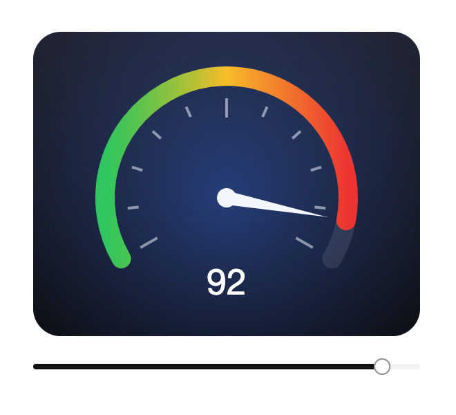
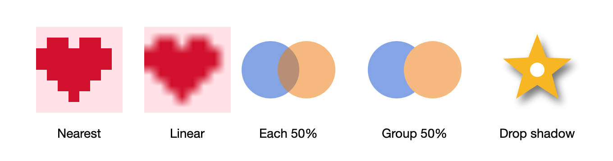
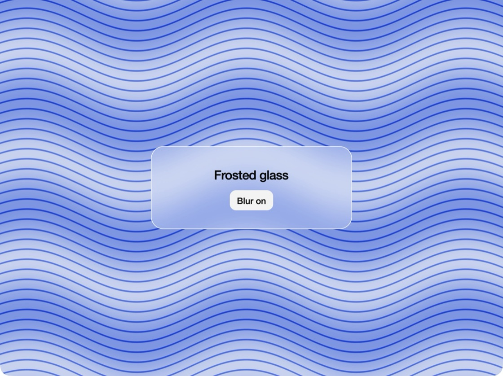
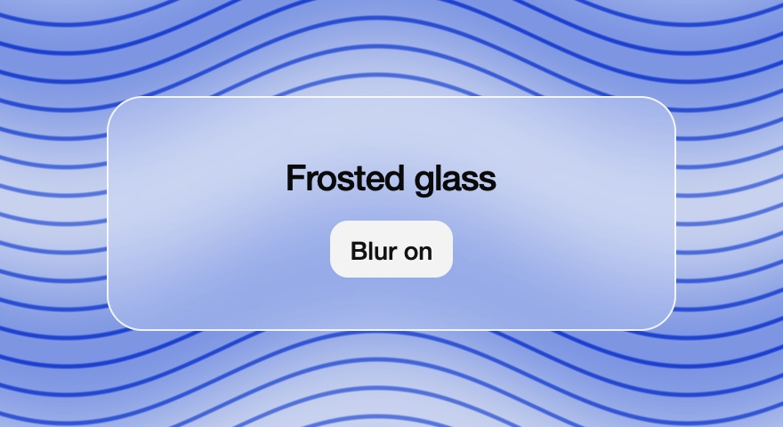
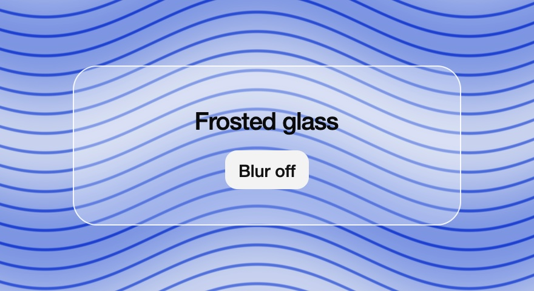

# 第 25 章　2D 图形与着色器

前两章的 `draw` 块只用了几个简单的 Canvas 方法：圆角矩形、圆和三角形。本章系统地介绍 `scoop.graphics`：路径、渐变、裁剪、变换、图像、图层滤镜，以及用 SkSL 编写的着色器和读取背景的“毛玻璃”效果；最后讲不开窗口、在 CPU 上绘图。读完本章，你会知道：

- Paint 和 Path 能描述哪些形状和笔触，渐变怎样使用；
- 裁剪和变换作用于什么，Canvas 的状态怎样保存和恢复；
- 绘图资源归谁所有，形状随数据变化时怎样替换；
- 怎样从像素或文件构造图像，两种采样方式有什么区别；
- 图层的整体透明度和逐个形状的透明度有什么不同，滤镜怎样作用在一组绘制上；
- 怎样编写、编译 SkSL 着色器并给它传参数，怎样模糊背后的画面；
- 怎样在没有窗口的情况下绘图并读回像素；
- 视频播放器、三维演示和终端这些真实项目怎样使用这些接口。

## 25.1　路径、渐变、裁剪与变换

`scoop.graphics` 是一个和窗口无关的 Skia 2D 绘图库。UI 中的 `draw` 块拿到的 `paint.canvas` 就是它的 `Canvas`；本章最后一节还会看到，它也可以完全脱离 UI 使用。

坐标是逻辑单位，原点在左上角，y 轴向下，和布局使用同一套单位，不需要关心屏幕的缩放倍率。颜色是 sRGB 的 `Color(red, green, blue, alpha)`，四个分量都在 0 到 1 之间。

下面的程序画了一个仪表盘：深色的圆角卡片，一圈刻度，一条颜色从绿到红渐变的弧线，一根指针。下面的滑块改变读数。保存为 `gauge.scoop`：

```scoop
{{#include ../../examples/ch25/gauge.scoop}}
```

```sh
scoop run gauge.scoop --release
```

把滑块拖到 92：



### Paint：颜色和笔触

`Paint` 描述怎样填充或描边一个形状：

| 字段 | 含义 | 默认值 |
| --- | --- | --- |
| `color` | 颜色 | 黑色 |
| `style` | `PaintingStyle.Fill` 填充，`Stroke` 描边 | 填充 |
| `strokeWidth` | 描边的宽度，以路径为中心向两侧各画一半 | 1 |
| `cap` | 线段端点：`StrokeCap.Butt` 平头、`Round` 圆头、`Square` 方头 | 平头 |
| `join` | 转角：`StrokeJoin.Miter` 尖角、`Round` 圆角、`Bevel` 斜角 | 尖角 |
| `gradient` | 渐变，有渐变时代替 `color` | 无 |
| `antiAlias` | 是否抗锯齿 | 是 |

仪表盘的弧线是一条宽 14、圆头的描边，颜色来自渐变：

```scoop
Paint(style = PaintingStyle.Stroke, strokeWidth = 14.0, cap = StrokeCap.Round, gradient = Some(heat))
```

### 渐变

`Gradient.linear(start, end, stops)` 沿一条线段变化，`Gradient.radial(center, radius, stops)` 从圆心向外变化；`stops` 是 `GradientStop(offset, color)` 的数组，`offset` 从 0 到 1。渐变使用和形状相同的局部坐标，和形状本身的位置无关：仪表盘的 `heat` 从弧线最左端的 x 坐标变到最右端，所以弧线的颜色由它经过的水平位置决定，左边绿、顶部黄、右边红。

渐变是普通的值，不持有原生资源，可以在 `draw` 块中随时创建。

### Path：任意形状

`path { ... }` 构造一个路径：

- `moveTo(point)` 开始一段新的轮廓，`lineTo`、`quadraticTo(control, end)`、`cubicTo(control1, control2, end)` 添加直线和贝塞尔曲线，`closeContour()` 闭合当前轮廓；
- `arcTo(oval, start, sweep, moveToStart)` 沿椭圆添加一段弧，角度是**弧度**，从 x 轴正方向开始顺时针计算（y 轴向下）；
- `addRect`、`addOval`、`addRoundRect` 直接添加完整的闭合形状。

`path(FillRule.EvenOdd) { ... }` 选择填充规则，决定自相交和嵌套的轮廓哪部分算“里面”，默认是 `NonZero`。

构造好的 `Path` 是一份不可变的快照。它可以回答 `bounds`（外接矩形）和 `contains(point)`（点是否在里面，适合做自定义形状的命中测试），`measure()` 返回 `PathMeasure`，用 `length` 和 `sample(distance)` 求路径的长度和某处的位置、切线方向，适合沿路径摆放文字或标记。

### 资源归谁所有

`Path` 持有原生资源，**用完要关闭**。仪表盘按资源的寿命分成了两类：

- **不变的形状**，比如卡片的轮廓、刻度弧和指针，在 `onMount()` 中创建，用 `scope.resource { ... }` 交给 scope，卸载时自动关闭；
- **随数据变化的形状**，比如表示读数的那段弧，在 `update()` 中根据新的 Props 创建，创建好新的再关闭旧的；它没有交给 scope，所以 `onUnmount()` 中要自己关闭最后一个。

这就是第 23 章那条规则的具体做法：不要在 `measure`、`scene` 或 `draw` 中创建需要关闭的资源。渐变、`Paint`、`Rect` 这些普通的值则不受这个限制。

### 裁剪和变换

Canvas 维护一个当前的状态：坐标变换和裁剪区域。

- `translate(dx, dy)`、`scale(sx, sy)`、`rotate(radians)` 和 `concat(transform)` 修改坐标变换，影响之后的所有绘制；
- `clipRect(rect)` 和 `clipPath(path)` 缩小裁剪区域，之后的绘制只出现在区域之内；
- `save()` 保存当前状态，`restore()` 恢复；`withState { child -> ... }` 把两者配成一对，块结束时（包括抛出异常时）自动恢复，块中只能使用 `child`。

仪表盘的 `draw` 块先用卡片的圆角轮廓裁剪，所以半径 170 的光晕在卡片的四个角上被切掉了，看不到卡片外面。画刻度时，它没有为每一根刻度计算两个端点，而是把原点移到表盘中心，转到起始角度，每画一根就再转 24 度：

```scoop
ticks.translate(center.x, center.y)
ticks.rotate(startAngle)
for (index in 0..10) {
    ...
    ticks.drawLine(Point(inner, 0.0), Point(radius - 16.0, 0.0), tick)
    ticks.rotate(sweepAngle / 10.0)
}
```

在旋转后的坐标中，每根刻度都只是 x 轴上的一条短线。指针也是一样：它的路径是一个指向 x 轴正方向的细长三角形，画的时候按读数旋转坐标即可。

注意这里的变换是 Canvas 上的，只影响这一段绘制。第 23.5 节讲过，`SceneContext` 上的变换才会同时移动子项和输入区域。仪表盘下方的读数是一个普通的 Label 子项，它的位置由 `measure` 决定，不受 `draw` 块中这些变换的影响。

`clipRect(rect, antiAlias = false)` 按设备像素硬裁剪，不做边缘的半透明过渡，用于相邻的图像块之间，避免在非整数缩放时出现接缝。25.6 节的终端就遇到了这个问题。

## 25.2　图像与图层

### 图像

`Image` 是一块不可变的像素，有两种常见的来源：

- `Image.decode(bytes)` 解码完整的 PNG 或 JPEG 文件内容，按文件中记录的方向旋转；数据不完整或格式错误时抛出 `GraphicsException`；
- `Image.fromRgba(width, height, pixels)` 从紧密排列的 RGBA8 字节构造，每个像素四个字节，按行排列，alpha 是直通的（没有预乘）。

`canvas.drawImage(image, destination, sampling, opacity)` 把整张图像画到目标矩形中，必要时缩放；`drawImageRegion(image, source, destination, ...)` 只画图像中的一部分。`Image` 同样持有原生资源，需要关闭。

普通应用显示图片用第 20 章的 `imageView` 就够了，它处理了加载、缩放方式和读屏器的替代文字。在 Canvas 上直接画图像，适合自绘控件内部的需要，比如地图的瓦片、游戏的精灵、图表的背景。

### 图层

`canvas.saveLayer(opacity, filter, blendMode, bounds)` 开始一个**图层**：之后的绘制先画到一块透明的画布上，`restore()` 时再把这块画布作为一个整体合成回去。合成时可以应用整体的透明度、一个图像滤镜和一种混合方式。

下面的程序演示了图像的两种采样方式和图层的两种用途。保存为 `layers.scoop`：

```scoop
{{#include ../../examples/ch25/layers.scoop}}
```

```sh
scoop run layers.scoop --release
```



从左到右：

- **采样。** 同一张 8×8 的图像放大 12 倍。`ImageSampling.Nearest` 取最近的像素，边缘清晰，适合像素画和需要逐像素对齐的内容；`Linear`（默认）在相邻像素之间插值，边缘平滑，适合照片。
- **逐个透明。** 两个圆各自用 50% 透明的颜色画，重叠的地方叠了两层，颜色更深，还透出了蓝色。
- **整体透明。** 两个不透明的圆画在一个 `saveLayer(opacity = 0.5)` 的图层中。图层中，橙色的圆盖住了蓝色的圆；合成时整个图层一起变成 50% 透明，重叠处只有橙色。淡入淡出一组内容时，你想要的几乎总是这一种。
- **图层滤镜。** `ImageFilter.dropShadow(offset, sigmaX, sigmaY, color)` 按图层中实际画出的内容生成投影：五角星和中间的白点作为一个整体，投影沿着星形的轮廓。

`ImageFilter` 提供：

- `blur(sigmaX, sigmaY)`：高斯模糊，`sigma` 以逻辑单位计；
- `dropShadow(offset, sigmaX, sigmaY, color)`：原内容加上投影；`dropShadowOnly(...)` 只要投影；
- `a.then(b)`：先 `a` 后 `b`，即 `b(a(source))`；
- `runtimeShader(...)`：用 SkSL 处理图像，见下一节。

滤镜也持有原生资源，示例在 `onMount()` 中创建并交给 scope。

和第 22 章的样式比较一下：`Style` 的 `contentEffects`（`DropShadow`、`Glow`、`Blur`）是给任意视图加效果的声明式写法；自绘元素内部要对自己画的一组形状加效果，就用图层和滤镜。`SceneContext` 也有 `saveLayer(opacity, filter)`（第 23.5 节），它作用于之后的所有内容，**包括子项**，适合把整个元素连同子控件一起淡化或模糊。

## 25.3　SkSL 着色器

纯色和渐变能满足大部分需要。需要逐像素计算的图案，比如噪声、等高线、自定义的渐变，可以用 **SkSL**（Skia 的着色语言，语法接近 GLSL）编写一段程序，由 GPU 为每个像素执行一次。

下面的程序用着色器画出铺满窗口的蓝色等高线，中间放一块磨砂玻璃面板。它来自 Scoop 官网的教程。保存为 `shader.scoop`：

```scoop
{{#include ../../examples/ch25/shader.scoop}}
```

```sh
scoop run shader.scoop --release
```



### 程序的结构

```text
layout(color) uniform half4 ink;
uniform float phase;
half4 main(float2 p) {
    ...
}
```

- `main(float2 p)` 对每个像素执行一次，`p` 是这个像素在**元素局部逻辑坐标**中的位置，原点在元素的左上角，单位和布局相同，不随屏幕缩放改变；返回值是这个像素的颜色。
- `uniform` 是从 Scoop 传进来的参数。`layout(color) uniform half4` 表示这是一个颜色，框架会把它转换到正确的颜色空间。

### 编译和绑定参数

- **编译。** `ShaderProgram.compile(source)` 编译程序。源码有错误时抛出 `GraphicsException`，消息就是编译器的诊断。编译有一定的开销，一个程序可以被多个元素共用：示例在组件中用 `scope.resource { ShaderProgram.compile(wavesSource) }` 编译一次，再交给元素。
- **绑定。** `program.makeShader { ... }` 为 uniform 绑定一组值，得到一个 `Shader`：`setColor(name, color)` 绑定 `layout(color)` 的颜色；`setFloat(name, value)`、`setFloats(name, values)` 绑定 `float`、`float2` 等，参数类型是 `Float`，所以示例写的是 `0.8f`；`setInt`、`setInts` 绑定整数；`setChild(name, shader)` 绑定 `uniform shader` 类型的子着色器，比如一张图像的 `image.toShader()`。没有绑定的数值 uniform 为 0。名称或类型对不上时报 `invalid shader binding`。
- **使用。** `canvas.drawRect(rect, paint, Some(shader))` 用着色器填充矩形。`drawPath`、`drawCircle`、`drawRoundRect` 等方法都有同样的 `shader` 参数，形状决定画在哪里，着色器决定每个像素的颜色。

`Shader` 是一组参数的**快照**，绑定之后不再改变。要改变参数，比如让 `phase` 随时间变化形成动画，就创建一个新的 `Shader`，并关闭旧的。持有 Shader 本身不会产生帧：示例静止时，窗口不再绘制。本书写作时用 `top` 查看，静止的示例 CPU 占用为 0%。

## 25.4　背景效果：毛玻璃

`Style` 的 `contentEffects` 和图层滤镜处理的都是“自己画的内容”。毛玻璃要处理的是面板**背后**已经画好的画面。示例的 `Poster` 是这样画面板的：

```scoop
// The backdrop filter samples what this layer has drawn so far: the waves.
val backdrop = if (frosted.value) Some(blur) else None
painter.scene(context, layout, glass, backdrop) { local -> local.children() }
```

`StylePainter.scene(context, bounds, style, filter) { ... }`（第 24.4 节）多了一个滤镜参数：它先用滤镜处理当前图层中、样式圆角范围内已经画出的内容，再在上面画 `Style` 的半透明底色、子项和边框。`glass` 样式设置了 `clipContent = true`，子项不会画到圆角之外。

点 Blur on 关闭模糊，面板变成普通的半透明底，线条清晰地透过来；再点一次恢复。下面左边是打开模糊时的面板，右边是关闭后的：

 

两点要注意：

- **背景只采样同一图层中先画的内容。** `Poster` 先画波浪线再画面板，所以面板模糊的是波浪线。画在面板之后的内容，或者画在其他图层中的内容，不会被采样。
- **模糊会扩展到边缘之外取样。** 高斯模糊大约要用到 3 倍 sigma 范围内的邻近像素，面板边缘附近的颜色也来自面板外面。

更底层的接口是 Canvas 上的 `drawBackdrop(outline, filter)`：用滤镜处理当前图层中、轮廓范围内已有的内容并画回去。要让一块玻璃面板连同它的背景效果、文字和按钮一起淡入淡出，用 `saveBackdropLayer(opacity, backdrop, bounds)`：它从下层已有的像素开始建立一个组，`restore()` 时按整体透明度在原背景和完整结果之间插值。

### 自定义背景滤镜

`ImageFilter.runtimeShader(program, sourceChild, sampleRadius) { ... }` 用一段 SkSL 程序处理图像：`sourceChild` 是程序中代表输入图像的 `uniform shader` 的名字，程序用 `background.eval(p)` 读取输入图像在某处的颜色；`sampleRadius` 声明程序最多会偏离当前像素多远去取样，框架据此准备足够的邻域。

工具链附带的 glass 示例（`scoop.ui.component/examples/glass`）在可滚动的色样列表上方放了两块固定的工具栏，左边用高斯模糊，右边用一段“折射”程序：它在面板的圆角附近按法线方向偏移取样的位置，让背后的线条像透过玻璃边缘一样弯折，最大偏移 13，所以 `sampleRadius` 也是 13。这个滤镜需要知道面板的尺寸，示例在 `measure` 中根据尺寸创建它，作为布局数据返回，并传入关闭函数（第 23.4 节），布局被替换时滤镜随之关闭。把这个目录复制到自己的工作目录，运行 `scoop run --release` 就能看到。

## 25.5　CPU 离屏绘制

`RasterSurface(width, height)` 是一块 CPU 上的画布。它**不需要窗口、GPU，也不需要启动应用**，所以可以用在命令行工具、服务端生成图片，以及测试中。保存为 `raster.scoop`：

```scoop
{{#include ../../examples/ch25/raster.scoop}}
```

```sh
scoop run raster.scoop --release
```

输出：

```text
{{#include ../../examples/ch25/raster.expected}}
```

程序在一块 36×13 像素的画布上画了一个圆、一个圆角矩形框和一条横线，然后用 `readPixels()` 读回像素，把红色分量低于一半的像素打印成 `#`。

- `surface.draw { canvas -> ... }` 中的 Canvas 和 UI 中的是同一个类型，本章介绍的所有方法都可以用。离屏画布没有屏幕缩放，一个单位就是一个像素。
- `readPixels()` 把像素复制出来，格式和 `Image.fromRgba` 的输入相同：直通 alpha 的 RGBA8，按行紧密排列，所以 36×13 的画布是 1872 个字节。
- `snapshot()` 返回一张独立的 `Image`，之后在画布上继续画不会改变它。这张图像可以交给 UI 中的 `drawImage`，比如在后台生成缩略图，再在界面上显示。

在 UI 测试中，用它可以把自绘控件的绘制代码单独拿出来，画到离屏画布上检查关键像素，而不必打开窗口（第 30 章）。

在 UI 的 `draw` 块中还有一个 GPU 上的版本：`canvas.createSurface(pixelWidth, pixelHeight, scale)` 返回一个和当前绘制目标兼容的 `OffscreenSurface`，它的 `snapshot()` 留在 GPU 上，不读回 CPU，适合把一块昂贵的内容渲染一次、之后反复绘制。另外，`canvas.recordDrawing(bounds) { record -> ... }` 把一段绘制录制成不可变的 `Drawing`，之后用 `drawDrawing` 重放；它保存的是绘制命令而不是像素，重放时仍会重新光栅化。一般的自绘控件用第 24.6 节的 `drawLayer` 就够了，它在内部做了类似的事。

## 25.6　真实项目中的做法

### 在着色器中转换视频颜色：scoop-video

视频解码器输出的画面通常不是 RGB，而是 NV12：一个全分辨率的亮度平面（Y）加一个半分辨率的色度平面（UV）。scoop-video（`scoop.ui.video/src/planes.scoop`）没有在 CPU 上转换颜色，而是把两个平面作为两张 GPU 图像导入，交给一段 SkSL 程序：

```text
uniform shader luma;
uniform shader chroma;
uniform float2 chromaOffset;
half4 main(float2 p) {
    float y = (luma.eval(p).r * 255.0 - 16.0) / 219.0;
    float2 cbcr = (chroma.eval(p * 0.5 + chromaOffset).rg * 255.0 - 128.0) / 224.0;
    ...
}
```

两张图像分别通过 `toShader()` 变成子着色器，用 `setChild("luma", ...)`、`setChild("chroma", ...)` 绑定；色度平面只有一半的分辨率，所以取样坐标是 `p * 0.5`。得到的 Shader 用一次普通的 `drawRect` 画出来。图像来自 `canvas.gpuDevice()` 返回的 `GpuDevice`，用它的 `importImage` 直接引用播放器交付的 Metal 纹理（这是 `@Unsafe` 的原生接口）。

项目的文档（`docs/ui-trace.md`）记录了 4K、60 帧视频的实测：每一帧画面只有一次 GPU 渲染，视频像素在 CPU 上的读回和上传次数都是零，实测约 59.9 帧每秒。

### 用原生 GPU 接口渲染：scoop-solar-system

三维太阳系（`src/render/renderer.scoop`）需要的是三维渲染，超出了 2D 绘图库的范围。它在 `draw` 块中用 `GpuDevice` 创建一块 GPU 缓冲，在 `@Unsafe` 的 `withNativeWrite` 中借出原生纹理，用各平台的原生 GPU 接口（macOS 上是 Metal）把场景渲染进去，然后取一张 `snapshot()`，再用普通的 `canvas.drawImage` 画到元素中：

```scoop
target.withNativeWrite { _, texture -> ... renderNative(renderer!!, texture, target, frame) ... }
image?.close()
image = Some(buffer!!.snapshot())
...
canvas.drawImage(image!!, Rect(0.0, 0.0, size.width, size.height))
```

场景没有变化时（相机、时间和选中的行星都没变），它跳过渲染，直接重画上一次的图像。工具栏、信息面板这些普通的控件则叠在三维视图的上面，和其他 Scoop 界面一样。

### 两遍绘制与硬裁剪：scoop-terminal

终端的屏幕是一个字符网格（`terminal-ui/src/render.scoop`）。它在一个裁剪区域中分两遍绘制：第一遍逐行平移坐标，画出所有背景色和默认背景不同的格子；第二遍再逐行画出排好版的文字。这是字符网格常见的画法：先画完所有背景再画文字，超出自己格子的字形笔画就不会被下一个格子的背景盖住。内联图片按协议规定的层次，分别插在默认背景之后、格子背景之后和文字之后绘制。

大图片被切成多块，每块用 `drawImageRegion` 画出。开发中发现，缩放比例不是整数时，抗锯齿裁剪会让相邻块的边界上出现一条变暗的细缝，项目因此给 Scoop 提交了修改，增加了 `clipRect(rect, antiAlias = false)`（`terminal-ui/src/image_paint.scoop`）：

```scoop
canvas.clipRect(tile.clip, antiAlias = false)
canvas.drawImageRegion(tile.lease.image, tile.source, tile.destination, tile.sampling)
```

它还用 `RasterSurface` 做了一件小事：`Image` 本身没有读取像素的方法，终端把 `Image.decode` 解出的图像用 `Nearest` 采样画到一块同样大小的离屏画布上，再用 `readPixels()` 读回 RGBA8 字节，交给不依赖 Skia 的终端核心（`terminal-ui/src/image_decoder.scoop`）。

## 常见误用

- **在 `draw` 或 `scene` 中创建 Path、Image、滤镜或编译着色器。** 每帧都会创建原生资源。不变的在 `onMount()` 中用 `scope.resource { }` 创建；随数据变化的在 `update()` 中替换并关闭旧的。
- **把 `arcTo` 和 `rotate` 的角度写成度数。** 它们使用弧度。
- **用 Canvas 的变换移动子项。** 只影响这一段绘制；移动子项和输入区域用 `SceneContext` 的变换。
- **想让一组内容整体半透明，却给每个形状设置透明度。** 重叠的地方会变深。用 `saveLayer(opacity)`。
- **`saveLayer` 或 `save` 之后忘了 `restore()`。** 后面的绘制都会受影响。用 `withState { }` 让它自动恢复。
- **给 `setFloat` 传 `Double`。** 参数类型是 `Float`，写成 `0.8f` 或调用 `toFloat()`。
- **背景滤镜没有效果。** 要模糊的内容必须在同一图层中、先于面板绘制。
- **把 `ContentEffect.Blur` 当成毛玻璃。** 它模糊的是内容自己，毛玻璃用背景滤镜。
- **用 `readPixels()` 读取 UI 的画面。** 离屏画布才能读回；UI 的画面在 GPU 上，测试窗口的像素见第 30 章。

## 小结

- `Paint` 描述填充或描边，`Gradient.linear` 和 `radial` 是普通的值；`path { }` 构造不可变的 `Path`，支持直线、贝塞尔曲线、弧（弧度、顺时针）和完整形状，可以求外接矩形、包含关系和长度。
- Path、Image、ImageFilter、ShaderProgram、Shader 都持有原生资源，需要关闭：不变的交给 scope，变化的在 `update()` 中替换。
- Canvas 的变换和裁剪影响之后的绘制，用 `save`／`restore` 或 `withState` 限定范围；它们不移动子项和输入区域。
- `Image.decode` 和 `Image.fromRgba` 构造图像，`Nearest` 和 `Linear` 是两种采样方式；`saveLayer` 让一组绘制整体透明、整体应用滤镜。
- `ShaderProgram.compile` 编译 SkSL，`makeShader` 绑定参数得到不可变的快照，`main(p)` 中的 `p` 是元素的局部逻辑坐标。
- `StylePainter.scene` 的滤镜参数、`drawBackdrop` 和 `saveBackdropLayer` 处理同一图层中先画的背景；`ImageFilter.runtimeShader` 用 SkSL 处理图像。
- `RasterSurface` 在 CPU 上绘图，不需要窗口，`readPixels()` 读回 RGBA8，`snapshot()` 得到独立的图像。

## 练习

1. 在 `gauge.scoop` 中，把 `heat` 渐变改成从表盘的圆心出发的 `Gradient.radial`，弧线的颜色怎样变化？为什么现在整条弧线几乎是同一种颜色？
2. 去掉 `gauge.scoop` 中的 `canvas.clipPath(card!!)`，光晕会画到哪里？
3. 用 `Path.measure()` 和 `sample(distance)`，在仪表盘的刻度弧上每隔 20 个单位画一个小圆点。
4. 在 `layers.scoop` 的第三组中，把 `dropShadow` 换成 `ImageFilter.blur(3.0, 3.0).then(ImageFilter.dropShadow(...))`，再交换 `then` 两边的顺序，比较结果。
5. 修改 `shader.scoop` 的着色器，让线条的颜色随 `p.x` 从蓝色渐变到紫色。再试着故意写错一个变量名，看看 `ShaderProgram.compile` 抛出的诊断是什么样子。
6. 修改 `raster.scoop`，把图形放大一倍画到 72×26 的画布上：只需要在 `draw` 块的开头加一行什么？
