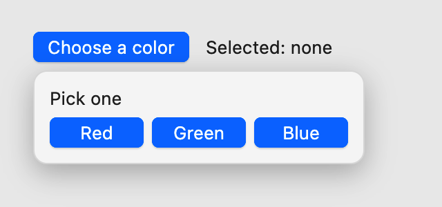
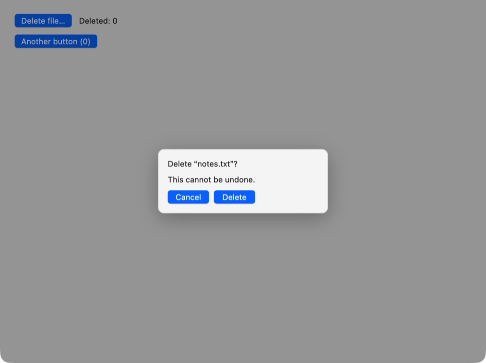
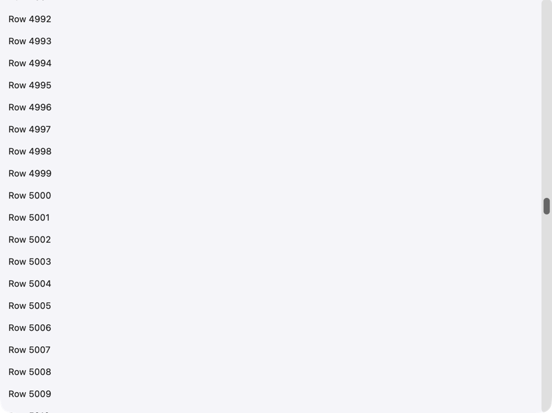
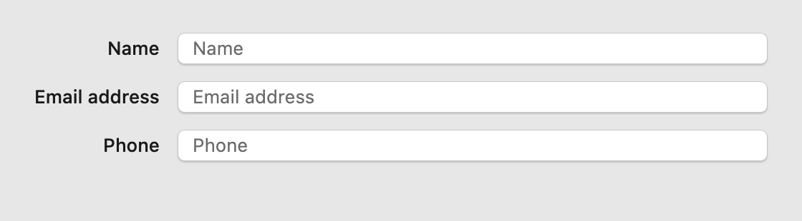
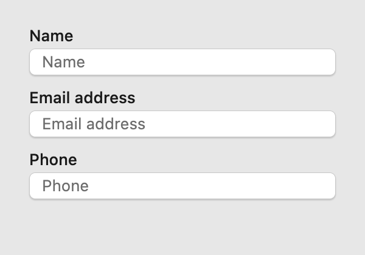

# 第 26 章　自定义弹层、容器与按需列表

第 17 章和第 18 章使用的滚动区域、虚拟列表、弹出框和对话框都是控件库提供的。它们建立在 `scoop.ui` 的几组公开接口之上：把内容送到页面之上的 `portal`，描述滚动位置和视口的 `ScrollViewport`，只构建看得见的子项的 `LazyElement`，以及在一次布局中向整个子树传递计划的 `LayoutInput`。本章用这些接口编写自己的弹层、对话框、列表和表单布局。读完本章，你会知道：

- `portal` 怎样把内容画在页面之上，又怎样让它在逻辑上仍属于原来的位置；
- 怎样让弹层贴着某个元素出现，怎样让点击弹层的空白处不会关闭它；
- 模态弹层怎样屏蔽背景，遮罩为什么要自己画；
- 自定义的滚动容器需要做哪几件事，怎样给它加上主题风格的滚动条；
- `LazyElement` 怎样按需构建、挂载和卸载子项，哪些子项必须保留；
- 怎样用 `LayoutInput` 让几行内容共用一列标签宽度；
- 表格、Markdown 预览和代码编辑器分别选择了哪种做法。

## 26.1　portal 与锚点

`portal(open, content) { ... }` 把一个 View 送到窗口的弹层出口中显示。它有两个看起来矛盾的特点：

- **画在页面之上。** 内容越过祖先的裁剪和变换，不会被滚动区域或卡片的圆角切掉；它在原来的位置只占约束允许的最小尺寸，不影响周围的布局。
- **逻辑上仍在原处。** 输入路由、Tab 顺序、读屏器的浏览顺序和组件的状态，都跟着它在组件树中的位置走，就像它是一个普通的子项。

`open` 是一个 `Binding<Boolean>`，它是弹层“是否打开”的唯一来源：用户按 Escape 或点击外部关闭弹层时，框架把它写回 false。

要让弹层贴着某个元素出现，需要一个 `LayoutAnchor`：

1. 创建一个 `LayoutAnchor()`，保存在组件的字段中；
2. 在触发器所在 Element 的 `onMount()` 中调用 `scope.layoutAnchor(anchor)`；
3. 在它的 `scene` 中调用 `context.anchor(anchor, rect)` 报告位置；
4. 在 portal 的配置中写 `anchored(anchor) { ... }`。

下面是一个完整的颜色选择弹层，它来自 Scoop 官网的教程。保存为 `popover.scoop`：

```scoop
{{#include ../../examples/ch26/popover.scoop}}
```

```sh
scoop run popover.scoop --release
```

点 Choose a color，按钮下方出现一张带阴影的卡片：



点一个颜色，卡片关闭，右边的文字变为所选的颜色。

示例中有两个很小、却很常用的 Element：

- **`AnchorBox`** 原样测量、放置唯一的子项，并在 `scene` 中把自己的矩形报告为锚点。锚点使用当前的变换和裁剪换算到窗口坐标，不需要输入区域。
- **`PanelArea`** 给卡片铺一个覆盖整个面板的输入区域，并用 `scope.routeChildren(area)` 让子项的事件经过它。为什么需要它？“点击外部”是按**输入区域**判断的：点在卡片的内边距上时，如果那里没有任何属于弹层的输入区域，这次点击就算在弹层之外，弹层会被关闭。

本书写作时，用自动化工具读取打开弹层后的辅助功能树，卡片中的 “Pick one” 和三个按钮紧跟在 “Selected: none” 的后面，和页面上的其他内容在同一个分组中，这就是“逻辑上仍在原处”。对 Green 执行 `AXPress`，弹层关闭，文字变为 “Selected: green”。点击外部和 Escape 关闭弹层没有用自动化工具核对（第 18 章说明了原因）。

示例读取颜色时用的是 `this.theme.read(scope)`。官网的原版写的是 `this.theme.current.value`，那是没有应用显示偏好的基础主题（第 21.6 节），本书做了修改。

### 定位与关闭

portal 的配置块中常用的项目：

- **定位**：`anchored(anchor) { preferredSide; alignment; gap; viewportPadding; matchAnchorWidth }` 贴着锚点；`viewport { horizontal; vertical; viewportPadding }` 在窗口中对齐，这是默认值，比如居中的对话框；`atPoint(point) { ... }` 以窗口坐标定位，适合右键菜单。框架先给内容一个有界的约束，再按内容的实际尺寸放置，空间不够时翻转到另一侧或者平移。弹层内的元素可以在 `scene` 中读取 `context.overlayLayout`，得到最终的 `bounds`、锚点和所在的一侧，比如用来画一个指向锚点的小箭头。
- **关闭**：`dismiss { escape = true; outsidePress = OutsidePress.CloseAndConsume }`，默认两者都不关闭。`CloseAndConsume` 关闭弹层并吞掉这次按下；`CloseAndContinue` 关闭的同时，让被点中的控件继续收到这次按下，只适用于非模态的弹层。每次只关闭最上层的、适用的那一个弹层。
- **其他**：`onCloseRequest` 可以拒绝用户发起的关闭（比如表单还没有保存），`onClosed` 在弹层真正移除后调用，`transition` 配置进入和退出的动画，`anchorVisibility` 决定锚点被滚出视野时关闭（`Close`）、隐藏（`Hide`）还是保持显示（`KeepVisible`）。

## 26.2　模态弹层

把 `mode` 设为 `OverlayMode.Modal`，就得到同一窗口内的模态弹层：打开时保存原来的焦点，屏蔽背景的输入，Tab 只在弹层内循环；关闭后焦点回到原来的位置。`focus { initialFocus = Some(handle) }` 指定打开后聚焦的控件。另一种模式 `OverlayMode.FocusContained` 只把焦点限制在弹层内，不屏蔽背景的指针输入。

遮罩、面板的外观和布局都由你放进 portal 的内容决定。下面的程序做了一个确认对话框：半透明的黑色遮罩铺满窗口，中间是一张卡片。保存为 `confirm.scoop`：

```scoop
{{#include ../../examples/ch26/confirm.scoop}}
```

```sh
scoop run confirm.scoop --release
```

点 Delete file…：



### 为什么遮罩要自己画

第一次写这个示例时，遮罩是一个带背景色的 `frame`，结果只有卡片周围的一小圈变暗了。原因是 portal 给内容的是**有界而宽松**的约束：最大值是窗口（减去 `viewportPadding`），最小值是 0。`frame` 按内容的尺寸收缩，不会主动占满。

所以示例写了一个 `Scrim` 元素，做法和控件库中对话框的实现一样：

- `measure` 直接取约束的最大值作为自己的尺寸，再把卡片测量好放在中央；
- `scene` 先在整个范围内画半透明的黑色，再放置子项；
- 输入区域只放在**卡片**上。遮罩部分不属于弹层，在上面点击就是“点击外部”；示例没有打开 `outsidePress`，所以点击遮罩不会关闭对话框。

再配上 `viewport { viewportPadding = 0.0 }`，遮罩才能贴到窗口的边缘。

### 读屏器看到了什么

本书写作时，打开对话框后读取辅助功能树，只剩下对话框中的两段文字和 Cancel、Delete 两个按钮，背景中的两个按钮都不见了：模态弹层也把背景从读屏器的浏览范围中移走了。对 Delete 执行 `AXPress`，对话框关闭，计数变为 “Deleted: 1”，背景的按钮重新出现。打开后焦点是否落在 Cancel 上、Escape 能否关闭，需要键盘，没有用自动化工具核对。

## 26.3　自定义滚动容器

第 17 章的 `scrollArea` 和 `virtualList` 都基于两个类型：

- **`ScrollState`** 是一个普通的业务对象，保存最近一次成功呈现的 `offset`、视口尺寸和内容尺寸，提供 `scrollTo`、`scrollBy`、`reveal` 和 `animateTo`。第 17 章在组件中直接使用过它。
- **`ScrollViewport`** 把一个 `ScrollState` 绑定到一个自绘的容器上，负责计算每一帧的滚动位置、裁剪和平移内容、发布滚动的几何信息。

下面的程序是一个一万行、固定行高的列表，右边有一条主题风格的滚动条。它在官网教程的示例上加了滚动条。保存为 `rows.scoop`：

```scoop
{{#include ../../examples/ch26/rows.scoop}}
```

```sh
scoop run rows.scoop --release
```



一个自绘的滚动容器要做四件事：

1. **绑定。** 在 `onMount()` 中用 `scope.scrollViewport(state)` 得到 `ScrollViewport`。
2. **布局。** 在 `measure` 中调用 `viewport.layout(viewportSize, contentSize)`，得到本帧的 `ScrollLayout`，其中 `snapshot.offset` 是本帧使用的滚动位置。`FixedRows` 据此算出可见的行号范围。
3. **呈现。** 在 `scene` 中调用 `viewport.present(context, layout, Some { content -> content.children() })`。回调中的内容自动裁剪到视口，并按滚动位置平移，所以子项按**内容坐标**放置即可：第 `i` 行放在 `y = i × 行高`。固定的装饰（比如滚动条）画在回调之外，不随内容滚动。
4. **接收滚轮。** `FixedRows` 在区域的默认动作中处理 `InputPointerEvent.Wheel`：`current.consumeScroll(lineStep) { amount -> ... }` 把按行或按像素的增量换算成位移，交给 `state.scrollBy(delta, ScrollOrigin.User)`，并返回实际用掉的部分，剩下的继续交给外层的滚动容器（第 17 章的 `chain`）。放在默认动作中，是为了让行内的子控件先有机会处理这次滚动。

### 滚动条：ViewportScrollbars

控件库的 `ViewportScrollbars` 给自绘的视口加上主题风格的滚动条：它按主题绘制，自己处理滚动条上的指针操作，并发布读屏器的滚动条语义，滚动的仍是同一个 `ScrollState`：

```scoop
bars = Some(
    ViewportScrollbars(scope, view, region) {
        ViewportScrollbarOptions(
            props.value.theme,
            axes = ScrollAxes.Vertical,
            visibility = ScrollbarVisibility.Always,
            lineStep = rowHeight
        )
    }
)
```

用法是把 `ScrollViewport` 的几个步骤换成它的版本：

- `bars.contentViewport(size, direction)` 返回扣除滚动条占用的空间之后的内容区域，行的宽度取它的宽度；
- `bars.layout(size, content)` 代替 `viewport.layout`，它会为滚动条留出位置；
- `viewport.present(...)` 之后调用 `bars.scene(context, layout)` 画出滚动条；
- 主题等选项变化时，在 `update()` 中调用 `bars.update()`，它返回滚动条的占用尺寸是否变化。

选项是一个返回 `ViewportScrollbarOptions` 的函数，每次需要时调用，所以总是读到最新的 Props。示例用 `ScrollbarVisibility.Always` 让滚动条始终显示，便于截图；默认的 `Auto` 跟随系统的设置（第 17.3 节）。

本书写作时，辅助功能树中出现了一个 `AXScrollBar`，值为 0；把它的值设为 0.5，列表滚动到了正中间，树中的文字变成了 “Row 4991” 到 “Row 5010”，上图就是这时的样子。任何时候，树中都只有二十行左右：没有构建的行，读屏器也看不到。需要让读屏器知道列表的总行数、按行跳转时，用第 17 章的 `virtualList`，它发布了完整的集合语义。

### 测量之后才知道滚到哪里

行高可变的容器，常常要在测量了内容之后才知道应该滚到哪里，比如插入新的内容时保持当前的阅读位置不跳动。这时在布局中构造 `ScrollAdjustment(state.requestRevision, offset)`，作为 `viewport.layout` 的第三个参数：它只在定位意图仍然是同一次请求时生效，新的滚动请求和正在进行的动画优先。

## 26.4　按需子项：LazyElement

`FixedRows` 能够只构建看得见的行，靠的是 `LazyElement`。

**数据源：`ItemSource`。** 它提供 `count`、`keyAt(index)`、`indexOfKey(key)` 和 `build(index)`。key 必须稳定且唯一（`ViewKey.Text` 或 `ViewKey.Number`）；数据变化时，换一个新的 `ItemSource` 快照。框架只对实际访问到的下标调用 `build`，不会预先构建全部的行；已经构建的行仅仅因为滚动而重新测量时，也不会重新调用 `build`。

**容器：`lazyElement(source, props, create)` 与 `LazyElement<L>`。** 生命周期和 `scene` 都和 Element 相同，区别在于 `measure` 收到的是 `LazyMeasureContext`：

- `context.itemCount` 是条目的总数；
- `context.measureItem(index, constraints)` 按需构建、挂载并测量第 `index` 项；
- `context.placeItem(index, origin)` 放置它；
- `context.pinnedItems` 列出**必须保留**的条目：持有焦点的、正在等待聚焦的、正在被按下或拖动的、正在输入文字的。即使它们滚出了可见范围，也要测量和放置，否则交互会被打断；视口的裁剪会让它们看不见。

本帧没有放置的条目会被卸载，状态随之丢失。`lazyElement` 的第四个参数 `retention` 可以设为 `ItemRetention.KeepAlive(maxOffscreenItems)`，额外保留若干个最近离开的实例，滚回来时复用它们的状态。

**按 key 聚焦：`scope.lazyFocus(viewport)`。** 没有构建的行，自然也拿不到它们的 `FocusHandle`。`LazyElement` 可以在 `onMount()` 中登记 `scope.lazyFocus(viewport, options)`，之后用 `requestFocus(key, ItemFocusEdge.First)` 请求聚焦某个 key 对应的行：这一行会加入 `pinnedItems`，容器通过 `pendingItem` 得知要先把它滚到可见的位置。`LazyFocusOptions` 还可以让整个列表只占一个 Tab 停靠点，用方向键在行之间移动。

**逐项呈现：`context.item(key)`。** `scene` 中默认用 `children()` 一次画出所有放置的条目。需要对不同的条目使用不同的变换和裁剪时，比如吸顶的分组标题和正文分别处理，可以改用 `context.item(key)` 逐项呈现；正文再用 `withScrollReveal(viewport, region, axes)` 声明自己可见的区域，扣除被吸顶部分遮住的顶部，这样“滚动到某一行”时不会把它滚到标题的下面。这两种接口的完整规则见工具链中 `scoop.ui` 的 README，本书没有为它们编写示例。

控件库中的 `virtualList`（第 17 章）就是用这些接口实现的。需要完整的键盘行为、读屏器的集合语义和跳转时，直接使用它通常更合适；只有布局方式确实特殊（比如网格、瀑布流、时间轴）时，才需要自己写 `LazyElement`。

## 26.5　共享测量输入：LayoutInput

普通的布局中，父元素只能通过约束影响子项：给多宽、多高。有时父元素做出了一个“计划”，需要整个子树在测量时都遵守，比如表格的列宽、表单的标签列宽、一次滚动的可见范围。`LayoutInput` 就是为此设计的：

- 父元素创建一个不可变的 `LayoutInput(plan)`，用 `context.measureChild(index, constraints, input)`（`LazyElement` 中是 `measureItem(index, constraints, input)`）测量子项；
- 子树中任何一层的元素，在自己的 `measure` 中用 `context.input<Plan>()` 读取这份计划。

下面的表单让几行“标签加输入框”共用一列标签的宽度：标签列和最宽的标签一样宽，标签右对齐；窗口太窄放不下时，改为标签在上、输入框在下。保存为 `fields.scoop`：

```scoop
{{#include ../../examples/ch26/fields.scoop}}
```

```sh
scoop run fields.scoop --release
```

窗口较宽时，三个标签右对齐，排成一列：



把窗口拉窄，标签移到了输入框的上方：



`Form` 的 `measure` 分两遍进行：

1. **试测。** 用一份特殊的计划 `probe`（`labelWidth` 为 `None`）测量每一行。`FieldLayout` 读到它，只测量标签，用 `skipChild` 跳过输入框，并把标签的宽度作为自己的宽度报告回来。
2. **正式测量。** `Form` 取最宽的标签作为标签列的宽度，判断是否需要竖排，构造真正的计划，再测量一遍，这次放置子项。

一个子项在放置之前可以测量多次（第 23.4 节），用不同的输入测量也一样。

几条规则：

- **输入穿过普通的组件。** 每一行是一个 `FieldRow` 组件，它 `render()` 出 `FieldLayout` 元素；`Form` 的输入穿过 `FieldRow` 到达 `FieldLayout`，中间的组件不需要知道它的存在。没有读取输入的子树（比如输入框内部）不受输入变化的影响，可以继续复用已有的布局。
- **只在 measure 中读取。** `render`、`scene` 或者已经结束的测量中都不能读取。`scene` 需要的数据要保存在 `LayoutResult` 的布局数据中。
- **不要用共享的可变字段代替它。** 比如把“最近一次试测的列宽”存在父元素的字段里让子项去读：试测和正式测量的结果会混在一起。
- **计划不变时复用同一个输入对象。** 示例只在计划变化时才创建新的 `LayoutInput`，子项据此判断能否复用上一次的布局。
- **同类型的输入由最近的覆盖。** 不同类型的输入可以嵌套，互不影响。

拉窄窗口之前，本书写作时先用自动化工具在 Name 输入框中写入了 “Ada”；切换到竖排之后，输入框移到了新的位置，文字仍然在。布局的变化不影响子项的状态。

## 26.6　真实项目中的做法

### 两个方向的虚拟化：scoop-grid

数据表格（`src/layout/`）把本章的接口几乎都用上了：

- **行在正文中按需构建。** `GridBody` 是一个 `LazyElement`，它选出的行包括：可见范围内的行（加上一定的预留）、`pinnedItems`、程序请求聚焦的行，以及正在编辑的行。固定行高时用紧约束测量，可变行高时只约束宽度、记录实测的高度，再统一放置。
- **列在每一行中按需构建。** `GridRowView` 同样是一个 `LazyElement`，对一行中的单元格做同样的事：只构建可见的列、冻结的列，以及为了确定行高而必须测量的列。
- **一份计划，测到稳定为止。** 根元素构造一份 `GridMeasurePlan`，通过同一个 `LayoutInput` 交给表头和正文。测量正文时，新测出的行高可能改变滚动范围和可见的行，于是根元素检查行高记录的版本，有变化就重新做计划、再测一遍，直到稳定：

  ```scoop
  var plan = layout()
  var shared = LayoutInput(plan)
  while (true) {
      val before = rows.revision
      context.measureChild(0L, Constraints.tight(Size(columns.total, headerHeight)), shared)
      context.measureChild(1L, Constraints.tight(Size(columns.total, ...)), shared)
      if (rows.revision == before) break
      plan = layout()
      shared = LayoutInput(plan)
  }
  ```

- **冻结的列不是另一棵树。** 冻结列的单元格和普通单元格在同一棵树中，只是通过 `LayoutInput` 拿到了不同的滚动轴：冻结列只随纵向滚动。单元格在 `scene` 中用 `withScrollReveal` 声明自己的可见区域，所以“滚动到某个单元格”时，它不会被滚到冻结列的下面。
- **编辑错误的提示是一个锚定的 portal。** 编辑器旁边的错误提示用 `OverlayPlacement.Anchored(anchor, gap = ...)` 贴着单元格显示，`anchorVisibility = AnchorVisibility.Hide`：单元格被滚出视野时，提示暂时隐藏。

项目的设计文档（`docs/DESIGN.md`）记录了为此向 Scoop 提交的修改，`LayoutInput` 就是其中之一（PR #157）。进度文档（`docs/PROGRESS.md`）也如实记录了性能：十万行的表格以每秒 600 点的速度滚动时约 60 帧每秒，以每秒 3000 点高速滚动时约 44 到 48 帧每秒，瓶颈在新行的布局、挂载和无障碍几何的发布。

### 不挂载子项的按需布局：scoop-markdown

Markdown 预览（`scoop.ui.markdown/src/preview/`）中的段落、标题、表格和代码块都是用 `TextLayout` 直接排版和绘制的，不是挂载的子 View，所以它没有使用 `LazyElement`，而是自己做了按需布局：一棵持久的高度树记录每个块的高度，没有测量过的块用估计值；`measure` 中从滚动位置找到第一个可见的块，向下测量到视口底部再加上预留，然后用新的高度重新计算滚动布局，如此循环，直到没有新测量的块为止。测量过的块被缓存，滚出范围的块释放排版结果。这和 grid “测到稳定为止”是同一个思路。

### 自己的滚动和自己的虚拟化：scoop-code-editor

代码编辑器的正文也不是子 View，而是 `EditorInk` 元素自己排版的文字行。它用 `ScrollViewport` 管理滚动，用本章的 `ViewportScrollbars` 画滚动条，`scene` 中先 `viewport.present(context, frame.scroll)`，再画文字，最后 `bars.scene(...)`；可见的行由它自己按行高索引计算，自动换行改变了行高之后同样重新检查滚动位置，直到测量的范围覆盖了最终的可见范围。查找面板等嵌入编辑器的小部件才是普通的子 View，由元素自己测量和放置。

## 常见误用

- **点击弹层的内边距，弹层关闭了。** 面板没有覆盖整个面板的输入区域。像 `PanelArea` 那样创建区域并 `routeChildren`。
- **在 builder 块中写 `anchored(this.anchor)`、在块中构造 View。** 报外层接收者的错误或类型为 `Unit`。先把字段取到局部变量，需要 View 值时在块外构造（第 2.5 节）。
- **用 `frame` 做模态遮罩，只盖住了卡片周围。** portal 的约束是宽松的。写一个取最大约束的元素，并把 `viewportPadding` 设为 0。
- **在遮罩上放输入区域，却希望点击遮罩算“外部”。** 只在面板上放区域。
- **子项在 `present` 的回调外放置，或者按视口坐标放置。** 回调中的内容会被平移，子项要按内容坐标放置。
- **滚轮事件在目标阶段就消费掉。** 行内的子控件没有机会处理，外层的滚动容器也收不到剩余的部分。放在默认动作中，并返回实际用掉的量。
- **只测量和放置可见的行，忘了 `pinnedItems`。** 正在编辑或聚焦的行滚出视野后被卸载，状态丢失。
- **在 `scene` 中读取 `LayoutInput`，或者用父元素的可变字段传递计划。** 输入只能在 measure 中读取，`scene` 需要的数据放进布局数据。

## 小结

- `portal(open, content)` 把内容画在页面之上，逻辑上仍属于原来的位置；`LayoutAnchor` 配合 `scope.layoutAnchor` 和 `context.anchor` 提供锚点；弹层面板要有覆盖整个面板的输入区域。
- `OverlayMode.Modal` 屏蔽背景的输入，把背景移出读屏器的浏览范围，并管理焦点；遮罩和面板由内容自己画，遮罩元素要取最大约束。
- 自定义滚动容器：`scope.scrollViewport(state)` 绑定，`viewport.layout` 计算本帧的滚动位置，`viewport.present` 裁剪并平移内容，滚轮在默认动作中用 `consumeScroll` 处理；`ViewportScrollbars` 提供主题风格的滚动条。
- `LazyElement` 用 `measureItem` 和 `placeItem` 按需构建子项，必须同时处理 `pinnedItems`；`ItemRetention.KeepAlive` 保留离屏的实例；`lazyFocus` 按 key 聚焦。
- `LayoutInput` 把父元素的计划交给整个子树的测量，`context.input<T>()` 读取；可以先试测、再正式测量；计划不变时复用同一个输入对象。

## 练习

1. 在 `popover.scoop` 中把 `preferredSide` 改为 `OverlaySide.Top`，再把窗口的高度缩小到按钮上方放不下卡片，弹层出现在哪里？
2. 在弹层的卡片中用 `context.overlayLayout` 读取弹层所在的一侧，画一个指向按钮的小三角形。
3. 给 `confirm.scoop` 的 portal 加上 `dismiss { outsidePress = OutsidePress.CloseAndConsume }`，点击遮罩会怎样？再把 `Scrim` 的输入区域改为整个遮罩，点击遮罩又会怎样？
4. 给 `rows.scoop` 的每一行加一个按钮，按下后改变这一行的文字。滚出视野再滚回来，改变还在吗？把 `lazyElement` 的 `retention` 设为 `ItemRetention.KeepAlive(20L)` 再试一次。
5. 修改 `rows.scoop`，让奇数行的高度是偶数行的两倍。需要改动哪些计算？
6. 在 `fields.scoop` 中增加一项计划：竖排时标签使用较小的字号。`FieldLayout` 能直接改变标签的字号吗？应该怎样实现？
