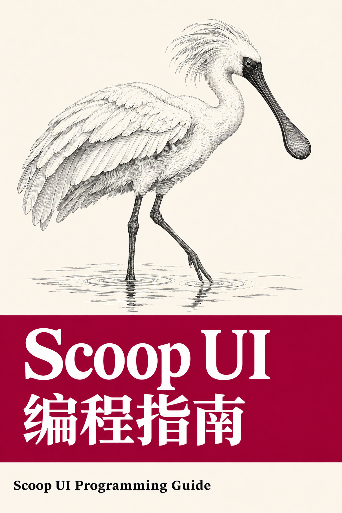

# 前言

<p align="center">
  <a href="images/cover.png"></a>
</p>

> **关于本书版本**：Scoop 语言和它的 UI 库仍在开发中，尚未正式发布，API 和工具命令都可能变化。本书是持续更新的在线书，会随工具链演进修订；如果书中内容与你手上的工具链行为不一致，以工具链为准，也欢迎反馈。
>
> 本书示例目前使用 `scoop 0.0.0-dev.local.20261127064200998720`（源码版本 `afced70c`）在 macOS（Apple Silicon）上验证。

## 这本书写给谁

本书面向想用 Scoop 编写桌面图形界面的程序员。它是[《Scoop 程序设计》](../programming/)的姊妹篇：那本书讲语言本身，这本书讲 `scoop.ui` 及相关的库。阅读本书前，你应该已经熟悉 Scoop 的类、lambda、接收者 lambda、属性委托和 Context；还不熟悉的话，先读《Scoop 程序设计》的前四部分。

不需要有图形界面编程的经验。用过 React、Jetpack Compose 或 SwiftUI 的读者会发现很多熟悉的概念，书中会专门指出它们和 Scoop UI 的不同之处。

## 本书讲什么

本书从第一个窗口讲起，依次介绍布局与文字、状态与数据流、输入与交互、滚动与弹层、主题与样式、自绘控件、桌面集成、测试、无障碍、性能和打包分发，最后用一个综合项目把这些内容串起来。读完全书，你应该能用现成的控件搭出完整的桌面应用，也能在需要时自己绘制控件，并把应用交付到用户手里。

第 1 章的最后一节介绍了各部分的内容和建议的阅读路线。

书中有两类提示框：

> **从其他框架过来**
>
> 对比 React、Jetpack Compose、SwiftUI 的做法，指出直接照搬时会遇到的问题。

> **深入一点**
>
> 介绍背后的机制。跳过这些内容不影响理解正文。

## 示例

书中出现的完整程序都放在本书仓库的 `examples/` 目录下，按章节编号存放，并用上面注明版本的工具链做过格式检查、语义检查和完整构建；演示错误写法的示例附有编译器的报错原文。

界面程序不像命令行程序那样有固定的输出，书中会用文字和截图描述运行结果。这些结果都在真实的窗口中操作验证过；截图在 macOS 上用浅色主题截取，在其他平台上字体和窗口边框会略有不同。

单文件示例保存为 `.scoop` 文件后就能运行：

```sh
scoop run counter.scoop --release
```

Windows 上的命令是 `sco`，例如 `sco run counter.scoop --release`。快捷键在 macOS 上用 ⌘，在 Linux 和 Windows 上用 Ctrl，框架把它统称为 Primary。
